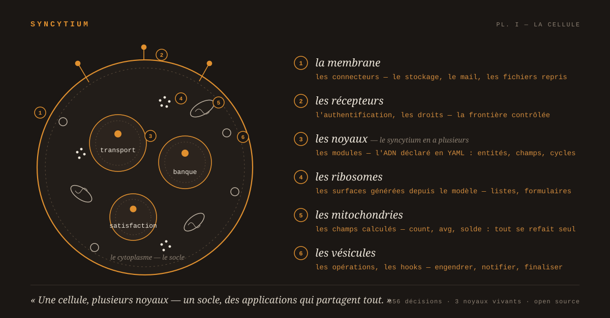

# Syncytium

**Syncytium est un framework, pas une application.** Il lit une description
de données et fait vivre, sans une ligne de code, la base, les écrans, les
API et la documentation d'une application métier.

## Le projet, en quelques mots

Voici comment je l'ai présenté sur LinkedIn, en août 2026, au début de sa
refonte avec Claude :

> Depuis le 12 juin, Claude Fable 5 m'accompagne dans la refonte d'un projet
> que je porte depuis 2016 : Syncytium. Les concepts sont toujours vivaces
> dans mon esprit mais la technologie que j'utilise est vieillissante…
>
> En biologie, un syncytium est une cellule unique à plusieurs noyaux, née de
> la fusion de cellules qui partagent désormais un même corps. Le projet
> tente de regrouper dans un même dessein les différentes composantes d'une
> application informatique. Le cœur d'une application repose sur la donnée
> et sa structure. Alors, pourquoi ne pas aller plus loin et générer des
> applications rien qu'en déclarant un méta-modèle ?
>
> — [le 11 août](https://www.linkedin.com/posts/aymeric-lesert-19491277_depuis-le-12-juin-claude-fable-5-maccompagne-activity-7492853400976560128-3Z3X)
> et [le 17 août 2026](https://www.linkedin.com/posts/aymeric-lesert-19491277_la-semaine-derni%C3%A8re-jai-d%C3%A9but%C3%A9-une-s%C3%A9rie-activity-7495242314890608640-jQA7)

Le nom encode l'architecture : une membrane unique, plusieurs noyaux
autonomes.



*La planche I, « La cellule », publiée le 3 septembre 2026 : la membrane
est les connecteurs, les récepteurs l'authentification et les droits, les
noyaux les modules déclarés en YAML, les ribosomes les surfaces générées,
les mitochondries les champs calculés, les vésicules les opérations et
les hooks ; le cytoplasme est le socle.*

1. **La membrane, le framework.** Syncytium, le tissu commun : le moteur
   open source. C'est ce dépôt.
2. **Un noyau, une solution.** Une application métier décrite sur le
   framework. Le concepteur écrit la description, en YAML.
3. **La cellule, une instance.** La solution déployée chez une TPE, avec
   ses données, ses comptes et sa propre vie.

Deux rythmes en découlent. Le moteur évolue sur sollicitation, par une
mise à jour technique. La description évolue à chaud : une nouvelle version
se dépose, les données migrent, les écrans et les API suivent.

## Une application en vingt-six lignes

Tout Syncytium tient dans cette promesse. Voici une application complète,
un annuaire, telle que le concepteur l'écrit :

```yaml
from: Syncytium-1.0
name: tiny
description: Une entité, quatre champs et une application complète avec API et documentation

environments:
  home:
    description: Exécution en mode local
    storage: sqlite

versions:
  production:
    environment: home

    1.0.0.0:
      release-notes: Version 1 de l'annuaire

      annuaire:
        personne:
          description: Les membres de l'entreprise
          label: "{prenom} {nom}"
          identity: [nom, prenom]
          fields:
            nom: text[..40]
            prenom: text[..40]
            age: integer
            fonction: text[..60]
```

De ces vingt-six lignes naissent la base et sa migration, l'écran de liste
et le formulaire, l'API versionnée, l'export et l'import, et la
documentation de l'application dans toutes ses formes. Le fichier est dans
[examples/01_tiny/](examples/01_tiny/).

## La documentation

La documentation du projet est dans [docs/](docs/README.md). Elle est **en
cours de réécriture**, chapitre par chapitre : chaque chapitre est relu
contre les décisions qui le fondent, découpé en documents courts, puis
réécrit pour être didactique, illustré d'exemples et lisible dans GitHub.
Le plan et l'avancement, chapitre par chapitre, sont dans
[docs/README.md](docs/README.md).

Les chapitres, dans l'ordre du plan :

1. [La configuration](docs/syncytium/configuration/README.md) — réécrit.
2. [Le modèle](docs/syncytium/modele/README.md) — en cours de réécriture.
3. Le langage d'expression.
4. Les surfaces et les composants.
5. Les hooks.
6. Les connecteurs.
7. Les droits et la sécurité.
8. La reprise et le mapping.
9. L'administration et l'exploitation.
10. La télémétrie.
11. La documentation générée.
12. Les API et les échanges.
13. Les cas d'usage.
14. La méthode et le projet.

À côté des chapitres : [le registre de conception](docs/conception.md),
les décisions numérotées, les questions et le journal des échanges depuis
juin 2026, trop gros pour l'affichage de GitHub et découpé en dernier ;
[les cas d'usage](usecases/) et [leurs configurations](examples/), cinq
cas, du tiny à l'entrepôt de données.

## L'état du projet

🚧 **Phase de conception.** Aucun code n'est écrit : tout est débattu point
par point, consigné au registre, puis documenté. Le code viendra quand la
documentation sera complète.

## Licence

Ce projet est distribué sous licence **GNU Affero General Public License
v3.0** (voir [LICENSE](LICENSE)). Toute version modifiée du moteur, y
compris proposée en tant que service en ligne, doit être publiée sous la
même licence : Syncytium est un bien commun et le restera.
