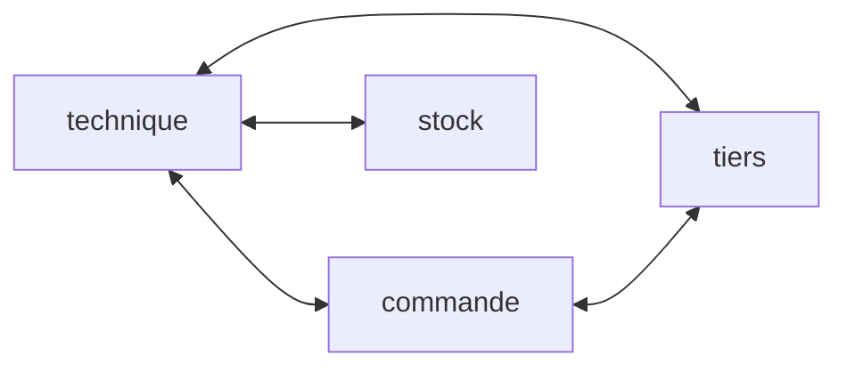
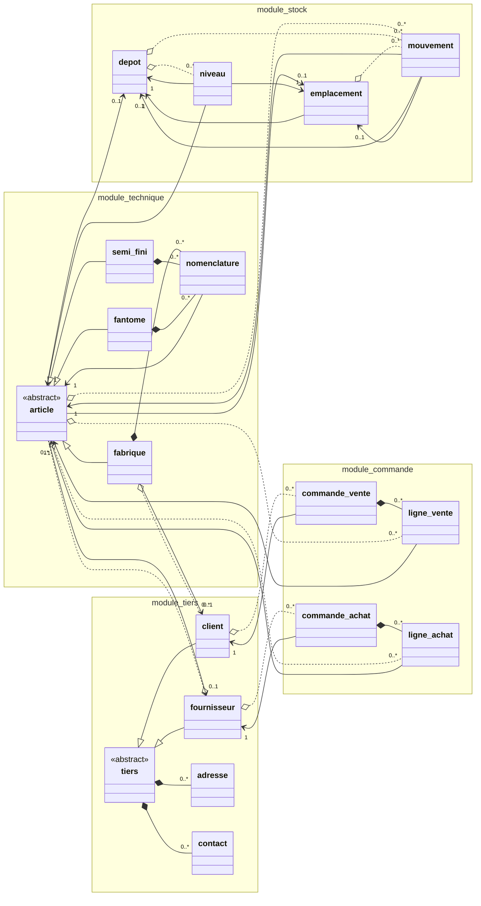
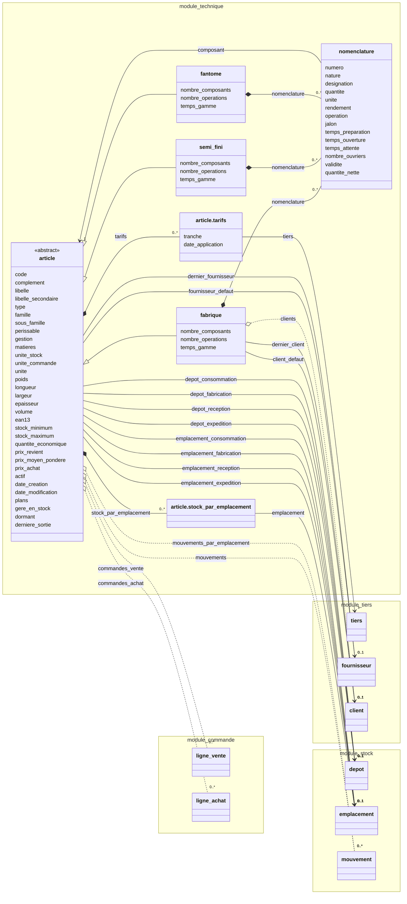
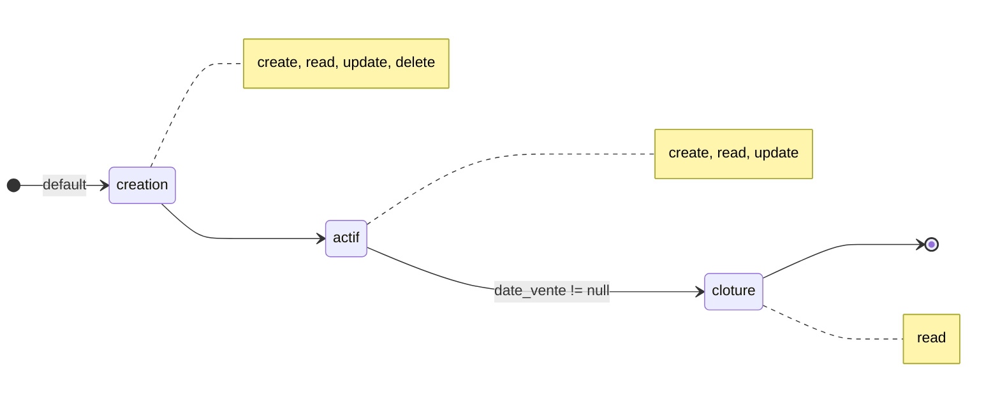

# La documentation générée par Syncytium

Ce document rassemble **les principes de la génération de la
documentation** : ce que Syncytium produit depuis la configuration,
pour qui, à partir de quoi, sous quelle forme, et ce que le concepteur
peut y ajouter. C'est le quinzième artefact préparatoire de la
documentation (Q58, le domaine 6 — D602), après
[configuration.md](configuration.md) (D994) et
[migration.md](migration.md) (D1028) ; il est ouvert le 04/10/2026
(D1118). **Il centralise les principes ; chaque artefact garde ce que
son élément apporte à la documentation** — l'entité et ses champs dans
[entity.md](entity.md), les hooks et leur `describe` dans
[hooks.md](hooks.md), les connecteurs dans
[connectors.md](connectors.md), les dépendances dans
[security.md](security.md), les rapports de la reprise dans
[migration.md](migration.md). Les décisions citées renvoient à la
[conception](conception.md). Les sections marquées *en proposition*
sont miennes, jusqu'à leur arbitrage.

## L'introduction — la documentation, partie visible du projet (D1137)

**« Le concept du projet repose sur la modélisation, la transformation
et la manipulation des données. Les données sont le cœur du système.
La documentation est la partie visible d'un projet. Historiquement, la
documentation est souvent un sujet peu traité ou insuffisamment
traité : à chaque exigence, un document est écrit et une étude est
faite. Le but du projet Syncytium est de construire un cadre pour
l'ensemble des documents qui caractérisent un projet, une application,
autour de la donnée — visant à automatiser et maintenir l'exploitation
du projet par les parties prenantes d'un projet ou par les membres
pouvant exiger ou demander des informations complémentaires. Ce cadre
doit permettre de construire la documentation et mettre à disposition
des informations avec différents niveaux de lecture. »** (l'auteur, le
08/10/2026 — D1137, D1138)

Ce que l'introduction fixe, et que le reste du document déroule :

- **la donnée au cœur** — tout document de Syncytium se tire du modèle
  de données, de ses règles et des données elles-mêmes (les trois
  sources, §1) ; ce qui n'en vient pas s'écrit en complément (D1122),
  jamais à part ;
- **un cadre pour l'ensemble des documents** — non pas un document
  par exigence, écrit puis oublié, mais les neuf documentations qui
  caractérisent une application (le contexte), tenues ensemble par
  une même matière ;
- **automatiser et maintenir** — la documentation se génère et vit
  avec la version servie (D333, D645, D1123) : elle ne se périme pas,
  elle n'attend personne ;
- **l'exploitation par les parties prenantes** — chaque lecteur (§3)
  y trouve sa vue, sous ses droits ; **et par ceux qui demandent des
  informations complémentaires** — l'édition préparée pour qui n'a pas
  de compte (§3), la question posée depuis l'écran (§25), l'assistant
  qui répond aux droits de celui qui l'interroge (D957) ;
- **construire la documentation, et mettre à disposition des
  informations** (D1138) — deux produits du même cadre : les documents
  (les neuf), et l'information servie sans document — le masque à
  l'écran, la réponse à une question, l'édition machine pour la BI et
  l'IA, le chiffre d'usage ;
- **différents niveaux de lecture** (D1138) — la même matière se lit
  de loin ou de près : la vue d'ensemble pour le décideur, le module
  pour l'opérateur, le détail pour le concepteur (les trois niveaux du
  modèle, §5 ; la générale, le module, l'écran de la fonctionnelle,
  §6) ; le lecteur choisit sa profondeur, le cadre garantit que chaque
  niveau résume exactement le suivant.

## Le contexte — les sept documentations (D1131)

Le 06/10/2026, l'auteur pose le contexte :

> « Une documentation d'abord fonctionnelle pour les utilisateurs, une
> documentation générale, des parties spécialisées avec des modes
> opératoires et des personas ; une documentation technique pour
> accéder à l'information (BI ou IA) comme le modèle de données, les
> règles et les données ; une documentation développeur pour utiliser
> les API, pour enrichir l'application et/ou pour étendre les
> composants disponibles ; une documentation d'architecture technique
> pour présenter les connexions entre l'application et son
> environnement ; une documentation réglementation (type RGPD) avec un
> référencement des données disponibles et des traitements liés ; une
> documentation promotionnelle pour exposer et vendre une application ;
> une documentation dédiée à la maintenance, à l'analyse des risques et
> à la recherche d'améliorations. »

**Sept documentations, puis neuf** — elles précisent les trois de
D333 : la fonctionnelle reste la première ; la technique se dédouble
(l'information, le développeur, l'architecture) ; trois naissent (la
réglementation, la promotion, la maintenance). Les arbitrages du
06/10 en ajoutent deux : **le projet et le support** (D1133) et **le
guide d'exploitation**, distinct du D.A.T. (D1134). Les masques (D209)
et les pièces de §14 à §25 sont des **formes** au service de ces neuf.
Les quatre parties qui suivent répondent aux quatre demandes du jour.

### 1. Le balayage — d'autres thèmes ?

Les sept couvrent ce que les décisions ont décrit. Quatre compléments :

- **la documentation du projet et du support** — le cycle de vie des
  versions (la promotion, la dépréciation, le Sunset — D340/D650), les
  notes de version, comment signaler une anomalie ou demander une
  évolution, le dépôt du client (D336) ; l'exemple de référence l'a
  (Procédures, Road map, F.A.Q.) — la F.A.Q., elle, est devenue une
  fonctionnalité du socle (§25, D1132). **La huitième documentation —
  acté** (D1133 : « le projet et le support est bien une huitième
  documentation ») ;
- **la formation** — un *usage* de la fonctionnelle plus qu'un type :
  les planches (§24), le parcours guidé (§19), les scénarios (§22)
  comme supports pédagogiques (D1129 — « le papier est une source de
  formation ») ; peut-être des exercices sur une instance d'essai ;
- **le D.A.T. et le guide d'exploitation — deux documentations, acté**
  (D1134) : « intimement liés mais [ils] couvrent des fonctions et des
  attendus distincts. Le D.A.T. est vu comme une description des
  inter-connexions entre l'application et son environnement + l'ensemble
  du paramétrage externe à l'application mais indispensable à son
  fonctionnement. Le guide d'exploitation explique l'installation, la
  configuration, la supervision et les opérations de maintenance. » Le
  D.A.T. est la quatrième documentation ; le guide d'exploitation (§17)
  **la neuvième** ; la septième garde l'analyse — les risques, les
  améliorations — et s'appuie sur les opérations que le guide explique
  (*ma lecture*) ;
- **la réglementation au-delà du RGPD** — l'accessibilité des écrans
  générés, les obligations légales du secteur (la conservation, la
  facturation), la sécurité comme obligation (les accès journalisés —
  D43, les dépendances — D924) : la cinquième s'élargirait en
  « réglementation et sécurité ».

### 2. Le classement — les sections et les pièces par documentation

| La documentation | Pour qui (§3) | Ce que ce document en dit déjà |
|---|---|---|
| **1. Fonctionnelle** — d'abord | l'utilisateur, le décideur | §6 la fonctionnelle (D1121 — les descriptions, les enchaînements, les opérations) ; §7 les masques ; §16 les enchaînements ; §19 le parcours guidé ; §22 les scénarios par personas ; §24 les modes opératoires ; §25 l'assistance — les questions et les réponses ; §14 l'export et l'import (le gabarit, la procédure) ; §15 le dictionnaire (par libellés) ; §5 la vue d'ensemble du modèle ; §9 les notes de version |
| **2. Technique — l'information (BI, IA)** | le concepteur, l'assistant IA, le décideur | §4 « Le dictionnaire de la donnée » — la donnée et la configuration du projet (D1241, D1243) ; §5 le modèle de données ; §15 le dictionnaire (par noms) ; §8 les données ; §9 les écarts calculés ; §2 le carburant ; la reprise ([migration.md](migration.md)) ; le chat (D957) |
| **3. Développeur** | le technicien, le concepteur de l'application | §10 l'API (le chapitre 12 du premier §4, D1242) ; les hooks — l'inventaire et comment en écrire un (D1244) ; §14 les formats d'échange |
| **4. Le D.A.T. — l'architecture technique** : les inter-connexions et le paramétrage externe indispensable (D1134) | l'administrateur, le concepteur | §4 chapitre 1 — les environnements et les connecteurs ; §4 chapitre 11 — les dépendances ; les secrets et les variables (D944/D321) |
| **5. Réglementation** | l'usager, le DPO, l'administrateur | §18 la conformité — le registre (D698), la matrice des droits, la sécurité de l'instance |
| **6. Promotionnelle** | le prospect, le dirigeant | rien encore — la seule à faire naître |
| **7. Maintenance, risques, améliorations** — l'analyse | l'administrateur, le concepteur, le décideur | §23 les contrôles et la supervision, les optimisations ; §8 les données ; §20 la complétude ; §9 les écarts (le risque d'une version) |
| **8. Le projet et le support** (D1133) | le dirigeant, l'administrateur, l'utilisateur | §9 les notes de version ; le cycle de vie des versions (D340/D650/D1123–D1124) ; le dépôt du client (D336) ; signaler, demander — §26, le rang 4 (D1347–D1355) |
| **9. Le guide d'exploitation** : l'installation, la configuration, la supervision, les opérations de maintenance (D1134) | l'administrateur | §17 le guide d'exploitation ; §23 les opérations de maintenance |
| *le socle de la génération* — transversal | — | §1 le principe ; §2 le carburant ; §3 les lecteurs ; §11 les formats ; §12 `documentation.yml` ; §13 le tiny et la méthode ; §21 la diffusion |

### 3. Les compléments — ce qui n'est pas encore décrit

**1. Fonctionnelle.** *La documentation générale* — la présentation de
l'application : l'entreprise, ce que l'application sert, les modules
et le schéma directeur (l'exemple de référence : « Présentation ») —
en textes complémentaires (D1122) ; *l'assistance* — les questions des
utilisateurs et leurs réponses, une fonctionnalité du socle (§25,
D1132), que complètent les messages de validation expliqués
(« pourquoi ce message ? » — D1116) ; *« mes droits »* — ce que
l'utilisateur peut faire, par
groupe ; *les notifications* — quand et pourquoi un mail arrive
(D108) ; *les documents produits* — les impressions et leurs gabarits
(D53) ; *la recherche* — ce qui se cherche et comment (D780).

**2. Technique — l'information.** *Une édition lisible par la
machine* — le méta-schéma et ses descriptions exportés (JSON ou YAML)
pour les outils de BI et pour l'IA : le mode d'emploi filtré par les
droits de D958, matérialisé ; *le modèle physique* — les tables et les
colonnes du storage par le `describe()` du connecteur (D630), la
correspondance du nom logique au stockage ; *les règles en un lieu* —
les validations, les calculés et leurs formules, les états, les
automatismes ; *l'historique* — comment lire les instantanés
(D168–D173) ; *les volumes et la diversité* par entité (D38–D39) ;
*l'accès pour la BI* — la lecture paginée (D22), l'export, les clés et
les identités.

**3. Développeur.** *Le contrat d'API* par version publiée (D99) :
l'authentification des comptes techniques (D28), l'épinglage (D98), la
pagination et les lots (D22), les tâches asynchrones (D24), les champs
exposés (D20), les erreurs (le 426 — D94), des exemples d'appel ;
*étendre* — les cinq familles de hooks ([hooks.md](hooks.md)) : écrire
un hook, son md (D778), la librairie d'exploration (D572/D599), le hook
d'interface listé (D918) ; les types et les composants personnalisés
(D359, D452) ; *enrichir* — la syntaxe de la configuration et le dépôt
du client (D336), le cycle des versions (D340) : c'est ici que la
documentation de référence de Syncytium entre (le point ouvert 11).

**4. Le D.A.T.** *Le schéma des connexions* — un diagramme calculé,
comme le modèle (D1119) : l'instance, son storage, l'authentification,
le SMTP, les bases d'origine de la reprise, les webhooks et les API
tierces, le LLM (D957), les postes ; *les environnements* et leur rôle
(production, staging, passif — D339, D112–D114), les flux et les ports
; **le paramétrage externe indispensable** (D1134) — les variables
d'environnement et les secrets (D321/D944/D902 : où ils vivent, qui les
tient), les comptes techniques chez les tiers (le fournisseur
d'identité, le SMTP, le LLM), les certificats (D919), les accès aux
bases d'origine, le DNS, le pare-feu ; le dimensionnement (D15) ; les
dépendances (D924). *Ce que la configuration sait* (les connecteurs et
leurs paramètres) se génère ; *ce qui est hors d'elle* (les comptes,
le réseau) s'écrit (D1122).

**5. Réglementation.** *Le registre complet* — par traitement, la
finalité et la base légale (écrites — D1122), les données et leur
confidentialité (calculées), les destinataires (les groupes, les
connecteurs sortants), les durées et l'anonymisation à l'échéance
(D696/D698), les transferts (le fournisseur du LLM) ; *les droits des
personnes* — comment l'application les sert (l'accès, la rectification,
l'effacement) ; *les mentions d'information* ; *la journalisation des
accès* (D43) ; au-delà, l'accessibilité et les obligations du secteur.

**6. Promotionnelle.** À faire naître : *la plaquette* — le nom, la
description, les modules (`title:`, `description:`), le modèle
d'ensemble en image, les écrans rendus, les personas et leurs scénarios
comme cas d'usage, « quoi de neuf » (les notes de version) ; *la
démonstration* — une instance d'essai et son jeu de données (D869) ;
*l'argumentaire du socle* — l'open source AGPL (D19), une instance par
client, les API, l'auto-documentation. Le ton et les textes sont écrits
(D1122) ; la structure et les visuels, générés. **Le mode public**
(D1150) : la page de présentation est construite par défaut et mise à
disposition sans aucun droit ; le concepteur peut rendre le projet
privé.

**7. Maintenance, risques, améliorations — l'analyse.** §23 (ses
contrôles, sa supervision, ses optimisations — ses opérations
s'expliquent au guide d'exploitation, 9), et *l'analyse des risques* : le dry-run d'une version (le risque de migration — D737),
les anomalies de la reprise, les validations en échec, les refus et les
pics (D43), les versions dépréciées encore appelées (D742), les
dépendances vulnérables (D924 — la veille hors moteur), la sauvegarde
et le PRA (D112–D114), les volumes et la performance (D985/D1012) ; *la
recherche d'améliorations* : les conseils (D45), le champ constant et
le domaine surdimensionné (D46/D48), les écrans jamais ouverts, la
complétude (§20), les demandes des utilisateurs (le lien vers le suivi
du projet — l'exemple de référence : « Création d'un ticket »).

**8. Le projet et le support** (D1133). *Le cycle de vie* — les
versions, leurs statuts et leurs passages (D340 : beta, production,
dépréciée, interdite ; D650 le Sunset ; D1123–D1124 la documentation
de chacune), les notes de version (D1112), ce qui change (§9) ; *le
dépôt du client* (D336) — où vit la configuration, comment elle se
versionne ; *signaler et demander* — une anomalie, une évolution, où et
comment (le lien vers le suivi du projet — l'exemple de référence :
« Création d'un ticket », « Suivi du projet », « Dépôt GIT ») ; *le
concepteur nommé* — celui qui a conçu l'application, le contact des
demandes d'évolution (D1153 — *ma proposition* : `author:` et
`contact:` dans `syncytium.yml`, en proposition) ; *le support* — qui
répond, dans quels délais ; l'assistance (§25) en est le pendant dans
l'application. La structure se génère (les versions,
les liens), les engagements s'écrivent (D1122).

**9. Le guide d'exploitation** (D1134). *Installer* — le moteur, le
storage, les connecteurs ; *configurer* — le `.env` et ses variables
(D321/D944), les environnements, le journal (D1091), le nettoyage
(D1073) ; *démarrer, arrêter, sauvegarder, restaurer* ; *superviser* —
le journal et ses niveaux, le tableau de bord, les alertes (D44), les
passages de la reprise ; *les opérations de maintenance* — la
promotion d'une version (D340), la copie d'un environnement (D1080),
la rotation du chiffrement (D1079), la relecture de la reprise (D943),
la restauration d'un enregistrement (D171) ; *dépanner* — les erreurs
connues et leur remède. §17 en est la maison ; ce que la configuration
déclare se génère, le reste s'écrit.

### 4. L'ordre — enrichir et valider ensemble

L'ordre tient compte des deux arbitrages du 06/10 — la huitième
documentation (D1133), le D.A.T. et le guide d'exploitation distincts
(D1134) — et est acté (D1135).

| Rang | Documentation | Ce qu'on y arbitre | Pourquoi là |
|---|---|---|---|
| 0 | *le socle de la génération* | §2, §3 (les lecteurs des neuf), §12, §13, §21 ; §11 renvoyé au domaine 7 | le cadre, vite |
| 1 | **Fonctionnelle** (1) | §6, §7, §16, §19, §22, §24, §25 (ses questions gardées), §14, §15 ; la générale, « mes droits » ; les neuf frottements du tiny | « d'abord fonctionnelle » ; le tiny la montre |
| 2 | **Technique — l'information** (2) | §4, §5, §8, §9 ; l'édition machine, le modèle physique, l'historique | tout en découle ; le tiny la montre |
| 3 | **Réglementation** (5) | §18 ; le registre complet, les droits des personnes | l'obligation de la TPE ; la matière est au modèle |
| 4 | **Le projet et le support** (8) | le cycle de vie, le dépôt, signaler et demander, le support | la matière est acquise (D340, D650, D1112, D1123) ; peu à arbitrer, et le cas 8 en aura besoin |
| 5 | **Développeur** (3) | §10 ; les hooks, l'extension, la syntaxe (le point 11) | les techniciens du cas 8 ; la forme attend le domaine 7 |
| 6 | **Le D.A.T.** (4) | le schéma des connexions, les environnements, le paramétrage externe | dépend des choix techniques (D1025) |
| 7 | **Le guide d'exploitation** (9) | §17 ; installer, configurer, superviser, les opérations | dépend des mêmes choix, et du D.A.T. |
| 8 | **Maintenance, risques, améliorations** (7) | §23 ; l'analyse des risques | dépend de la télémétrie et de l'instance |
| 9 | **Promotionnelle** (6) | la plaquette, la démonstration, l'argumentaire | réemploie les huit autres ; les textes sont à écrire |

Le document garde ses sections numérotées jusqu'à la fin des
arbitrages ; **le regroupement physique par documentation** viendra
avec la documentation structurée (D1021), quand les numéros n'auront
plus à servir de repères.

### 5. Le plan de travail détaillé (D1136 — validé le 06/10/2026)

Pour chaque rang de D1135 : **le périmètre** de la documentation à
fournir, **les sections** qui la portent déjà, **les étapes** — chacune
un arbitrage, donc une décision —, **la déclinaison** qui l'éprouve,
**les livrables** (ce que la documentation générée contiendra, et les
artefacts `docs/*.md` à mettre à jour), **les dépendances**. Les étapes
se prennent dans l'ordre ; une étape qui attend une dépendance se
consigne au principe et se finalise après elle. **Chaque rang remplit
la colonne de sa documentation dans la matrice composants ×
documentations** (§13, D1159), dans les artefacts des composants.

#### Rang 0 — le socle de la génération

- **Périmètre** : ce qui vaut pour les neuf — les lecteurs, le
  carburant, la méthode, la personnalisation, la diffusion, les
  formats.
- **Sections** : §1 (arbitré), §2, §3, §11, §12, §13, §21.
- **Étapes** :
  1. §3 — les lecteurs des neuf documentations : qui lit quoi, sous
     quels droits (le prospect et le dirigeant, le DPO, l'exploitant
     rejoignent la table) ;
  2. §2 — le carburant : la table validée, une colonne pour les
     fichiers complémentaires (D1122) et pour l'édition machine ;
  3. §13 — la méthode : la documentation attendue écrite à la main
     pour le tiny (fait), puis pour un module du cas 5 ; chaque
     frottement une décision ;
  4. les frottements transversaux du tiny : 6 (la langue de
     l'édition), 7 (le type dit en clair — [types.md](types.md)), 9
     (les chapitres de l'instance montrés vides au dépôt) ;
  5. §12 — `documentation.yml` : la liste de ses propriétés et sa place
     (l'environnement ou le projet) ;
  6. §21 — la diffusion : les canaux × les lecteurs ;
  7. §11 — les formats : le principe des trois éditions (lisible,
     imprimable, machine) ; la forme attend le domaine 7 (D1126).
- **Déclinaison** : le tiny.
- **Livrables** : §2, §3, §12, §13, §21 validés ;
  [configuration.md](configuration.md) (`documentation.yml`) ;
  [types.md](types.md) (la forme en clair de chaque type).
- **Dépendances** : aucune, sauf §11.

#### Rang 1 — la fonctionnelle (documentation 1) — *clos le 11/10/2026, D1238*

*(Les sept sections acquises — §6 D1189, §7 D1192, §14 D1211, §15
D1217, §16 D1196, §20 D1221, §22 D1210 — ; §19 et §24 fondus dans §22
(D1187–D1188) ; §5 et §9 réglés par D1218 ; les compléments absorbés
(D1220) ; les déclinaisons validées (D1231, D1234) ; les neuf rubriques
des artefacts validées (D1235) ; le menu déclaré (D1237). Soixante-neuf
décisions, D1170–D1238.)*

- **Périmètre** : la générale (l'entreprise, l'application, les
  modules, le schéma directeur), par module et par écran (les
  descriptions, les enchaînements, les opérations — D1121), les
  masques, les scénarios par personas, les planches, le parcours
  guidé, le gabarit d'import, le dictionnaire par libellés, « mes
  droits », les notifications, les documents produits, la recherche ;
  l'assistance (§25 — ses questions gardées, D1133).
- **Sections** : §6, §7, §16, §19, §22, §24, §25, §14, §15, §5 (la vue
  d'ensemble), §9 (les notes).
- **Étapes** :
  1. les frottements du tiny 1, 2, 3, 5, 8 (l'identité et
     l'obligation, l'historique par défaut, le mono-poste, le registre
     vide, le nom nu) ;
  2. §6 — le plan de la fonctionnelle : la générale (en textes
     complémentaires), le module, l'écran ; l'édition par langue ;
  3. §7 — les masques : les trois lectures, le « ? » qui montre et qui
     mène à la page ;
  4. §16 — les enchaînements : les parcours du menu, les cycles
     d'états et leur diagramme, les automatismes ;
  5. §22 — les personas : où ils se déclarent, la part générée (les
     wizards — D1130, les droits) et la part écrite ;
  6. §24 — les planches : le gabarit, la planche dans l'application,
     la régénération à la version ;
  7. §19 — le parcours guidé : lu ou joué, sa parenté avec le wizard ;
  8. §14 — le gabarit d'import : les en-têtes (noms ou libellés), la
     ligne d'exemple, la procédure ;
  9. §15 — le dictionnaire par libellés : par version ou par module ;
  10. §5 et §9 — la vue d'ensemble aux libellés, les notes de version
      pour l'usager ;
  11. *(tombée, D1220 — les compléments sont absorbés par le plan de
      §6 : « mes droits » au chapitre 4, les notifications au chapitre
      3, les documents produits et la recherche au chapitre 2.)*
- **Déclinaison** : le tiny (les frottements soldés, D1170–D1182 ; la
  déclinaison réécrite sur le plan à sept chapitres le 11/10) ; **le
  véhicule** (cas 3) — les états, les enchaînements, la section du
  module (D1227–D1228), **les personas et une planche** (D1209) ; **la
  banque** (cas 4) — les trois langues, les opérations, la section du
  module (D1229–D1230), **les personas** (D1210) ;
  l'entrepôt n'est pas le lieu des personas (D1207 — il décrit une
  migration et l'alimentation d'un entrepôt).
- **Livrables — faits** : §6, §7, §14, §15, §16, §20, §22 acquis
  (§19 et §24 dedans) ; la rubrique « La documentation » dans les neuf
  artefacts (D1235) ; `usecases/01_tiny.md` réécrit sur le plan (D1231)
  ; `usecases/03_vehicule.md` et `usecases/04_banque.md` — les personas
  et la section du module (D1209–D1210, D1234) ; la configuration des
  personas, le premier `menu.yml` et le tableau de bord de la banque
  dans `examples/` (2bcc1da, D1230, D1237). *(Le plan d'origine disait
  :)* §6, §7, §14–§16, §19, §22, §24 validés ;
  [entity.md](entity.md), [composants.md](composants.md) (le wizard
  comme scénario), [rights.md](rights.md) (les personas et les
  groupes) ; `usecases/01_tiny.md` amendé ; une déclinaison dans
  `usecases/05_entrepot.md`.
- **Dépendances** : aucune.

#### Rang 2 — l'information, pour la BI et l'IA (documentation 2) — *clos le 16/10/2026, D1314*

- **Périmètre** : le modèle (en tables et en diagrammes), les règles,
  les données et leurs usages, les écarts entre versions, le
  dictionnaire par noms, l'édition lisible par la machine, le modèle
  physique, l'historique, la reprise.
- **Sections** : §4, §5, §8, §9, §15, §2.
- **Étapes** :
  1. §4 — le plan du dictionnaire de la donnée : **acquis le 13/10/2026
     (D1241–D1265)** — le périmètre, le titre, cinq parties dans
     l'ordre de l'auteur, les annexes ;
  2. §5 — le modèle de données : **acquis le 14/10/2026 (D1266–D1278)**
     — les quatre blocs arbitrés et rendus, les groupes de champs
     (D1273), le `title:`, la table d'entity.md ; deux contraintes
     Mermaid relevées pour le domaine 7 ;
  3. §9 — les écarts : **acquis le 14/10/2026 (D1281–D1283)** — ce
     qui touche la donnée, la chaîne beta → production, les dépréciées
     par les notes de version, une section par champ ;
  4. l'édition lisible par la machine : **acquis** — l'annexe A, la
     configuration dépliée, entière, les clés `*` retirées (D1245,
     D1247, D1250) ;
  5. §8 — les données : **acquis le 14/10/2026 (D1287–D1288)** — les
     indicateurs par type et par entité, les valeurs par fréquence, le
     seuil en réglage (en proposition) ;
  6. le modèle physique : **acquis le 15/10/2026 (D1292–D1300)** — le
     storage refondé (D1294–D1297), le format pivot (D1298),
     `describe(model)` et `get_instance()` (D1299), les index, les
     partitions ; le contenu dans [connectors.md](connectors.md) ;
  7. les règles, l'historique, les volumes : **placés** (D1254, D1257,
     D1265) — le contenu avec les étapes 3 et 5 ;
  8. la reprise des données : **acquis le 15/10/2026 (D1302)** — le
     chapitre 4.1 en six sections, le contenu dans
     [migration.md](migration.md) ;
  9. le contrat du hook de type : **acquis le 15/10/2026 (D1301)** —
     les cinq livraisons (la forme en clair, la déclinaison, les
     indicateurs, l'exemple, le marquage), dans [hooks.md](hooks.md) et
     [types.md](types.md) ;
  10. la lisibilité de l'index 5.1 (D1263) — à la déclinaison ;
  11. la colonne 2 de la matrice (§13) dans les artefacts : **acquise
     le 15/10/2026 (D1303)**.
- **Déclinaison** : **faite** — le tiny (usecases/01_tiny.md, et la
  documentation d'exemple `usecases/01_tiny_dictionnaire.md`) ;
  l'entrepôt (usecases/05_entrepot.md — les évolutions, les groupes,
  les profils, la hiérarchie au stockage, la reprise, l'index mesuré) ;
  les points arbitrés D1304–D1313.
- **Livrables** : **acquis** — §4, §5, §8, §9 ; [entity.md](entity.md)
  (la correspondance, les groupes, `partition:`), [types.md](types.md)
  (la facette du type, la déclinaison), [connectors.md](connectors.md)
  (le storage refondé, `describe(model)`, les index, les partitions),
  [telemetry.md](telemetry.md) (les indicateurs),
  [migration.md](migration.md) (le chapitre 4.1), [hooks.md](hooks.md)
  (le contrat du hook de type), [configuration.md](configuration.md)
  (les groupes, les réglages), [rights.md](rights.md),
  [administration.md](administration.md), [composants.md](composants.md),
  [mapping.md](mapping.md), le glossaire ; la colonne 2 de la matrice
  (D1303) ; les groupes de champs dans la configuration du cas 5.
  **Ouvert au-delà du rang** : les colonnes du socle (D1305).
- **Dépendances** : la forme des diagrammes et de l'édition machine
  au domaine 7 ; les indicateurs à l'instance.

#### Rang 3 — la réglementation (documentation 5) — *clos le 20/10/2026, D1346*

- **Périmètre** : le registre des traitements, les droits des
  personnes, les mentions d'information, la journalisation des accès,
  la sécurité de l'instance ; au-delà du RGPD, l'accessibilité et les
  obligations du secteur.
- **Sections** : §18.
- **Étapes** :
  1. ce qu'est un traitement et ce que le registre calcule : **acquis
     le 19/10/2026 (D1317–D1321, D1329)** — une opération ou une suite
     impliquant un champ `rgpd:`, l'entité le stockage, le module le
     périmètre, groupé par module ;
  2. ce qui s'écrit : **acquis le 19/10/2026 (D1322–D1328)** — le bloc
     `rgpd:` à quatre niveaux (`controller`, `legal`, `purpose`), la
     rétention au nettoyage, l'échéance à l'anonymisation, `countries:`
     au connecteur ;
  3. les droits des personnes : **acquis le 19/10/2026 (D1330–D1333)**
     — le chapitre par module, `rgpd.extract(identity)` depuis
     l'identité civile, `rgpd.anonymize`, la limitation par l'état, le
     contact et le DPO ;
  4. les mentions d'information et la journalisation des accès :
     **acquis le 19/10/2026 (D1335–D1336)** — `rgpd.notice` générée,
     ancrée par le concepteur, le manque notifié ; les deux chapitres ;
  5. la cinquième élargie à la sécurité : **acquis le 19/10/2026
     (D1337–D1338)** — le chapitre de la sécurité, une section par
     principe en trois paragraphes ;
  6. l'accessibilité des écrans générés et les obligations du secteur :
     **acquis le 19/10/2026 (D1339–D1342)** — le RGAA testé à
     l'ingestion, `accessibility:` et `regulation:`.
- **Déclinaison** : **faite** (D1344) — le tiny (aucun traitement), la
  banque (le mono-poste sans marquage), l'entrepôt (le registre complet,
  ses blocs `rgpd:` écrits dans la configuration).
- **Livrables** : §18 acquis (D1317–D1344) ; [security.md](security.md)
  (la rubrique « La documentation », le registre, le chapitre de la
  sécurité), [rights.md](rights.md) ; la colonne 5 de la matrice dans
  les dix artefacts et la matrice d'ensemble.
- **Dépendances** : aucune pour le registre ; l'instance pour les
  accès journalisés.

#### Rang 4 — le projet et le support (documentation 8)

- **Périmètre** : le cycle de vie des versions, les notes et ce qui
  change, le dépôt du client, signaler et demander, le support.
- **Sections** : §9 ; §26 (créée le 20/10/2026).
- **Étapes** :
  1. la page des versions : les statuts, les passages, les Sunsets
     (D340/D650), la documentation de chacune (D1123–D1124) : **acquis
     le 20/10/2026 (D1347–D1355)** — le Sunset lu comme l'état (D742),
     les dates lues à l'instance (D1350), les ressources, les droits
     d'auteur et les auteurs (D1349/D1352/D1354), `copyright:` et
     `authors:` (D1355) ;
  2. le dépôt du client (D336) et la version du format (D1083) : ce
     que la documentation en dit ;
  3. signaler et demander : les liens vers le suivi du projet, où ils
     se déclarent (une clé `support:` ? `documentation.yml` ?) ;
  4. le support : qui répond, les engagements — écrits ; l'assistance
     (§25) en pendant.
- **Déclinaison** : **l'entrepôt** (la 1.0.0.0 en production, la
  1.0.0.1 en beta).
- **Livrables** : une section « Le projet et le support » ;
  [configuration.md](configuration.md).
- **Dépendances** : aucune.

#### Rang 5 — le développeur (documentation 3)

- **Périmètre** : le contrat d'API par version, l'extension par les
  hooks et les composants, l'enrichissement par la configuration, les
  formats d'échange.
- **Sections** : §10, §4 (chapitres 7–9), §14.
- **Étapes** :
  1. §10 — le contrat d'API : par entité, les opérations (D22, D24),
     les champs exposés (D20), l'authentification (D28), l'épinglage
     (D98), les erreurs (D94), les exemples ;
  2. étendre : les cinq familles de hooks — écrire un hook, son md
     (D778), `describe()`, la librairie d'exploration, le hook
     d'interface listé (D918) ; les types et composants personnalisés ;
  3. enrichir : la documentation de référence de Syncytium dans celle
     de l'application (le point 11) — embarquée ou liée ;
  4. les formats d'échange : le gabarit CSV côté technique, les
     webhooks.
- **Déclinaison** : le tiny (les exemples d'appel) ; **la banque** (ses
  hooks).
- **Livrables** : §10 validé ; [hooks.md](hooks.md),
  [connectors.md](connectors.md) ; le sort de `docs/` dans
  l'application.
- **Dépendances** : la forme du contrat d'API au domaine 7.

#### Rang 6 — le D.A.T. (documentation 4)

- **Périmètre** : les inter-connexions de l'application avec son
  environnement et le paramétrage externe indispensable (D1134).
- **Sections** : §4 (chapitres 1 et 11) ; une section à créer.
- **Étapes** :
  1. le schéma des connexions, calculé : l'instance, le storage,
     l'authentification, le SMTP, les bases d'origine, les webhooks et
     API tierces, le LLM, les postes ;
  2. les environnements et leur rôle (D339, D112–D114), les flux et
     les ports ;
  3. le paramétrage externe : les variables `${…}` que la
     configuration référence (calculables), les comptes chez les
     tiers, les certificats (D919), le DNS, le pare-feu (écrits) ;
  4. le dimensionnement (D15), les dépendances (D924).
- **Déclinaison** : **l'entrepôt** (production et staging, trois
  storages, `azure_ad`, `smtp`, la base Cegid).
- **Livrables** : une section « Le D.A.T. » ;
  [connectors.md](connectors.md), [security.md](security.md),
  [administration.md](administration.md).
- **Dépendances** : les choix techniques (D1025).

#### Rang 7 — le guide d'exploitation (documentation 9)

- **Périmètre** : installer, configurer, démarrer et arrêter,
  sauvegarder et restaurer, superviser, les opérations de maintenance,
  dépanner (D1134).
- **Sections** : §17, §23 (ses opérations).
- **Étapes** :
  1. ce que la configuration et [administration.md](administration.md)
     génèrent (les environnements, les connecteurs, le journal, le
     nettoyage, les opérations périodiques, les commandes) et ce qui
     s'écrit ;
  2. les procédures : la promotion (D340), la copie (D1080), la
     rotation (D1079), la relecture (D943), la restauration (D171), la
     sauvegarde ;
  3. la supervision quotidienne : le journal, le tableau de bord, les
     alertes (D44), les passages de la reprise ;
  4. le dépannage : les erreurs connues et leur remède.
- **Déclinaison** : **l'entrepôt**.
- **Livrables** : §17 validé ;
  [administration.md](administration.md).
- **Dépendances** : les choix techniques (D1025), le D.A.T.

#### Rang 8 — la maintenance, les risques, les améliorations (documentation 7)

- **Périmètre** : l'analyse — la supervision des usages, les
  contrôles, les optimisations, les risques, la recherche
  d'améliorations, la complétude de la documentation.
- **Sections** : §23, §8, §20, §9.
- **Étapes** :
  1. §20 — la complétude : le rapport, le seuil, l'avertissement à
     l'ingestion — **calculable dès maintenant** sur les quatre
     exemples ;
  2. §23 — la supervision des usages : les indicateurs retenus (les
     plus fréquents, les moins utilisés, les non utilisés), les canaux
     (D44), la part de chaque lecteur, la périodicité ;
  3. l'analyse des risques : le dry-run (D737), les anomalies de la
     reprise, les validations en échec, les refus et les pics (D43),
     les dépréciées appelées (D742), les dépendances (D924), le PRA,
     les volumes (D985/D1012) ;
  4. la recherche d'améliorations : les conseils (D45), le retrait et
     le resserrement (D46/D48), les écrans jamais ouverts, les
     demandes, les questions sans réponse (§25).
- **Déclinaison** : la complétude des quatre exemples (au dépôt) ;
  l'entrepôt pour le reste, à l'instance.
- **Livrables** : §8, §20, §23 validés ;
  [telemetry.md](telemetry.md).
- **Dépendances** : la télémétrie et l'instance, sauf §20.

#### Rang 9 — la promotionnelle (documentation 6)

- **Périmètre** : la plaquette, la démonstration, l'argumentaire du
  socle.
- **Sections** : aucune ; une section à créer.
- **Étapes** :
  1. la plaquette : la structure générée (le nom, la description, les
     modules, le modèle d'ensemble, les écrans rendus, les personas et
     leurs scénarios, « quoi de neuf »), les textes écrits ;
  2. la démonstration : l'instance d'essai, le jeu de données (D869) ;
  3. l'argumentaire du socle : l'open source (D19), une instance par
     client, les API, l'auto-documentation — la part de Syncytium.
- **Déclinaison** : l'entrepôt ; le cas 8 le jour venu.
- **Livrables** : une section « La promotionnelle ».
- **Dépendances** : les huit autres ; le jeu de données (D869).

#### Rang 10 — Syncytium lui-même, et `docs/` consultable sur GitHub (D1316) *(en proposition)*

« Prévois un rang dans le plan de la documentation pour documenter
Syncytium et reprendre toute la documentation docs/ rédigée en la
rendant consultable dans le projet Github » (l'auteur, le 19/10/2026).

- **Périmètre** : Syncytium comme produit — le moteur, ses règles, son
  catalogue, ce que les seize artefacts décrivent — et le dépôt comme
  lieu de lecture : `docs/`, le registre, les cas d'usage, les
  exemples.
- **Sections** : aucune ; documentation.md et le [glossaire](glossaire.md)
  en pivots.
- **Étapes** *(mes lectures)* :
  1. l'inventaire des artefacts et de leur état — ce qui est acquis, en
     proposition, périmé ;
  2. la structure de lecture : un sommaire d'entrée, les renvois entre
     artefacts et registre, le glossaire en pivot, les cas d'usage comme
     illustrations ;
  3. le rendu sur GitHub : le Markdown natif, les diagrammes Mermaid
     rendus, les pages ou le wiki — la forme au domaine 7 (D1126) ;
  4. la reprise artefact par artefact — le regroupement physique de
     documentation.md par documentation (D1021), la mise à jour du
     glossaire, les points ouverts de §27 soldés un à un.
- **Déclinaison** : le dépôt lui-même.
- **Livrables** : `docs/` consultable sur GitHub ; la PR vers `develop`.
- **Dépendances** : les neuf autres rangs — le rang 10 les clôt.

## 1. Le principe — trois documentations, trois sources, une seule version

**« La description et l'autogénération de la documentation sont un
des piliers du projet »** (D810). Le méta-schéma et la configuration
construisent en automatique, autant que possible (D333) :

1. **une documentation technique** — ce que l'application est : son
   modèle, ses règles, ses droits, ses connecteurs, ses hooks, ses
   dépendances, ses versions ;
2. **les masques d'explication** (D209) — l'aide en ligne tissée dans
   l'application : la description de la surface et celles des champs
   affichés, à la première consultation ou sur sollicitation ;
3. **une documentation fonctionnelle** — ce que l'application fait,
   pour celui qui s'en sert : **elle exploite les descriptions, les
   enchaînements et les opérations** (D1121) ; **une partie en est
   intégrée à l'expérience utilisateur** — les masques en sont la
   forme première.

Elle a **trois sources** (D1122) :

1. **les fichiers de configuration** — le modèle, dont le moteur
   déduit la base de la documentation sans qu'on l'écrive (les types et
   leurs facettes, les validations, les droits, le modèle de données en
   diagrammes — D1119, les écarts entre versions — D1112, le registre
   des traitements — D698, les dépendances — D924), et **les items qui
   complètent ce que le modèle ne dit pas** : `title:`, `hint:`,
   `description:`, `placeholder:`, les notes de version (D810,
   D124/D258/D840, D1112, D1120) ;
2. **les fichiers complémentaires** que la configuration référence
   (D767/D956) — une image, une description longue, des explications :
   le md du fonctionnement d'un hook (D778), les ressources (D346) ;
3. **les données de l'instance** (D334) — l'usage ou le non-usage des
   valeurs et des plages, la télémétrie (D38–D51, la diversité
   D46/D48) : **le modèle dit ce qui est permis, la base dit ce qui est
   fait**.

La documentation rédigée du projet Syncytium — les artefacts de
`docs/` — n'est pas une source de la documentation de l'application ;
ce que D645 lui demandait d'en porter (« la documentation technique de
Syncytium ») reste à placer (§27).

Et une règle qui les tient ensemble : **chaque version active porte sa
documentation** (D1123 — D645/D810) ; *la version documentée est
exactement la version servie*. **Les versions actives sont celles de
`beta/` et de `production/`** (D1124) ; **une version dépréciée n'a plus
de documentation** : la sienne dit qu'elle n'est plus disponible et
**renvoie à la liste des versions disponibles, présentée par leurs
notes de version**. **Par défaut, la documentation disponible est celle
de la version la plus élevée** ; chaque version décrit l'état à cette
version, et **les éléments antérieurs peuvent s'y ajouter en
annotation** (les écarts, §9). Rien à rédiger à part, rien à oublier :
elle vit avec le modèle et ne se périme jamais (D333). **Par défaut,
sans configuration** (D1090) : `documentation.yml` ne vient que pour la
personnaliser.

**Ce que la documentation comprend** (D1125 — « les principes posent
les types de documentation et les points ci-dessus ») : outre les trois
documentations et le modèle de données en diagrammes (§5), dix pièces,
chacune détaillée dans sa section — **l'export et l'import** (§14), **le
dictionnaire des données** (§15), **les enchaînements** (§16), **le guide
d'exploitation** (§17), **la conformité** (§18), **le parcours guidé**
(§19), **la complétude de la documentation** (§20), **la diffusion**
(§21), **les scénarios d'utilisation par des personas** (§22 — D1127 ;
le plan de test de l'exemple de référence est écarté), **la
maintenance, les contrôles et la supervision** (§23 — D1128), **les
modes opératoires imprimables** (§24 — D1129), **l'assistance — les
questions, les réponses, les commentaires** (§25 — D1132, une
fonctionnalité du socle). L'auteur garde la possibilité d'ajouter
d'autres pièces.

Ses lecteurs ne sont pas que des humains : les descriptions sont
**« exploitables par des IA »** (D124) — le module de chat lit les
données et les descriptions sous les droits de l'utilisateur (D957), le
cas 7 fait générer la configuration par l'IA (D1023).

## 2. Le carburant — ce que la configuration apporte *(le rang 0, étape 2 — acquis, D1155–D1157)*

**Le principe** (acquis). Tout élément de configuration porte sa
description, en ligne ou par fichier (D810/D767). **Ce que la
documentation doit porter s'écrit en propriété, jamais en
commentaire** (D1100) : le commentaire YAML est pour le lecteur du
fichier, la propriété pour la documentation. Les trois sources de
D1122 — la configuration, ses fichiers complémentaires, les données —
se détaillent ici.

### a. La configuration — ce que chaque élément apporte

| L'élément | Ce qu'il apporte | Décisions |
|---|---|---|
| le projet (`syncytium.yml`) | `name:`, `description:` ; la version du format `from:` ; `visibility:` — ce qui se lit sans droit ; le concepteur nommé (`author:`, `contact:` — en proposition) ; le dossier `resources/` (logos, icônes) | D322, D346, D1083, D1151, D1153 |
| l'environnement | sa `description:` (la nature : la vie courante, le développement), son `storage:`, ses connecteurs ; le journal, le nettoyage, les opérations périodiques — la matière du guide d'exploitation | D1090, D1094, D1091, D1073, D1134 |
| la version | son statut (son dossier — la beta éditée en brouillon), les `release-notes:` — **l'évolution fonctionnelle, écrite par le concepteur** ; les `languages:` ; les écarts calculés par Syncytium | D340, D1101, D1112, D1145 |
| le module | `name:` l'invariant ; `title:` le nom d'usage par langue, `hint:`, `description:` ; son menu, ses tableaux de bord | D416, D439, D1120 |
| l'entité | `name:` l'invariant ; `title:` le nom d'usage par langue ; `label:` (le gabarit du visage), `hint:`, `description:`, l'identité, les états et leur graphe, les validations (`description:`/`message:`), l'historisation, le `rgpd:` ; **et, à l'instance, le nombre de lignes** — dans la limite de ce que le lecteur voit (D1155) | D843, D1116, D1120, D1155 |
| le champ | le type et ses facettes, `label:`, `hint:` (la courte), `description:` (la longue, en Markdown — D1102), `placeholder:`, `required:`, `default:`, les validations, la confidentialité, les `allow:`, le `rgpd:`, `unchanged:`, `from:` (le renommage), `deprecated:` (le remplacement ou l'abandon, obligatoire) ; **et, à l'instance, ce que le stockage en dit** — le compteur de chaque valeur d'un énuméré, la diversité d'un texte, à l'instant de la consultation (D1155) | D124, D258, D650, D840, D941, D1111, D1155 |
| les opérations | leur `description:`, leur contrat et son degré, leurs effets | D148–D152, D699 |
| les surfaces (`gui:`) | la `description:` de la surface → le masque d'explication ; **le wizard** → un scénario, ses steps en étapes, sa planche | D209, D438, D1130 |
| les groupes | la `description:` affichée, le degré (`reader` compris) — les personas s'y adossent | D414, D1099, D1140, D1127 |
| les types personnalisés et les réglages (`settings.yml`) | leur `description:`, leurs facettes | D359, D991 |
| les connecteurs | `description:` + `describe()` — ce que la classe dit d'elle-même ; les paramètres sans les valeurs confidentielles | D630, D944 |
| les hooks | `describe()` + le fichier md du fonctionnement ; **le hook d'interface est listé** pour que l'administrateur sache quel code tourne chez ses utilisateurs | D645, D778, D918 |
| la reprise | la `description:` des sources et de leurs colonnes (D1100–D1102), celle des règles et de leurs affectations (D1105), les destinataires des rapports | D1100–D1106, D1061 |
| `documentation.yml` | les gabarits des éditions (`templates:` — le cartouche, le filigrane), les pages ajoutées, les sections retenues, les canaux | D1090, D1143, D1145 |
| le moteur | ses dépendances et leurs versions ; la documentation du socle — ce qui est commun à toute application | D924, D645 |

**Les données dans la documentation des entités et des champs**
(D1155) : « la documentation est à enrichir avec les données présentes
dans le stockage. Par exemple, sur un champ ayant un type énuméré,
afficher le compteur d'enregistrements correspondant à une des valeurs
à l'instant de la consultation de la donnée. Sur une entité, le nombre
de lignes disponibles (consultable dans la limite de la vision de
l'utilisateur) ; le but est de compléter les descriptions avec des
éléments de contexte afin de montrer que la documentation est vivante.
L'utilisateur peut ainsi se rendre compte du manque d'utilisation d'une
valeur ou d'une diversité de valeurs faible pour un champ texte,
laissant la place à une étude pour mieux structurer l'information. »
*Mes lectures* : calculé **à la consultation**, jamais stocké (D38 — la
télémétrie par champ, à la volée) ; **dans la limite de ce que le
lecteur voit** — la confidentialité (D25) et la sécurité au niveau
ligne (D70–D76) ; par type — l'énuméré : le compteur par valeur ; le
booléen : vrai, faux, vide ; le texte : les valeurs distinctes, la
diversité (D46/D48) ; le nombre et la date : les bornes observées, les
vides ; la référence : les cibles liées ; l'entité : le nombre de
lignes, la dernière modification ; la forme de chaque type dans
[types.md](types.md) (le rang 2) ; au dépôt, le cadre vide (c). **Et
les usages, de la même manière** (D1168) : la documentation d'un
module, d'un écran, d'un rapport, d'une opération dit, à la
consultation, combien de fois il a servi — l'écran ouvert, le rapport
produit, l'opération déclenchée, le wizard mené à son terme — et depuis
quand ; les non utilisés se voient là où ils sont décrits.

### b. Les fichiers complémentaires

La configuration **référence** ce qu'elle ne porte pas en ligne
(D1122) — toujours par `~{…}` (D956/D767), jamais un fichier libre :
un fichier qu'aucune clé ne cite est un orphelin (D1082). Les formes :
**une description par fichier** (`description: ~{README.md}` — le cas
4) ; **une image** — le logo, les icônes, une illustration
(`resources/`, D346) ; **le md d'un hook** (D778) ; **les pages
ajoutées** de `documentation.yml` (§12) — la présentation de
l'entreprise, le guide de démarrage, les textes de la promotionnelle,
les engagements du support, les étapes hors de l'application d'une
planche (§24), la finalité et la base légale d'un traitement (§18) :
tout ce qui s'écrit parce que la donnée ne le dit pas. **Ces textes
sont en Markdown, par langue, toujours versionnés avec la
configuration** (D1156) — un texte complémentaire appartient à une
version — **sauf la page d'accueil, qui est présente sur l'application
de façon globale** : elle vit au projet, hors des versions (*ma
lecture* : la page de `visibility:` et l'accueil de l'application —
`home:` dans `syncytium.yml`, en proposition).

### c. Les données de l'instance

Ce que l'application a vécu entre dans sa documentation (D334) :
**les usages** — les compteurs, la diversité, les plus fréquents, les
moins utilisés, les non utilisés (§8, §23) ; **les questions et les
réponses** de l'assistance (§25, D1132) — la F.A.Q. de chaque écran ;
**la reprise** — ses passages, ses compteurs, ses anomalies
(migration.md) ; **les versions servies** et leur appel (D742). Cette
source n'existe qu'à l'instance : **la documentation du dépôt montre
ces chapitres vides, avec leur cadre** (D1157 — le frottement 9 du tiny
soldé).

### d. Les langues

Une seule langue au modèle → les textes en texte simple ; plusieurs →
la langue précisée, sinon une erreur d'ingestion (D1101). La
documentation suit : celui qui lit dedans lit dans la langue de son
profil ; une édition se construit dans la langue de l'émetteur, jamais
dans une langue que la version ne connaît pas (D1144) — acquis (D1157).

**Les textes du moteur** (D1160) : les libellés, les intitulés, les
gabarits que la documentation ajoute d'elle-même (« Les champs »,
« Obligatoire », le cartouche…) **sont génériques** ; **les langues
portées par Syncytium se trouvent dans un fichier de configuration**
du moteur ; **ajouter une langue revient à définir tous les items pour
cette langue** ; **chaque item est codifié et unique**. *Mes lectures*
: un catalogue par langue, une clé par item (`documentation.fields`,
`documentation.required`…) ; un catalogue incomplet ou une clé en
double est une erreur au démarrage ; les langues d'une version
(D1101) sont prises parmi celles du moteur — une langue que le moteur
n'a pas s'ajoute d'abord à lui ; l'emplacement du fichier relève du
domaine 7. **La facette documentation d'un composant repose sur ces
codes et ce fonctionnement** (D1161, §13).

## 3. Les lecteurs *(le rang 0, étape 1 — acquis : le principe D1139–D1147, les rôles D1148–D1153, la table D1154)*

### Le principe

*(Sept énoncés, arbitrés un à un le 08/10/2026 — D1139 à D1147 ; le
principe des lecteurs est acquis. Les rôles suivent.)*

1. **Une projection, pas un document** (D1139 — acquis). La
   documentation est la projection de la configuration pour un lecteur
   et des droits (D334 — le partage sous les règles d'accès ; D44 —
   « Syncytium se décrit lui-même »). Il n'y a pas une documentation
   par lecteur : il y a une matière, et autant de vues que de lecteurs.
2. **Les lecteurs sont des rôles** (D1140 — acquis, enrichi). Une
   personne en tient plusieurs ; dans une TPE, le dirigeant est souvent
   le décideur, le responsable de traitement et le prospect de la
   version suivante. La documentation s'adresse au rôle ; la personne
   choisit la vue. Les rôles qui ont un compte sont **les degrés**
   (D699) — **`reader`**, `user`, `manager`, `administrator` — et le
   compte technique (D28) ; **le concepteur n'en est pas un** (D1153) :
   un rôle sans compte ni degré, détaché des utilisateurs et des
   administrateurs, qui lit au dépôt ; **le degré `reader` est nouveau**
   (D1140) :
   « les documentations mises à disposition sans possibilité d'accéder
   au détail » — le décideur, le DPO, l'auditeur, l'hébergeur lisent
   ainsi dedans, sans toucher une donnée. Les autres rôles — l'usager,
   le prospect — ne sont connus de Syncytium que comme destinataires
   d'une édition.
3. **On ne lit que ce que l'on voit** (D1141 — acquis). Le lecteur qui a un compte et un
   groupe (D28, D699) lit la documentation telle que l'application la
   lui sert : filtrée par sa confidentialité (D25), ses `allow:`
   (D886), les versions publiées (D99) ; ce qu'il ne voit pas à l'écran
   n'existe pas davantage dans sa documentation — une entité invisible
   n'y a ni page, ni entrée, ni trace (l'esprit de D193).
4. **Le lecteur sans compte lit une édition** (D1142 — acquis). Qui
   doit lire sans manipuler reçoit un compte au degré `reader` (D1140)
   ; qui n'entre pas du tout dans l'application — l'usager, le
   prospect, l'auditeur de passage, l'hébergeur — reçoit une
   **édition** : un extrait figé, sorti de l'application sous une forme
   qui se transporte (§11, §21). **Seuls les degrés `manager` et
   `administrator` préparent une édition**, restreinte à leurs droits
   — et en deçà s'ils le veulent —, **et décident de la diffuser à des
   personnes externes à l'application**. **L'édition porte un
   cartouche** — en en-tête ou en pied de page — **qui référence le
   numéro de version, la date et l'auteur de l'édition** ; la page de
   garde, l'en-tête, le pied et le format se décrivent avec le langage
   des rapports, le `template` (D1143, §12). Pour une
   édition publique, rien de confidentiel et aucune donnée (*ma
   lecture*) ; préparer et diffuser sont des actes journalisés, comme
   l'export (D43/D196 — *ma lecture*).
5. **Dans sa langue, à sa version** (D1144, D1145 — acquis). Celui qui
   lit dedans lit dans la langue de son profil — choisie parmi les
   langues permises du modèle (D217/D1101), donc toujours connue ; si
   une version retire la langue de son profil, la langue par défaut de
   la version le sert, la première de la liste (D1101 — *ma lecture*,
   le seul cas « hors de la liste ») — et à la version qui lui est
   servie (D1123–D1124). **L'édition se construit dans la langue de
   l'émetteur et dans la version que l'émetteur exploite** ; elle **ne
   peut pas se construire dans une langue que la version ne connaît
   pas** ; une édition d'une version **beta** est possible — il faut
   pouvoir vérifier qu'une beta fournit la documentation attendue —
   **et le document est alors marqué « brouillon »** : un filigrane de
   fond de page, dont le texte vaut « Beta vx.y.z.w » par défaut, se
   personnalise ou s'omet (D1145 — un item du gabarit, §12) ;
   l'émetteur peut faire appel à une version antérieure, sans intérêt.
6. **Une matière, plusieurs formes, plusieurs niveaux de lecture** (D1146 — acquis). Le
   même lecteur retrouve la même matière sous la forme qui convient au
   moment — le masque à l'écran (§7), la page de documentation, la
   planche imprimée (§24), l'édition machine (le contexte,
   l'information — la BI, l'IA) — et à la profondeur qui lui convient :
   la vue d'ensemble, le module, le détail (D1138) ; aucune forme ne
   dit autre chose que les autres, chaque niveau résume exactement le
   suivant.
7. **L'assistant est un lecteur comme un autre** (D1147 — acquis). Le module de chat
   (D957) lit la documentation aux droits de l'utilisateur qui
   l'interroge (D958) — ni plus, ni moins ; l'analyste de BI de même,
   aux droits de son compte.

### Les rôles

*(Les douze rôles et leurs noms sont acquis — D1148, D1152, D1153 ; le
glossaire les porte sous « Lecteur ».)*

| Le rôle | Qui c'est | Ce qu'il cherche | Lit dedans ou une édition |
|---|---|---|---|
| **le concepteur** | celui qui écrit la configuration (le glossaire) — **un rôle sans compte ni degré** (D1153) : il peut laisser le projet aux administrateurs sans accéder à l'application ni à ses données | le modèle complet, les règles, les écarts, les hooks, la reprise, la complétude | **par les fichiers de `syncytium document`** (le canal 2, un produit — D1348) **ou dans son propre environnement**, la sandbox (D907) — D1353 ; dedans seulement s'il reçoit un compte, à son degré comme un autre ; la documentation le nomme — celui qui a conçu l'application, le contact des demandes d'évolution |
| **l'administrateur** | celui qui fait tourner l'instance — le degré `administrator` (D699) | les environnements, les connecteurs, le journal, les opérations, le registre, les groupes | dedans |
| **le responsable métier** | le degré `manager` (D699) — celui qui répond aux questions (§25) et pilote un module | les parcours de son module, les personas, les règles qui s'y appliquent, les usages | dedans |
| **l'utilisateur** | l'opérateur, le degré `user` | ce que fait chaque écran, chaque champ, chaque opération ; la procédure sur une page, posée sur le bureau (D1129) | dedans — les masques, les pages, les planches imprimées |
| **le décideur** | le dirigeant | ce que l'application couvre et comment les choses se tiennent — en une image ; ce qui change ; ce que les usages disent | dedans, au degré `reader` (D1140) — ou à son degré s'il opère |
| **l'analyste** (BI) | un compte technique ou nominatif qui lit les données | le dictionnaire, le modèle physique, l'édition machine, les clés, l'historique | dedans, sous ses droits |
| **l'assistant IA** | le module de chat (D957) | le mode d'emploi filtré par les droits de l'utilisateur qui l'interroge (D958) | dedans, aux droits de l'utilisateur |
| **le technicien** | le consommateur des API (D334), un compte technique (D28) | le contrat de chaque version publiée, les champs exposés, les exemples | dedans, les versions publiées (D99) ; ou l'édition HTML publiée (§21) |
| **l'usager** | la personne dont les données sont traitées | ce que l'application sait d'elle, pourquoi, combien de temps, ses droits | une édition, sur sa demande : **l'extraction des traitements et des informations qui la concernent**, exécutée par un responsable métier ou un administrateur (D1149) |
| **le DPO** (l'auditeur aussi — D1152) | le responsable de traitement, celui qui contrôle | le registre complet, les droits, les accès journalisés, les transferts | dedans, au degré `reader` ; une édition pour l'auditeur de passage |
| **l'hébergeur** | l'exploitant de l'infrastructure, souvent un prestataire | le D.A.T., le guide d'exploitation — sans les secrets (D944) | dedans, au degré `reader`, ou une édition |
| **le prospect** (le partenaire aussi — D1152) | celui à qui l'on montre l'application | ce qu'elle fait, à quoi elle ressemble, ce que vaut le socle | **le mode public** (D1150) : une page de présentation, construite par défaut et mise à disposition sans aucun droit ; `visibility:` (D1151) — le concepteur peut rendre le projet privé |

**Les neuf documentations et leurs lecteurs** (D1154 — acquis) :

| La documentation | Les lecteurs | Le filtre |
|---|---|---|
| 1. Fonctionnelle | l'utilisateur, le responsable métier, le décideur | les droits du groupe : on ne lit que ce qu'on voit ; la langue du profil |
| 2. Information (BI, IA) | le concepteur, l'analyste, l'assistant, le décideur (la vue d'ensemble) | le concepteur lit tout, au dépôt ; l'analyste et l'assistant sous les droits de leur compte |
| 3. Développeur | le concepteur, le technicien | les versions publiées (D99) ; les hooks et la configuration au concepteur seul, au dépôt |
| 4. D.A.T. | l'administrateur, le concepteur, l'hébergeur | jamais une valeur confidentielle (D944) |
| 5. Réglementation | l'usager, le DPO, l'administrateur | l'usager : une édition sur sa demande, l'extraction de ce qui le concerne (D1149) ; le DPO : tout le registre |
| 6. Promotionnelle | le prospect, le dirigeant | le mode public (D1150, `visibility:` — D1151) : se diffuse sans aucun droit — rien de confidentiel, aucune donnée |
| 7. Maintenance, risques, améliorations | l'administrateur, le responsable métier, le décideur ; le concepteur s'il a accès | à l'instance ; le journal à l'administrateur (D737 le donnait au concepteur ; détaché de l'instance par D1153, il ne le lit plus) |
| 8. Projet et support | le dirigeant, l'administrateur, l'utilisateur (signaler, demander) | ouverte à l'entreprise |
| 9. Guide d'exploitation | l'administrateur, l'hébergeur | sans les secrets |
| **le modèle de données** (§5) — transversal | tous, chacun à son niveau | la vue d'ensemble dans la fonctionnelle et la promotionnelle ; la vue du module dans la fonctionnelle et l'information ; la vue de l'entité, le modèle physique et le dictionnaire dans l'information |

**Le modèle de données** a sa maison dans l'information (2) — entier,
à ses trois niveaux, avec le modèle physique et le dictionnaire — ; la
fonctionnelle (1) en porte la vue d'ensemble et la vue du module, aux
libellés, sans les types ; la promotionnelle (6) la vue d'ensemble
seule, comme l'image de ce que l'application couvre. Il irrigue les
autres sans y figurer en diagramme : la réglementation lit le registre
entité par entité, le développeur le contrat d'API entité par entité ;
le D.A.T. montre les connexions, pas le modèle.

## 4. Le dictionnaire de la donnée — la documentation de l'information (D1241, D1243) *(le rang 2, étape 1 — acquis, D1241–D1265 : le périmètre, le titre, l'ordre, les cinq parties et les annexes)*

**« Cette documentation est centrée sur la donnée et la configuration du
projet. »** (D1241) — ce que l'application sait, à une version donnée,
et ce que le concepteur a écrit pour le dire ; un chapitre y entre s'il
décrit la donnée ou la configuration de la version, sinon il appartient
à une autre documentation (le développeur, l'exploitation,
l'architecture). Les noms sont ceux de la configuration (la langue du
modèle — D335), les types ceux du catalogue.

**Le titre et les quatre axes** (D1243) : **« Ce document s'intitulera
"Le dictionnaire de la donnée" : sa structure, ses évolutions, son
origine et son usage. »** Le dictionnaire des données de §15 n'est plus
une annexe : il est le document entier. **Les hooks n'y apparaissent
pas comme notion** (D1244) : « Les hooks s'intégreront au document sans
que la notion de hook apparaisse » — le lecteur voit une opération, un
type, un stockage ; la facette (D1158) livre la description, l'assembleur
ne dit pas d'où elle vient ; l'inventaire des hooks et comment en écrire
un vont à la documentation du développeur. **La configuration entière
et dépliée en annexe** (D1245) : « La configuration dans son intégralité
et dépliée (à l'exception des clés confidentielles) sera portée en
annexe de ce document. La configuration en json ou yaml sera
exploitable pour l'IA. » — l'édition machine de §11, un seul objet, deux
rendus ; **dépliée** (D1250) = un seul arbre : les `~{…}` résolus, les
fichiers complémentaires inclus, les défauts du socle écrits aux trois
niveaux comme si le concepteur les avait posés (D1239), les textes du
catalogue dans les langues de la version.

**L'intégralité et la confidentialité** (D1247) : **« Le dictionnaire de
données décrit l'intégralité des données et affiche le niveau de
confidentialité de l'information. Seules les clés confidentielles
(marquées par "*") n'apparaissent pas dans la documentation. »** Le
dictionnaire n'est pas filtré par les droits de son lecteur : tout champ
y est, avec son niveau (`confidentiality:`) ; ce qui disparaît, ce sont
les valeurs des clés `*` de la configuration — les secrets des
environnements (D944). L'annexe A suit la même règle. **Le chapitre des
données** (D1248–D1249) : « les informations extraites sont celles de
la visibilité de la documentation », **« à interpréter par "les données
stockées dans la base de données couverte par le meta-modèle sont
celles que l'utilisateur a le droit de consulter" »**. Deux régimes
dans le même document : le modèle, intégral pour tous (D1247) ; les
données de l'instance, aux droits du lecteur — un champ qu'il ne peut
lire reste décrit, ses volumes, sa diversité, ses valeurs ne lui sont
pas servis.

**L'exhaustivité** (D1246) : **« La documentation fonctionnelle décrit
ce qui est accessible à un utilisateur. Le dictionnaire de données
décrit l'exhaustivité de la donnée. Le dictionnaire de données comble
les informations manquantes de la documentation fonctionnelle. »** La
fonctionnelle est un extrait du dictionnaire : ce qui a une entrée de
menu, un écran, un libellé (D1195) ; le dictionnaire dit tout le reste —
les entités sans entrée, les internes, les champs que les écrans ne
montrent pas, les formules, les messages, les droits — aux droits du
lecteur. *Ma lecture, en proposition* : le dictionnaire marque ce que la
fonctionnelle ne montre pas, pour que le décideur sache ce qui vit hors
de l'écran.

**Le plan — acquis** (D1241–D1265) : cinq parties dans l'ordre de
l'auteur (D1261) — la couverture, la structure avec ses évolutions, le
stockage, l'origine, l'usage — puis les annexes ; les quatre axes de
D1243 sont les quatre lectures de chaque élément (les évolutions à
l'entité et au champ — D1257) ; la forme est celle de la fonctionnelle (D1189) ; les chapitres de
l'exploitation et de l'API ont rejoint §17 et §10 (D1242).

| Partie | Chapitre | Contenu | Source |
|---|---|---|---|
| **1. La couverture** | | le cartouche, le filigrane Beta (D1142, D1145) | commun |
| **2. La structure, avec ses évolutions** *(acquise, D1251–D1258)* | **2.1 La version** | le projet (le nom, la description, la version du format), le numéro, le statut (D338/D340), les langues, les notes de version — ni les environnements ni les storages, qui sont au guide d'exploitation (D1251) | `syncytium.yml`, `version.yml` |
| | **2.2 Le modèle** | les trois vues de §5 — l'ensemble, le module, l'entité — par les noms (D1218) ; puis une section par module, une sous-section par entité : la description, les identités nommées (D1170–D1171), le visage (`label:`), l'historisation — et comment lire les instantanés (D168–D173) —, le `rgpd:` ; **la table des champs, par groupe** (D1273 — une section par groupe, l'implicite en tête ; l'identité `identity:` nommée « identity » par défaut, D1304) — le nom, le type en clair et ses facettes *tel qu'appliqué*, les réglages fondus (D1253), le libellé en complément dans la langue du document, l'aide, l'obligation, le défaut, le niveau de confidentialité (D1247), **les exceptions d'écriture** (D1311 — vide quand le champ suit son entité, les groupes quand son `allow:` s'en écarte) ; une liste de valeurs composées en sous-table, nommée `entité.champ` (D1271, D1274) ; **les règles de l'entité** (D1254) — les validations (la règle, sa description, son message en gabarit), les calculés et leurs formules, les états avec leur graphe et leurs transitions, les automatismes ; **les évolutions de l'entité et de chaque champ** (D1257–D1258, §9) — « depuis la version x » dans la table ; **une section par champ** (D1283) après la table : la description détaillée, l'historique (ajouté, renommé — `from:` —, retypé, déprécié avec son remplacement, supprimé, avec la version et son statut) **et les évolutions à venir** (D1285 — ce que la beta changera), les opérations qui l'écrivent et les règles qui le lisent, la télémétrie (D1216) ; toutes les entités, tous les champs (D1246–D1247) | calculé, les entités, la facette des types |
| **3. Le stockage** *(acquis, D1255, D1260–D1261, D1292–D1300)* | | **les données telles qu'elles sont stockées** (D1260) — « le connecteur storage matérialise le stockage des types dans la base de données » ; pour tout outil de BI qui se connecte aux données sans passer par Syncytium : par entité sa table, par champ sa colonne, son type physique et sa conversion, les clés, **les index dérivés des critères de recherche et de sélection du modèle, chacun avec son origine** (D1292), **les partitions** (D1293, D1300 — `partition:` à l'entité), les tables de liaison et de l'historique, les tables de Syncytium signalées ; la correspondance du nom logique au stockage (D630, D1255) — le `describe(model)` rend ce que les règles de transcription produisent pour le modèle en paramètre, une fonction pure de la configuration (D645, D1299), `get_instance()` lisant la base en place ; *ma lecture, à confirmer* : par famille de storage présente dans la configuration, sans nommer les environnements ; servi par une instance, celui de son storage | la facette stockage des types (D683), le storage |
| **4. L'origine** *(acquise, D1262, D1302)* | **4.1 Reprise des données** | le nom de la configuration (D1256, D1259) ; **six sections** (D1302) — le déclaré : la migration déclarée, les sources (les colonnes lues et écartées), les règles (les champs mappés, les destinataires), le graphe source → cible dans les deux sens (l'index 5.1 lu depuis l'autre bout) ; l'observé, à l'instance : le modèle lu et ses versions, les passages (la couverture, les clés d'origine par statut, le refusé et ses motifs) ; le guide d'exploitation dit comment lancer et lire les rapports ; une section par migration ([migration.md](migration.md)) | la reprise |
| | **4.2 Les imports** | ce qui entre par fichier : pour chaque entité importable, le gabarit de §14 (D1211) par les noms — les colonnes, la clé de rapprochement ; le fichier se télécharge depuis l'écran d'import ; quand les modules sont fermés et que la reprise seule écrit, le chapitre le dit et renvoie à la description de la reprise (D1312) | calculé |
| | **4.3 Les opérations** | ce qui crée ou modifie une donnée hors saisie : les opérations par entité cible, leur contrat (ce qu'elles lisent, ce qu'elles écrivent), leurs effets, les valeurs par défaut posées à la création ; chaque champ écrit par une opération le dit dans sa ligne de la partie 2 | les entités, les md des opérations |
| **5. L'usage** *(acquise, D1263–D1265)* | **5.1 Où sert chaque champ** | l'index par entité et par champ, sur le graphe de D1198 : les formules, les validations, les opérations, les règles de reprise, les rapports, les écrans qui lisent un champ ; qui référence une entité ; l'analyse d'impact ; la vue transversale des règles, par le graphe (D1254). **Sa lisibilité, par le pli** (D1263, D1313 — mesuré sur l'article de l'entrepôt : une, onze, quarante-sept lignes) : la synthèse en une ligne par entité ; le détail replié aux champs qui pèsent — lus par une formule, une validation, une règle de reprise ou un rapport —, les usages triviaux omis ; l'exhaustif sur demande — la zone du champ (D1216) dans la documentation servie, l'annexe dans l'édition | calculé |
| | **5.2 Les droits** | **la matrice des droits** (D1264 : « la visibilité est simple et rapide ») — les entités en lignes, les groupes en colonnes, les quatre actes et les opérations permises dans la case, la condition d'état quand il y en a une (D1172) ; la composition des groupes (D1099), le degré (D699) ; les profils de confidentialité lus comme « qui voit » chaque niveau | `groups.yml`, `settings.yml` |
| | **5.3 Les données** | **une façon d'exploiter la télémétrie de Syncytium** (D1265) — §8 : les volumes par entité, la synthèse ; le détail par champ dans la zone sur demande (D1216) ; à l'instance seulement, sur les données que le lecteur a le droit de consulter (D1248–D1249) ; la liste des indicateurs par type, à l'étape 5 du rang 2 | l'instance, la télémétrie |
| **Annexes** *(acquises, D1261)* | **A. La configuration dépliée** | entière, les clés `*` retirées (D1247), le niveau de confidentialité affiché ; lisible dans le document, JSON ou YAML pour la machine et l'IA (D1245) ; l'arbre des réglages y reste lisible (D1253) | calculé |
| | **B. Le glossaire des types** | les types du catalogue et les types personnalisés employés par la version, en clair : la forme, les contraintes, l'exemple — construit des livraisons du hook de type (D1180, D1301) | calculé |

## 5. Le modèle de données — la représentation graphique (D1119)

**« Il faut ajouter un volet "modèle de données" de type UML pour
faciliter la lecture » ; « le modèle de données, au-delà d'une
description littérale, est à représenter graphiquement pour que le
modèle soit facilement perceptible par un opérateur ou un
décideur. »** (l'auteur, le 04/10/2026). Le modèle se lit donc deux
fois : en tables (§4) et en diagrammes — et le diagramme s'adresse
aussi à ceux qui ne liront jamais la table.

**Acquis** : un volet « modèle de données », graphique, de type UML,
**calculé depuis la configuration** — rien à dessiner, le modèle est
déjà là (le patron des écarts, D1112) ; pour le concepteur,
l'opérateur et le décideur.

**Les trois vues — amendées par D1213–D1214** (l'auteur : « on pose
une vue générale par module, une vue générale de l'ensemble des
entités de l'application, puis pour chaque module, une vue sélective
inspirée du global mais limitée aux items du module et à ses
interactions ») :

| La vue | Ce qu'elle montre | Pour qui | Où |
|---|---|---|---|
| **les modules et leurs liens** | une boîte par module ; **la flèche dans le sens de la dépendance** — de qui référence vers qui est référencé —, un seul trait par sens, sans poids ; **les associations dérivées font flèche aussi** : la vue montre les liens bidirectionnels (D1266) | le décideur ; l'opérateur qui découvre | en tête de la fonctionnelle (§6, chapitre 1) et du dictionnaire (§4, partie 2) |
| **l'ensemble des entités** | toutes les entités de la version, par module, en diagramme de classes — **le nom du module, de l'entité et du champ seulement**, aux styles ci-dessous ; les listes en liens | le décideur ; le concepteur | le dictionnaire (§15), la documentation de l'information |
| **le module, en vue sélective** | **module par module** (D1269) : toutes ses entités avec **tous leurs champs**, les calculés compris, aux styles ci-dessous ; les compositions et les associations portées par les liens, non par une ligne ; les liens vers les entités des autres modules posés, ces entités **sans leurs champs**, dans leur paquetage | l'opérateur du module ; le concepteur | le chapitre du module (§6, chapitre 3) ; la partie 2 du dictionnaire (§4) |

*(Ma « vue de l'entité » de D1119 tombe : la table du dictionnaire la
remplace.)*

**Les styles du diagramme** (D1213 — remplacent ma correspondance UML
de D1119 : la visibilité `+#-`, le `/nom`, le `{id}` tombent) :
**souligné** pour les identifiants ; *italique* pour les champs
calculés ; « * » pour les champs sécurisés (une confidentialité
au-dessus de `public`, D25) ou `rgpd:` (D695) ; **gras** pour les champs
servant de référence dans d'autres entités ; les listes — les
associations, les compositions — **en liens** ; **aucun type au
diagramme**, la table le dit. Ce qui demeure de D1119 : le module → le
paquetage ; `inheritance:` → la généralisation ; `states:` → **un
diagramme d'états** à part, les valeurs du statut et les passages
permis (D422) — le véhicule (cas 3) en a un. La table détaillée dans
[entity.md](entity.md).

**Les groupes de champs** (D1273, D1279 — dans `fields:`, une clé à
`title:` et `fields:` sans `type:`, entity.md) :
le diagramme fait **un compartiment titré par groupe** dans la classe,
l'implicite en tête ; une classe de quarante champs se lit alors par
blocs. Mermaid ne dessine pas de compartiment titré (la même réserve
que les marques, l'outil au domaine 7) ; PlantUML le fait (`-- Les prix
--`). **Une structure interne se nomme par son entité** : `article.tarifs`
(D1274).

**Les diagrammes s'appuient sur les noms, invariants** (D1218) — un
seul jeu de diagrammes, quelle que soit la langue et quelle que soit la
documentation ; **les libellés décrivent** le module, l'entité ou le
champ et « viennent apporter un complément dans la langue du lecteur »
— dans la table du dictionnaire et dans les sections, jamais à la place
du nom sur le diagramme. *(Ma lecture « l'édition fonctionnelle montre
les diagrammes avec les libellés » est écartée.)*

**La forme dépend de l'architecture technique et des modes de rendu**
(D1126) : ce document dit ce que le diagramme montre, pas comment il
se dessine. Les exemples ci-dessous sont écrits en Mermaid
(`classDiagram`, `flowchart`, `stateDiagram-v2`) parce qu'un texte de
diagramme se lit dans le dépôt et se rend sur GitHub ; l'outil —
Mermaid, PlantUML, un SVG calculé — se choisit au domaine 7.

**Le rendu vérifié** (le 13/10/2026, Mermaid 10.9.1, dans un navigateur —
l'étape 2 du rang 2) : les quatre exemples ci-dessous se rendent. Deux
contraintes de Mermaid, à retenir pour le domaine 7 : **un `namespace`
ne peut pas porter le nom d'une classe** (« Setting tiers as parent of
tiers would create a cycle » — le module `tiers` et l'entité `tiers` du
cas 5) : le rendu préfixe le paquetage (`module_tiers`) ou choisit un
outil qui l'accepte ; **les styles de D1213 — souligné, italique, gras,
« * » — ne se rendent pas dans les membres d'une classe Mermaid**, qui
n'accepte ni balise ni creole (le texte s'affiche tel quel) : PlantUML
(le creole `__nom__`, `//nom//`, `**nom**` dans les membres) ou un SVG
calculé les portent ; les exemples Mermaid écrivent donc les noms sans
leurs marques.

**Le nom d'usage — `title:` (D1120).** `name:` est l'invariant du
module et de l'entité, quelle que soit la langue (D124/D335) ; `label:`
le gabarit d'*un enregistrement* (« `{code} — {libelle}` »). **`title:`
et `description:`, déclinés par langue, complètent `name:`** : le
`title:` est le texte que montrent l'entrée de menu par défaut (D186),
la vue d'ensemble fonctionnelle et les titres de la documentation —
« Produit fabriqué », « Ligne de nomenclature » ; texte simple à une
langue, par langue à plusieurs (D1101) ; sans lui, le `name:`. *Mes
lectures* : au singulier, le pluriel n'est pas une propriété ; le même
`title:` que celui des surfaces — **confirmées** (D1277) : l'entrée de
menu par défaut l'emploie tel quel, le `label:` de l'entrée (D1237) dit
le pluriel voulu ; un formulaire sans `title:` prend celui de l'entité.

**La vue des modules et de leurs liens du cas 5** (D1214, la première
vue ; D1266) — une boîte par module ; la flèche dans le sens de la
dépendance, un seul trait par sens, sans poids ; les associations
dérivées font flèche aussi. Dans le cas 5, les quatre couples liés le
sont dans les deux sens — la référence dans un sens (`ligne_vente →
article`), l'association dérivée dans l'autre (`article.commandes_vente`)
— : quatre traits à deux têtes, et **deux têtes sont deux dépendances**
(D1267 : « Une association dérivée en face de chaque référence reste une
dépendance. Enlevé le module et l'association ne tient plus ») ;
`commande` et `stock`, `tiers` et `stock` ne se touchent pas. Une seule
tête quand un seul sens existe ; le même trait pour la référence et
l'association dérivée. *(Rendu vérifié.)*



**La vue de l'ensemble des entités du cas 5** (la deuxième vue), telle
que Syncytium la calculerait — dix-huit entités, quatre paquetages, un
trait par couple : **la généralisation** par le triangle, **la
composition** par le losange plein et le trait plein, **la référence**
par la flèche simple, **l'association dérivée par le losange vide et le
pointillé** (D1268 — dix traits sur le cas 5, du côté de l'entité qui la
porte), **les cardinalités** gardées — l'obligation et la multiplicité
que le nom ne dit pas ; **le parent abstrait** annoté `<<abstract>>`,
l'italique attendant l'outil ; les paquetages préfixés `module_` (la
contrainte Mermaid ci-dessus). *(Rendu vérifié.)*



**La vue sélective du module `technique` du cas 5** (la troisième vue —
D1214 : « inspirée du global mais limitée aux items du module et à ses
interactions » ; D1269 : « tous les champs (y compris les champs
calculés). Les compositions et associations sont portées par les liens
… les liens vers les autres modules et entités sont positionnés (sans
mettre les champs dans ces entités liées hors du module) ») : les cinq
entités du module avec tous leurs champs de valeur — l'article en a 33
sur 47 — ; **tout champ qui pointe vers une entité est un lien, son nom
en étiquette, un lien par champ** (D1270 : « Pour une référence, un lien
avec une flèche est son nom en étiquette. Pas besoin de le rappeler dans
l'entité ») — la référence en flèche, la composition en losange plein,
l'association dérivée en losange vide et pointillé (D1268) ; **une liste
de valeurs composées est une structure interne** (D1271 : une classe
nommée par son entité — `article.tarifs`, `article.stock_par_emplacement`
(D1274) —, composée par l'article, ses références en liens) ; les entités liées des autres
modules dans leur paquetage, sans champs ; les liens posés sont ceux que
le module déclare (D1272). *(Rendu vérifié ; les marques de D1213 —
souligné, italique, « * », gras — absentes, Mermaid ne les porte pas :
`code` et `complement` seraient soulignés, `nature`, `dormant` ou
`dernier_fournisseur` en italique, `prix_revient` étoilé.)*



**Le diagramme d'états du véhicule** (le cas 3 — `states: statut`,
D422 : les valeurs du champ-statut, les passages permis, les droits de
chaque état ; D1276) : **un diagramme par entité qui déclare `states:`**,
dans sa sous-section (la partie 2 du dictionnaire) et dans la section
de son entrée de menu (la fonctionnelle, D1195) ; un dérivé hérite du
cycle de vie de son parent. **Le trait porte la cible et la condition
telle qu'écrite** (`when:`), pas de verbe inventé — le nom de
l'opération qui déclenche le passage s'il y en a une ; la naissance par
le `default:` ; **les actes permis (`allow:`) en note**, la table des
états qui suit porte le détail — les actes, la condition, la description
de chaque état. Dans la fonctionnelle, le libellé de l'état et la
description du passage remplacent l'expression. *(Rendu vérifié.)*



Le tiny (§13) donne la plus petite vue possible : le paquetage
`annuaire`, la classe `personne`, quatre attributs, deux `{id}`.

## 6. La documentation fonctionnelle *(le rang 1, étape 2 — le plan acquis, D1183–D1189 ; un extrait du dictionnaire de la donnée, D1246)*

Ce que l'application fait, pour celui qui s'en sert — **« ce qui est
accessible à un utilisateur »** (D1246 : le dictionnaire de la donnée,
§4, dit l'exhaustivité et comble ce qu'elle ne dit pas) — **trois
matières** (D1121) : **les descriptions** (`title:`, `hint:`,
`description:` — ce qu'est chaque chose), **les enchaînements** (le
menu et ses parcours — D189/D193, les états et leurs passages — D422,
les automatismes) et **les opérations** (les verbes et ce qu'ils font).
**Les libellés remplacent les noms, la langue de l'utilisateur remplace
celle du modèle** ; ni type, ni stockage, ni formule — ce qu'un champ
*est*, pas comment il se calcule. **Une partie s'intègre à l'expérience
utilisateur** (D1121) : les masques (§7), les aides en place — la
documentation lue à part et l'aide lue en place sont la même matière.

**L'exemple de référence** (D1126) : la documentation fonctionnelle de
DSP Gestion, l'application de l'auteur, en HTML. Ce qu'elle montre, et
ce que j'en retiens *(mes lectures)* :

- **son plan** — Présentation (l'entreprise, l'application, ses
  modules, **le modèle de données complet en une image, une couleur par
  module**), Fonctionnalités, Architecture technique, Installation et
  configuration, Procédures, Plan de test, Road map, F.A.Q. ;
- **les fonctionnalités s'ouvrent sur ce qui est commun** à tous les
  modules — l'écran principal et ses bandeaux, l'état de la connexion,
  le changement de module, le journal, le profil, **la procédure
  d'import CSV** (le fichier, la vérification, la validation, la
  création / modification / suppression des seules lignes qui
  changent), les notes de version dans l'application, **le cycle de vie
  d'une donnée** (la suppression qui marque sans effacer) — puis **un
  chapitre par module**, avec ses indicateurs et **le sous-modèle de
  chaque domaine** (les fournisseurs et les plats, les menus, les
  clients, les commandes, les tournées) : les trois niveaux de §5,
  avant la lettre ;
- **l'application mène à sa documentation** : un « ? » au niveau du
  module, un « ? » au niveau de la fonctionnalité, chacun ouvrant la
  page du wiki qui lui correspond — la part intégrée de D1121 prend la
  forme d'une **adresse** : chaque module et chaque surface a sa page,
  atteignable depuis l'écran, le masque (§7) en est le résumé en place ;
- ce qui est commun à toutes les applications — l'écran, l'import, le
  cycle de vie — **est la documentation du socle** : c'est là que « la
  documentation technique de Syncytium » de D645 trouverait sa place
  dans celle de l'application (le point ouvert 11) ;
- **le plan de test** — des scénarios Gherkin par entité (étant donné /
  quand / alors), le premier étant l'accès à la documentation depuis
  l'écran — est **écarté** par l'auteur et **remplacé par des scénarios
  d'utilisation de l'application par des personas** (D1127, §22).

**Le plan** *(acquis — « la table me convient », D1189)* — sur le plan de
l'exemple de référence et la déclinaison du tiny, onze chapitres ; pour
chacun, d'où vient la matière (**écrit** = un texte complémentaire du
concepteur, D1156 ; **calculé** = la configuration ; **vivant** = les
données et les usages de l'instance, D1155/D1168) et le niveau de
lecture qu'il sert (D1138) :

| Le chapitre | Ce qu'il contient | La matière | Le niveau |
|---|---|---|---|
| 0. La couverture | en édition seulement : la page de garde, le cartouche, le filigrane d'une beta (D1142–D1145) ; dedans, la page d'accueil (`home:`, D1156) | calculé, écrit | — |
| 1. La présentation | **la générale** — l'entreprise, l'application, le schéma directeur (`pages: presentation`) ; puis les modules et ce que chacun sert (`title:`, `description:`), **la vue d'ensemble du modèle** (§5), le concepteur et le contact (D1153), **les notes de version** en langage d'usager (D1112) et ce qui change (§9) | écrit, puis calculé | l'ensemble |
| 2. Le socle | ce qui est commun à toute application Syncytium (le point ouvert 11, D645) : l'écran principal, la connexion et le profil, le changement de module, la recherche, les notifications, « mes droits », le cycle de vie d'une donnée (la désactivation D137, la réactivation D903), l'historique quand il est actif, l'export et l'import (§14), les documents produits, l'assistance (§25) — les textes génériques du catalogue (D1160), **bornés à ce que la version emploie** | calculé | l'ensemble |
| 3. Un chapitre par module | dans l'ordre du menu : le titre, la description, **la vue du module** (§5) ; puis **une section par entrée de menu — un écran, un rapport ou une action** (D1194), dans l'ordre du menu : **l'entité et sa description, la table de ses champs** — libellé, type en clair, obligation, aide, description, valeurs (D1232–D1233) —, **l'écran** qui les dispose — la matière du masque (§7) —, le cycle de vie de l'entité et de ses enfants avec les permis (D1195), les opérations — leurs transformations et leurs déclencheurs (D1196) —, les règles par des exemples (D1229) ; l'entité hors du menu n'y est pas ; à l'instance, les usages et les données vivantes | calculé, vivant | le module, le détail |
| 4. Les scénarios d'utilisation | par persona (§22) : la part générée des wizards, la part écrite ; **les actions qui traversent les modules s'y retrouvent**, avec le wizard (D1185) ; **le parcours guidé y est fondu** — le tour des écrans du persona en est le squelette (D1187) ; **les modes opératoires aussi** — la planche est la forme condensée d'un scénario, une à trois planches synthétiques qui montrent un enchaînement d'écrans et d'actions (§24, D1188) | calculé, écrit | le module |
| 5. La F.A.Q. | les questions répondues de l'assistance (§25) | vivant | le détail |
| 6. Les annexes | **les glossaires** — les termes du métier, puis les types (D1180, D1183) ; **le dictionnaire des données** par libellés (§15, D1183) ; le gabarit d'import de chaque entité (§14) | écrit, calculé | le détail |

- **Ce que l'utilisateur ne voit pas** n'y figure pas : la
  confidentialité et les droits filtrent la documentation comme ils
  filtrent l'écran (D334) ; le chapitre 3 ne décrit que ce que la
  version active (pas d'import documenté si rien ne s'importe).
- **La part intégrée** (D1121) : chaque module et chaque écran du
  chapitre 3 a son adresse ; le « ? » de l'écran y mène, le masque (§7)
  en est le résumé en place.
- **Le glossaire au survol** (D1184) : dans le rendu pour les
  utilisateurs, le survol d'un terme du glossaire affiche sa définition
  — l'usage dynamique ; **le survol n'est proposé que sur la première
  occurrence du mot trouvée dans la page** ; en édition, le glossaire
  reste une annexe.
- **L'édition par langue** : dedans, la langue du profil (D1144) ; en
  édition, celle de l'émetteur — une édition par langue ; un texte
  complémentaire absent dans une langue tombe sur la langue par défaut
  de la version (D1101) et la complétude le signale.
- **Pas de chapitre des enchaînements entre modules** (D1185) : un lien
  qui traverse les modules — la promotion déclenchée d'ailleurs (D145),
  l'automatisme sur les données d'un autre module (D54), la
  notification — se raconte dans le chapitre du module qui le
  déclenche et dans celui qui le reçoit : **les enchaînements se
  suivent dans les deux sens, par des annotations et des références**
  (D1186) — à chaque bout, une ligne générée qui dit l'autre bout et
  l'adresse de sa page (un lien dedans et en HTML, le numéro de
  chapitre en édition imprimable) ; les actions transverses vécues se
  retrouvent dans les scénarios des personas et dans le wizard.
- **Le parcours guidé, fondu dans les personas, reste disponible à la
  demande** (D1187) : l'utilisateur qui le souhaite obtient le tour de
  ses écrans — tous ceux que ses droits lui ouvrent, module par module
  dans l'ordre du menu, chaque champ avec son aide — qui peut apporter
  plus d'éléments que le scénario d'un persona ; joué dans
  l'application (§19), pas un chapitre de l'édition (ma lecture).
- **Les trois niveaux** (D1138) : les chapitres 1 et 2 se lisent pour
  l'ensemble, le 3 pour le module puis l'écran, les annexes pour le
  détail d'un mot.

## 7. Les masques d'explication (D209) *(le rang 1, étape 3 — acquis, D1190–D1192)*

Acquis : à la **première consultation ou sur sollicitation** d'une
surface — liste, formulaire, widget de résumé, widget de synthèse —, le
masque présente **la description de la surface** et **reprend les
descriptions des champs affichés** (D124) ; les descriptions déclarées
sont l'aide en ligne, sans rédaction séparée. La première consultation
se mémorise au profil (l'interprétation de D209). Le `hint:` (D840) est
l'aide courte, au « (?) » du champ, sur les trois écrans (D262).

**Acquis (D1190–D1192)** :

- **le masque est la documentation fonctionnelle de l'écran, servie en
  place** — même matière que le chapitre 3 de §6, même langue, mêmes
  droits, rien n'est rédigé deux fois (D1190) ; **un groupement de
  champs** (la `section`, D489) qui demande une explication la reçoit
  **dans la description de l'écran**, et l'édition la porte sur le
  groupement (ma lecture de la forme : une partie titrée du nom de la
  section s'attache à elle) ;
- **ce que le masque montre** (D1191) : la description de la surface ;
  pour chaque champ qui en a, **son `hint:` au masque, sa `description:`
  au détail** ; un champ sans l'un ni l'autre **n'y est pas — son nom
  suffit à lui-même** ; **et la `description:` de tout composant
  graphique entre au masque** (D1193) — le kpi, le graphique, le
  widget, la section, le bouton d'une opération, comme le champ ; une surface sans description dont aucun champ
  ne porte d'aide n'a pas de masque (ma conséquence) ; la complétude
  (§20) continue de compter le champ sans aucune aide — « il reste »
  (D1199) ;
- **le « ? » de l'écran** fait trois choses (D1192) : il montre le
  masque, il mène à la page de l'écran dans la documentation (D1121),
  il porte l'assistance — les questions répondues de l'écran et « poser
  une question » (§25, D1132) ;
- **le glossaire** se lit au survol dans le masque comme dans la page
  — la première occurrence du terme (D1184).

## 8. La troisième source — les données (D334) *(le rang 2, étape 5 — acquis, D1287–D1290)*

La documentation **exploite les données enregistrées** pour dire
l'usage. Elle ne vit qu'**avec l'instance** : une documentation
générée au dépôt, sans base, n'a pas cette part ; la documentation
servie par l'application l'a — **sur demande** (D1216), calculée à
l'instant, rien ne se stocke (D38, D736) ; dans une édition, **la
photographie à la date de l'édition**, la date au cartouche (D1288).
**Ce qu'elle extrait, ce sont les données que le lecteur a le droit de
consulter** (D1248–D1249) : un champ protégé ne montre rien à qui ne
peut le lire. Sa place : le chapitre 5.3 du dictionnaire (D1265) et la
section de chaque champ (D1283).

**Les indicateurs** (D1287). Pour tout champ : le nombre de valeurs
renseignées et la part de vides, **la diversité représentative** (D46 —
un champ constant, candidat au retrait), la date de dernière écriture.
Puis, par famille de type :

| La famille | Les indicateurs |
|---|---|
| `enum`, `boolean` | la répartition par valeur ; **les valeurs jamais employées** (D48) |
| `text` et dérivés | la longueur minimale, maximale, moyenne, rapportée à la borne déclarée |
| `integer`, `decimal`, `amount`, `measure`, `percentage` | le minimum, le maximum, la moyenne ; la plage occupée rapportée au domaine (D48 — un domaine surdimensionné, à resserrer) |
| `date`, `time`, `datetime`, `period`, `duration` | la plage ; la répartition par année ou par mois |
| la référence | le nombre de cibles distinctes ; la part de références sans cible permise |
| la composition, la liste, l'association | le nombre moyen d'éléments |
| `file`, `image` | le nombre, la taille totale |
| le calculé | les indicateurs de son type |

**Les valeurs et leur fréquence** (D1287) : « si la diversité des
valeurs est importante », les agrégats seuls ; « si la diversité est
faible ou si quelques valeurs représentent une grande majorité », **les
valeurs et leur fréquence s'affichent** — pour tout type, le texte
compris, la référence par son visage. **Le seuil suit la courbe de
Pareto** (D1290) : les valeurs s'affichent quand 20 % d'entre elles
représentent 80 % des lignes ; les deux nombres en réglage global
de l'application (D1291) — `application: { telemetry: { values:
pareto[80/20] } }` ; la diversité faible, lue au ratio de D46, les montre
de même.

**Pour l'entité** : le volume ; les créations, les modifications et
**les suppressions — Syncytium fait du soft delete** (D141) — par
période ; la répartition par état quand elle en a un ; la part
d'enregistrements historisés ; les compteurs de lecture et d'écriture
(D39).

**Qui livre quoi** (D1288) : **le hook de type livre ses indicateurs**
comme il livre sa forme en clair — une clause de son contrat
([hooks.md](hooks.md), [types.md](types.md), l'étape 9) ;
[telemetry.md](telemetry.md) porte la liste, le dictionnaire la
consomme ; le tableau de bord « telemetry » du module d'administration
(D736) montre les mêmes chiffres, à sa manière. Cette source nourrit
aussi la pièce §23 — la supervision des usages, les contrôles, les
optimisations.

## 9. Les écarts entre versions (D1112) *(le rang 2, étape 3 — acquis, D1281–D1286 ; rendus à l'élément, D1257)*

**Syncytium calcule les écarts et les présente ; le concepteur ne les
décrit pas** (D1112) — la description d'un champ dit ce qu'il est,
jamais ce qui a changé ; les notes de version disent le sens
fonctionnel ; le renommage se déclare par `from:` (D1111), seule
déclaration fiable (D4).

**Ce qui compte comme écart** (D1281) : **ce qui touche la donnée** —
l'existence (ajouté, supprimé, déprécié avec son remplacement, D650), le
nom (`from:`), le type et ses facettes, l'obligation, le défaut,
l'identité, la confidentialité et le `rgpd:`, le groupe, les
validations, les états. **Ni les calculés et leurs formules**, « puisque
[le calculé] exploite la donnée », **ni les opérations et les droits**,
qui « conditionnent leurs transformations », **ni les textes**. *Ma
lecture* : un calculé est au dictionnaire par sa formule courante, sans
histoire ; les opérations et les droits se lisent à l'usage (§4, la
partie 5), sans histoire.

**La documentation décrit la version dans son état ; l'historique
porte sur l'écart de cette version avec les versions antérieures, et
les évolutions à venir se précisent aussi** (D1284–D1285 : « C'est
important pour le technicien qui doit préparer l'évolution de l'appel
des API ») — *ma lecture* : à venir = ce que la ou les beta au-dessus
de cette version dans la chaîne changent ; la documentation d'une
production dit ce que la beta va renommer, retyper, supprimer,
déprécier ; dans la section du champ, après l'historique, « à venir :
1.0.0.1 (beta) — renommé en `nom_court` » ; au chapitre de la version,
la liste des évolutions à venir. **Plusieurs beta** (D1286) : chaque
beta se compare à celle qui la précède, la première à la dernière
production ; la production dit « à venir » pour toutes, dans l'ordre ;
la plus élevée n'a pas d'« à venir ». **La version de référence** (D1282) : **une
beta se compare à la beta précédente si elle existe, sinon à la dernière
production ; la chaîne remonte toutes les beta et toutes les
productions.** Pour les versions
dépréciées, la documentation renvoie aux notes de version et **dit depuis
quelle version un champ existe** : un champ disparu en déprécié
n'apparaît pas, un champ apparu en déprécié porte la version de son
apparition, les autres modifications en déprécié ne se disent pas. *Ma
lecture* : chaque champ porte « depuis la version x », toujours ; les
écarts détaillés ne se calculent qu'entre versions actives.

**La forme** (D1283) : **pas dans la table, qui resterait trop dense —
une section par champ**, après la table de l'entité, « pour tracer son
historique, pour afficher le résultat de telemetry, pour fournir une
documentation plus détaillée quand cela est nécessaire, pour décrire les
opérations ... ». *Ma lecture, en proposition* : la table garde « depuis
la version x » en une colonne courte ; la section du champ porte, dans
l'ordre, la description détaillée, l'historique (les écarts par
version, avec le statut — D1257), les opérations qui l'écrivent et les
règles qui le lisent (l'écho de l'index 5.1), la télémétrie (D1216, à
l'instance) ; elle ne s'écrit que si l'un de ces éléments existe. Au
chapitre de la version (2.1), les notes écrites et la liste complète
calculée.

**L'exemple du cas 5**, entre la 1.0.0.0 (production) et la 1.0.0.1
(beta) : `tiers.nom_court` renommé depuis `abrege` (`from:`) ;
`tiers.langue` retypé, `text[..3]` devenu `enum` à quatre valeurs ;
`technique.article.commentaire` ajouté. Sans le `from:`, le calcul
aurait dit « `abrege` supprimé, `nom_court` ajouté ».

**Pour le technicien** — le consommateur de l'API (D1148 ; la lecture
confirmée, D1285) : la même liste, calculée une fois, **filtrée par
l'exposition** (D20), dit ce que son contrat perd ou gagne d'une version
publiée à la suivante — un champ renommé change une clé, un champ
retypé un format, un champ supprimé casse l'appel — et ce que la beta
prépare : le préavis de la dépréciation en trois temps (D650), le 426
sous la version minimale (D94) ; elle sert la documentation du
développeur, à son rang.

## 10. La documentation de l'API *(en proposition)*

D334 : « les techniciens de parties tierces — les consommateurs des
API, dont la documentation générée s'enrichit ». Pour chaque version
**publiée** (D99), la documentation donne, par entité : les champs
exposés (D20 — la politique d'exposition), les opérations, les
exemples d'appel — la lecture, la création, la modification, la
suppression, la recherche — tels que le tiny les montre (D1026),
l'épinglage de version (D98). **La forme** (un format standard de
description d'API, les exemples en `curl`) relève de l'architecture
technique (D1025) ; le principe — l'API documentée depuis le modèle,
version par version — est acquis.

## 11. Les formats et le support *(le rang 0, étape 7 — acquis, D1165–D1166)*

- **Le format dépend de l'architecture technique et des modes de
  rendu** (D1126) : il se fixe au domaine 7. Ce document retient le
  principe de **trois éditions d'une même matière** — *lisible* (la
  page servie dans l'application, le Markdown et l'HTML au dépôt —
  D630 ; l'exemple de référence est en HTML, §6), *imprimable* (le PDF,
  l'A4 des planches — D53/D187, D1129), *machine* (le JSON ou le YAML
  pour la BI et l'IA — le rang 2) ; un seul assemblage (§13), plusieurs
  rendus ; les diagrammes suivent (§5 — le texte dans le Markdown,
  l'image ailleurs).
- **Deux moments** (D1157) : *au dépôt* — depuis la configuration
  seule, par une commande, le résultat en fichiers (la documentation se
  diffe et se versionne avec le dépôt du client — D336), les chapitres
  de l'instance vides ; *dans l'application* — servie par l'instance,
  sous les droits du lecteur, enrichie des données (§8, D1155), comme
  une surface du socle (le patron de `_migration[suivi]` — D1029).
- **Les langues** (D1144, D1160–D1163) : celui qui lit dedans lit dans
  la langue de son profil ; une édition se construit dans la langue de
  l'émetteur ; les intitulés du moteur viennent du catalogue de chaque
  langue.
- **Les descriptions sont en Markdown** (D1102 — les tableaux des
  codes), les textes complémentaires aussi (D1156) ; `label:`, `hint:`,
  `placeholder:` en texte simple.
- **Le Markdown est le format que livrent les composants et le rendu
  humain** (D1165) ; les formats des interlocuteurs en sont des
  conversions. **L'édition machine ne passe pas par la facette** : elle
  fournit un YAML ou un JSON à partir des informations internes du
  moteur et des items de configuration — **l'annexe A du dictionnaire
  de la donnée, la configuration dépliée** (D1245, §4).
- **L'imprimable — acquis** (D1165–D1166) : **les éditions se
  construisent par les reports, le `template`** (l'option 2 — D1143 :
  la page de garde, l'en-tête, le pied et le format décrits avec le
  langage des rapports ; D562 : le `paragraph` en mustache et markdown,
  qui accueille tel quel le fragment Markdown d'un composant ; D483 :
  le viewer à la volée ; D564 : le même template rendu à l'écran, en
  PDF, en mail) ; **le template intègre la table des matières, les
  en-têtes, les pieds de page, la pagination et la couverture ; les
  diagrammes en image et les copies d'écran s'y ajoutent bien**
  (D1166). **Au dépôt, le Markdown converti en PDF avec des marqueurs**
  (l'option 1 — le canal 2), où le Markdown reste le livrable et le PDF
  une commodité. Le rendu des diagrammes en image attend le domaine 7.

## 12. `documentation.yml` — la personnalisation (D1090, D1164) *(le rang 0, étape 5 — acquis)*

**Acquis** : la génération est portée par Syncytium par défaut, sans
configuration ; `documentation.yml` ne vient que pour la personnaliser
(D1090) ; le tiny n'en a pas. Ce que la séance a décidé depuis se
range en **trois lieux, selon ce qui varie** (D1164 — « les trois
lieux me conviennent, gardons les clés proposées » ; le reste se
complète au fur et à mesure) :

**Au projet** (`syncytium.yml`) — ce qui vaut pour toute l'application,
hors des versions : `visibility:` (D1151), la page d'accueil, globale
(D1156), le concepteur nommé (D1153) :

```yaml
# syncytium.yml (en proposition)
visibility: promotional          # public | private | promotional (D1151)
home: ~{home.md}                 # la page d'accueil, globale — hors des versions (D1156)
author: Aymeric Lesert           # celui qui a conçu l'application (D1153)
contact: evolutions@example.org  # le contact des demandes d'évolution (D1153)
accessibility: ~{documentation/accessibility.md}   # la déclaration d'accessibilité, un texte du concepteur par langue (D1341)
glossary:                        # le glossaire des termes du métier (D1180 ; la clé validée, D1219)
  tiers: Toute personne ou société en relation avec l'entreprise — client, fournisseur, prospect.
  article:                       # un terme = une liste de mots, singulier et pluriel (D1197 ; `words:` validé, D1219)
    words: [article, articles]
    description: Ce que l'entreprise achète, fabrique ou vend — une référence, pas une pièce.
```

**Au module** — le quatrième lieu (D1180) : les termes propres au
module, par la clé `documentation:` de son fichier :

```yaml
# modules/stock/documentation.yml (en proposition)
glossary:
  lot: Une quantité d'un article reçue ou fabriquée en une fois, suivie sous un même numéro.
regulation: ~{documentation/regulation.md}   # les obligations du secteur, un texte par langue — au module ou à l'entité (D1342)
```

**À la version** — ce qui est versionné avec la configuration (D1156) :
les gabarits des éditions, les pages ajoutées, les scénarios (D1202) ;
**la clé `documentation:` de `version.yml` référence le fichier**
(acquise, D1219 — le véhicule et la banque l'emploient) :

```yaml
# versions/production/v1.0.0.0/documentation.yml (en proposition)
templates:                       # les gabarits des éditions (D1143) — le formalisme du template
  edition: ~{documentation/edition.yml}     # la page de garde, le cartouche (D1142), le filigrane de la beta (D1145)
  planche: ~{documentation/planche.yml}     # A4 paysage, le gabarit des modes opératoires (§24)
pages:                           # les pages ajoutées — Markdown, par langue (§2 b)
  presentation: ~{documentation/presentation.md}   # l'entreprise, l'application, le schéma directeur
  support: ~{documentation/support.md}             # qui répond, dans quels délais (8)
```

*(Un bloc `sections:` — retenir ou écarter des chapitres par
documentation — a été proposé puis retiré (D1164) : les droits et
`visibility:` écartent déjà ce qui doit l'être ; il reviendra si une
déclinaison en montre le besoin.)*

**À l'environnement** — ce qui dépend de lui (D342/D1090) : où les
fichiers vont, ce qui se notifie, ce qui se publie ; la clé
`documentation:` de `production.yml` référence le fichier :

```yaml
# environments/production/documentation.yml (D1167, en proposition)
output:
  directory: ${SYNCYTIUM_DOCUMENTATION_DIRECTORY}   # les fichiers du dépôt (le canal 2)
  formats: [markdown, pdf]                          # la forme au domaine 7 (D1126)
notify:                          # les notifications de la documentation — le mécanisme de D108/D397, de nouveaux déclencheurs
  - { when: release, what: [notes, changes], to: [direction], by: [mail] }       # une version promue en production
  - { when: beta, what: [completeness], to: [administrators], by: [notification, mail] }   # une version déposée en beta
publish:
  api: true                      # l'édition HTML de l'API, servie aux techniciens (le canal 6)
```

**Les déclencheurs et les contenus de `notify:`** (D1167) — *en
proposition* : `when: release` — une version promue en production ;
`when: beta` — une version déposée en beta, pour la vérifier ; `every:`
— une période. Les contenus : `notes` — les notes de version (D1112) ;
`changes` — ce qui change, calculé (§9) ; `completeness` — **le
rapport de complétude de la documentation** (§20) : ce que le
concepteur n'a pas décrit — les entités sans description, les champs
sans aide, les énumérés sans libellé, les opérations et les hooks
sans description, les surfaces sans masque, les champs nominatifs sans
`rgpd:` — avec un taux par module ; envoyé à l'ingestion d'une version,
il dit ce qui manque avant la promotion. **Les usages ne se notifient
pas : ils s'intègrent dans la documentation** des entités, des modules,
des écrans, des rapports… à la consultation, comme les données dans
celle des champs et les volumes dans celle des entités (D1168, D1155) ;
la synthèse périodique de la télémétrie (D44/D738) reste l'affaire de
la télémétrie.

*Rien n'est obligatoire* : sans ces fichiers, Syncytium génère tout
avec ses défauts — le gabarit par défaut (D1143), la page de
présentation (D1150), aucune diffusion. **Le gabarit par défaut** porte
le cartouche de D1142 — le numéro de version, la date et l'auteur de
l'édition, tirés de l'entité « contexte » (D254, où la version et la
date s'ajoutent) — et le filigrane de la beta (D1145), « Beta
vx.y.z.w » par défaut, personnalisable ou absent ; le concepteur le
remplace ou le complète (la page de garde au logo de `resources/`, un
avertissement de confidentialité en pied) ; le format est la dimension
de page du template — A4 portrait pour les documentations, A4 paysage
pour les planches.

Ce qui manque se complétera au fur et à mesure des rangs (D1164).

## 13. La méthode — les composants portent la documentation, Syncytium assemble (D1158–D1159) *(le rang 0, étape 3 — acquis)*

**« La documentation est portée dans tous les composants. Chaque type
de composant définira sa déclinaison dans les différents types de
document. Syncytium assemblera les éléments pour construire les types
de document. »** — et, dans la foulée : **« La documentation est donc
une facette des composants. »** (l'auteur, le 09/10/2026 — D1158). La
charge de travail est acceptée telle quelle ; en avançant, des règles
et des implémentations se généraliseront.

*Quatre règles (D1159 — « les quatre règles tiennent, la matrice est le bon instrument ») :*

1. **Chaque composant porte sa documentation.** Le composant est tout
   élément de configuration — le projet, l'environnement, la version,
   le module, l'entité, le champ et son type, la surface (la liste, le
   formulaire, le wizard, le template, le widget, le tableau de bord),
   l'opération, le groupe, le connecteur, le hook, la source et la
   règle de reprise — et tout élément du socle (les modules internes,
   l'assistance, l'écran commun). Il porte ses propriétés
   documentaires (`title:`, `hint:`, `description:`… — §2 a), ses
   fichiers complémentaires (§2 b) et ce que les données en disent
   (§2 c, D1155) : D810 — « description partout » — et D645 —
   « describe partout » — disaient déjà la chose. **La documentation
   est une facette du composant**, au même titre que l'affichage, le
   stockage, l'API ou la validation (D120, D1012) : chaque type de
   composant la déclare comme il déclare ses autres facettes — une
   rubrique de sa fiche. **Cette facette repose sur les codes et le
   fonctionnement de D1160** (D1161) : ce qu'un composant dit de
   lui-même dans un document est fait de ses propriétés documentaires
   (les textes du concepteur), de ce que les données en disent, et
   **d'items génériques, codifiés et uniques**, résolus dans la langue
   du lecteur par le catalogue du moteur. *Mes lectures* : la rubrique
   « La documentation » de chaque fiche énumère ses codes
   (`entity.identity`, `field.required`, `wizard.step`…) ; le catalogue
   se range par type de composant. **Deux niveaux pour les langues
   d'un composant ajouté** (D1162) : **un composant ajouté à Syncytium
   pour Syncytium porte toutes les langues du moteur, sinon c'est une
   erreur** — c'est un prérequis ; **un composant ajouté par un
   concepteur** (un hook, un type, un composant personnalisé — D452)
   **ne porte que les langues de sa version** (D1101) — une application
   en français seul n'a pas à traduire ses composants. **Le catalogue
   est en couches** (D1163) : une application est un assemblage
   d'applications ou de modules qui peuvent inclure des hooks divers ;
   **chaque hook porte ses langues** ; **l'application reprend les
   langues existantes, les surcharge ou en ajoute** ; **un hook qui n'a
   pas la ou les langues attendues — celles de la version — est une
   erreur d'ingestion, et c'est au concepteur de compléter**, dans sa
   configuration. *Ma lecture* : le plus proche l'emporte (la cascade
   D359) — l'item de l'application sur celui du hook, celui du hook sur
   celui du moteur ; la surcharge ne change que le texte, jamais le
   code.
2. **Chaque type de composant définit sa déclinaison dans chaque type
   de document.** La matrice **types de composants × neuf
   documentations** : chaque cellule dit ce que le composant apporte à
   ce document, à quel niveau de lecture (D1138), pour quels lecteurs
   (§3), ce qu'il demande au concepteur et ce qu'il tire de
   l'instance. **La cellule se spécifie dans l'artefact du
   composant** — une rubrique « La documentation » dans
   [entity.md](entity.md), [types.md](types.md) (type par type),
   [composants.md](composants.md) (fiche par fiche), [hooks.md](hooks.md),
   [connectors.md](connectors.md), [mapping.md](mapping.md),
   [rights.md](rights.md), [administration.md](administration.md),
   [migration.md](migration.md) — ; documentation.md garde les principes
   et la matrice d'ensemble.
3. **Syncytium assemble.** Chaque type de document a son plan (§4, §6,
   les pièces §14–§25, les sections à naître) : l'ordre dans lequel les
   fragments des composants s'assemblent — en suivant la structure de
   la configuration (le projet, ses environnements, ses versions, leurs
   modules, leurs entités, leurs champs), les droits du lecteur (§3) et
   le niveau demandé (D1138) ; les fichiers complémentaires s'insèrent
   là où la configuration les référence (D1156) ; le gabarit de
   l'édition habille le tout (D1143).
4. **Les déclinaisons par l'exemple vérifient.** Le tiny porte la
   déclinaison complète (`usecases/01_tiny.md`, « La documentation
   générée ») ; les rangs du plan désignent l'exemple qui éprouve
   chaque documentation (le véhicule, la banque, l'entrepôt) ; la
   déclinaison vit dans la maison du cas, en Markdown (D1126), rien
   dans `examples/` (D1082) ; chaque frottement devient une décision ;
   la déclinaison est reprise à chaque décision qui la touche.

**La matrice, en esquisse** — les lignes sont les types de composants,
les colonnes les neuf documentations ; chaque cellule renvoie à la
rubrique qui la spécifie. Trois lignes, pour la forme :

| Le composant | 1 Fonctionnelle | 2 Information | 3 Développeur | 4 D.A.T. | 5 Réglementation | 6 Promotionnelle | 7 Maintenance | 8 Projet | 9 Exploitation |
|---|---|---|---|---|---|---|---|---|---|
| l'entité | la section de son entrée de menu : son titre, sa description, son écran, son cycle de vie et ses permis, ses opérations (D1194–D1196) ; hors du menu, rien ici | sa sous-section au chapitre 2.2 (D1252) : la description, les identités, le visage, l'historisation, le `rgpd:`, la table des champs par groupe, les règles, les évolutions ; les trois vues ; sa table au chapitre 3 avec ses index et ses partitions (D1292–D1293) ; qui la référence à l'index 5.1 ; ses droits à la matrice 5.2 ; ses données au 5.3 (D1287) | ses points d'API | — | le stockage de ses champs `rgpd:`, son module soumis ; ses actes du socle et ses opérations comme traitements, son wizard comme suite (D1317–D1318) ; son bloc `rgpd:` (D1325) ; son état pour la limitation ; sa rétention par `rgpd.anonymize` (D1334) | son titre dans la vue d'ensemble | ses usages, ses anomalies | — | — |
| le champ | son libellé, son aide ; le masque ; **à quoi il sert** — ses emplois en langage d'usager (D1198) | sa ligne par groupe : le type en clair tel qu'appliqué, le libellé, l'obligation, le défaut, le niveau de confidentialité, « depuis la version x » ; **sa section** (D1283) : la description, l'historique et l'à venir (D1285), les opérations et les règles qui le touchent (D1198), la télémétrie (D1287) ; sa colonne au chapitre 3, l'index que son `searchable:` ou son identité lui vaut (D1292), la partition qu'il porte (D1293) | son exposition (D20) | — | son marquage `rgpd:` — `personal`, `sensitive`, `consent`, `identity` (D695, D1332) —, par lui-même ou par son type ; son niveau de confidentialité, son audit (D703), sa rétention calculée, les traitements qui le touchent ; `identity`, le point de départ de `rgpd.extract` | — | sa diversité, ses valeurs inemployées | — | — |
| le type personnalisé (D1179) | son entrée au glossaire : titre, sens, contraintes en clair | sa forme en clair tel qu'appliqué, sa déclinaison, ses indicateurs, son exemple (D1301) ; les modes de recherche qu'il admet, origines des index (D1292) ; son entrée à l'annexe B | — | — | le marquage qu'il porte (D1178) — `personal`, `sensitive`, `consent`, `identity` —, hérité par tout champ qui l'emploie ; le registre se lit par type puis par champ | — | — | — | — |
| le wizard | le scénario, la planche, le parcours guidé | — | — | — | une suite d'opérations — un traitement du registre quand une étape touche un champ marqué (D1318, D1329) | un cas d'usage | sa fréquence d'emploi | — | — |

**La matrice se remplit rang par rang** (D1159) : chaque rang du plan
(le contexte, partie 5) spécifie la colonne de sa documentation pour
tous les types de composants, dans leurs artefacts ; la matrice
d'ensemble, ici, en tient le sommaire.

**L'IA — deux parties** (D1169, ouverte par D1222–D1223) :

- **construire ou améliorer une application** (D1222 — « en utilisant
  les consignes que le moteur Syncytium met à disposition - syntaxe de
  la configuration, consignes, règles, recommandations ») : Syncytium
  publie ce qu'une IA doit savoir pour écrire une configuration — *mes
  lectures* : la grammaire des clés, les règles d'ingestion, les
  recommandations d'écriture, les exemples, en forme lisible par la
  machine, livrés avec le moteur ; **la maison : la documentation du
  développeur, sous la forme d'une skill** (D1224) — le paquet de
  consignes qu'une IA charge ; le cas 7 (D1023) en sera l'épreuve ;
- **générer la documentation** (D1223, D1225) : « la documentation
  générée à chaque sollicitation avec un minimum de consigne » est
  **instable** ; **Syncytium la génère de façon prévisible —
  déterministe —, par une génération structurée, à la demande** : pas
  besoin de la générer à l'ingestion ; et **l'IA pour ce qu'elle sait
  bien faire, la rédaction** — **par la partie 1** (D1226 — « en
  s'appuyant sur la partie 1, nous pouvons compléter les éléments de la
  documentation dans la configuration pour générer la documentation.
  Par conséquent, la partie 2 reste déterministe et générée par le
  moteur de Syncytium sans IA ») : l'IA, armée de la skill, écrit et
  complète la configuration — les descriptions, les aides, les titres,
  les textes complémentaires, les scénarios — que le concepteur relit
  et commet ; **le moteur génère sans IA** ; le connecteur `llm` (D957)
  garde le chat. **La note D1169 est close** ; les six garde-fous
  ci-dessous, écrits pour une IA dans le moteur, sont sans objet — ce
  que l'IA écrit passe par le dépôt et la relecture du concepteur, et
  la complétude (§20) reste la mesure.

**La note d'origine, pour mémoire : l'IA pour rédiger la documentation lisible**
(D1169 — « ajoute la possibilité d'utiliser un moteur d'IA pour générer
la documentation lisible par un humain depuis les données techniques »
— close par D1226).
La génération mécanique livre des tables, des listes, des diagrammes ;
un moteur d'IA — le connecteur `llm` de D957 — saurait en tirer de la
prose : la documentation générale d'un module, le parcours guidé (§19),
le récit d'un scénario (§22), un premier jet des notes de version
depuis les écarts (§9), la plaquette, les traductions des textes libres,
des réponses proposées dans l'assistance (§25). *Mes six garde-fous, en
proposition* : **jamais en direct** — l'IA rédige une fois, au dépôt,
et son texte entre dans la configuration comme un fichier
complémentaire versionné (D1122, D1156), Syncytium restant une
fonction pure de la configuration (D645) ; **depuis l'édition machine
seule** (D1165), avec la consigne de ne dire que ce que le modèle dit,
et **relu par un humain** avant publication — la complétude (§20)
signale un texte généré non relu ; **rien de confidentiel** — ni les
secrets (D944), ni les données ni les usages de l'instance (D1155), le
transfert au registre, un projet `private` n'envoie rien ; **jamais
indispensable** — la génération sans IA est complète, le connecteur
peut manquer (D959) ; **pas les items du moteur** (D1160), seulement
les textes libres, les traductions en brouillons à relire ; **tracé** —
le texte généré porte le modèle, la date, l'état de relecture ; le
cartouche d'une édition reste signé d'un humain (D1142).

## 14. L'export et l'import *(le rang 1 — acquis, D1211)*

L'import est un écran du module, réservé au responsable métier ou à
l'administrateur (D211) ; il ne prend que des fichiers CSV, un par
entité, en tout-ou-rien après un dry-run, avec un rapport cellule par
cellule (D234, D120) ; l'export est une fonction de la liste, CSV ou
Excel, dans la facette d'affichage (D187/D120). La documentation
**génère, pour chaque entité importable, le gabarit du fichier
attendu** (D1211) :

- **un gabarit par entité et par langue** — les en-têtes sont les
  libellés des champs dans la langue de l'opérateur (D236) ; il se lit
  dans les annexes de la fonctionnelle (le chapitre 7, D1183) et se
  télécharge depuis l'écran d'import ;
- **ses colonnes** — les champs saisissables seuls (ni calculés, ni
  fichiers, ni communications — D236) ; pour chacune : le type en
  clair, le masque, l'obligation, les valeurs permises d'un énuméré par
  leur libellé, **la valeur par défaut**, et la clé de rapprochement —
  les champs de l'identité (D1035 ; avec `identities:`, toutes citées,
  la première complète rapproche — D1171) ;
- **la ligne d'exemple** — les `placeholder:` des champs, **et la valeur
  par défaut du champ quand le placeholder manque** ; sans l'un ni
  l'autre, la cellule reste vide, la complétude ne le compte pas ;
- **la procédure**, calculée — l'écran du module, les deux modes (D235
  : le remplacement, avec le classement créé / modifié / inchangé /
  supprimé et la confirmation ; le complément), le dry-run, le rapport
  cellule par cellule, le tout-ou-rien, la correction à la source ;
- **l'export miroir** (D237) — le fichier ré-importable ; le gabarit est
  sa mise en page : « exporter, corriger au tableur, réimporter en
  remplacement ».

## 15. Le dictionnaire des données *(le rang 1 — acquis, D1212–D1217 ; au rang 2, il est le document entier de l'information — « Le dictionnaire de la donnée », D1243, §4)*

**Deux glossaires ouvrent le dictionnaire** (D1180 — « nous distinguons
le glossaire des types, et le glossaire des termes » ; **le glossaire
comme le dictionnaire sont des annexes** de la documentation
fonctionnelle, D1183 ; dans l'application, le terme se lit au survol de
sa première occurrence dans la page, D1184) : **le glossaire
des termes**, écrit par le concepteur — la liste des termes du métier
et leur définition, dans `documentation.yml` du projet (pour toute
l'application) ou du module (pour les siens) : la clé `glossary:` (§12
— mes lectures : un terme = une clé, sa définition par langue en
Markdown ; le module ajoute aux termes du projet, le même terme deux
fois = une surcharge signalée) ; **un terme est une liste de mots, le
singulier et le pluriel** (D1197 — `words:` en proposition :
`lot: { words: [lot, lots], description: … }`), et le survol reconnaît
chacune de ses formes ; **le glossaire des types**, calculé
(D1179 — « les types définis dans
une application [doivent être] disponibles dans un glossaire de la
documentation. Un glossaire doit faciliter le traitement sémantique du
document et l'utilisation de vocabulaire lié au métier ») : chaque type
personnalisé (les dérivés des settings, D359/D991, à tous les étages de
la cascade) par son `title:` et sa `description:` par langue, sa base,
ses facettes de sens (`rgpd:` D1178, la confidentialité), ses
contraintes en clair, et les champs qui l'emploient — les termes du
métier avant leurs emplois ; la complétude (§20) compte le type sans
description ; l'édition machine (D1165) et la documentation de
l'information l'exportent en premier, pour les traitements sémantiques
(le chat D957, l'assistant lecteur D1147). *Mes lectures.*

**Le dictionnaire des données — la définition** (D1212–D1215, les
mots de l'auteur) : **« un inventaire exhaustif »** des données,
**lisible, « sous forme de tableau »**, qui **« nécessite peu de
traduction »** ; il **inclut une représentation graphique** « pour
embrasser l'ensemble de l'application » ; il **« vient après en
exploitant la structure et les propriétés d'explication (placeholder,
hint, description, title, ...) »** ; il est **« construit par Syncytium
à partir d'informations qui sont fournies par chaque item »**, et
« les hooks de type devront être adaptés pour que cela s'intègre
parfaitement dans ce schéma ». Ni les entités, ni les états, ni les
opérations comme entrées d'un lexique : les données. *(Mon lexique
alphabétique du 05/10 est écarté.)*

**1. La représentation graphique, en trois vues** (D1213–D1214) :

| La vue | Ce qu'elle montre |
|---|---|
| **les modules et leurs liens** | une boîte par module ; la flèche dans le sens de la dépendance, un seul trait par sens, sans poids ; les associations dérivées font flèche aussi — les liens bidirectionnels (D1266) |
| **l'ensemble des entités de l'application** | toutes les entités de la version, par module, en diagramme de classes : **le nom du module, de l'entité et du champ seulement** ; les effets de style — **souligné** pour les identifiants, *italique* pour les champs calculés, « * » pour les champs sécurisés ou `rgpd:`, **gras** pour les champs servant de référence dans d'autres entités ; les listes — les associations, les compositions — **en liens** |
| **chaque module, en vue sélective** | « inspirée du global mais limitée aux items du module et à ses interactions » : toutes ses entités avec tous leurs champs ; les compositions et les associations en liens ; les entités liées des autres modules sans leurs champs (D1269) |

Aucun type au diagramme : la table le dit. *(Mes lectures : « sécurisé »
= une confidentialité au-dessus de `public` (D25) ou un `rgpd:` (D695) ;
« référencé » = la cible d'une référence (D396) ou d'une association
(D405) ; le trait d'une composition plein, celui d'une association
pointillé — la convention de rendu au domaine 7, D1126.)*

**2. Le dictionnaire, en tableaux** (D1215 — *ma forme, en
proposition*) : **une table par entité**, dans l'ordre des modules et
des entités de la configuration ; une ligne par champ :

| Champ | Type | Obligatoire | Défaut | Valeurs | Aide | Exemple |
|---|---|---|---|---|---|---|
| le libellé, avec les marques du diagramme — <u>souligné</u>, *italique*, \*, **gras** | le type en clair (« une date », « un texte de 40 caractères au plus » — la forme au rang 2, D1160) | oui / non (l'identité implique oui, D1170) | la valeur par défaut | les valeurs permises d'un énuméré, par leur libellé | le `hint:` ; la `description:` au détail | le `placeholder:` |

— **« peu de traduction »** : les libellés, les aides et les valeurs
viennent de la configuration par langue (D1101), le reste de la table
est le même dans toutes les langues ; les intitulés de colonnes sont
des items du catalogue du moteur (D1160).

**La zone d'analyse d'un champ, sur demande** (D1216 — « le
dictionnaire de données est une entrée vers une analyse claire de
l'information ») : sur la ligne d'un champ, une zone se déplie et
montre **les différentes valeurs possibles, les statistiques
d'utilisation, la volumétrie** — pour le décideur ou le contrôleur de
gestion, « savoir si une valeur a un sens ou est utilisée sans avoir
besoin de se connecter au modèle de données » ; pour le concepteur,
« les items utilisés ou pas », « les impacts d'une évolution ». *Mes
lectures* : à l'instance seulement (D1157 — vide au dépôt), dans la
limite de ce que le lecteur voit (D1155/D334) ; les valeurs distinctes
et leur compte, le taux de renseignement, les plages occupées (§8), le
nombre de lignes, les usages (D1168), les emplois et l'impact (D1198) ;
une édition peut l'inclure sur demande de l'émetteur, en instantané
daté ; les mesures viennent de la télémétrie et du stockage (D38).

**3. Qui le construit.** Syncytium, depuis **les informations que
fournit chaque item** : l'entité, le champ, le type, le hook livrent
leur ligne et leur figure par leur facette documentation (D1158) ;
**le contrat du hook de type gagne cette facette** — le type en clair,
ses contraintes, son exemple, dans chaque langue du moteur (D1162) —
à écrire au rang 2 dans [hooks.md](hooks.md) et [types.md](types.md).

**Où il se lit** *(ma lecture)* : l'annexe de la fonctionnelle (D1183)
en porte la version lisible, dans la langue du lecteur, bornée à ce
qu'il voit (D334) ; la documentation de l'information (le rang 2) la
version complète, par les noms, avec les formules et les emplois
(D1198). Chaque table renvoie à la section de son entité et la section
y renvoie (D1186) ; les termes du glossaire s'y lisent au survol
(D1184).

## 16. Les enchaînements *(le rang 1, étape 4 — acquis, D1185–D1186, D1194–D1196)*

La deuxième matière de la documentation fonctionnelle (D1121) : **ce
qui mène à quoi**.

- **La documentation suit le menu, comme un sous-plan des matières**
  (D1194) : le chapitre d'un module se structure par ses entrées de
  menu, dans leur ordre ; **chaque section est un écran, un rapport ou
  une action** ; les sous-menus des compositions (D439) font des
  sous-sections ; ce que le menu met en avant, la documentation le met
  en avant.
- **Le cycle de vie se décrit dans la section de l'entrée de menu**
  (D1195) : pour l'entité que l'entrée atteint, et ses enfants (les
  compositions de l'agrégat, D101), le diagramme d'états (§5) et la
  table des passages permis ; **les permis** — l'`allow` par état
  (D422), l'`allow` d'un champ (D886) — se lisent dans la section comme
  une propriété de l'entité ou du champ, avec les groupes qui les
  franchissent ; **une entité que le menu n'atteint pas n'est pas
  décrite dans la fonctionnelle** — elle reste au dictionnaire
  (l'annexe) et à la documentation de l'information.
- **Les opérations complètent la section** (D1196) : pour chacune, **les
  transformations qu'elle porte** (ses effets — `set`, `notify`,
  `document`, la promotion) et **ses conditions de déclenchement** — le
  bouton, le `when:` de l'automatisme (le cliquet — D354/D428), la
  période et son heure (D609/D943), les notifications et leurs
  destinataires (D108) ; **ce qu'elle fait vient de la description de
  son hook** (`description: ~{documentation.md}`, D645/D1122) ; **une
  opération qui en enchaîne plusieurs se décrit par la liste de ses
  étapes, chacune avec sa description** (D1227).
- **Les précisions du véhicule** (D1227) : l'entrée de sous-menu d'une
  composition (D193) fait sa section — la liste de l'enfant, tous
  possesseurs confondus, le possesseur en colonne ; la liste embarquée
  dans l'onglet reste à la section du possesseur ; l'accueil du module
  est une section, la première ; la table du cycle de vie porte, par
  état, les verbes permis et **le libellé des groupes que l'`allow`
  cite** ; les messages des règles se montrent **par des exemples — les
  gabarits résolus sur les `placeholder:` des champs** (D1229, qui
  amende D1227 : « La vente du 15/03/2026 précède l'achat du
  12/06/2015 ») ; **une notification sans destinataire
  remonte à tout le monde, dans la zone des notifications de
  l'application**, et par mail à qui le veut, par la configuration de
  son profil (D1228) — la section le dit ainsi, le socle (§6, chapitre
  2) décrit le réglage du profil.
- **L'ordre d'une section** (D1232 — « je ne vois pas la description
  des entités et de ses champs ») : **l'entité** — sa description, son
  visage, son identité ; **ses champs** — une table : le libellé, **le
  type en clair** (D1233 — « un texte de 40 caractères au plus »,
  « l'un de : … », « une date, calculée », « un budget (3.5) » — la
  référence par l'entité cible et sa section ; les formes à fixer au
  rang 2, D1160), l'obligation, l'aide, la description, les valeurs
  d'un énuméré, l'exemple du placeholder, le mode d'usage du composant
  (D1229) ; les calculés en italique ; **l'écran** — la liste, le
  formulaire et ses onglets, qui disposent ces champs ; puis le cycle
  de vie, les opérations, les règles ; une liste qui partage l'entité
  d'une autre renvoie à ses champs.
- **Les précisions de la banque** (D1229) : **une liste n'a de section
  que par son entrée de menu** ; une liste ou un graphique placés dans
  un écran se documentent dans la section de cet écran ; **chaque
  composant graphique porte un mode d'usage** — un texte générique du
  catalogue du moteur (D1160, ma lecture) — que la documentation de
  l'écran intègre à côté de la description du champ qu'il rend (le
  picker à création directe : « tapez un libellé absent pour le
  créer ») ; une liste ou un graphique qu'aucune entrée de menu ni
  aucun écran n'atteint n'est documenté nulle part — le concepteur
  déclare le menu (`menu:` du module, D351/D439).

**Jamais un chapitre à part pour
ce qui traverse les modules** (D1185) : le lien se raconte dans le
module qui le déclenche et dans celui qui le reçoit — **dans les deux
sens, par des annotations et des références** (D1186 ; mes lectures :
les liens calculés depuis la configuration — la référence vers l'entité
d'un autre module, l'association, la promotion et son déclencheur,
l'opération à `when:` sur les données d'un autre module, la
notification, le wizard qui change de module ; l'annotation générée
aux deux bouts, la référence = l'adresse de la page ; la même règle
entre les entités et les écrans d'un même module) ; ce qui se vit de
bout en bout est un scénario de persona (§22), appuyé sur le wizard.
**Les liens sont ceux que l'ingestion garantit** (D1198) : les
références et les associations entre entités et champs, dans les
traitements et les opérations ; la documentation les reprend pour
montrer les relations, **dire à quoi sert un champ** — propriété ou
calculé : les formules qui le lisent, les validations, les opérations
et leurs effets, les règles de reprise, les rapports, les écrans — et
**mesurer l'impact d'une modification du modèle** (le graphe complet
et l'analyse d'impact à la documentation de l'information, le rang 2 —
ma lecture).

## 17. Le guide d'exploitation *(en proposition ; reçoit le chapitre 11 du premier §4 — D1242)*

**La neuvième documentation** (D1134) : « l'installation, la
configuration, la supervision et les opérations de maintenance » —
distincte du D.A.T., qui décrit les inter-connexions et le paramétrage
externe. La documentation de l'administrateur — l'écho de
[administration.md](administration.md) pour une instance : les
environnements et leur nature (production, staging, passif — D339), le
storage et les connecteurs de chacun, par leur `describe()` et leurs
paramètres **sans les valeurs confidentielles** (D944) ; le journal, ses
niveaux, sa rotation ; les règles de nettoyage (D1073) ; les opérations
périodiques et leur calendrier ; le registre des traitements (D698) ;
la reprise, ses passages et ses rapports (migration.md) ; les comptes, les groupes et les affectations ;
les commandes du moteur (`syncytium copy …`, `encrypt`, `rotate` —
D1080) ; les dépendances (D924). *À trancher* : ce qui vient de la
configuration seule et ce qui demande l'instance (les états, les
derniers passages).

## 18. La conformité *(le rang 3 — acquis, D1317–D1346)*

« Le document que la TPE peine à tenir, Syncytium le génère » (D698) :
**le registre des traitements**. **Le traitement** (D1317) : « une
opération ou une suite d'opérations impliquant au moins un champ avec
l'option rgpd. L'entité portant le champ rgpd: décrit le stockage de
cette donnée. Le module portant au moins une entité avec un champ rgpd:
est soumis à la RGPD. L'anonymisation et le nettoyage sont des
traitements qui viennent appuyer le réglementaire en tenant la
fréquence des opérations, de la règle portée par l'opération, ... » —
*mes lectures* : les lignes du registre sont des opérations — les
quatre actes du socle sur une entité marquée, les opérations déclarées
dont le contrat lit ou écrit un champ marqué, les règles de reprise qui
l'écrivent, l'import et l'export, les notifications et les mails qui
l'emportent, les webhooks, l'appel du LLM (D957), et les traitements
d'appui — `anonymize` (D697), le nettoyage (`cleanup.yml`, D1073), la
rétention échue (D698) — avec leur fréquence (D943) et leur règle ;
l'entité donne le stockage (le dictionnaire, chapitre 3),
l'historisation, la confidentialité ; le module est le périmètre
soumis, une section du registre par module. **Une suite d'opérations a
trois formes** (D1318) — le wizard, l'action qui en définit une
(`operations: [ … ]`, D609), le déclencheur qui référence une opération
ou une liste (`when:`, `every:`) — : *ma lecture*, une suite est **un seul
traitement** (D1329) — son responsable, sa base légale, sa finalité
écrits une fois, ses étapes dans l'ordre avec ce que chacune lit ou
écrit ; une opération du socle lancée par trois suites apparaît trois
fois ; un champ marqué touché par une étape marque la suite entière. Les champs marqués
`rgpd:` (D695), le marquage généralisé par le type (D1178). **Un projet
sans aucun champ `rgpd:` n'est pas forcément une anomalie : Syncytium
ne décide pas de ce qui est réglementaire** (D1319 — amende D1177) : le
registre écrit « aucun traitement », la complétude ne relève pas
l'absence de marquage. **Le responsable du traitement** (D1320) : « une
propriété d'un traitement … un groupe d'utilisateurs, rendant sa
définition et sa vérification plus simple » ; un traitement sans
responsable « peut apparaître comme non précisé dans la documentation,
le concepteur pourra compléter » — *ma lecture* : la clé `controller:`
sur l'opération, le wizard, le déclencheur, héritable du module et de
l'entité par la cascade (D359) ; qui peut déclencher reste l'`allow:` et
le degré ; **la forme** (D1321) : « la réglementation présente la
documentation des traitements groupée par module. La référence aux
données exploitées par les traitements viennent compléter la section du
traitement » — *ma lecture* : une section par module soumis, une
sous-section par traitement (son nom, sa forme, son responsable, qui
peut le déclencher, sa fréquence, sa règle), puis les données qu'il
exploite — les champs `rgpd:` par entité, leur niveau, leur stockage
(le renvoi au dictionnaire), leur rétention, les connecteurs sortants. **Le bloc `rgpd:` du
traitement** (D1322) : « la clé "rgpd:" qui déclinera les propriétés
propres à la RGPD comme "controller", "legacy", "purpose" ... » — la même
clé qu'au champ, où elle marque (D695) ; au traitement, le bloc :

```yaml
operations:
  relance_impayes:                 # une opération déclarée — un traitement
    operations: [ select_impayes, notify ]
    rgpd:
      controller: comptabilite     # le responsable — un groupe (D1320)
      legal: contract              # la base légale, à valeurs fermées (D1326)
      purpose: Relancer les clients en retard de paiement   # la finalité, par langue
```

**Le même bloc dans les settings, global au projet** (D1323 : « rgpd:
se décline pour une visibilité globale dans tout le projet ») —
`settings: { rgpd: { controller: direction, legal: contract } }`,
les défauts de tout traitement ; **quatre niveaux** (D1324–D1325 :
« rgpd: apparaît dans les settings du projet, du module, de l'entité ou
d'un traitement ») — le module et l'entité les surchargent dans leurs
settings, le traitement dans son bloc, propriété par propriété, le
plus proche l'emporte ; à l'entité, le bloc des settings se distingue
du marquage de ses champs par sa place ; les actes du socle sur une
entité marquée prennent le bloc de l'entité, à défaut du module *(ma
lecture)* ;
**`legal:`** (D1326) : les six valeurs du RGPD — `consent`, `contract`,
`legal_obligation`, `vital_interests`, `public_task`,
`legitimate_interest` — et, pour chacune, un paragraphe en clair porté
par le catalogue du moteur, par langue (D1160) : le concepteur écrit la
valeur, Syncytium le texte. **Une propriété absente à tous les
niveaux** est « non précisée » au registre et la complétude la compte ;
un groupe inconnu en `controller:` est une erreur d'ingestion ;
`purpose:` est un texte par langue (D1327). **La rétention et
l'échéance** (D1328) : « la rétention est déjà portée par l'opération
de cleanup. La rétention est la plus longue période parmi les
traitements. L'échéance de la validité de la donnée portée par
l'anonymisation » — **le nettoyage reste aux fichiers et aux traces, l'anonymisation
des enregistrements porte sa règle et sa fréquence** (D1334 :
`rgpd.anonymize` déclarée avec `every:` et son `filter:`), le registre
fait la somme — par donnée marquée, la rétention résultante et
l'échéance, à l'instance (D1329) ; **le pays du
stockage**, `countries:` dans la section `rgpd:` du connecteur, une
liste (D1345) — le lieu
du storage, les transferts hors Union des connecteurs sortants. **Les droits des
personnes** (D1330) : un chapitre par module soumis — pour chaque droit,
l'opération qui le sert, qui l'exécute, ce qu'elle produit ; le texte de
chaque droit et le délai légal au catalogue du moteur ; **le projet
déclare le contact du responsable et le DPO** — `settings: { rgpd: {
controller: direction, contact: …, dpo: { name: …, email: …, phone: … }
} }` *(ma lecture de la forme)* ; la limitation est servie par l'`allow:`
par état que le concepteur déclare (D1172), l'effacement par
`anonymize` (D697), l'accès et la portabilité par **l'extraction — `rgpd.extract(identity)`, la
vingtième opération du socle, au plancher `manager`** (D1331, D1333 — la
famille `rgpd` des opérations réglementaires, `rgpd.anonymize` y entre) ; **le
marquage de l'identité civile** (D1332) : « rgpd sur un champ pour
marquer l'identité d'une personne (Nom, Prénom, ou autre propriété) -
ici, l'identité n'est pas un identifiant unique mais l'identifiant
civil de la personne. En apportant cette précision et en parcourant
l'arbre de la donnée, nous pouvons définir toutes les données liées à
une personne et que ces données lui sont personnelles » — *ma lecture* :
`rgpd: identity`, une quatrième valeur ; `rgpd.extract` cherche sur ces
seuls champs, exacte ou normalisée, présente les enregistrements trouvés, le
responsable confirme, puis Syncytium suit les références et les
compositions (D1198) et réunit ce qui est lié ; le résultat, une édition
à cartouche (D1142), journalisée (D62) ; l'opposition et le retrait du
consentement par l'anonymisation des seuls champs `consent`. **Les
mentions d'information** (D1335) : générées depuis le registre — le
texte du socle `rgpd.notice`, par entité marquée ou par module, dans
chaque langue, assemblé des blocs `rgpd:` et des paragraphes du
catalogue — ; **« le concepteur ancre l'opération à son choix »**, par
un `paragraph` (D488), sur le formulaire, la page d'accueil, l'édition
de `rgpd.extract` ou ailleurs ; **« si l'option n'apparaît pas et que
"rgpd" est présent, un manque doit être notifié »** — la complétude
compte la mention non ancrée ; la provenance (D178) entre dans la
mention en mots simples et dans la documentation pour le contexte.
**La journalisation des accès** (D1336) : par module soumis, un chapitre
des mentions — le texte généré dans chaque langue et ses places — et
un chapitre de la journalisation — ce qui est audité (le `sensitive`
d'office, `trace: audit`, D702–D704), ce qui est journalisé (les actes,
les refus, D43), qui consulte (`administrator`), la rétention et
l'anonymisation de l'audit (D41), les comptes à l'instance. **La sécurité de l'instance** (D1337 — la
cinquième élargie à la sécurité) : un chapitre au niveau du projet —
**les dépendances** du moteur et des hooks avec leurs versions,
calculées à l'instance, les failles « identifiées hors du moteur »
(D924) ; **le code tiers** — les hooks d'interface câblés, les origines
autorisées de l'environnement (D918), les connecteurs en `unencrypted:`
signalés (D705) ; **les secrets** — par connecteur, les clés `*` par
leur nom, jamais leur valeur (D944), le chiffrement au repos et en
transit (D707, D902) ; **les mesures de sécurité du registre renvoient
à ce chapitre** ; **Syncytium ne qualifie pas la sécurité** — des
faits, ni verdict ni note (D1319) ; **la structure** (D1338) : une
section par principe — les douze de [security.md](security.md) —,
chacune en trois paragraphes, le socle, la configuration, l'instance ;
en tête, un sommaire des douze avec un mot d'état — déclaré, vérifié,
absent. **L'accessibilité** (D1339–D1341) : « Syncytium va s'appuyer sur
RGAA. Mais, Syncytium ne pourra pas répondre aux 106 points portés par
cette norme. Cependant, en utilisant les tests, nous pouvons préciser
les cas qui passent et ceux qui ne passent pas. Et, nous nous
limiterons à cela. Le but, ici, est de montrer à quel niveau nous
sommes pas forcément un objectif à atteindre » ; les critères **testés
par Syncytium et enregistrés dès l'ingestion**, pour les composants
endogènes comme exogènes — le chapitre montre, par critère, passe, ne
passe pas, non testé, et par composant le détail *(ma lecture)* ; **la
déclaration d'accessibilité**, un texte du concepteur dans
`accessibility:` de `documentation.yml` du projet, le texte seul.
**Les obligations du secteur** (D1342) : `regulation:` de
`documentation.yml` d'une entité ou d'un module — le chapitre les
reproduit par module et y joint ce que le registre sait, les rétentions
et les bases légales *(ma lecture)* ; **les droits des
personnes** — l'usager demande **l'extraction des traitements et des
informations qui le concernent** ; un responsable métier ou un
administrateur exécute la requête, qui produit une édition à cartouche
(D1142, D1149) ; **la matrice des droits** — les groupes, leur
composition (D1099), leur degré (D699), ce que chacun lit et écrit ; **la sécurité de l'instance** — les
dépendances du moteur et leurs versions (D924), le code tiers servi au
navigateur (D918), le chiffrement des secrets (D902/D944). Pour
l'administrateur, le DPO et l'usager — ce dernier sous l'angle de ses
seules données.

## 19. Le parcours guidé *(fondu dans §22 — D1187)*

D258 fait de la `description:` « la matière du tutoriel » : la
documentation **génère un tutoriel**, module par module, écran par
écran dans l'ordre du menu — à quoi sert l'écran (sa description), les
champs qui comptent (leurs `hint:`), les opérations offertes, l'écran
suivant. Il se lit à part, dans la documentation fonctionnelle, et
pourrait **se jouer dans l'application** : la première consultation
(D209) étendue à un tour guidé, pas à pas. **Tranché (D1187)** : le
parcours guidé est **fondu dans les scénarios des personas** (§22) — le
tour des écrans d'un persona est le squelette généré de ses scénarios ;
il n'est plus un chapitre de la documentation fonctionnelle, mais
**reste disponible à la demande de l'utilisateur** — le tour de tous
les écrans que ses droits lui ouvrent, qui peut apporter plus
d'éléments que le scénario d'un persona ; joué dans l'application (ma
lecture : le texte seul n'a plus d'objet, le scénario le porte).

## 20. La complétude de la documentation *(le rang 1 — acquis, D1173/D1177/D1182/D1199/D1221)*

Le rapport du concepteur, à la façon de la couverture (D861/D1060) :
**ce qui n'est pas décrit** — les entités sans `description:`, les
champs sans `hint:` ni `description:`, les énumérés sans libellé, les
opérations et les hooks sans description ni md, les surfaces sans
`description:` (le masque vide), **le traitement sans responsable**
(D1320 — « non précisé ») et **la mention d'information non ancrée**
quand `rgpd:` est présent (D1335) ; non l'entité sans marquage `rgpd:` — un
projet sans champ marqué n'est pas une anomalie, Syncytium ne décide
pas de ce qui est réglementaire (D1319, amende D1177) —, **les champs libres d'un
formulaire d'appel** sans `hint:` ni `description:` (D1230) ; un taux par module et par version ;
dans la documentation technique, et à l'ingestion comme avertissement.
**Un défaut du socle n'est pas un manque** (D1173) : `history:` tu, les
droits tus — la documentation dit en clair ce qui s'applique, la
complétude ne relève que ce qui devrait être écrit et ne l'est pas —
**sauf quand le défaut tient lieu d'un texte destiné au lecteur** : le
`label:` absent est le gabarit `${name}` du socle (D1181), il s'affiche
tel quel, et la complétude le compte (D1182) ; le champ sans `hint:` ni
`description:` n'est pas au masque — « son nom suffit » (D1191) — mais
reste dans le rapport (D1199).
**Le seuil** (D1221) : **une ligne de commande mesure la complétude,
avec le même moteur que celle qui génère la documentation** ; **le
seuil est à la discrétion du concepteur** — « s'il souhaite diffuser
une version sans documentation, c'est son choix » ; Syncytium mesure et
rapporte, jamais ne refuse. *Ma forme* : `syncytium document
<environnement> <documentation> --check [--version] [--language]` — le
même verbe et les mêmes options que la génération (§21), `--check`
mesure sans produire : le taux par module et par version, la liste de
ce qui manque, un code de retour qui porte le taux pour le script d'un
concepteur qui voudrait son propre seuil ; le rapport de `notify:`
(D1167) est ce même résultat.

## 21. La diffusion *(le rang 0, étape 6 — acquis, D1167–D1168)*

Comment la documentation parvient à ses lecteurs — **sept canaux**,
chacun déclaré ou implicite, mis en regard des lecteurs de §3 :

| Le canal | Ce qui passe | Le format | Pour qui | Déclaré où |
|---|---|---|---|---|
| **1. dans l'application** | les masques (§7), la page de chaque module et de chaque surface (le « ? »), l'assistance (§25), le parcours guidé (§19), la planche d'un wizard (§24), la documentation servie à ses niveaux (D1138) | la page servie par l'application — l'édition *lisible* (§11) | qui a un compte, à ses droits et dans sa langue (D1139–D1147) | implicite — toujours |
| **2. en fichiers, au dépôt** | toutes les documentations, générées depuis la configuration seule, sans les chapitres de l'instance (D1157) ; versionnables avec le dépôt du client (D336) — **un produit, non une maison : la documentation, dans son ensemble, est portée par l'application (D1348, confirmée D1351)** | Markdown, HTML — *lisible* ; la forme au domaine 7 (D1126) | le concepteur | `output:` de l'environnement (§12) ; la commande `syncytium document` (D1167) |
| **3. l'édition** | un extrait figé, à cartouche (D1142), au gabarit (D1143), au filigrane s'il est beta (D1145), dans la langue et la version de l'émetteur (D1144) | PDF ou HTML — *imprimable* ou *lisible* | qui n'a pas de compte — l'usager (D1149), l'auditeur de passage, l'hébergeur ; préparée par un `manager` ou un `administrator` qui décide de la diffuser | `templates:` de la version (§12) |
| **4. notifié** | ce qui se rapporte : les notes d'une version promue et ce qui change, le rapport de complétude (§20) — le mécanisme des notifications (D108/D397), de nouveaux déclencheurs ; les usages, eux, s'intègrent à la documentation de chaque composant (D1168) | la notification, le corps du mail, une pièce jointe PDF | les groupes destinataires | `notify:` (§12, D1167) |
| **5. imprimée** | un chapitre ou le tout (D53/D187) ; les planches des modes opératoires, une page A4 chacune (§24, D1129) | PDF — *imprimable* ; la dimension de page du gabarit | l'opérateur, le papier sur le bureau | les gabarits (§12) |
| **6. publiée** | l'édition de l'API, servie aux techniciens (§10) ; **le mode public** — la page de présentation, sans aucun droit (D1150) | HTML — *lisible* | le technicien ; le prospect | `publish:` (§12) ; `visibility:` au projet (D1151) |
| **7. l'édition machine** | le méta-schéma et ses descriptions, aux droits du compte (le rang 2) | JSON ou YAML — *machine* | l'analyste, l'assistant | implicite — par l'API |

**Les défauts** (D1167 — acquis) : les canaux 1 et 7 sont le socle,
jamais désactivés ; les canaux 2 à 6 se paramètrent (§12) et valent par
défaut ainsi — le dépôt sur demande, l'édition sur demande, la
notification à la promotion d'une version, l'impression à la demande,
la publication selon `visibility:`.

**La commande du dépôt** (D1167–D1168 — acquis) :
`syncytium document <environnement> <documentation> [--version x.y.z.w]
[--language fr]` — **la documentation à générer est l'une des neuf**,
par sa clé anglaise (D335) : `functional`, `information`, `developer`,
`architecture` (le D.A.T.), `regulation`, `promotional`,
`maintenance`, `project`, `operations` (le guide d'exploitation) — ou
`all` ; sans version, la plus élevée des actives (D1123) ; sans langue,
celle du poste (D1114) ; le résultat dans `output.directory`, au format
de `output.formats` ; **`--check` mesure la complétude sans produire**
(D1221 — le même moteur ; ma forme).

## 22. Les scénarios d'utilisation par des personas (D1127) *(le rang 1, étape 5 — acquis, D1200–D1210)*

**Le plan de test est écarté** — les tests relèvent du développement
(D869) — **et remplacé par des scénarios d'utilisation de l'application
par des personas** (D1127). **Le parcours guidé (§19) y est fondu**
(D1187) : le tour des écrans d'un persona — ses seuls écrans, dans
l'ordre du menu — est le squelette généré de ses scénarios ; le tour
complet reste disponible à la demande de l'utilisateur. **Les modes
opératoires (§24) y sont fondus aussi** (D1188) : la planche est la
forme condensée d'un scénario — une à trois planches, synthétiques, un
enchaînement d'écrans et d'actions. *Mes
propositions* : **un persona par groupe
d'utilisateurs** (D414 — le commercial, le logisticien, le bureau
d'études, la direction du cas 5) : une personne fictive nommée, son
rôle, ce qu'elle vient faire ; ses droits sont ceux du groupe, qui
filtrent ce qu'elle voit (D193/D334). **Un scénario** = un parcours
dans l'application, dans la langue de l'utilisateur : le persona, son
but, la fréquence, le point de départ (l'entrée de menu), les étapes
(les écrans traversés, les champs saisis, les opérations déclenchées,
les états franchis — §16), le résultat. **Ce que Syncytium génère** :
pour chaque groupe, les squelettes des scénarios que ses droits
permettent — créer, consulter, modifier, supprimer chaque entité
accessible, déclencher chaque opération, mener chaque cycle d'états ;
**ce que le concepteur complète** : le nom et le rôle des personas, les
scénarios métier (les fichiers complémentaires — D1122). *Où se
déclarent les personas, la part générée et la part écrite : la
proposition de l'étape 5, plus bas.*

**Le persona s'appuie sur les wizards** (D1130 — « ce que nous avons
déjà décrit dans la constitution des GUI, les wizards »). Le wizard
([composants.md](composants.md) — D546–D552, D594) est déjà **un
scénario fait surface** : une démarche guidée en `steps`, chaque step
un écran, certains portant une opération pré-exécutée, le fil d'Ariane
qui dit le chemin parcouru (D505), la transaction tenue ouverte jusqu'à
la validation finale (D594), le menu qui l'adresse (`[@wizard]` —
D439). L'auteur le confirme : **« les wizards décrivent la succession
de tâches pour réaliser une opération… ça se marie bien avec mon
concept de persona et de fonctionnalités de bout en bout »** — le
scénario d'un persona est **une fonctionnalité de bout en bout**, et le
wizard en est la succession de tâches dans l'application. *Mes
lectures* : **chaque wizard qu'un persona peut atteindre est l'un de ses
scénarios**, déjà écrit par le concepteur dans la configuration — ses
steps en sont les étapes, le `title:` du wizard le but, ses opérations
les actes ; les scénarios générés par les droits (créer, modifier,
supprimer, mener un cycle) complètent ceux que les wizards portent ; et
**la planche d'un wizard** (§24) se dessine step par step. Le wizard est
ainsi la forme vécue du scénario, la planche sa forme imprimée, le
parcours guidé (§19) sa forme lue.

**La proposition de l'étape 5** *(le rang 1 — en proposition, à
arbitrer point par point)* :

1. **Où se déclare le persona** — *acquis (D1200)* : **sur le groupe**,
   dans `groups.yml` — la clé `persona:` porte le prénom fictif
   (`name:`), le rôle (`role:`) et ce qu'il vient faire (`description:`)
   — les clés validées, D1219 ; **le groupe porte
   `description:`, le persona l'emploie par défaut et la surcharge par
   la sienne s'il en a une** ; des textes par langue (D1101) ; le
   persona est le visage documentaire du groupe, ses droits sont ceux
   du groupe, rien ne se déclare deux fois ; un groupe sans `persona:`
   a un persona généré, nommé par le groupe (« un membre de
   `commercial` ») — la complétude le compte (un texte pour le lecteur
   manque, D1182). La voie `documentation.yml` est écartée.

   ```yaml
   # groups.yml (D1200 ; les clés name/role sont miennes)
   commercial:
     degree: user
     description: Les commerciaux — la saisie des commandes et le suivi des livraisons.
     persona:
       name: Camille
       role: Commerciale sédentaire
       description: Elle saisit les commandes de ses clients et suit leurs livraisons.   # surcharge celle du groupe
   ```

2. **La part générée** — *acquis (D1201 — « les actes de base dans le
   tour »)* : pour chaque persona, **le tour de ses écrans**
   (D1187 — ses modules, ses entrées de menu dans l'ordre, chaque écran
   avec son masque), le squelette ; **un scénario par wizard** qu'il peut
   atteindre (D1130 — le `title:` du wizard est le but, ses steps les
   étapes, ses opérations les actes, chaque step avec l'image de son
   écran) ; les actes de base que ses droits permettent — créer,
   consulter, modifier, supprimer, mener un cycle d'états — ne font pas
   des scénarios à part : ils sont dans le tour, à l'écran où ils se
   jouent.

3. **La part écrite** — *acquis (D1202–D1204)* — **les scénarios métier** du concepteur, en
   Markdown, versionnés (D1156), **interprétés par Syncytium** : la
   fréquence, les étapes — chacune reliée à l'écran ou à l'opération
   par son adresse (D439/D566) pour que Syncytium y mette le lien et,
   sur la planche, l'image de l'écran —, les étapes hors de
   l'application, les encarts (« ne pas… »). **La forme — acquise
   (D1202)** : dans `documentation.yml` de la version, `scenarios:` par
   groupe ; **chaque scénario a un nom** (sa clé), **un `title:`** (le
   but) **et une `description:`** qui référence son Markdown ; **le
   multilingue porte sur `title:` et `description:`** (par langue,
   D1101 — un fichier par langue ; **un fichier qui manque dans une
   langue de la version est une erreur d'ingestion, sans bascule sur
   la langue par défaut** ; le nom des fichiers est libre — un
   sous-dossier par langue, ou `<scénario>.<langue>.md` comme dans les
   cas d'usage, D1210). **Le lien d'une étape peut porter
   des paramètres** liés au contexte du scénario (D1203) : filtrer une
   liste, affecter des valeurs sur un écran — la page et la planche
   montrent l'écran dans cet état (ma forme : `?champ=valeur&…` à la
   suite de l'adresse).

   ```yaml
   # versions/production/v1.0.0.0/documentation.yml (D1202)
   scenarios:
     commercial:
       telephone:
         title: Répondre à un client sur la disponibilité d'un article
         description: ~{documentation/scenarios/commercial/telephone.md}
   ```

   **L'exemple**, sur l'entrepôt (cas 5 — `languages: [fr]`, les textes en
   texte simple, D1101) ; **les conventions du corps Markdown —
   acquises (D1204)** : une ligne « Quand » dit la fréquence ; les
   étapes sont la liste numérotée ; **un lien Markdown dont la cible est
   une adresse**, paramétrée ou non, relie l'étape à l'écran ou à
   l'opération — le composant cité entouré sur la planche ; une étape
   sans adresse est hors de l'application ; une citation `> **À ne pas
   faire**` fait l'encart ; le titre vient de `title:`, pas du fichier.

   ```yaml
   # groups.yml — le persona du groupe (D1200)
   commercial:
     label: Commercial
     description: L'administration des ventes — les clients et les commandes de vente.
     persona:
       name: Camille
       role: Commerciale sédentaire
       description: Elle répond aux clients sur leurs commandes et sur la disponibilité des articles.
   ```

   ```markdown
   <!-- documentation/scenarios/commercial/telephone.md -->
   Quand : plusieurs fois par jour, au téléphone, le client en ligne.

   1. Ouvrir [les commandes en cours du client](commande.commande_vente?client=DUPONT&statut=en_cours) :
      les lignes en retard en premier.
   2. Ouvrir la commande concernée et lire [la ligne](commande.ligne_vente) : la quantité
      commandée, la quantité expédiée, le délai d'expédition.
   3. Ouvrir [les niveaux de stock](stock.niveau) de l'article : le stock physique par
      dépôt et par emplacement, les lots et leur péremption.
   4. Si le stock ne couvre pas la ligne, consulter [le pilotage du stock](stock[pilotage]) :
      les entrées attendues du mois.
   5. Donner la réponse au client, et noter l'engagement pris dans l'ERP — l'entrepôt ne
      s'écrit pas.

   > **À ne pas faire** : promettre une date d'expédition d'après le seul stock physique —
   > un lot périmé n'est pas livrable, le pilotage le signale.
   ```

   La planche de ce scénario : le titre, cinq étapes, quatre images
   d'écran — la liste filtrée, la ligne, les niveaux, le tableau de
   bord — et l'encart ; sur une page.

4. **Les trois formes d'un scénario** — *acquis (D1205)* : **lue** — le
   texte du chapitre 4 de §6 ; **vécue** — le wizard, quand le scénario
   en est un (un scénario écrit n'a pas de forme vécue, sauf à devenir
   un wizard) ; **imprimée** — la planche (§24), une à trois pages,
   synthétique, un enchaînement d'écrans et d'actions, générée pour
   tout scénario dont les étapes citent des écrans ; et **le tour
   complet à la demande** de l'utilisateur. **La planche se régénère
   avec la version** — les écrans changent, les images suivent ; un
   scénario écrit dont une adresse ne résout plus est une erreur
   d'ingestion (D805). **Un scénario écrit peut citer un wizard** par
   son adresse (`[@nom]`) : la planche en reprend les étapes à cet
   endroit, sans que le concepteur les réécrive.

5. **Le plan du chapitre 4** — *acquis (D1206)* — par persona, dans
   l'ordre des groupes de `groups.yml` : **qui il est** (le `persona:`,
   sa description ou celle du groupe) ; **ce qu'il voit** (ses modules,
   ses entrées de menu dans l'ordre du menu — ses droits en clair, le
   « mes droits » servi dedans) ; **ses scénarios** — ceux des wizards
   qu'il atteint, dans l'ordre du menu, puis ceux du concepteur, dans
   l'ordre de `scenarios:` — chacun avec le renvoi à sa planche, la
   planche renvoyant au scénario (D1186) ; les scénarios qui traversent
   les modules s'y lisent de bout en bout (D1185). **Un groupe
   contenant** (D1099) a son persona et son tour, renvoie aux scénarios
   de ses constituants sans les répéter, et ne porte en propre que ses
   scénarios écrits. **Les groupes au degré `administrator`** ont leur
   persona ; leurs scénarios d'administration relèvent du guide
   d'exploitation (§17), la fonctionnelle ne leur donne que ce qu'ils
   font comme utilisateurs.

6. **La déclinaison** — *acquise (D1209–D1210)* — **sur le véhicule
   (cas 3) et la banque (cas 4)** (D1207 — « l'entrepôt n'est pas le
   plus adapté pour démontrer l'intérêt de la documentation sur les
   scenarii » ; la déclinaison écrite sur l'entrepôt le 11/10 est
   écartée) : le véhicule — le groupe `foyer`, Paul, quatre scénarios,
   la planche de l'achat à crédit sous filigrane beta
   ([usecases/03_vehicule.md](../usecases/03_vehicule.md)) ; la banque —
   Léa par langue, quatre scénarios en trois langues, la planche du
   virement ([usecases/04_banque.md](../usecases/04_banque.md)) ; dix
   frottements arbitrés. Les deux cas sont des
   mono-postes (`authentication: none`, D759) : **ils déclarent leur
   groupe dans un `groups.yml` minimal pour y porter le persona** —
   « en utilisant un group, nous rentrons dans le standard » (D1208 ;
   mes lectures : le groupe `foyer`, l'utilisateur par défaut y
   appartient, le degré `administrator`).

## 23. La maintenance, les contrôles et la supervision (D1128) *(en proposition)*

**« Cette documentation est à compléter avec des opérations de
maintenance, de contrôles ou de supervision incluant quelques aspects
que nous avons déjà évoqués comme les optimisations ou les usages les
plus fréquents, les moins utilisés ou les non utilisés. »** (l'auteur,
le 05/10/2026 — la dixième pièce ; il garde la possibilité d'en
ajouter d'autres.)

*Mes propositions* — la pièce où la documentation cesse de décrire pour
**mesurer et conseiller** ; ses opérations de maintenance s'expliquent
au guide d'exploitation (§17, D1134), elle en garde l'analyse — nourrie
par la troisième source (§8, D334)
et par la télémétrie ([telemetry.md](telemetry.md)) ; elle n'existe
qu'avec l'instance — au dépôt, elle se montre vide, avec son cadre.

- **La supervision — les usages.** Par entité, les compteurs de
  lecture et d'écriture (D39) ; par champ, la diversité des valeurs
  (D38, D46/D48) ; par écran et par opération, la fréquence d'emploi ;
  par API, les compteurs et les acteurs (D40). D'où **les plus
  fréquents, les moins utilisés, les non utilisés** : les entités
  jamais écrites, les champs jamais renseignés, les valeurs d'énuméré
  jamais choisies, les écrans jamais ouverts, les opérations jamais
  déclenchées — le tableau de bord pour l'exploration, la synthèse
  périodique pour l'alerte (les canaux de D44, D733/D738) ; **et, dans
  la documentation même, l'usage de chaque composant là où il est
  décrit** — le module, l'écran, le rapport, l'opération (D1168,
  comme D1155 pour les données).
- **Les contrôles.** La complétude de la documentation (§20) ; la
  couverture et les compteurs de la reprise
  ([migration.md](migration.md)) ; les validations qui échouent le plus
  ; les versions servies, leur épinglage (D98/D99) et l'appel d'une
  version dépréciée (D742) ; les refus de droits journalisés (D43).
- **Les optimisations.** Ce que les mesures suggèrent, en conseils —
  jamais en actes (le volet conseil, D45) : le champ constant, candidat
  au retrait (D46) ; le domaine surdimensionné, à resserrer (D48) ; les
  calculés à matérialiser et les agrégats à pousser au storage
  (D985/D1012) ; les listes lentes et les champs à indexer (*ma
  lecture*, à l'architecture).
- **La maintenance — les opérations.** Le nettoyage (D1073), la
  rotation du chiffrement (D1079/D1080), la copie d'un environnement
  (`syncytium copy … --with-storage` — D1080), la promotion d'une
  version (D340), la relecture complète de la reprise
  (`reset_coverage` — D943), la restauration d'un enregistrement (D171)
  ; pour chacune : quand, qui, comment, la trace.

*À trancher* : la part servie à l'administrateur et au concepteur ; la
périodicité de la synthèse ; les seuils (la calibration de
telemetry.md).

## 24. Les modes opératoires imprimables (D1129) *(fondus dans §22 — D1188 ; la planche elle-même, en proposition)*

**« Des planches imprimables en A4, sur une page, affichables sur un
bureau, dans un classeur… tous mes utilisateurs n'exploitent pas
toujours l'aspect digital et le papier est une source de formation et
un support pédagogique riche en explication. »** (l'auteur, le
05/10/2026 — l'exemple : ses planches pour DSP Gestion, « la création
d'un client », « la mise à jour des tournées ».)

**Fondus dans les scénarios des personas** (D1188 — « les modes
opératoires peuvent être fusionnés avec les personas. La particularité
est de condenser les propos dans des documents d'une planche (1, 2 ou 3
planches si ce besoin). Elles doivent rester synthétiques et montrer un
enchaînement d'écrans et d'actions. ») : la planche n'est plus un
chapitre de la documentation fonctionnelle mais **la forme condensée
d'un scénario** (§22) — une à trois planches, synthétiques, un
enchaînement d'écrans et d'actions ; ce qui suit décrit la planche
elle-même.

**Ce qu'est une planche**, d'après l'exemple : une page, en paysage ;
**un titre** rouge — le but, et quand on le fait (« une fois par jour en
fin de journée ») ; **des étapes numérotées**, en gras, le numéro en
rouge ; **sous ou à côté de chaque étape, la capture de l'écran** où
elle se joue, **le bouton ou le champ qui compte entouré de rouge** ;
**des flèches** d'une étape à la suivante ; **un encart** pour ce qu'il
ne faut pas faire (« ne pas modifier le nom, le prénom, l'adresse ici —
le faire dans l'application seulement »). La procédure **traverse les
outils** : le logiciel de gestion, l'application, l'outil de tournées.

*Mes propositions.* **La planche est la forme imprimable d'un scénario
d'utilisation** (§22) : un persona, un but, des étapes. **Ce que
Syncytium génère** — pour chaque scénario dont les étapes sont dans
l'application : le titre (le but, la fréquence), les étapes dans
l'ordre, et pour chacune **l'image de l'écran, rendue par Syncytium
lui-même** — l'écran généré se dessine, il n'y a pas à le photographier
—, le champ ou l'opération de l'étape mis en évidence, le libellé et le
`hint:` comme texte de l'étape, **les avertissements tirés des
validations** (leur `message:` — D1116) et des `hint:`. **Ce que le
concepteur écrit** : les étapes hors de l'application (les fichiers
complémentaires — D1122), les encarts métier, l'ordre des scénarios
dans le classeur. **La forme** : une page A4 paysage par scénario, en
PDF (D53/D187), au gabarit stable — le même pour toutes les planches
d'une application, décrit comme un `template` (D1143, §12 — la
dimension de page en paysage, le logo, le cartouche) ; le rendu dépend
de l'architecture (D1126). *À
trancher* : le gabarit unique ou déclinable ; la planche aussi dans
l'application (le « ? » d'une opération ouvre sa planche) ; ce qui se
régénère quand la version change (les écrans changent, la planche
suit — l'écart D1112 la signale). **Un wizard donne sa planche sans
rien écrire** (D1130, §22) : ses steps sont les étapes, chaque step
son écran.

## 25. L'assistance — les questions, les réponses, les commentaires (D1132) *(en proposition)*

**« Concernant la F.A.Q., cela peut se transformer en fonctionnalité
proposée par le socle. Mon idée est de permettre aux utilisateurs
d'exprimer une question à partir d'un écran ou d'une fonctionnalité et
de laisser le concepteur ou un responsable métier y répondre, rendant
ainsi la question disponible et ouverte aux différents outils. Cela
pourrait être ouvert également à des commentaires qui viendraient
enrichir le dialogue et la collaboration autour d'un outil et de son
fonctionnement. En intégrant ces éléments au socle, et en paramétrant
la mise à disposition de cette fonctionnalité, nous gérons sous
Syncytium une richesse qui pourrait être traitée simplement. »**
(l'auteur, le 06/10/2026)

**Acquis.** La F.A.Q. n'est pas un texte rédigé : c'est **une
fonctionnalité du socle**. L'utilisateur pose sa question **depuis
l'écran ou la fonctionnalité** où elle lui vient ; **le concepteur ou
un responsable métier répond** ; la question répondue est **disponible
et ouverte aux différents outils** ; **des commentaires** enrichissent
le dialogue ; **la mise à disposition se paramètre**.

*Mes propositions.*

**Un module interne du socle** — `_assistance` (le préfixe des modules
internes, D1029 ; le nom est mien), à côté de `_migration` et `_chat` :
aucune configuration ne le déclare, il naît avec le moteur et s'active
par paramétrage. **Son modèle**, trois entités, en esquisse :

```yaml
question:
  description: Une question posée depuis un écran ou une fonctionnalité
  label: "{titre}"
  identity: [numero]
  states: statut
  fields:
    numero: integer
    ancre: text                  # l'adresse de ce qui est questionné (D566)
    titre: text[..120]
    texte: text
    auteur: _administration.utilisateur
    date: datetime
    statut: { type: enum, values: { ouverte: { label: Ouverte }, repondue: { label: Répondue }, close: { label: Close } } }
    reponses: list of reponse
    commentaires: list of commentaire
reponse:
  fields: { auteur: _administration.utilisateur, date: datetime, texte: text, retenue: boolean }
commentaire:
  fields: { auteur: _administration.utilisateur, date: datetime, texte: text }
```

**L'ancre** est l'adresse universelle (D566) — le module, l'entité, la
liste, le formulaire, le champ, l'opération, le wizard : elle donne à
la question sa place dans l'aide en place et dans la documentation.

**Les droits** (D699, D1099) : poser et commenter — tout utilisateur
qui voit l'ancre (une entité invisible ne reçoit pas de question) ;
répondre et clore — le degré `manager` (le responsable métier) ou
`administrator` (le concepteur) ; retenir une réponse — l'auteur de la
question ou un répondant ; la question ouverte est visible de son
auteur et des répondants, la question répondue de tous ceux qui voient
l'ancre.

**Les surfaces** : depuis l'écran, le « ? » (le masque, §7) montre les
questions répondues de l'écran et le bouton « poser une question » ;
pour les répondants, la liste `_assistance[questions]`, les ouvertes
d'abord ; les notifications (D108) — aux répondants à chaque question,
à l'auteur à la réponse.

**Ce qu'elle nourrit** : la documentation fonctionnelle — la F.A.Q. de
chaque écran, générée des questions répondues (la troisième source
s'élargit, D334 : les données de l'instance comprennent ce que les
utilisateurs demandent) ; le chat (D957) — les questions et les
réponses entrent dans sa connaissance, sous les droits ; la complétude
(§20) et la supervision (§23) — les questions sans réponse, les écrans
qui en suscitent le plus : l'écran qui pose question est l'écran à
mieux documenter ; les scénarios et les planches (§22, §24) — une
question fréquente appelle une planche.

**Le paramétrage** : une clé `assistance:` à l'environnement (ou au
projet — à trancher) : `enabled`, les groupes qui répondent (défaut :
les degrés `manager` et `administrator`), la rétention. Les questions
portent le nom de leur auteur : `rgpd:` au socle, l'anonymisation au
départ de la personne (D696).

*À trancher* : le nom du module ; actif par défaut ou non ; une réponse
retenue ou plusieurs ; les commentaires sur une question close ; la
question anonyme ; la F.A.Q. dans la documentation du dépôt — les
questions vivent à l'instance, le dépôt la montre vide (le frottement 9
du tiny) ou l'exporte.

## 26. Le projet et le support *(le rang 4 — en cours ; l'étape 1, la page des versions, acquise : D1347–D1355)*

**La huitième documentation** (D1133) : le cycle de vie des versions,
les notes et ce qui change, le dépôt du client, signaler et demander,
le support ; l'assistance (§25) en est le pendant dans l'application.
Ses lecteurs : le dirigeant, l'administrateur, l'utilisateur (§3,
D1154). **Elle est portée par l'application, comme toute
documentation** (D1348 : « la documentation, dans son ensemble, est
portée par l'application. Seule la documentation de Syncytium
lui-même, la spécification du projet Syncytium que nous menons est
portée par le dépôt de Syncytium. ») — *mes lectures, confirmées
(D1351, D1353)* : la
maison de toute documentation générée est l'application, la page des
versions comme les autres ; le dépôt du client (D336) porte la
configuration, jamais la documentation générée ; les fichiers de la
commande `syncytium document` (D1167, le canal 2 de §21) sont un
produit — une édition, un essai —, non une maison ; **le concepteur
sans compte (D1153) lit par ces fichiers, ou dans son propre
environnement — la sandbox (D907) ou le local** (D1353 : « a et c »,
le compte `reader` qu'on lui donnerait écarté) ;
`docs/` du dépôt de Syncytium porte la spécification du projet, le
rang 10 (D1316).

### 1. La page des versions (D1347)

**Ce qu'elle liste** : toutes les versions que le projet connaît, dans
les quatre dossiers (D340 ; rien ne s'efface, D345), du numéro le plus
haut au plus bas — le numéro, le statut, l'environnement que le statut
implique (beta sur le staging, production sur la production), les
langues, les notes de version écrites (D808, D1096) ; rien de plus sur
les environnements, qui sont au guide d'exploitation (D1251) ; **et,
D1349 : « les ressources, les droits, les auteurs et les liens vers les
droits »** — **les droits d'auteur, non les droits et privilèges**
(D1352 : « erreur liée à une homonymie, "les droits" Vs "les droits
d'auteur" » ; D1354 : « Non, je faisais mention aux droits
d'auteur » ; confirmée, D1355) : la page nomme **les
titulaires des droits d'auteur** — ceux de l'application, sa
configuration (l'entreprise, le concepteur), et ceux de chaque
ressource embarquée (`resources/`, D346 : les icônes, les images, les
polices), **avec le lien vers le texte de leurs droits** ; **les
auteurs**, les personnes qui ont écrit la version (D1153 ne nomme que
le concepteur du projet, `author:`) ; Syncytium dit les siens. Les
clés (D1355) : `copyright:` au projet (`syncytium.yml`, à côté
d'`author:` et `contact:`), `authors:` à la version, et par entrée de
`resources.yml` un `copyright:` et un `url:` —
[configuration.md](configuration.md) §3.1 et §3.4. Les droits
d'accès restent à la documentation des droits
([rights.md](rights.md)). **Les
passages** : les transitions de D344–D345 — beta vers production,
production vers dépréciée ou interdite, beta vers interdite ; **les
dates d'ingestion et de promotion, lues au registre des versions de
l'instance** (D1350 — D326, D344 ; la page vit dans l'application,
D1348). **L'état, jamais
l'échéance** (D742 — le « Sunset » du plan se lit comme la
dépréciation, un état porté par la version, en trois temps, D650) : une
dépréciée « encore appelable, remplacée par la x », une interdite
« retirée » ; l'intention de dépréciation se lit sur la production,
comme l'« à venir » de §9 (D1285). **La documentation de chacune**
(D1123–D1124) : pour une version active, le lien vers ses
documentations, la plus élevée par défaut ; pour une dépréciée, l'avis
et la liste des actives par leurs notes ; pour une interdite, le même
avis, ses notes conservées pour mémoire (D345). **Ce qui change** : les
notes écrites, l'évolution fonctionnelle (D1112), puis, calculé, le
résumé des écarts de §9 en mots et par module — tant de champs ajoutés,
renommés, retypés, supprimés, dépréciés —, le renvoi au dictionnaire
pour le détail ; sur la production, l'« à venir » des beta ; la suite
des pages fait l'historique par concaténation (D808). **Où elle se
lit** : dans l'application, pour tous les degrés, `reader` compris (D1348) — la
version courante de l'environnement et ses notes, puis la liste ;
notifiée à la promotion par `notify: release`, les notes et ce qui
change (D1167). Aucune clé nouvelle de configuration.

### 2. Le dépôt et le format (D1356–D1359)

**Le dépôt** : la configuration vit dans un dépôt distinct du projet
Syncytium (D336), versionné par le client. **Aucune clé ne le pointe**
(D1356 : « La documentation n'a pas besoin de décrire dans une clé qui
pointe le repository. Cela est porté par l'outil de gestion du code
source (git, scion,...). Si la documentation veut l'exposer, cela peut
être porté dans la documentation générale du projet. ») — ma
proposition `repository:` retirée ; *ma lecture* : le concepteur qui
veut nommer le dépôt l'écrit dans la présentation générale (§6,
chapitre 1). **Comment il se versionne, calculé** (D1357) : le dossier
des versions et ses quatre statuts (D324, D340) — déposer une version
dans un dossier est le geste, l'ingestion porte le statut (D344) ; par
version, l'arbre des fichiers tel que l'ingestion l'a lu, les fichiers
atteints par `~{…}` (D1082), rien d'autre. **Les fichiers après
ingestion** (D1357) : le moteur ne les réécrit jamais (D331–D332) et ne
les relit pas (D327) ; la documentation le dit en une phrase — ce qui
est servi est la version ingérée, modifier un fichier n'a d'effet qu'au
dépôt d'une nouvelle version, le build au moins (D326) ; le registre
des versions essayées (D326) complète la page des versions — les essais
refusés et leur cause, à l'instance. **La version du format** :
`from: Syncytium-1.0`, la première clé (D1083) ; D1358 : « La version
du format est utilisée par un utilitaire pour récupérer le core,
ingérer la configuration, créer l'instance et mettre à disposition la
suite d'outils qui facilitera l'exploitation du projet. » — *mes
lectures, à confirmer* : un utilitaire d'amorçage, hors du moteur
(`syncytium init`, en proposition), lit `from:`, récupère le core — le
moteur qui parle ce format —, ingère la configuration, crée l'instance
et installe la suite d'outils (les commandes du moteur, D1080, D1167) ;
la documentation 8 dit le format que parle la configuration et le core
qui la sert ; le refus d'un format trop récent (D330) vaut pour un
moteur lancé directement, l'utilitaire l'évite en récupérant le core
qui convient ; la conversion d'un format antérieur (D331) reste et se
mentionne — « format Syncytium-1.0, lu par le core 2.3 » ; l'outil de
mise à niveau est un outil du concepteur (D332), au rang 5 ; le détail
de l'utilitaire au guide d'exploitation (§17, le rang 7).

*Les étapes 3 et 4 — signaler et demander, le support — à venir.*

## 27. Les points ouverts *(rafraîchis à la clôture du rang 3, le 20/10/2026)*

*Tranchés et retirés de la liste : les lecteurs (§3, D1139–D1154), le
plan de la fonctionnelle (§6, D1189), les masques (§7, D1190–D1193),
les formats et la commande (§11, D1165–D1168), `documentation.yml`
(§12, D1164), la méthode (§13, D1158–D1159), la documentation du socle
dans celle de l'application (D645 → le chapitre 2 de §6, D1189), les
modes opératoires comme chapitre (§24 → §22, D1188), le parcours guidé
comme chapitre (§19 → §22, D1187).*

1. *(clos le 11/10 — D1171, D1184, D1186 confirmés, D1197–D1199)* ;
2. *(clos le 11/10 — le rang 1 entier, D1238 : les sept sections, les
   déclinaisons, les neuf rubriques, le menu)* ;
3. *(clos le 11/10 — avec le rang 1, D1238)* ;
   les compléments (« mes droits », les notifications, les documents
   produits, la recherche) ; la colonne 1 de la matrice dans les
   artefacts ; les déclinaisons sur le véhicule, la banque, l'entrepôt ;
4. *(clos le 11/10 — l'inventaire des défauts du socle écrit dans
   configuration.md, à trois niveaux, D1239)* ;
5. *(clos le 13/10 — le plan du dictionnaire de la donnée, §4,
   D1241–D1265)* ;
6. *(clos le 14/10 — §5 acquis, D1266–D1278 ; la forme au domaine 7,
   avec les contraintes Mermaid notées : le préfixe des paquetages, les
   styles et les compartiments non rendus)* ;
7. *(clos le 14/10 — §8 acquis, D1287–D1290 ; le seuil par la courbe de
   Pareto, 80/20)* ;
8. *(clos le 14/10 — §9 acquis, D1281–D1283)* ;
9. la documentation de l'API — le principe ici, la forme au domaine 7
   (§10) ; les écarts filtrés par l'exposition pour le technicien
   (D1285), au rang 5 ;
10. les pièces encore en proposition, à arbitrer à leur rang : le
    guide d'exploitation (§17) — §18, la conformité, acquise au rang 3
    (D1317–D1344) —, la complétude et son seuil (§20), la maintenance (§23 — la part de chaque lecteur,
    la périodicité, les seuils), l'assistance (§25 — le nom du module,
    actif par défaut, les réponses retenues, la question anonyme, la
    F.A.Q. au dépôt) ;
11. le contexte (D1131, D1133–D1135) : la formation comme usage ; la
    réglementation élargie à la sécurité ; les compléments par
    documentation ;
13. *(ouvert le 15/10 — hors rang)* les colonnes du socle au stockage —
    l'identité technique, le soft delete, l'audit — à étudier à
    l'implémentation (D1305) ;
12. *(clos le 11/10 — l'IA, D1222–D1226 : elle assiste le concepteur par
    une skill de la documentation du développeur, le moteur génère sans
    elle ; la skill s'écrit au rang 5.)*
