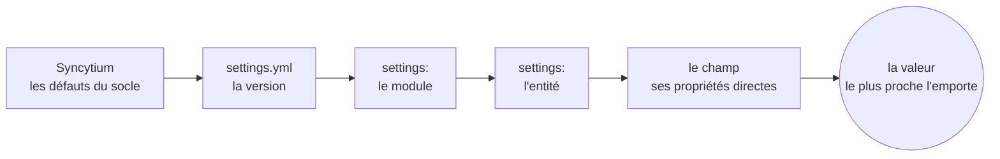
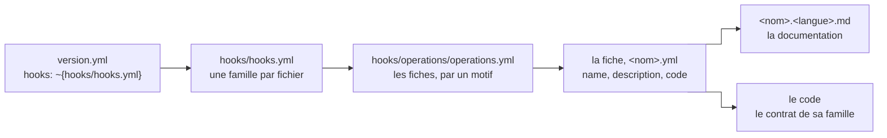

# La version — ce qu'elle porte

*Les sous-chapitres 3.5 à 3.10 de l'[arbre](03-arbre.md) : les réglages, les
groupes, le module et son menu, l'entité, les hooks et la reprise.*

## Le sommaire

- [3.5 `settings.yml` — la maison des types et des réglages (D359, D360, D991–D993)](#35-settingsyml--la-maison-des-types-et-des-réglages-d359-d360-d991d993)
  - [Les types et les dérivés](#les-types-et-les-dérivés)
  - [La cascade](#la-cascade)
  - [La règle des paramètres (D1535)](#la-règle-des-paramètres-d1535)
  - [La règle des défauts (D1175)](#la-règle-des-défauts-d1175)
- [3.6 `groups.yml` — les groupes (D414)](#36-groupsyml--les-groupes-d414)
- [3.7 Le module — `<module>.yml` (D765, D416)](#37-le-module--moduleyml-d765-d416)
  - [`menu.yml` — une carte d'entrées nommées (D1237)](#menuyml--une-carte-dentrées-nommées-d1237)
- [3.8 L'entité, les champs, les surfaces](#38-lentité-les-champs-les-surfaces)
- [3.9 `hooks/` — le mécanisme des hooks](#39-hooks--le-mécanisme-des-hooks)
  - [La chaîne à deux étages](#la-chaîne-à-deux-étages)
  - [La fiche du hook](#la-fiche-du-hook)
  - [La description, un fichier Markdown par langue](#la-description-un-fichier-markdown-par-langue)
  - [Les traces codifiées, `errors:`](#les-traces-codifiées-errors)
  - [Ce qu'un hook ne contourne pas](#ce-quun-hook-ne-contourne-pas)
- [3.10 `migration/` — la migration des données](#310-migration--la-migration-des-données)

## 3.5 `settings.yml` — la maison des types et des réglages (D359, D360, D991–D993)

Les settings règlent les défauts. Ils se structurent en trois niveaux
(D1239) : le type de composant, puis le composant, puis la propriété.

```yaml
# Les champs : les défauts des types du catalogue et les types dérivés
field:
  # Le texte : la normalisation à la frontière, pour tous les champs de ce type
  text:
    normalize: me.trim()

  # Une date au masque de l'ERP : un type dérivé, sa base et ses défauts
  date_pmi:
    type: date
    mask: "yyyymmdd"

  # Le montant : la devise par défaut
  amount:
    currency: EUR

  # Le nom d'une personne : un dérivé qui porte le marquage RGPD ; tout champ de ce type en hérite
  nom:
    type: text[..40]
    rgpd: personal

# Les entités : l'historisation par défaut pour toute l'application
entity:
  history: true
```

### Les types et les dérivés

Sous `field:`, la clé est le nom d'un type :

- sans `type:`, elle règle les défauts d'un type du catalogue ;
- avec `type:`, elle définit un dérivé, qui hérite de sa base et
  surcharge ce qu'il nomme (D359, D992) ;
- le dérivé d'un dérivé se résout à l'ingestion ; un cycle est une
  erreur ;
- un dérivé ne redéfinit jamais un type du catalogue (D408) ;
- un dérivé s'emploie par la forme courte, `date_creation: date_pmi` ;
- un dérivé porteur de sens transmet son marquage, `nom: nom` hérite du
  `rgpd: personal` (D1178) ; la normalisation (D870, D872), la devise
  (D993) et l'historisation (D1174) se règlent de même.

### La cascade

Les settings se lisent du plus loin au plus près (D359, D360, D588) :
`settings.yml` de la version, puis `settings:` du module, puis
`settings:` de l'entité. Le plus proche l'emporte. Le champ garde le
dernier mot, par ses propriétés directes.

La cascade, du plus loin au plus près :



### La règle des paramètres (D1535)

Un hook décrit par son contrat la liste de ses paramètres : le mode, le
nom, le type, la valeur par défaut. Ce sont les `properties` de sa fiche
(D809). Le socle a les siens, décrits par Syncytium : l'inventaire est
dans [05-defauts.md](05-defauts.md). Trois cas se présentent.

- **Un paramètre connu, surchargé par la configuration**, exploite les
  informations connues du paramètre : seule la valeur se réécrit.
- **Un paramètre surchargé d'un autre paramètre**, d'un étage à l'autre
  de la cascade, exploite les propriétés du rang précédent.
- **Un paramètre rattaché à aucun paramètre existant**, en forme courte,
  est une valeur texte et statique (D590). La forme longue dit tout
  (D588, D589) : `mode:`, `dynamic` surchargeable à chaud par
  l'administration ou `static` ; `type:`, texte par défaut ; `value:`,
  la valeur par défaut.

```yaml
# La marge : un paramètre libre en forme courte, texte et statique
marge: 10%

# Le taux : un paramètre libre en forme longue, décimal, surchargeable à chaud par l'administration
taux:
  mode: dynamic
  type: decimal
  value: 20

# Le compteur : un paramètre du socle surchargé ; son mode et son type sont connus, seule la valeur s'écrit
counter:
  reset: never
```

### La règle des défauts (D1175)

Toute valeur ou tout statut par défaut de Syncytium se surcharge dans
les settings. Les types (D359), le `reset:` du compteur (D409),
`normalize:` (D870), les paramètres (D588, D1535), `history:` (D1174)
sont les cas d'un seul principe.

- La clé porte le nom de la propriété réglée, sous le nom du type quand
  c'est une propriété de type.
- Un défaut est statique dès qu'il engage le stockage ou la structure,
  dynamique sinon.
- Une clé qui ne nomme aucun défaut connu est une erreur d'ingestion
  (D311).

## 3.6 `groups.yml` — les groupes (D414)

Un groupe est une clé. Il porte son libellé, sa description, les groupes
qu'il voit, et son degré.

```yaml
# La production : les opérateurs et la préparation
production:
  label: { fr: Production }
  description: { fr: Les opérateurs et la préparation des commandes }

# La direction : elle voit ce que voient la production, le commercial et les achats
direction:
  label: { fr: Direction }
  groups: [production, commercial, achats]

# L'administration : le degré porté par le groupe
administration:
  degree: administrator
```

La hiérarchie est sans lien parent et acyclique ; un membre d'un groupe
voit ce que voient les groupes qu'il nomme (D414, D1099). Le degré est
porté par le groupe (D699, D701). Les affectations des personnes aux
groupes vivent en base, pas dans la configuration (D27, D341). Le détail
dans [les droits](../07-securite/README.md).

## 3.7 Le module — `<module>.yml` (D765, D416)

Un module regroupe des entités. Son fichier les déclare, et porte ses
droits, son menu, ses réglages, ses ressources et ses tableaux de bord.

```yaml
# Le nom du module : l'invariant, quelle que soit la langue
name: technique

# Le nom d'usage, par langue ; sans lui, le nom
title: Technique

# La description du module
description: Les données techniques de l'ERP, standardisées

# Les droits du module : l'entrepôt est en lecture seule, les entités en héritent
allow:
  create: false
  update: false
  delete: false

# Les entités du module, en liste explicite
entities:
  - ~{article/article.yml}
  - ~{nomenclature/nomenclature.yml}

# Le menu du module ; sans lui, le défaut
menu: ~{menu.yml}

# Les réglages du module : l'étage module de la cascade
settings: ~{settings.yml}

# Les ressources attachées au module
resources: ~{resources/resources.yml}
```

Les décisions de ces clés : D1120 pour `name:` et `title:`, D886 pour la
cascade de `allow:`, D765 pour la liste des entités, D351 pour le menu,
D359 pour les réglages, D1530 pour les ressources (la déclaration, ma
lecture). Les tableaux de bord du module, `dashboards:`, sont décrits
dans [les surfaces](../04-composants/06-surfaces.md).

Déclarer un module, c'est l'activer (D350) : présent, il est actif ;
retiré par une nouvelle version, il est désactivé.

### `menu.yml` — une carte d'entrées nommées (D1237)

Le menu est une carte, dans l'ordre d'affichage. Chaque entrée porte son
`label:` par langue et son `link:`, une adresse logique (D439) :

- `<module>.<entité>`, la liste par défaut de l'entité ;
- `<module>.<entité>[<liste>]`, une liste nommée ;
- `<module>.<entité>.<opération>`, une opération ;
- `<module>.<entité>[+<formulaire>]`, une création ;
- `<module>.<entité>[@<wizard>]`, un wizard ;
- `<module>[<dashboard>]`, un tableau de bord du module.

Ce que le menu fait à l'écran — le défaut, les droits, la
documentation qu'il ordonne — est décrit à sa fiche, parmi les surfaces
(D1604, [les surfaces](../04-composants/06-surfaces.md)).

Un sous-menu porte `items:`, la carte de ses entrées. Le menu de la
banque (le cas 4), le premier au dépôt (D1230), tel qu'il est écrit :

```yaml
# Le menu du module : une carte d'entrées nommées, dans l'ordre d'affichage. Chaque entrée porte son libellé par langue
# et son lien, l'adresse ; un sous-menu porte ses entrées. Sans libellé, l'entrée prend le titre de la surface liée.
# Sans menu déclaré, le défaut ne connaît qu'une liste par entité ; les trois listes de l'écriture ont ici chacune leur
# entrée, en sous-menu. Une liste absente du menu et d'un écran n'est documentée nulle part.

# L'accueil du module
accueil:
  label:
    fr: Tableau de bord
    en: Dashboard
    es: Panel de control
  link: banque[accueil]

# Les comptes
comptes:
  label:
    fr: Comptes bancaires
    en: Accounts
    es: Cuentas bancarias
  link: banque.compte

# Les écritures, en sous-menu — une entrée par liste
ecritures:
  label:
    fr: Écritures
    en: Entries
    es: Apuntes
  items:
    operations:
      link: banque.ecriture[par_operation]
    comptable:
      link: banque.ecriture[par_comptable]
    rapprochement:
      link: banque.ecriture[pointage]

# Les référentiels
referential:
  items:
    budgets:
      link: banque.budget
    lieux:
      link: banque.lieu
```

Quatre règles complètent la forme :

- une entrée sans `label:` prend le titre de la surface qu'elle lie ;
- un sous-menu sans `label:` prend son nom nu, et la complétude le
  compte ;
- l'icône vient de la surface visée (D439) ; le dictionnaire `label:` du
  module (D440) ne sert pas au menu ;
- sans menu déclaré, le défaut ne connaît qu'une liste par entité (D351)
  ; le menu est filtré par la confidentialité à l'affichage.

## 3.8 L'entité, les champs, les surfaces

Les mécanismes de ce chapitre s'appliquent tels quels à l'entité :
`fields: ~{fields.yml}`, la forme courte, les facettes en bloc,
l'interpolation des profils de confidentialité, les expressions. Le sens
vit dans trois chapitres :

- l'en-tête de l'entité, `name`, `description`, `label`, `identity`,
  `inheritance`, `states`, `history`, `fields:`, `validation:`,
  `operations:`, `gui:`, `allow:`, dans [entity.md](../02-modele/02-entite.md) ;
- les champs et leurs facettes dans [05-types.md](../02-modele/05-types.md), dont
  `sort:` et `group:` sur une association dérivée (D1016, D1017) et
  `unit:` sur une mesure empruntée à une référence (D1009) ;
- les surfaces, `lists`, `forms`, `summary`, `widgets`, `wizards`,
  `templates`, et `dashboards` au module, dans
  [les surfaces](../04-composants/06-surfaces.md).

## 3.9 `hooks/` — le mécanisme des hooks

> **Un hook** est un prolongement par code : un type, un composant, une
> opération, une fonction ou un connecteur, écrit contre le contrat de
> Syncytium. Il rend transparent l'usage d'un développement propre au
> projet. Syncytium en fournit déjà un ensemble : ses types, ses
> composants et ses opérations sont des hooks
> ([glossaire](../../glossaire.md)).

Un hook ajoute un nom à un catalogue de Syncytium. Ce nom s'emploie
ensuite comme un nom du socle : le mot « hook » n'apparaît jamais dans
la configuration (D408). Les types, les composants et les opérations
que Syncytium embarque sont eux-mêmes des hooks : « tous les types
proposés sont finalement des hooks qui appartiennent à Syncytium »
(D408). Ce que Syncytium embarque et ce que le concepteur ajoute passent
par la même porte (D37, D52).

Il y a quatre familles (D1671, D1672, D1702). Chacune se décrit à la
fin du chapitre de ses composants (D1673) :

- **le type**, avec ses méthodes (D1674, D1700), au chapitre 2,
  [le modèle](../02-modele/README.md) ;
- **le composant**, au chapitre 4, [les composants](../04-composants/README.md) ;
- **le connecteur**, au chapitre 5, les connecteurs ;
- **l'opération**, au chapitre 6, les opérations (D1675).

Le style et la langue ne sont pas des hooks. Le socle impose l'affichage
de ses composants et propose quelques styles (D1672). Une langue se
déclare par son code dans `languages:` (D1671, voir [l'arbre](03-arbre.md)).

Un hook ajouté a les mêmes droits qu'un élément du socle (D65) : il se
règle en défaut de type, il se surcharge au champ. S'il échoue, le
moteur se replie sur l'élément par défaut (D68). Un doublon de nom entre
un hook et le socle est une erreur d'ingestion (D344, D396). Un hook de
code définit une signature et un code dans le langage que Syncytium
exploite (D570). Ce langage et sa sandbox relèvent de l'architecture
technique, qui n'est pas posée (D602, D1669). Ce qui suit est donc la
déclaration du hook dans la configuration. Les règles de chaque famille
se complèteront à l'implémentation (D1684).

### La chaîne à deux étages

Les hooks de l'application vivent à la racine de la version, dans le
dossier `hooks/` (D644). `version.yml` les déclare par une clé, `hooks:`
(D805) :

```yaml
# Les hooks de la version
hooks: ~{hooks/hooks.yml}
```

La chaîne a deux étages, sur le patron des modules (D777) :

- `hooks.yml` référence un fichier par famille ;
- le fichier de famille liste ses fiches, une à une ou par un motif
  (D806).

Les chemins sont relatifs au fichier qui les cite (D768). Un dossier par
hook ou tout dans un fichier : l'organisation est libre (D807). Dans le
cas 4 (banque), `hooks/hooks.yml` :

```yaml
# Les familles de hooks
# Une famille par fichier ; le projet n'a que des opérations.
operations: ~{operations/operations.yml}
```

`hooks/operations/operations.yml` :

```yaml
# Les opérations du projet
# Un dossier par opération, listés par le motif : le fichier au nom de l'opération, sa documentation et son code.
operations:
  - ~{.*/.*\.yml}
```

Le motif `.*/.*\.yml` prend chaque fichier YAML d'un sous-dossier : une
fiche par opération.

La chaîne, de la version au code, pour la banque :



### La fiche du hook

Une fiche porte quatre clés (D809) :

- `name`, le nom que le hook ajoute au catalogue ;
- `description`, sa documentation, un fichier Markdown par langue ;
- `code`, son fichier source ;
- `properties`, ses paramètres.

Dans le cas 4, `hooks/operations/dupliquer/dupliquer.yml` :

```yaml
# L'opération dupliquer
# La duplication d'une écriture entre deux dates, au pas choisi.
name: dupliquer

# La description
# La documentation de l'opération, en Markdown, une par langue de la version.
description:
  fr: ~{documentation.fr.md}
  en: ~{documentation.en.md}
  es: ~{documentation.es.md}

# Le code
code: ~{source.txt}

# Les propriétés
# Aucune.
properties: { }
```

Les `properties:` sont les paramètres du hook : le mode, le nom, le
type, la valeur par défaut (D1535). Ils suivent la règle des paramètres,
ci-dessus : la configuration en surcharge la valeur, le socle garde le
reste. Deux clés s'ajoutent quand le hook en a besoin (D1667) :

- `dependencies`, les bibliothèques qu'il embarque, chacune par son nom,
  sa version et sa licence (D1432) ; absente, le hook n'en embarque
  aucune ;
- `errors`, ses traces codifiées, `~{errors.yml}` (D1461) ; absente, le
  hook n'émet aucune trace propre.

Les dossiers `types/`, `components/` et `connectors/`
suivent la même forme. Ce qu'une famille déclare en plus est au chapitre
de sa famille.

### La description, un fichier Markdown par langue

Chaque hook s'accompagne d'un fichier Markdown par langue qu'il supporte
(D778, D1403). La fiche le référence par `description:`. Ce fichier dit
ce que le hook fait, pour qui, avec quel résultat. C'est la brique
humaine de la documentation générée : la documentation fonctionnelle le
reprend comme la description de l'opération, dans la section de son
entité (D1196, D1227). Des gabarits y insèrent les paramètres et la
déclaration du hook (D562).

Trois règles :

- le fichier est une configuration : il ne cite ni décision ni histoire
  du cas (D1085) ;
- un hook ajouté porte les langues de la version ; une langue qui manque
  est une erreur d'ingestion (D1162, D1163) ;
- Syncytium décrit ses propres hooks de même, une section par famille,
  une par implémentation (D1403).

### Les traces codifiées, `errors:`

Un hook qui émet ses propres traces les codifie dans un fichier, la clé
`errors:` de sa fiche (D1461). Chaque entrée a un code, un niveau et un
message, un gabarit par langue. Une erreur porte en plus de quoi la
résoudre : la famille du dépannage, la position de sécurité, qui résout,
et un arbre de résolution, une analyse et des branches (D1462). Le
détail croît avec le niveau : une trace `debug` n'a que son code et son
message, une `error` le détail entier (D1463). L'exemple est inventé,
aucun cas n'en porte ; `hooks/operations/virer/errors.yml` :

```yaml
# Les traces du hook, par code : le détail croît avec le niveau.

# Une trace : le code, le niveau et le message suffisent.
D001:
  # Le niveau de la trace.
  level: debug

  # Le message, un gabarit par langue.
  message: { fr: "Virement de {montant} vers {compte} : les deux écritures créées" }

# Une erreur : le détail entier, l'arbre de résolution compris.
E001:
  # Le niveau de la trace ; le journal le reprend.
  level: error

  # La famille du dépannage : le démarrage, un connecteur, la reprise, une version…
  family: connector

  # La position de sécurité : l'annulation, la page de maintenance, le mode safe.
  safety: cancel

  # Rejouable telle quelle, ou à corriger avant.
  retry: true

  # Qui résout, l'administrateur, le concepteur ou l'intégrateur, et son canal.
  resolver: administrator

  # Les paramètres typés du gabarit.
  parameters: { compte: text, date: date, montant: amount }

  # Le renvoi à une fiche du guide d'exploitation, s'il y en a une.
  procedure: restaurer_enregistrement

  # Le gabarit du journal, par langue.
  message:
    fr: "Le compte cible {compte} est clos depuis le {date}"
    en: "Target account {compte} has been closed since {date}"

  # La description, facultative, par langue.
  description:
    fr: Le virement vise un compte que son titulaire a fermé.

  # L'arbre de résolution : des nœuds, acyclique ; une analyse, des branches, une action à chaque feuille.
  resolution:
    # Un nœud : une analyse, le gabarit résolu.
    check: { fr: "Le compte {compte} est-il réellement clos ?" }

    # Les cas ; une feuille porte une action.
    branches:
      oui: { action: { fr: "Choisir un autre compte cible et relancer le virement de {montant}." } }
      non: { action: { fr: "Rouvrir le compte {compte} depuis sa fiche, puis relancer." } }
```

Le niveau est celui du journal (D737), la famille celle du dépannage
(D1456), le message un gabarit du journal (D562). Le guide
d'exploitation reprend ces entrées, code par code.

### Ce qu'un hook ne contourne pas

Un hook est un citoyen du moteur, jamais un super-utilisateur :

- il lit le modèle par la librairie d'exploration, par les noms
  logiques, jamais par le stockage, et il écrit dans la transaction
  (D572, D599) ; les droits, la confidentialité, la validation et la
  concurrence par champ ne se contournent pas (D196, D25, D364, D307,
  D111) ;
- il ne lit ni variable d'environnement ni fichier que sa fiche et la
  configuration ne référencent : rien hors de la configuration (D1440,
  D1429) ;
- sa signature se vérifie à l'ingestion, comme le typage statique (D330,
  D344, D581) : l'erreur ne passe jamais l'ingestion ;
- un hook d'interface est le seul code tiers au navigateur : il ne
  reçoit jamais `private`, il relève de l'ergonomie, jamais de la
  sécurité, et la documentation générée le liste (D918, D645).

Ce que l'ingestion refuse est dans [les règles](06-regles.md).

## 3.10 `migration/` — la migration des données

Le nom est celui des cas ; l'organisation est libre (D1883). Une
migration porte les données d'une description vers une autre, et elle a
deux origines (D1882) : une source, c'est la reprise ; la version
antérieure, c'est la migration de version. Le dossier range les deux :

- `migration.yml` décrit et nomme les processus de migration, un par
  connecteur d'origine (D662, D1888) : `from:` la base d'origine
  (D1087), `mode:` et `reset:`, `relative` et `false` par défaut
  (D671, D1889), `sources:` (D1884), `mapping:`, `operations:` ; une
  reprise un pour un s'écrit en forme courte, `legacy: fichier_csv` ou
  `legacy: fichier_csv[client]`, les entités entre crochets séparées par
  une virgule : le connecteur se décrit, le mapping est champ à champ
  (D1895–D1897) ;
- `sources/<TABLE>.yml` décrit chaque entité d'origine (D947, D966) :
  `alias`, `name`, `filter`, `identity`, `partition`, `fields`,
  `validation` ; la table d'appartenance déclare ses compositions par
  `list of`, le fils ne déclare rien (D1913, D1914) ; une colonne typée `TABLE.colonne` est une référence,
  `TABLE[NOM].colonne` une référence nommée quand l'entité est visée
  plusieurs fois (D995), `A.colonne or B.colonne` une référence à l'une
  de deux entités (D996) ; les calculés de la source s'écrivent en
  `formula:` (D660) ;
- `mapping/NNN_<nom>.yml` écrit chaque règle (D656) : `to`, `filter`,
  `distinct`, `parent`, `fields`, `validation`, `report`, `operations` ;
- `exchange/` porte les surcharges de la version par rapport à la
  version antérieure, en un volet ascendant et un volet descendant
  (D1883) : ce sont les règles de mapping d'une migration de version
  (D1971). Aucun cas n'en porte encore.

La base miroir ne se déclare pas dans un processus : elle sert leur
enchaînement, et se déclare dans le fichier de l'environnement, par
`mirror:` (D1890, D1891). Elle porte son connecteur et la rétention du
détail des passages (D1892) : en forme courte, `mirror: temporaire` ou
`mirror: temporaire[5d]` ; en bloc, `storage:` et `retention:` (D1894).
Par défaut, c'est un connecteur en mémoire et quatre-vingt-dix jours ; le
connecteur se configure pour une base très volumineuse (D1889).

Le détail dans [mapping.md](../../mapping.md). Le pilotage et le suivi,
les passages, les clés d'origine, le modèle lu, les anomalies, sont le
module `_migration` du socle, que l'application n'expose pas (D1028) :
[migration.md](../../migration.md).
