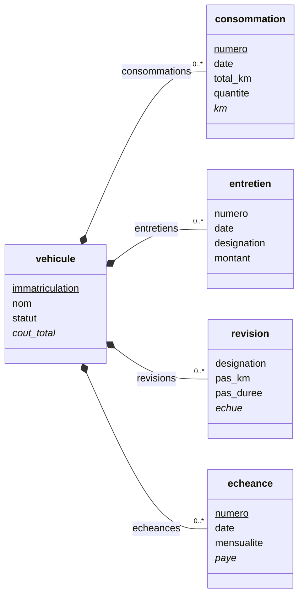

# L'entité — l'en-tête, la validation, les renvois

> **Une entité** est un objet du métier, ou une table dans un modèle
> relationnel : le client, la commande, l'article. Elle a ses champs,
> ses règles, sa présentation ([glossaire](../../glossaire.md)).

Une entité se décrit dans un fichier d'en-tête. Il dit son nom, son
identité, son visage, son cycle de vie, et renvoie à ses champs, à ses
opérations et à sa présentation. Le véhicule (le cas 3) est l'exemple
complet :

```yaml
# Le véhicule
# La feuille d'identification du classeur et son bilan, tout calculé. La plaque identifie le véhicule, le classeur
# garde son nom ; le statut porte le cycle de vie.
name: vehicule

# La description de l'entité
description: Un véhicule du foyer — l'identification, le financement, la vie et le bilan

# Le visage texte
# Le nom ; la photo est le visage image.
label: "{nom}"

# L'identité
# La plaque — l'arbitrage de la reprise.
identity: [immatriculation]

# Le cycle de vie
# Le champ énuméré qui porte les états.
states: statut

# Les champs
# Rangés par groupe.
fields: ~{fields.yml}

# Les opérations
# Le cycle de vie de l'échéancier.
operations: ~{operations.yml}

# L'interface
# La liste des véhicules en cartes et le formulaire à onglets.
gui: ~{gui.yml}

# La cohérence des données
validation:
  - rule: date_vente >= date_achat if date_vente is not null
    message: La vente du {date_vente} précède l'achat du {date_achat}.
```

## Le sommaire

- [Le nom et les textes](#le-nom-et-les-textes)
- [L'identité](#lidentité)
- [Le cycle de vie, l'héritage, l'historique](#le-cycle-de-vie-lhéritage-lhistorique)
- [Les champs, les opérations, la présentation, la partition](#les-champs-les-opérations-la-présentation-la-partition)
- [La validation](#la-validation)
  - [Les trois sévérités](#les-trois-sévérités)
- [Les opérations — le renvoi](#les-opérations--le-renvoi)
- [La présentation — le renvoi](#la-présentation--le-renvoi)
- [La dépréciation d'une entité](#la-dépréciation-dune-entité)
- [L'exemple fil rouge](#lexemple-fil-rouge)

## Le nom et les textes

- **`name:`** est le nom de l'entité, invariant quelle que soit la
  langue (D124, D1120). L'adresse `<module>.<entité>` en découle (D394,
  D765).
- **`title:`** est son nom d'usage, celui qu'on montre : l'entrée de menu
  par défaut, la vue d'ensemble du modèle, les titres de la
  documentation (D1120). Il s'écrit par langue, au singulier ; le
  `label:` d'une entrée de menu dit le pluriel (D1277). Sans `title:`,
  c'est le `name:`. Un formulaire sans `title:` prend celui de l'entité.
- **`hint:`** est la description courte, un mot de précision ;
  **`description:`** la description longue, l'aide détaillée et la
  matière du tutoriel (D209, D258, D840).
- **`label:`** est le visage texte de l'entité : un gabarit qui cite ses
  champs, `"{nom}"`, `"{code} — {nom}"` (D397). Un champ `image` de
  l'entité en est le visage image (D386).

## L'identité

> **L'identité** d'une entité est sa clé fonctionnelle : la liste des
> champs qui distinguent un enregistrement des autres, comme la plaque
> d'un véhicule. **L'identité technique**, elle, est le matricule
> interne et invisible de l'enregistrement, un UUID qui ne change jamais
> ([glossaire](../../glossaire.md)).

L'identité s'écrit `identity: [immatriculation]`. Six règles
l'encadrent.

- **Toute entité en porte une**, la sienne ou celle de sa racine
  d'héritage, que les dérivés conservent (D1035, D1039). Une entité sans
  identité est une anomalie de description, refusée à l'ingestion.
- **Ses champs sont obligatoires** sans qu'on l'écrive : cela découle de
  la définition (D1170).
- **L'identité interne reste l'UUID**, hors déclaration (D142).
- **Pour une composition, la clé vaut au sein du possesseur.** Elle ouvre
  l'accès par la clé, `collection[<clé>]` (D841). Une clé composée
  s'énumère, une valeur par champ, `[v1, v2]` ; l'étendue globale passe
  par l'entité, la clé des parents en tête, `transport.consommation[…]`
  (D842).
- **L'unicité ne vaut que parmi les actifs** (D141) : un enregistrement
  supprimé ne bloque pas sa clé ([04-vie.md](04-vie.md)).
- Écrite `identity:`, l'identité se nomme « identity » (D1304).

**Plusieurs identités.** Une entité peut en porter plusieurs, nommées,
par `identities:` (D1170, D1171). C'est une carte ordonnée, exclusive
d'`identity:` :

```yaml
# Les identités de la facture : la mensuelle à la naissance, le numéro une fois attribué
identities:
  mensuelle: [client, mois]
  numero: [numero]
```

- la première est l'identité de naissance : ses champs sont obligatoires ;
- les suivantes sont acquises : leurs champs ne sont pas obligatoires, et
  un compteur attribué à la validation y a sa place ;
- une identité dont un champ est nul ne vaut pas pour l'enregistrement ;
- l'accès par la clé vise la première ; une autre se nomme,
  `factures[numero: v]` (D1550).

## Le cycle de vie, l'héritage, l'historique

> **Le cycle de vie** est la suite d'états qu'un enregistrement
> traverse : brouillon, confirmée, expédiée. Un champ énuméré le porte ;
> chaque état déclare ses droits et ses passages
> ([glossaire](../../glossaire.md)).

- **`states:`** désigne le champ énuméré qui porte le cycle de vie,
  `states: statut` (D424). Ses valeurs portent les droits par état et le
  graphe des passages ([03-champs.md](03-champs.md), `values:`).
- **`inheritance:`** déclare le parent ; ce que l'enfant reçoit et
  comment un enregistrement change de niveau sont dans
  [la vie d'un enregistrement](04-vie.md).
- **`history:`** allume l'historisation : inactive par défaut, elle se
  règle en cascade, de la version au module puis à l'entité, et s'éteint
  par `history: false` (D168, D1174). Ce que l'historique contient est
  dans [la vie d'un enregistrement](04-vie.md). Sans historique, la
  documentation l'écrit en clair, « pas d'historique » (D1173).

## Les champs, les opérations, la présentation, la partition

- **`fields:`** porte les champs, en place ou par fichier (D767) ; ils
  sont décrits dans [les champs](03-champs.md).
- **`operations:`** porte les opérations, dans l'ordre des boutons (D432).
- **`gui:`** porte la présentation (D767).
- **`partition:`** découpe physiquement la table selon un ou plusieurs
  champs, par période pour une date : `partition: date_comptable[year]`,
  `partition: [site, statut]` (D1293, D1300). Sans déclaration, pas de
  partition ; le storage décide de la forme.

Une propriété qui porte une carte peut cumuler plusieurs fichiers, dans
l'ordre (D968) : c'est un mécanisme de la
[configuration](../01-configuration/02-mecanismes.md).

## La validation

> **Une validation** est une règle de refus : sur le champ, elle juge sa
> valeur ; sur l'entité, la cohérence de l'enregistrement
> ([glossaire](../../glossaire.md)).

`validation:` porte les règles de l'entité : des expressions booléennes,
évaluées au scellé de la transaction, après chaque modification (D156,
D594). Une règle s'écrit sous deux formes, mêlables dans la même liste
(D1116, D1117) :

- **la forme courte**, l'expression seule ;
- **la forme longue**, `rule:`, `description:`, `message:`, et
  `severity:`.

Les mêmes formes valent au champ (D364), à l'entité (D404) et à la règle
de reprise (D1105).

Le `message:` est un gabarit qui cite les valeurs, `{date_vente}`
(D1106). Sans lui, à l'échec, Syncytium construit le message : la règle,
les valeurs des champs qu'elle cite, la clé de l'enregistrement.

Le message construit se compose de labels du catalogue des textes du
moteur (D1944) :

- chaque opérateur a le sien, un gabarit nommé
  `_syncytium.<opérateur>.validation` (D1945, D1948). L'opérateur s'y
  écrit par son nom, non par son signe : `_syncytium.equal.validation`,
  `_syncytium.in.validation` (D1949) ;
- le gabarit cite quatre noms : `{left}` et `{right}`, les deux côtés
  tels qu'ils sont écrits ; `{left_value}` et `{right_value}`, leurs
  valeurs. Un label d'enveloppe porte la règle et la clé de
  l'enregistrement (D1949) ;
- un second label, `_syncytium.<opérateur>.description`, donne la
  traduction littérale d'une règle : la documentation l'emploie, sans
  montrer le code brut ;
- `not`, `and`, `or` et `xor` assemblent les messages de leurs membres,
  à gauche et à droite, par leur propre label, `_syncytium.and.validation`
  (D1947, D1949) ;
- le projet traduit ou réécrit un label sans toucher au code de
  Syncytium.

`message:` est donc facultatif, dès que le catalogue couvre tous les
labels dans les langues de la version. Le concepteur l'écrit pour
surcharger le message construit (D1946). Un label qui manque dans une
langue de la version est une erreur d'ingestion, comme tout item du
catalogue (D1163, D1949).

### Les trois sévérités

Une règle en échec n'empêche pas toujours l'enregistrement. La forme
longue porte sa sévérité, `severity:` (D157, D1559) :

- `error`, le défaut : la règle bloque ;
- `confirm` : l'utilisateur confirme pour passer, et sa confirmation est
  tracée ;
- `info` : la règle signale sans bloquer.

```yaml
# La cohérence des données
validation:
  # La vente suit l'achat
  - rule: date_vente >= date_achat if date_vente is not null
    message: La vente du {date_vente} précède l'achat du {date_achat}.

  # Un kilométrage inhabituel se confirme
  - rule: km_initial < 500000
    severity: confirm
    message: Un kilométrage initial de {km_initial} km est inhabituel.
```

À l'enregistrement, la vérification se fait en trois passes :

1. toutes les erreurs d'un coup, jamais une seule à la fois ;
2. puis les confirmations, regroupées en une seule validation ;
3. puis les informations, regroupées.

L'API suit le même protocole : le rejet avec la liste des erreurs, la
re-soumission avec l'acquittement des confirmations, les informations
signalées dans la réponse.

## Les opérations — le renvoi

> **Une opération** est une action déclarée sur une entité, au-delà de
> créer, modifier, supprimer : valider, envoyer, clôturer. Elle s'exerce
> sous droits, et peut déclencher un changement d'état
> ([glossaire](../../glossaire.md)).

Une opération est un verbe de l'entité, porté par un hook d'opération :
le hook porte le code, l'opération est sa déclaration, une suite
d'actions dont l'exécution du hook est la première (D609, D1771). Le
bloc `operations:` la déclare (D432) :

- **un verbe sans `when:`** est un bouton : sa garde `if` (D430), son
  `label:`, son `commit:`, `auto` ou `confirm` (D596), son formulaire
  d'appel `form:` (D775) ;
- **un verbe avec `when:`** est un automatisme, déclenché quand
  l'expression devient vraie (D354, D428) ;
- **les `actions:`** composent la suite (D1750, D1751) : `notify`,
  `document`, `set`, `webhook`, ou une autre opération, après le commit.

La famille entière est au chapitre 6, [les opérations](../06-operations/README.md).

## La présentation — le renvoi

L'entité accroche ses surfaces dans `gui:`. Chacune est nommée ; la
première déclarée est la surface par défaut (D437, D438).

| Le bloc | La surface | L'essentiel |
|---|---|---|
| `forms:` | les formulaires : `record`, et les formulaires d'appel des opérations (D775) | un arbre de composants : les conteneurs, `header`, `page`, `footer`, `tabs`, `sections`, rangés par `layout:` (D491, D509) ; les feuilles, `field[…]`, `operation[…]`, `chart[…]`, `paragraph` ; le `visible:` vivant (D567) |
| `lists:` | les listes, la porte d'entrée de l'entité | un tableau, `columns:`, ou une liste de widgets (D492) ; `editable:`, `filter:`, `sort:`, `title:` ; sans formulaire déclaré, le formulaire par défaut du socle (D438, D530) |
| `widgets:` | la carte d'un enregistrement, ou une synthèse (D202, D492) | des sections, des feuilles, des graphiques ; un `paragraph` au gabarit |
| `charts:` | les graphiques de l'entité | `x:`, le découpage, `date[month]` (D516) ; `y:`, la fonction d'agrégation (D517) |

Tout se relie par une adresse, `<type>[<nom>]` : `field[nom]`,
`operation[ajuster_echeancier]`, `list[echues]` (D566). Hors de l'entité
courante, l'adresse se qualifie, `chart[consommation.evolution_consommation]`.
Le module porte ses tableaux de bord, `dashboards:`, et le menu les
adresse (D439, D554). Les fiches des composants sont dans
[le catalogue des composants](../04-composants/README.md).

## La dépréciation d'une entité

> **La dépréciation** d'un élément annonce son retrait. L'élément vit
> encore ; le bloc `deprecation:` dit ce qui le remplace, ou son abandon.
> Elle ne se confond pas avec la dépréciation d'une version, qui est
> effective ([glossaire](../../glossaire.md)).

Une entité peut être appelée à disparaître : une autre l'absorbe, ou le
métier ne la tient plus. La configuration ne la retire pas d'un coup.
Elle l'annonce d'abord, dans l'en-tête de l'entité, dans la version en
service (D650, D1871). Ses enregistrements se lisent et s'écrivent comme
avant.

**La forme courte.** Le bloc nomme la remplaçante, rien de plus (D1873).
La remplaçante est une autre entité, nommée par son module et son nom
(D1875). L'exemple est construit, aucun cas n'en porte. Dans l'entrepôt,
une entité des tranches de prix céderait à l'article, qui porte la grille
tarifaire :

```yaml
# L'entité tranche
name: tranche

# La dépréciation
# L'entité vit encore dans cette version ; l'article la remplace, par sa grille tarifaire.
deprecation: technique.article
```

**La forme longue.** Elle porte deux clés (D1871) :

- **`documentation:`**, le texte qui explique la dépréciation. C'est un
  texte de la version : à plusieurs langues, il les porte toutes
  (D1474) ;
- **`to:`**, l'entité remplaçante.

Sans `to:`, le bloc dit l'abandon, et `documentation:` est exigée. Une
dépréciation dit toujours le remplacement ou l'abandon ; l'ingestion le
vérifie (D650). Le bloc n'a pas de `mode:` : sa présence dit l'intention
(D1872).

```yaml
# L'entité tranche
name: tranche

# La dépréciation
# L'entité vit encore dans cette version ; le texte dit ce qui la remplace.
deprecation:
  documentation: Les tranches vivent désormais dans la grille tarifaire de l'article.
  to: technique.article
```

**Ce que la dépréciation d'une entité touche.** Elle ne s'arrête pas à
l'en-tête (D1877). Le registre le dit : « La dépréciation d'une entité va
avoir un impact sur tous les champs de l'entité dépréciée » (D1875).

- tous les champs de l'entité, touchés avec elle ;
- ses surfaces et ses opérations ;
- les références, les compositions et les associations qui la visent
  depuis d'autres entités ;
- ses enregistrements, que l'API sert encore.

**De l'intention à la suppression.** Une dépréciation se joue en trois
temps :

1. **L'intention.** Le bloc est écrit. Rien ne change : l'entité vit, ses
   enregistrements se lisent et s'écrivent (D650, D1872).
2. **La validation.** Une beta complète la dépréciation : en retirant
   l'entité, elle la valide (D1870, D1875).
3. **La suppression.** Elle vient avec une version : l'entité quitte la
   description, et ses champs avec elle (D650).

Le mot `deprecated` nomme autre chose : le statut d'une version, déposée
dans `versions/deprecated/`. Là, la dépréciation est effective (D1869).
Sur une entité, le bloc s'écrit toujours `deprecation:` (D1871).

## L'exemple fil rouge

Le véhicule (le cas 3, `examples/03_vehicule/`) déroule l'entité entière :

- `vehicule` : l'identité, le statut Création → Actif → Clôture, le
  financement à plat, le bilan calculé, le formulaire à six onglets, la
  liste en cartes ;
- ses quatre compositions, `consommation`, `entretien`, `revision`,
  `echeance`, en édition dans la liste, avec les formulaires par défaut ;
- le tableau de bord d'accueil du module.

L'agrégat du véhicule, l'entité et ses quatre compositions, les champs
abrégés :



Les conventions sont celles du diagramme calculé ([09-documentation.md](09-documentation.md#lentité-dans-le-diagramme)) : l'identité soulignée, le calcul en italique, le champ sécurisé marqué ✱, la référence fléchée avec son nom et sa cardinalité, la composition au losange plein, l'association dérivée au losange vide et au pointillé.

La banque (le cas 4, `examples/04_banque/`) montre la recherche déclarée,
`searchable:`, les opérations à formulaire d'appel, et les montants à
devise, `amount`, quand la devise a un sens métier (D771).
