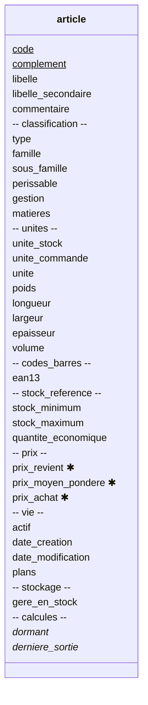

# Les champs — `fields.yml`

> **Un champ** est la plus petite donnée d'une entité. Il a un nom, un
> type et des propriétés ([glossaire](../../glossaire.md)).

Les champs d'une entité forment une carte ordonnée : le nom du champ est
la clé, l'ordre de déclaration est l'ordre d'affichage par défaut. Ils
s'écrivent sous `fields:`, en place ou dans un fichier, `fields.yml`.

## Le sommaire

- [La forme courte et le bloc](#la-forme-courte-et-le-bloc)
- [Les groupes de champs](#les-groupes-de-champs)
- [Les propriétés d'un champ](#les-propriétés-dun-champ)
  - [Le type et les liens](#le-type-et-les-liens)
  - [La saisie](#la-saisie)
  - [Le calcul et les valeurs](#le-calcul-et-les-valeurs)
  - [La documentation du champ](#la-documentation-du-champ)
- [Le renommage d'un champ](#le-renommage-dun-champ)
- [La dépréciation d'un champ](#la-dépréciation-dun-champ)
- [L'ordre du fichier](#lordre-du-fichier)

## La forme courte et le bloc

Un champ sans façon s'écrit en une ligne : son nom, puis son type.

```yaml
# Le lieu d'achat, en forme courte : le type seul
lieu_achat: text[..60]
```

Dès qu'il porte une facette ou sa documentation, il s'écrit en bloc. Le
véhicule écrit ainsi ses champs, chacun avec son libellé et son aide :

```yaml
# Le lieu d'achat : le type, le libellé et l'exemple de la zone vide
lieu_achat:
  type: text[..60]
  label: Lieu d'achat
  placeholder: Garage Peugeot à Dôle

# Le kilométrage au retrait : le type, l'obligation, le libellé et l'aide
km_initial:
  type: integer[0..]
  required: true
  label: Kilométrage initial
  hint: Le compteur au retrait du véhicule — la première ligne de consommation en part.
```

## Les groupes de champs

> **Un groupe de champs** range des champs sous un titre, comme les prix
> d'un article. Il est nommé, titré par langue et ordonné ; le modèle
> reste plat, et un champ s'adresse sans son groupe
> ([glossaire](../../glossaire.md)). Il ne se confond pas avec **un
> groupe d'utilisateurs**, qui porte les droits.

Dans la même carte, une clé qui porte `fields:` sans `type:` est un
**groupe** (D1279, D1289). Il a son `title:`, par langue, et ses champs,
en place ou dans un fichier. L'entrepôt range les prix de l'article dans
un groupe :

```yaml
# Les prix : un groupe, son titre et ses champs dans un fichier
prix:
  title: Les prix
  fields: ~{prix.yml}
```

- Les champs hors groupe forment **le groupe implicite**.
- Les noms des champs restent uniques dans l'entité ; un champ s'adresse
  sans son groupe.
- Un groupe ne s'emboîte pas dans un autre.
- Un champ qui porte `type:` et `fields:` n'est pas un groupe : c'est une
  liste de valeurs composées (D115).

Le groupe est une vue (D1273) : un compartiment du diagramme, une
section de la table du dictionnaire, un onglet du formulaire par défaut.
Le groupe implicite occupe l'en-tête de l'écran, au-dessus des onglets.

L'article de l'entrepôt, le groupe implicite en tête, puis un compartiment
par groupe ; les champs qui pointent vers une entité, ceux de `stockage` et de
`liens`, sont des liens du diagramme, pas des lignes :



## Les propriétés d'un champ

### Le type et les liens

- **`type:`** est le type du champ, pris au [catalogue](05-types.md), ses
  bornes au nom : `text[..40]`, `integer[0..]`, `date[yyyy-mm]` (D362,
  D366). Trois types sont des liens vers une autre entité
  ([07-liens.md](07-liens.md)) :
  - **la référence**, le nom d'une entité, `transport.revision` (D394) ;
  - **la composition**, `list of <entité>` : le parent déclare, l'enfant
    ne déclare rien, il atteint son possesseur par `owner` (D399, D760) ;
  - **l'association**, `association with <entité>[.<champ>]` (D400, D762).
- **`sort:`** et **`group:`** s'écrivent sur une association dérivée, une
  liste calculée (D405). `sort:` donne les clés de tri dans l'ordre,
  `sort: [owner.date, owner.numero]` ; `first()` et `last()` rendent alors
  l'élément de tête ou de queue (D997, D1017). `group:` donne les champs
  de regroupement, `group: [emplacement]` : l'association livre une
  cellule par combinaison, et une fonction d'agrégation s'évalue cellule par cellule
  (D1016). Les méthodes `sort(…)` et `group(…)` en sont les formes en
  ligne (D1015, D1017).
- **`filter:`** et **`check:`** s'écrivent sur une référence : le filtre
  des candidats, l'origine citée par `me.` ; le contrôle, `selection` par
  défaut, ou `immutable` (D394–D396).

### La saisie

- **`required:`** rend le champ obligatoire : le nul est retiré (D373).
  Les champs de l'identité le sont sans qu'on l'écrive (D1170).
- **`mode:`** dit si le champ se modifie (D364) :
  - `editable`, le défaut ;
  - `read-only` ;
  - `write-once`, l'écriture unique : vide, la saisie est permise ;
    renseigné, elle est refusée (D153). L'administrateur garde l'écriture
    pleine, une correction tracée.

  Ce qui s'écrit se lit toujours (D73). Un calculé est en lecture seule
  par nature. Le code d'un client, saisi à la création, ne bouge plus :
  `code: { type: text, mask: "C-999999", mode: write-once }`.
- **`default:`** est la valeur de naissance ; un statut naît à son
  `default:` (D424). Quand une version change le défaut, les
  enregistrements existants gardent leur valeur (D1976).
- **`unmapped: true`** marque un champ que la cible possède : il est
  tenu hors du mapping d'une reprise. Aucune règle ne l'écrit, il naît à
  son `default:` et garde sa valeur, la saisie restant libre (D941,
  D1965). Une règle de migration qui l'alimente est une erreur
  d'ingestion. C'est une volonté déclarée, non un oubli à combler.
  `false` par défaut.
- **`mask:`** est le masque de saisie, `_`, `9`, les littéraux
  (D259–D265) ; il pilote aussi la lecture des sources (D820).
- **`searchable:`** déclare au modèle la capacité de recherche, `range`,
  `mutualizable[<nom>]` ; les listes la consomment (D780, D784). Sans
  `searchable:`, aucun écran ne filtre sur le champ ; une liste prend
  par défaut pour critères ses champs affichés qui le portent, et ne
  nomme en critère qu'un champ qui le porte (D1596) : un autre champ est
  une erreur d'ingestion, un nom mutualisé vaut pour les champs qui le
  déclarent (D1598). Sans déclaration,
  ni à la liste ni aux champs, la liste n'a aucun critère (D1597) ; sa
  recherche texte globale ne porte, elle aussi, que sur les champs qui
  ont `searchable:` (D1632).
- **Les facettes propres à un type**, `currencies:`, `units:`,
  `decimals:`, sont décrites à sa fiche ([05-types.md](05-types.md),
  [06-composes.md](06-composes.md)).

### Le calcul et les valeurs

- **`formula:`** fait du champ un calculé : une expression, en lecture
  seule, recalculée dès qu'une dépendance change (D255, D298). Elle
  emploie les fonctions d'agrégation des collections, `sum`, `max`, `count`, les
  fonctions des types au point, `montant.currency`, `nb_jours.days`,
  l'accès par la clé, `owner.consommations[me.numero - 1].date` (D841),
  et les mots `owner`, `me`, `context`. Le langage est décrit dans son
  propre chapitre.
- **`values:`** porte les valeurs d'un énuméré ; chacune a son `label:`
  par langue. Sur le champ qui porte le cycle de vie, chaque valeur porte
  aussi ses droits, `allow` (D422), et ses passages, `promote:` et
  `demote:`, avec `to:` et `when:` (D426, D427).

### La documentation du champ

- **`label:`** est le libellé, par langue : les colonnes, les
  formulaires, les exports (D124, D127). Sans lui, le gabarit du socle
  `${name}`, le nom du champ (D1181) ; ce gabarit est un défaut du socle,
  porté par l'inventaire (D1175, D1239).
- **`abbreviation:`** est l'abréviation du libellé, par langue, pour la
  tablette et le smartphone (D265, D1619) :
  `abbreviation: { fr: Ouv., en: Opened }`. Sans elle, le libellé.
  Elle s'affiche sur la tablette et le smartphone, et partout où la
  place manque, comme la colonne étroite d'une liste (D1622) ; le
  composant juge du manque de place (D1624).
- **`hint:`** est la description courte (D840). Sur un pc, elle
  apparaît au survol de la souris. Sur une tablette ou un smartphone,
  il n'y a pas de survol : elle se lit par un clic sur une petite icône
  (?) à côté du champ, ou en texte plus petit sous la zone (D1618). Le
  composant choisit selon la place disponible (D1620).
- **`description:`** est la description longue, l'aide du masque
  d'explication (D209) et la matière du tutoriel.
- **`placeholder:`** est la valeur de démonstration dans la zone vide,
  `AA-999-AA`, par langue (D128) ; une image a la sienne, une icône
  (D390).

La documentation dit aussi **à quoi sert** un champ : les formules qui
le lisent, les validations, les opérations, les règles de reprise, les
rapports, les écrans (D1186, D1198). Rien ne se déclare : Syncytium le
calcule depuis les liens que l'ingestion garantit.

## Le renommage d'un champ

> **Le renommage** change le nom d'un champ, d'une entité ou d'un
> module d'une version à l'autre. L'élément renommé garde ses données :
> il dit son ancien nom par `from:`
> ([glossaire](../../glossaire.md)).

Un champ change de nom d'une version à l'autre. Syncytium ne peut pas
le deviner : un champ qui disparaît et un champ qui apparaît ne disent
pas qu'ils sont le même. Le concepteur l'écrit donc sur le champ, par
`from:` (D1111, D1985). Dans l'entrepôt, le nom abrégé du tiers,
`abrege`, devient `nom_court` à la version 1.0.0.1 :

```yaml
# Le nom court du tiers : le type, l'ancien nom, le libellé et l'aide
nom_court:
  type: text[..10]
  from: abrege
  label: Nom court
  hint: Le nom court, celui des listes.
```

- **Les données suivent.** La migration de version porte les valeurs
  de l'ancien nom au nouveau. L'API des versions antérieures continue
  de servir l'ancien nom (D651).
- **L'origine se déduit.** Sans précision, l'ancien nom se lit dans la
  dernière version connue. C'est l'écriture la plus facile à lire.
- **L'origine peut s'écrire.** `from: <ancien nom>@<version>` nomme la
  version d'origine. Elle doit être la dernière version connue :
  sinon, c'est une erreur d'ingestion (D1986).

**Écrire le numéro de version est préconisé.** Un renommage oublié dans
le modèle se rejouerait à la version suivante. Si le champ d'origine
n'existe plus, l'ingestion le refuse : c'est le meilleur des cas. Si
deux champs ont échangé leurs noms, ils reviendraient en arrière sans
qu'on le veuille. La version écrite évite de procéder deux fois à la
transformation (D1982, D1985) : à la version suivante, elle n'est plus
la dernière version connue, et l'ingestion refuse le renommage oublié
au lieu de le rejouer (D1986).

Une entité ou un module renommé le dit de la même façon, par `from:`
(D1111, D1984). Ce qu'un renommage ne suffit pas à dire — éclater un
champ, en fusionner deux — s'écrit dans les règles d'`exchange/` de la
migration de version ([mapping.md](../../mapping.md)).

## La dépréciation d'un champ

> **La dépréciation** d'un élément annonce son retrait. L'élément vit
> encore ; le bloc `deprecation:` dit ce qui le remplace, ou son abandon.
> Elle ne se confond pas avec la dépréciation d'une version, qui est
> effective ([glossaire](../../glossaire.md)).

Un champ peut être appelé à disparaître : un autre le remplace, ou le
métier n'en veut plus. La configuration ne le retire pas d'un coup. Elle
l'annonce d'abord, sur le champ lui-même, dans la version en service
(D650, D1869). Le champ se saisit, se lit et répond à l'API comme avant.
Le bloc s'écrit parmi les propriétés du champ (D1871).

**La forme courte.** Le bloc nomme le remplaçant, rien de plus (D1873). Le
remplaçant est un autre champ, nommé par son entité et son nom (D1875).
L'exemple est construit, aucun cas n'en porte. Dans l'entrepôt, le prix de
vente unique d'un article céderait à sa grille tarifaire :

```yaml
# Le prix de vente : la grille tarifaire de l'article le remplace
prix_vente:
  type: amount
  deprecation: article.tarifs
```

**La forme longue.** Elle porte deux clés (D1871) :

- **`documentation:`**, le texte qui explique la dépréciation. C'est un
  texte de la version : à plusieurs langues, il les porte toutes
  (D1474) ;
- **`to:`**, le champ remplaçant.

Sans `to:`, le bloc dit l'abandon, et `documentation:` est exigée. Une
dépréciation dit toujours le remplacement ou l'abandon ; l'ingestion le
vérifie (D650). Le bloc n'a pas de `mode:` : sa présence dit l'intention
(D1872).

```yaml
# Le prix de vente : la grille tarifaire le remplace, et le texte dit pourquoi
prix_vente:
  type: amount
  deprecation:
    documentation: Le prix unique cède à la grille tarifaire, qui porte un prix par tiers et par tranche.
    to: article.tarifs

# La référence de l'ancien système : abandonnée, sans remplaçant
reference_ancienne:
  type: text[..20]
  deprecation:
    documentation: Plus aucun document ne cite cette référence.
```

**Ce que la dépréciation d'un champ touche.** Tout ce qui cite le champ
(D1877) :

- les formules et les validations qui le lisent ;
- les colonnes des listes et les zones des formulaires qui l'affichent ;
- les opérations et les règles de reprise qui l'écrivent ;
- l'API, qui le sert encore.

Syncytium calcule déjà ces liens pour dire à quoi sert un champ (D1186,
D1198).

**De l'intention à la suppression.** Une dépréciation se joue en trois
temps :

1. **L'intention.** Le bloc est écrit. Rien ne change : le champ se saisit
   et se lit (D650, D1872).
2. **La validation.** Une beta complète la dépréciation : en retirant le
   champ, elle la valide (D1870, D1875).
3. **La suppression.** Elle vient avec une version : le champ quitte la
   description (D650).

Le mot `deprecated` nomme autre chose : le statut d'une version, déposée
dans `versions/deprecated/`. Là, la dépréciation est effective (D1869).
Sur un champ, le bloc s'écrit toujours `deprecation:` (D1871).

## L'ordre du fichier

Un fichier de champs se lit comme une page. La banque en fixe la
convention :

- **le fichier est aéré** : les accolades dépliées en bloc, une ligne
  vide entre deux champs ;
- **les champs saisis en tête, les calculés en pied**, séparés par un
  commentaire, `# Les champs calculés` ;
- **le commentaire d'un champ se place devant lui**, jamais à sa droite ;
  ce qui parle à l'utilisateur n'est pas un commentaire, c'est un
  `hint:` ou une `description:` (D258, D840).
