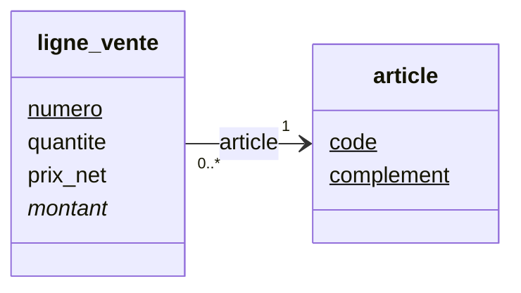
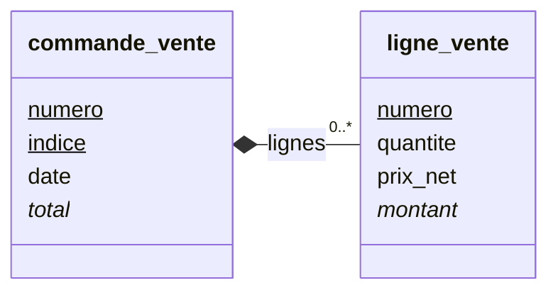
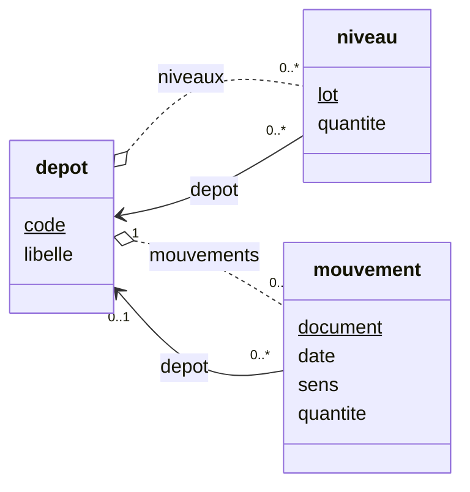
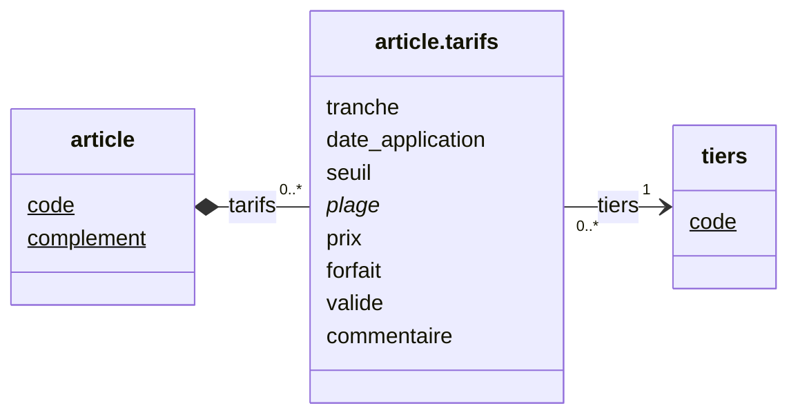
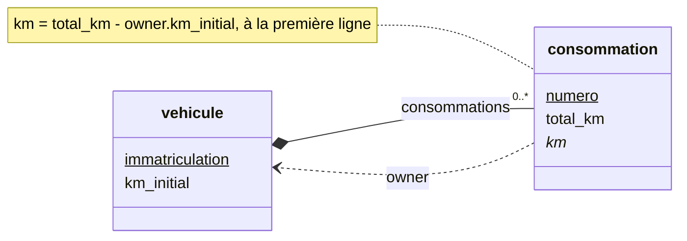
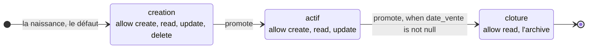

# Les collections, les liens, les générés

Un champ ne porte pas toujours une seule valeur. Il peut porter une
liste, une plage, ou pointer vers d'autres enregistrements. Il peut
aussi être produit par Syncytium : un numéro, un calcul, un statut. Ce
fichier décrit ces types ; ceux qu'un hook ajoute sont dans
[les hooks du modèle](08-hooks.md).

## Le sommaire

- [Les collections et les plages](#les-collections-et-les-plages)
  - [`list of <type simple>`, la liste](#list-of-type-simple-la-liste)
  - [`range of <type>`, la plage](#range-of-type-la-plage)
- [Les liens](#les-liens)
  - [La référence, `<module>.<entité>`](#la-référence-moduleentité)
  - [La composition, `list of <entité>`](#la-composition-list-of-entité)
  - [L'association, `association with <entité>[.<champ>]`](#lassociation-association-with-entitéchamp)
  - [L'association dérivée, `association with <entité> if …`](#lassociation-dérivée-association-with-entité-if-)
  - [Le lien n-aire, `list of [a, b]`](#le-lien-n-aire-list-of-a-b)
  - [L'accès montant, `owner`](#laccès-montant-owner)
- [Les générés et le contexte](#les-générés-et-le-contexte)
  - [`counter`, le compteur](#counter-le-compteur)
  - [Le champ calculé, `formula:`](#le-champ-calculé-formula)
  - [Le statut, `states:`](#le-statut-states)
  - [L'entité `context`](#lentité-context)

## Les collections et les plages

> **Une liste** est un champ à plusieurs valeurs du même type,
> `list of phone`. Sur un nom d'entité, elle devient une composition
> ([glossaire](../../glossaire.md)).

### `list of <type simple>`, la liste

« La phrase se lit » : `list of text`, une liste de textes (D296, D362).

- **Les facettes du champ s'appliquent à chaque élément.**
- **Une liste d'énumérés**, avec `values:`, se saisit en multi-sélection.

**La collection est un type** : elle porte ses fonctions d'agrégation en méthodes, et
le langage la combine, l'interroge, l'adresse par la clé (D580). Tout cela est décrit
dans [les collections](../03-langage/03-collections.md).

### `range of <type>`, la plage

Le registre la définit : « la déclinaison de `list of` avec 2
contraintes en nombre et en ordre » (D497, D498).

- **Deux valeurs**, la première inférieure ou égale à la seconde.
- **Le minimum ou le maximum peut manquer** : la plage est ouverte.
- **Les libellés** portent sur trois éléments : min, value, max.
- **La jauge** est un cas particulier de plage.

## Les liens

> **Une référence** pointe vers un enregistrement d'une autre entité.
> **Une composition** est un lien de possession : les enfants naissent,
> vivent et disparaissent avec leur parent. **Une association** est un
> lien souple, sans possession : chacun vit sa vie
> ([glossaire](../../glossaire.md)).

### La référence, `<module>.<entité>`

Le registre le dit : « si le type est le nom d'une entité, c'est une
référence » (D394–D398, D216). Aucun `to:` n'est nécessaire. La ligne
de vente de l'entrepôt référence son article :

```yaml
# L'article de la ligne : une référence vers une entité d'un autre module
article:
  type: technique.article
  required: true
  label: Article
  description: >-
    La référence, résolue par sa clé à la reprise. La désignation de la ligne n'est pas reprise : elle vit dans une
    table de libellés, hors de l'exemple.
```

- **Le filtre** des candidats lit l'origine par `me.`.
- **Le contrôle**, `check:` : `selection`, le défaut, ou `immutable`.
- **L'accès retour** est automatique, par une liste nommée : l'entité
  pointée atteint ceux qui la pointent sans rien déclarer.

La ligne de vente et son article, la cardinalité « 1 » par `required:` :



### La composition, `list of <entité>`

Le parent déclare ce qu'il possède ; l'enfant ne déclare rien (D399,
D400, D420). La commande de vente de l'entrepôt possède ses lignes :

```yaml
# Les lignes : la composition de la commande
lignes:
  type: list of ligne_vente
  label: Lignes
  description: La suppression de la commande les emporte ; la suppression d'un article ne les touche pas.
```

- **L'agrégat est le grain d'écriture** : le parent et ses enfants
  s'écrivent d'un bloc, indivisible.
- **Une entité peut se composer d'elle-même** (D135) : une nomenclature
  dont une ligne est une autre nomenclature. La récursivité est validée
  acyclique ; l'agrégat est l'arbre entier, écrit, supprimé et verrouillé
  d'un bloc.

La commande de vente et ses lignes, le losange plein du côté du parent :



### L'association, `association with <entité>[.<champ>]`

L'association relie librement, entre modules, sans cascade (D400, D401).
Elle reprend les propriétés de la référence : le filtre, `me.`,
`check:`, l'affichage au visage.

- **Le champ de destination** se nomme au point (D761, D762). Par
  défaut, c'est le champ au nom de l'entité ;
  `association with order.billing` lève une ambiguïté.

### L'association dérivée, `association with <entité> if …`

Une vue navigable, jamais stockée, en lecture seule (D405). La vérité
reste la référence. Le dépôt de l'entrepôt atteint ainsi ses niveaux et
ses mouvements :

```yaml
# Les niveaux du dépôt : l'accès retour, en vue dérivée
niveaux:
  type: association with stock.niveau if depot = me
  label: Niveaux
  description: L'accès retour aux niveaux du dépôt, nommé en vue dérivée.
```

Elle admet `sort:` et `group:` ([03-champs.md](03-champs.md)) :

```yaml
# Les mouvements par article : la vue dérivée, groupée par article
mouvements_par_article:
  type: association with stock.mouvement if emplacement = me
  group: [article]
  label: Mouvements par article
  description: >-
    Le second accès aux mouvements, la vue dérivée groupée par article : une cellule par article passé par cet
    emplacement.
```

Le dépôt, ses niveaux et ses mouvements : la référence reste la vérité, la
vue dérivée la remonte :



### Le lien n-aire, `list of [a, b]`

Chaque élément est une combinaison des entités nommées (D402). Chaque
entité nommée a ses propriétés.

- **Une dimension de valeur typée** peut s'ajouter aux entités (D897) :
  `list of [tiers.tiers, tranche: text[1], date_application: date]`, le
  temps en dimension.
- **La cellule porte ses champs**, calculés compris (D403) : en bloc sous
  `fields:` quand elle s'enrichit (D898), entre accolades au cas court.

Le dépôt de l'entrepôt contrôle son stock par une matrice emplacement ×
article :

```yaml
# Le contrôle du stock : une matrice emplacement × article, calculée par cellule
controle_stock:
  type: 'list of [emplacement: stock.emplacement, article: technique.article]'
  formula: 'mouvements.group(emplacement, article).sum(sens.select(entree: quantite, sortie: -quantite))'
  label: Contrôle du stock par les mouvements
  description: >-
    La matrice emplacement × article : la somme des quantités entrées moins les sorties, évaluée par cellule —
    group(emplacement, article) fait une cellule par couple présent dans les mouvements. La quantité est signée par
    le sens, dans l'unité de stock de l'article ; le tableau de bord la compare aux niveaux.
```

La grille tarifaire de l'article, une structure interne : ses dimensions et
les champs de la cellule en lignes, l'entité nommée en lien :



### L'accès montant, `owner`

`owner` désigne le possesseur d'une composition ; il est unique (D760,
D761). Un associé s'atteint par son champ de référence. La consommation
du véhicule lit ainsi le kilométrage initial de son véhicule,
`owner.km_initial`.

La consommation remonte à son véhicule par `owner`, le sens inverse de la
composition :



## Les générés et le contexte

> **Un compteur** est un numéroteur automatique : jamais deux fois le
> même numéro. **Un champ calculé** a une valeur déduite d'une
> expression ; l'utilisateur ne la modifie pas
> ([glossaire](../../glossaire.md)).

### `counter`, le compteur

Le compteur est attaché à son champ, ou **mutualisé** par son nom,
`counter[mon_compteur]` (D154, D155, D297, D409, D410).

```yaml
# Le numéro de la commande : un compteur au format à six chiffres
numero:
  type: counter
  format: "{counter:000000}"
  label: Numéro
  description: Un compteur — le type est déclaré, la reprise écrit la valeur.
```

- **La réinitialisation** se déclare, `reset:` ; `never` par défaut.
- **Il est en lecture seule partout** ; en création, il s'affiche
  « *(attribué à la validation)* ».
- **La continuité** est le contrôle porté par la propriété du compteur :
  il identifie les trous (D154).
- **La migration le surcharge** (D883) : la valeur reprise entre telle
  quelle. La méthode `update(valeur)` du type, dans les `operations:` de
  la règle, positionne le compteur courant sur la plus grande valeur
  (D999) : `commande_vente.numero.update(numero)`. Le compteur mutualisé
  se nomme au crochet, `counter[mon_compteur].update(valeur)` (D1555).
- **Le rejeu** retrouve l'enregistrement par son identité, jamais par une
  nouvelle allocation (D930).
- **Dans une identité**, le compteur fait une identité acquise (D1171,
  [02-entite.md](02-entite.md)) : le champ n'est pas obligatoire, et l'identité
  ne vaut qu'une fois le compteur attribué.

### Le champ calculé, `formula:`

Une expression du langage (D255, D298). Le champ est en lecture seule et
se recalcule dès qu'une dépendance change. Son composant est celui de
son type de résultat. Les valeurs nommées d'une fonction se lient au
point (D593).

### Le statut, `states:`

`states:` désigne le porteur du cycle de vie : le champ énuméré, ou la
hiérarchie d'héritage (D353, D421–D427). Il porte le graphe des
passages, `promote:` et `demote:`. Une entité a un seul statut.

Le statut du véhicule, trois états et deux passages, le second au cliquet
(D422, D425–D427) :



### L'entité `context`

Le moteur, en lecture seule (D254, D588–D591). Ses parties :

- `user`, l'utilisateur, traversable ;
- `location`, `now` ;
- `instance`, `application`, `module` ;
- `entity`, `field` ;
- `file`, `page`, `pages`, au document ;
- `settings.<nom>`, les paramètres statiques et dynamiques, en cascade.

Une entité de l'application nommée `context` prend le pas ; l'ingestion
le signale par un avertissement.
