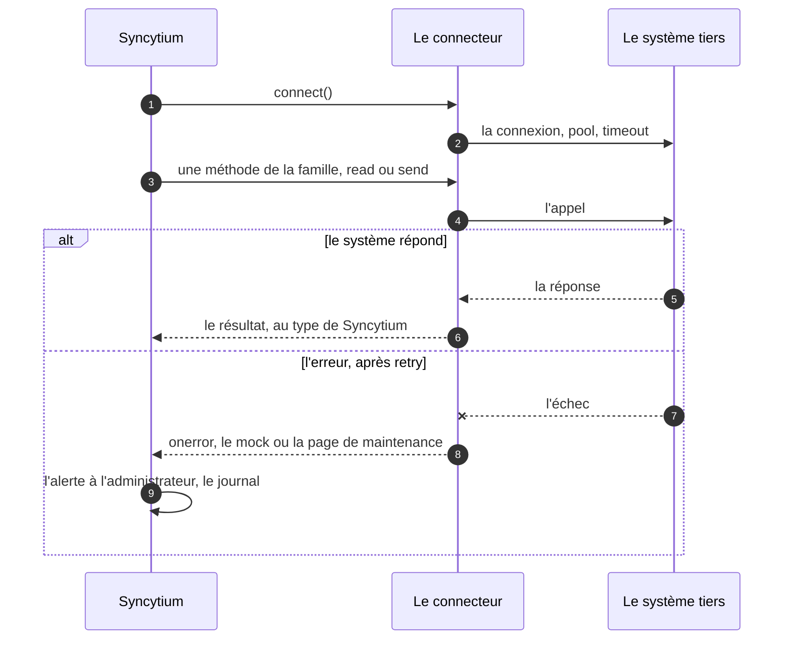

# Le socle commun

Avant les familles et leurs contrats, un connecteur est d'abord un
connecteur. Ce fichier dit ce que toute classe implémente et porte :
les méthodes que le moteur appelle, les propriétés que tout connecteur
accepte, et ce qui se passe quand il tombe.

## Le sommaire

- [Les méthodes](#les-méthodes)
- [Les propriétés](#les-propriétés)
- [La position de sécurité](#la-position-de-sécurité)

## Les méthodes

> **Le socle commun** est ce que toute classe de connecteur implémente et
> porte, quelle que soit sa famille : sept méthodes, des propriétés
> minimales, une position de sécurité ([glossaire](../../glossaire.md)).

Toute classe implémente sept méthodes (D621, D627, D630) :

- **`initialize()` et `release()`**, au démarrage et à l'arrêt de
  l'application ;
- **`connect()` et `disconnect()`**, à l'appel du connecteur ;
- **`ping()`**, la santé : la méthode rend un statut, `error`,
  `initialized`, `disconnected`, `connected`, `closed` ; `every:` fixe sa
  fréquence ; le tableau de bord de la santé le lit (D731) ;
- **`onerror()`**, la défaillance : la méthode rend un mock de résultat
  pour un connecteur non critique, ou appelle la page de maintenance
  pour un connecteur clé (D627) ; c'est l'écho du repli des hooks
  (D68) ;
- **`describe()`**, la documentation du connecteur, pour la documentation
  de l'instance (D630) ; c'est la règle de tous les hooks (D645) ; pour
  le storage, `describe(model)` rend le modèle tel qu'il est stocké
  (D1299).

## Les propriétés

Tout connecteur porte les mêmes propriétés (D621–D627, D1712). Un cas
n'écrit que ce qu'il surcharge. Leurs défauts sont à l'inventaire du
chapitre 1, [les défauts du socle](../01-configuration/05-defauts.md), en
proposition jusqu'à l'implémentation.

- **`connection: permanent | on_demand | idle[15min]`**, la connexion
  permanente, à l'appel, ou fermée au laps d'inactivité (D621). Le
  défaut est `on_demand`.
- **`pool:`**, le nombre de connexions, le parallélisme des opérations
  asynchrones (D622, D436). Le défaut est 1.
- **`retry:` et `timeout:`**, la reprise sur erreur (D625). Les défauts
  sont aucune relance et un délai par famille. Ce `retry` n'est pas la
  reprise de données (D175).
- **`onerror: maintenance | mock`**, la page de maintenance pour un
  connecteur clé, le mock de résultat pour un connecteur non critique
  (D627). Le défaut est `maintenance` pour le storage du modèle, le
  `smtp` et l'`authentication`, `mock` pour les autres. Un connecteur
  est clé quand son `onerror` vaut `maintenance`.
- **`every:`**, le rythme, la fréquence du `ping()` (D604, D621).
- **`rgpd: { countries: [FR] }`**, le ou les pays du stockage ou de la
  destination, une liste (D1345), pour le registre des traitements : le
  lieu du storage, les transferts hors Union des connecteurs sortants
  (D1328).

Ces propriétés sont minimales : « un connecteur peut compter plus de
propriétés et cela dépendra de leur implémentation » (D1713). Une classe
ajoute les siennes : la carte `entities:` d'un storage de format, la
`convention:` de nommage d'un storage de reprise, les paramètres
qu'elle expose (D1711).

## La position de sécurité

En cas d'erreur, « il faut passer sur une page de maintenance et une
alerte doit être émise » (D626). La page de maintenance est l'affaire
des connecteurs clés, le mock celle des autres (D627).

La condition indispensable (D626) : « l'application doit démarrer
uniquement si l'envoi de mail à l'administrateur est possible ». Le
canal d'alerte passe avant tout ; le `smtp` est vérifié au démarrage.
Le `smtp` de classe `none` satisfait la condition : le canal existe,
muet, assumé (D763).

Un appel, et la position de sécurité quand il échoue (D620–D627) :

