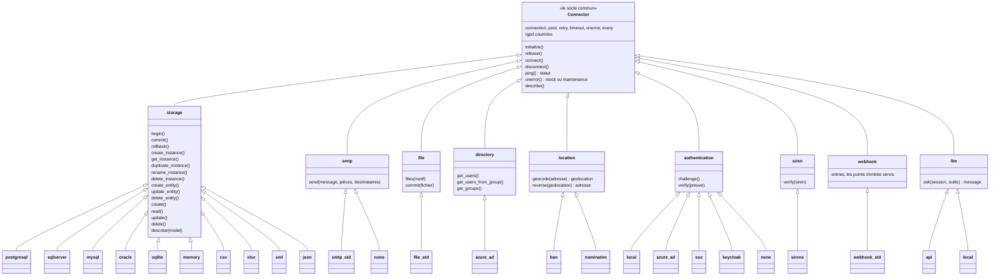

# Les connecteurs

> **Un connecteur** est une passerelle entre Syncytium et un système
> tiers : une base de données, un annuaire, des fichiers, un géocodeur,
> un serveur de mail. Il est déclaré à l'environnement, il décrit ses
> entrants et ses sortants, et sa famille est son contrat
> ([glossaire](../../glossaire.md)).

Une application Syncytium ne vit pas seule. Elle stocke ses données,
envoie des mails, lit des fichiers, authentifie ses utilisateurs,
géocode des adresses. Chaque échange avec l'extérieur passe par un
connecteur. Ce chapitre dit ce qu'est un connecteur, comment il se
déclare, ce que toute classe implémente, les neuf familles et leurs
contrats, le hook qui en ajoute une classe, et ce que le connecteur
livre à la documentation. Les décisions citées entre parenthèses
renvoient au [registre](../../conception.md).

## Le sommaire

1. Le connecteur
   - [Le diagramme — `Connector`, les familles, les classes (D1715–D1717)](#le-diagramme--connector-les-familles-les-classes-d1715d1717)
   - [La nature](#la-nature)
2. [La déclaration et le câblage](declaration.md)
   - [La déclaration — `environments/<env>/connectors.yml`](declaration.md#la-déclaration--environmentsenvconnectorsyml)
   - [Le câblage — le socle par le nom, le hook par `uses:`](declaration.md#le-câblage--le-socle-par-le-nom-le-hook-par-uses)
   - [Les renvois — les déclencheurs et la migration](declaration.md#les-renvois--les-déclencheurs-et-la-migration)
3. [Le socle commun](socle.md)
   - [Les méthodes (D621, D627, D630)](socle.md#les-méthodes-d621-d627-d630)
   - [Les propriétés (D621–D627, D1712, D1713)](socle.md#les-propriétés-d621d627-d1712-d1713)
   - [La position de sécurité (D625–D627)](socle.md#la-position-de-sécurité-d625d627)
4. [Les neuf familles](familles.md)
   - [Les familles et le catalogue des classes (D604, D623, D692, D957)](familles.md#les-familles-et-le-catalogue-des-classes-d604-d623-d692-d957)
   - [`storage`](familles.md#storage)
   - [`smtp` (D628)](familles.md#smtp-d628)
   - [`directory` (D633)](familles.md#directory-d633)
   - [`file` (D634–D635, D972–D973)](familles.md#file-d634d635-d972d973)
   - [`location` (D637)](familles.md#location-d637)
   - [`authentication` (D692)](familles.md#authentication-d692)
   - [`siren` (D639)](familles.md#siren-d639)
   - [`webhook` (D640–D641)](familles.md#webhook-d640d641)
   - [`llm` (D957)](familles.md#llm-d957)
5. [Le storage](storage.md)
   - [Les quatre énoncés (D1294–D1297)](storage.md#les-quatre-énoncés-d1294d1297)
   - [Le contrat (D629, D680–D689)](storage.md#le-contrat-d629-d680d689)
   - [La facette des types (D876)](storage.md#la-facette-des-types-d876)
   - [La conversion au type (D681–D684)](storage.md#la-conversion-au-type-d681d684)
   - [La migration à chaud et l'orchestration (D631, D674, D686–D687)](storage.md#la-migration-à-chaud-et-lorchestration-d631-d674-d686d687)
   - [Les storages de format (D636)](storage.md#les-storages-de-format-d636)
6. [Le hook de connecteur](hooks.md)
   - [Une classe dans une famille (D603–D642)](hooks.md#une-classe-dans-une-famille-d603d642)
   - [La déclaration](hooks.md#la-déclaration)
7. [Ce que le connecteur livre à la documentation](documentation.md)
   - [La facette du connecteur (D1158–D1159)](documentation.md#la-facette-du-connecteur-d1158d1159)
   - [Le `describe(model)` du storage (D1292, D1299, D1300, D1722)](documentation.md#le-describemodel-du-storage-d1292-d1299-d1300-d1722)
8. [Les décisions](#les-décisions)

## Le diagramme — `Connector`, les familles, les classes (D1715–D1717)

Trois notions, à ne pas confondre : **le connecteur**, déclaré à
l'environnement par son nom, qui nomme sa famille par `type:` et sa
classe par `class:` ; **la famille**, le contrat ; **la classe**,
l'implémentation qui remplit ce contrat. L'arbre a une racine,
`Connector`, le socle commun de tout connecteur : ses méthodes et ses
propriétés minimales (D621–D627, D1712, D1713). **Les familles sont
définies par le socle lui-même** (D619, D1716) : « il ne sera pas
possible pour le concepteur d'ajouter une nouvelle famille, sauf à
faire évoluer le socle lui-même ». Chaque famille hérite de `Connector`
et ajoute ses méthodes ; chaque classe hérite de sa famille et expose
ses paramètres et ses propriétés spécifiques (D1711). Le concepteur
ajoute une classe à une famille, par un hook de connecteur, jamais une
famille.

Les spécificités d'une classe se lisent à sa déclaration : la carte
`entities:` et les entêtes d'un storage de format (D828, D845), la
`convention:` de nommage d'un storage de reprise, les paramètres que
chaque classe expose (D1711). Le reste de ce document détaille la
déclaration, le câblage, le socle et le contrat de chaque famille.

## La nature

Un connecteur est une passerelle entre Syncytium et un système tiers
(D79) : une base de données, un annuaire, des fichiers, un géocodeur, un
serveur de mail. Il décrit ses entrants et ses sortants (D606). Cinq
traits le définissent.

- **Il est global** (D603). Un connecteur ne se décline ni par module ni
  par entité. Toute l'application le partage.
- **Il est déclaré à l'environnement** (D616, D617). Chaque environnement
  a ses propres connecteurs : le staging les siens, la production les
  siens. L'ingestion vérifie que chaque environnement les décrit tous.
- **Il est sans contexte** (D603). Ses paramètres sont ses propriétés,
  fixées au démarrage de l'application. Il est hors de la pile des
  contextes (D553), l'exception assumée.
- **Sa famille est son contrat, sa classe l'implémente** (D605, D613).
  `type:` nomme la famille, `storage`, `smtp`, `location` ; chaque
  famille a ses propres méthodes. `class:` nomme l'implémentation,
  `postgresql`, `ban`, `smtp_std` ; la compatibilité se juge à la
  famille.
- **Le stockage est un connecteur** (D606). Les entités sont liées à un
  connecteur de base de données : le storage porte l'instance, pas
  seulement l'échange.

Quelques connecteurs suffisent au bon fonctionnement d'une application
(D612) : la banque en déclare quatre, l'entrepôt sept.

## Les décisions

Ce chapitre repose sur les décisions de la famille « les connecteurs »,
relues le 02/11/2026 (D1707–D1729). Elles sont 76 au registre :
D29, D79, D108–D110, D218, D603–D605, D611–D612, D616–D617, D621, D626–D629, D633, D635–D637, D639, D641, D680, D686, D716, D721, D723, D733, D763, D829, D836, D845, D876, D883, D901, D911, D914, D945, D973, D1093, D1260, D1292–D1296, D1298, D1300, D1309, D1345, D1507–D1508, D1708–D1729. Chacune se lit dans [le registre](../../conception.md).
