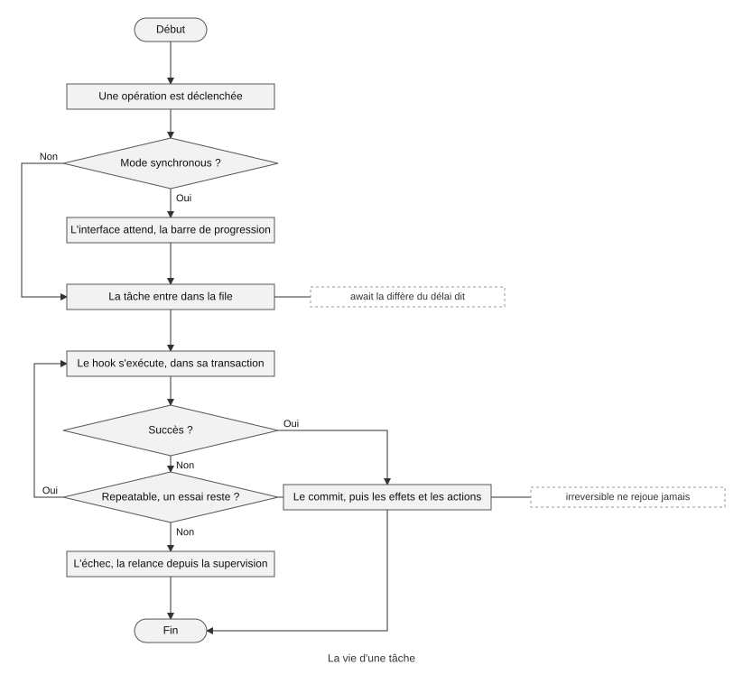

# Les tâches

Une opération déclarée une fois donne mille tâches. Ce fichier dit ce
qu'est une tâche, la file qui la porte, son mode, son exécution et ses
essais, ses droits et sa relance ; la supervision est au chapitre 10.

## Le sommaire

- [La file](#la-file)
- [Le mode](#le-mode)
- [L'exécution](#lexécution)
- [Les droits et la relance](#les-droits-et-la-relance)
- [La supervision](#la-supervision)

## La file

> **Une tâche** est l'exécution d'une opération, suite à un
> déclencheur. Toute exécution passe par la file, non bloquante, avec
> son état, sa progression et son résultat, retenu une durée réglée
> ([glossaire](../../glossaire.md)).

Une opération se déclare une fois ; chacune de ses exécutions est une
tâche (D1748). Toutes les tâches passent par la file, qui borne la
concurrence (D54, D55). Une tâche a un état, une progression, un
compteur, un total et un message, et un résultat enregistré, que le
déclencheur consulte pendant la durée `retention:`, dont le défaut est
un paramètre d'administration, `operation.retention`, quatre-vingt-dix
jours (D906). L'API déclenche une tâche et suit son avancée, le 202 et
sa ressource de suivi, au chapitre 13 (D24).

## Le mode

`mode:` dit comment l'interface vit la tâche (D436) :

- **`synchronous`**, le défaut : l'interface se met en pause avec une
  barre de progression ; la tâche passe par la file comme les autres,
  le synchrone est une posture de l'écran, pas un chemin séparé (D54) ;
- **`asynchronous`** : la tâche est enregistrée, l'utilisateur continue,
  le résultat l'attend ;
- **`await[+3h]`**, **`await[+2d at 08:00]`** : la tâche est différée du
  délai dit.

## L'exécution

`execution:` est une propriété du contrat du hook, pas de la
déclaration (D1743, D1744) :

- **`once`**, le défaut : un seul essai, `try: 1`, `delay: 0` ; en
  échec, la relance est manuelle (D57) ;
- **`repeatable`** : la tâche peut être rejouée ; `try:` le nombre
  d'essais, `delay:` le délai entre deux essais, en millisecondes ou en
  secondes ;
- **`irreversible`** : les effets ne se défont pas, un mail parti ne se
  rappelle pas ; aucun rejeu, la relance manuelle depuis la supervision.

La vie d'une tâche, du déclenchement à l'issue : le mode, la file, l'exécution, le
rejeu ou la relance (D54, D55, D57, D436, D1743, D1744).

`rollback` défait la transaction, jamais les effets (D1744). Le
déterminisme est au contrat aussi : une opération `deterministic`
rend, dans sa fenêtre, le résultat mémorisé d'un appel identique
(D59, D905) ; [le hook d'opération](07-hooks.md) le détaille.

## Les droits et la relance

Qui déclenche est dit par `allow:` et le plancher du contrat (D53,
D700). Le déclencheur lit le résultat. L'opération s'exécute avec les
droits de son contrat, non ceux de l'utilisateur : une élévation
contrôlée (D53).

La relance suit la nature de la tâche (D88) : le déclencheur relance une
opération `repeatable` en échec terminal ; l'administrateur relance
tout, depuis la supervision. Les effets `webhook` et les `actions` sont
des tâches ; leur anomalie est tracée et notifiée au déclencheur par son
canal, in-app depuis l'interface, webhook depuis l'API (D87).

Par l'API, une opération ne se rejoue pas dans sa fenêtre de
`cooldown:` : une exécution par période, mesurée de la fin de
l'exécution au début de l'appel suivant, le rappel refusé et journalisé
(D43, D58, D904) ; le défaut est le paramètre d'administration
`operation.cooldown`, une minute.

## La supervision

La file et ses contrôles globaux, tout annuler, tout mettre en pause,
tout relancer (D61) ; la supervision des tâches, annuler, reporter,
reprioriser, le journal des exécutions (D56) ; l'audit de chaque action
de supervision, avec son motif (D62) : tout cela est au chapitre 10,
l'administration (D1689, D1758).
