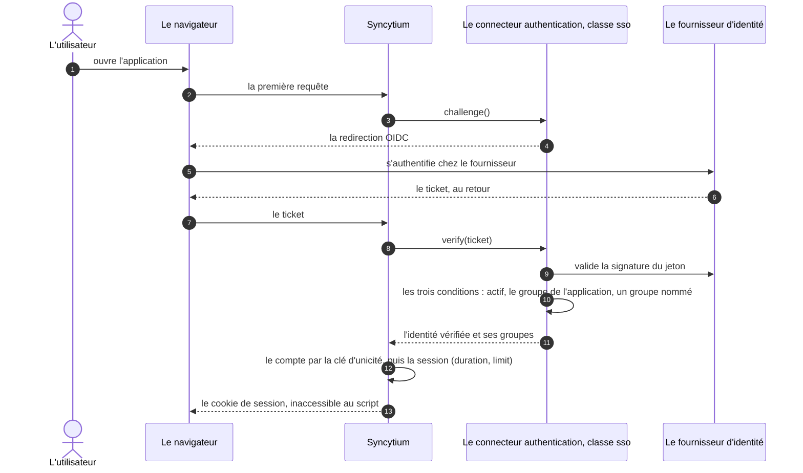
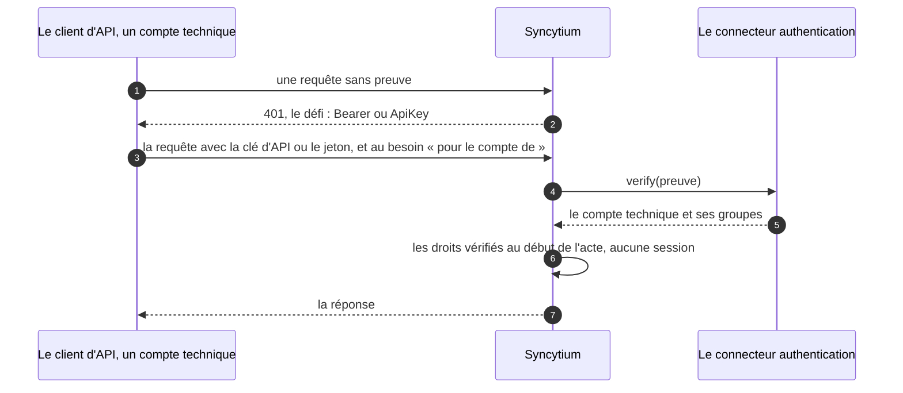

# L'identité et l'entrée

> **L'entrée** est le passage d'un utilisateur dans l'application : le
> connecteur d'authentification vérifie qui il est et ses groupes, le
> moteur ouvre une session de l'interface ; l'API n'a pas de session,
> chaque requête porte sa preuve ([glossaire](../../glossaire.md)).

Avant de voir une donnée ou d'agir, un utilisateur entre. Ce fichier dit
ce qu'est un compte et son identité, ce que fait le connecteur
d'authentification, ce qu'est la session de l'interface, comment l'API
prouve qui l'appelle, et comment un webhook est gardé. Les décisions
citées entre parenthèses renvoient au [registre](../../conception.md).

## Le sommaire

- [Les comptes et l'identité](#les-comptes-et-lidentité)
- [L'authentification](#lauthentification)
- [La session](#la-session)
- [L'API au porteur](#lapi-au-porteur)
- [La garde du webhook](#la-garde-du-webhook)

## Les comptes et l'identité

Un compte est l'un de quatre types, et chaque type a son canal : la
compromission d'un canal n'ouvre pas l'autre (D28, D77).

- **Le compte technique** appelle l'API ; il a ses groupes, donc son
  périmètre, et sa version d'API épinglée (D98).
- **L'utilisateur interne** travaille dans l'interface, par ses groupes.
- **Le client provisionné** naît d'une fiche client ; il suit sa fiche,
  désactivée, il l'est aussi.
- **Le client auto-créé**, vérifié par les ventes, est une variante du
  précédent, non prioritaire.

L'identité d'un compte est un UUID interne, stable, jamais exposé : il
est l'ancre de l'appartenance, de l'audit, des références (D82, D142,
D75). Le rapprochement d'une identité externe vers ce UUID se fait par
**la clé d'unicité**, que le connecteur d'authentification définit : le
GUID Entra en priorité, parce qu'il ne change pas ; le courriel en repli,
qui peut changer ; le login en local (D82). Changer d'adresse ou
fusionner un doublon sont des opérations d'administration (D721, D722),
au chapitre 10, comme l'entité système `user` qui porte les comptes
(D719).

## L'authentification

L'authentification est un connecteur, de la famille `authentication`
(D692). Son contrat a deux gestes, `challenge()`, le défi, et
`verify(preuve)`, la vérification, et deux visages, l'utilisateur
interactif et l'API. Tous les chemins finissent en une identité vérifiée,
rapprochée du compte par la clé d'unicité. Les cinq classes du socle,
`local`, `azure_ad`, `sso`, `keycloak`, `none`, sont décrites au
chapitre 5 ([les familles](../05-connecteurs/04-familles.md), D716,
D759). Ce que la sécurité en retient :

- **la nature de l'authentification se choisit à l'installation**, derrière
  le connecteur, et seul un administrateur la change (D29, D32, D78) ;
- **une seule source active** : pas de mode mixte ; changer de source
  exige une authentification de test réussie contre la nouvelle, l'échec
  laisse l'ancienne (D80) ;
- **le compte nominatif naît au premier login** ; les groupes arrivent
  dans le jeton à chaque connexion, et un retrait dans l'annuaire prend
  effet à la connexion suivante (D30, D31) ; l'association des groupes
  est dans [les groupes](02-groupes.md) ;
- **l'annuaire est en lecture seule** : le connecteur `directory`
  synchronise les comptes, jamais l'inverse ; les comptes synchronisés ne
  se modifient pas dans Syncytium, sauf la désignation individuelle, les
  modules et le statut (D633, D713) ;
- **chaque classe porte les réglages de la session** qu'elle sait tenir,
  en paramètres à l'environnement (D1801, D1805) ; ils sont décrits
  ci-dessous.

L'entrepôt se connecte par Microsoft 365 :

```yaml
# L'authentification
# Microsoft 365 : les utilisateurs se connectent avec leur compte de l'entreprise ; l'affectation aux groupes reste un
# acte d'administration.
authentication:
  class: azure_ad
  parameters:
    tenant: ${AZURE_TENANT}
    client_id: ${AZURE_CLIENT_ID}
    client_secret*: ${AZURE_CLIENT_SECRET}
```

Le véhicule, sur un seul poste informatique, ne demande rien : la classe
`none`, aucun défi, aucun secret ; l'utilisateur par défaut appartient
aux groupes déclarés, au degré `administrator` (D759, D1208) :

```yaml
# L'authentification
# Pas de secrets dans la famille : aucune.
authentication:
  class: none
```

La séquence d'une entrée par le SSO, du premier clic au cookie de
session :



L'utilisateur ne confie jamais son secret à Syncytium ; les trois
conditions de l'entrée sont contrôlées par le connecteur, non par le socle
(D1792, D1793) ; le socle reçoit une identité vérifiée et ses groupes,
rapproche le compte par la clé d'unicité (D82) et ouvre la session dans un
cookie (D917).

Deux choses ne sont pas ici. Le secours, quand l'authentification
manque, l'amorçage, le bris de glace, le mode safe (D33, D81, D718,
D745), est au chapitre 9, le moteur. Le quotidien du compte local,
l'invitation, le mot de passe oublié, le renouvellement, le verrouillage
(D720, D721, D722, D723), est au chapitre 10, l'administration.

## La session

> **La session** est le temps pendant lequel un utilisateur connecté
> agit sans se ré-authentifier. Elle ne fige jamais des droits
> ([glossaire](../../glossaire.md)).

Deux bornes règlent la session (D693) :

- `duration`, l'inactivité au glissement : chaque action renouvelle le
  délai, le délai passé déconnecte ; huit heures par défaut ;
- `limit`, la borne absolue : la ré-authentification est obligatoire ;
  sept jours par défaut ; en SSO, la borne du fournisseur d'identité
  prime si elle est plus courte.

Ces bornes, avec le verrouillage et l'invitation du compte local, sont
des paramètres du connecteur d'authentification, à l'environnement ;
chaque classe déclare les siens, `local` tous, `sso` et `azure_ad` les
deux bornes, `none` aucun (D1801, D1805). Trois règles les complètent :

- **les sessions simultanées sont libres** ; l'administrateur voit les
  sessions d'un compte et peut les révoquer ; la déconnexion manuelle est
  toujours possible (D15) ;
- **la session ne fige jamais des droits** : ils se vérifient au début de
  chaque opération ou sollicitation, l'acte entamé s'achevant sous les
  droits de son départ, dans sa transaction (D694, D594) ; un cache de
  droits, invalidé à chaque modification par les interfaces
  d'administration, tient la latence (D341) ;
- **la session de l'interface voyage dans un cookie** inaccessible au
  script, sécurisé, restreint au site, jamais dans le stockage du
  navigateur (D917).

## L'API au porteur

L'API n'a pas de session : chaque requête porte sa preuve, la clé d'API
ou le jeton, et le 401 est le défi (D692). Quatre règles (D917, D107,
D1803, D1805) :

- **le porteur seul, jamais le cookie** : une page tierce ne peut faire
  porter la session de l'utilisateur à une requête d'API ; la
  falsification de requête inter-sites est fermée par construction ;
- **la clé d'API est rotative** par défaut, deux clés actives pendant la
  rotation ; les jetons des comptes techniques sont créés et révoqués par
  l'administration ;
- **le « pour le compte de »** est un paramètre de chaque appel, un
  en-tête dédié : une délégation bornée au périmètre du sujet, chaque
  appel attribuable (D76) ;
- **le compte technique est aux groupes** comme les autres ; sans
  groupe, il est un `reader` (D746, D1793).

Les réglages des API, la clé, sa rotation, le rate limiting, se
définissent aux settings, dans le bloc `application:`, sous une clé
`api:` en proposition (D1805). Les en-têtes, le 401, le 426 sous la
version minimale, la bêta sur sollicitation, la pagination au curseur,
le rate limiting et la rotation du côté du technicien sont au chapitre
13, les API (D94, D98, D100, D103, D105). Ce que le moteur sert au
navigateur, HTTPS, les origines autorisées, l'injection de script, est
au chapitre 9 (D918, D919).

La séquence d'un accès par l'API, sans session :



Chaque requête porte sa preuve (D692) ; le porteur seul, jamais le cookie
(D917) ; le « pour le compte de » est un paramètre de l'appel (D1803) ; les
droits se vérifient à chaque acte (D694).

## La garde du webhook

Un webhook est une entrée : une route que l'application sert à un
système tiers. Aucune entrée anonyme : la garde est d'office sur la
route, et elle appelle le même `verify` que l'authentification (D640,
D641, D642). La famille `webhook` est au chapitre 5
([les familles](../05-connecteurs/04-familles.md)).
