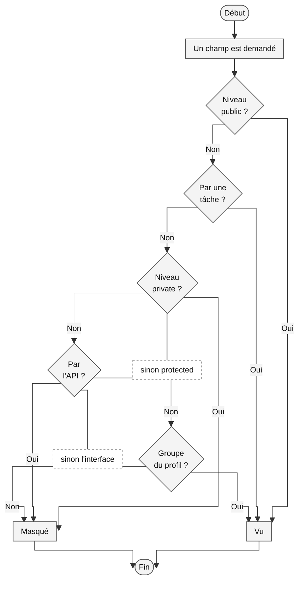

# La confidentialité

> **La confidentialité** est le niveau d'exposition d'une donnée :
> `public`, partout ; `protected`, l'interface et les tâches ; `private`,
> les tâches seulement. Elle se resserre par groupes
> ([glossaire](../../glossaire.md)).

Qui voit quelle donnée : la confidentialité répond au champ, pour chaque
canal et pour chaque groupe. Ce fichier dit les trois niveaux, le second
axe, les groupes, les profils et les trois écritures, l'héritage des
champs calculés et de l'historique, et tout ce qui suit la confidentialité
quand la donnée sort. L'écriture de la facette au champ est au chapitre 2
([les types](../02-modele/05-types.md), D1800). Les décisions citées
entre parenthèses renvoient au [registre](../../conception.md).

## Le sommaire

- [Les trois niveaux](#les-trois-niveaux)
- [Le second axe, les groupes](#le-second-axe-les-groupes)
- [Les profils et les trois écritures](#les-profils-et-les-trois-écritures)
- [L'héritage et l'historique](#lhéritage-et-lhistorique)
- [Partout où la donnée sort](#partout-où-la-donnée-sort)

## Les trois niveaux

Un champ a un niveau de confidentialité, `public` par défaut (D25).
Les trois niveaux sont emboîtés : ce que l'API voit, l'interface le voit,
et ce que l'interface voit, les tâches le voient.

- `public` : l'API, l'interface et les tâches ;
- `protected` : l'interface et les tâches, jamais l'API ;
- `private` : les tâches seulement ; la donnée ne quitte le serveur que
  par une tâche déclarée, le bulletin qui incorpore le salaire.

Changer le niveau d'un champ est une migration de contrat pour l'API :
passer de `public` à `protected` est une suppression pour elle, et le
mécanisme de dépréciation s'applique (D13).

## Le second axe, les groupes

Le niveau dit quel canal voit ; les groupes disent qui voit (D26, D27).
Les deux se composent au champ : un champ `protected` ouvert aux achats
et à la direction n'est vu que par l'interface et les tâches, et, dans
l'interface, que par les membres de ces deux groupes (D364). Un membre
d'un groupe contenant voit ce que voient ses constituants
([les groupes](02-groupes.md), D1099).

Les conditions, dans l'ordre où elles jouent, sur les champs de l'entrepôt :



Le niveau d'abord, le canal ensuite, les groupes enfin (D25, D26, D364).

## Les profils et les trois écritures

Le niveau et les groupes s'écrivent une fois, dans un profil nommé, à la
racine du projet, dans `syncytium.yml` (D885, D1536). L'entrepôt en
déclare trois :

```yaml
# Les profils de confidentialité
# Un niveau et les groupes qui voient le champ, nommés une fois et référencés au champ ; chaque profil porte son
# niveau (level) et ses groupes (groups) : confidentiality: financier.
confidentiality:

  # Le profil financier
  # Les prix de revient, les prix d'achat, les valeurs de stock, le bancaire.
  financier:
    level: protected
    groups: [achats, direction]

  # Le profil de la direction
  # Les marges, les commissions.
  direction:
    level: protected
    groups: [direction]

  # Le profil commercial
  # Les conditions commerciales.
  commercial:
    level: protected
    groups: [commercial, direction]
```

Au champ, `confidentiality:` a trois écritures (D1798, D1800) :

- **le nom d'un profil**, la forme courte recommandée,
  `confidentiality: financier` ;
- **un niveau seul**, `confidentiality: private`, pour un niveau sans
  groupe ;
- **la forme longue**, `confidentiality: { level: , groups: [..] }`,
  pour un cas qu'un profil n'aurait pas à nommer.

Un profil ne porte jamais le nom d'un niveau, `public`, `protected` ou
`private` : la forme courte se lit sans confusion, et un profil ainsi
nommé est une erreur d'ingestion (D1799). Le client de l'entrepôt :

```yaml
  taux_representant:
    type: percentage
    confidentiality: direction
    label: Commission
    hint: Le taux de commission du représentant — réservé à la direction.
```

## L'héritage et l'historique

Un champ calculé hérite du niveau le plus restrictif de ses sources, à
travers les relations et les sources des hooks ; l'abaisser est un acte
explicite, que la validation signale, jamais silencieux (D102). Quand une
entité hérite d'une autre, un champ appartient à un niveau d'héritage et
n'est visible que si l'enregistrement l'a atteint : la même machinerie
(D144).

L'historique d'une entité a sa propre visibilité : les groupes qui le
voient, `visibility:` dans la forme longue d'`history:` ; sans elle, la
visibilité est celle de l'entité (D170, D413). Les champs de
l'historique gardent la confidentialité de l'entité d'origine, et
l'anonymisation s'étend aux instantanés, sinon la donnée fuit par le
passé (D170). L'écriture d'`history:` est au chapitre 2
([la vie d'un enregistrement](../02-modele/04-vie.md)).

## Partout où la donnée sort

La confidentialité suit la donnée hors du champ :

- **les menus** ne montrent que les entrées visibles (D193) ;
- **l'export** n'écrit que les colonnes visibles (D196) ;
- **les widgets** hérités se surchargent sans élargir (Q53) ;
- **la communication** a la confidentialité de son entité (D393) ;
- **les thèmes** sont des objets comme les autres : le choix n'offre que
  le visible (D753) ;
- **le hook d'interface**, le seul code tiers au navigateur, ne reçoit
  jamais `private` (D66, D918) ;
- **les fichiers** appartiennent au moteur et ne sont jamais servis
  directement : tout accès passe par le moteur, sous la confidentialité
  du champ et l'appartenance de la ligne ; les noms sur disque sont
  opaques (D923) ;
- **le dictionnaire de la donnée** montre tout champ avec son niveau,
  seules les clés confidentielles n'y paraissent pas (D1247).
