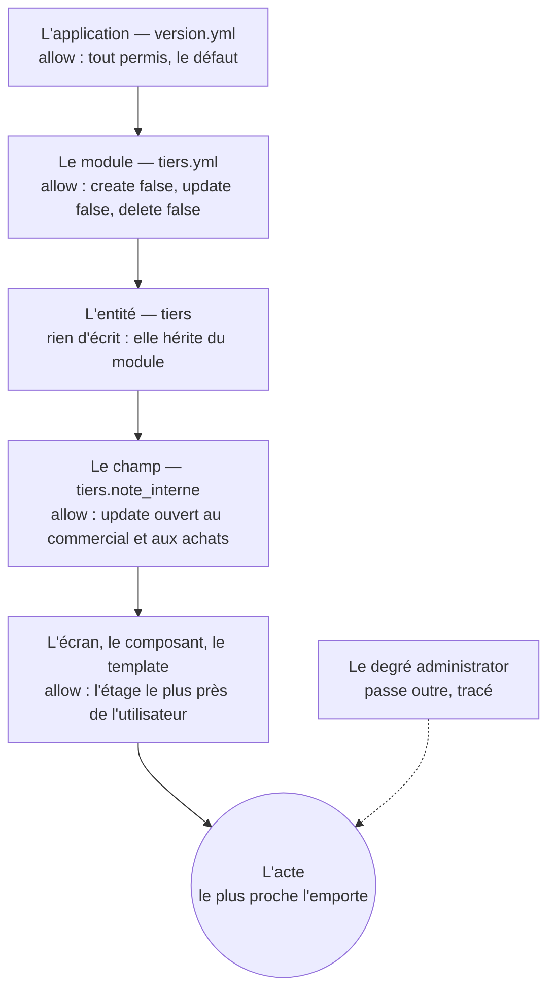

# Les droits d'action

> **Un droit d'action** dit qui peut créer, lire, modifier, supprimer un
> enregistrement, ou déclencher une opération. Il s'écrit `allow:`, une
> règle à trois propriétés, `enable`, `group`, `when`, par état ou en
> bloc libre, à tous les étages ; le plus proche l'emporte
> ([glossaire](../../glossaire.md)).

Qui fait quoi : les droits d'action s'inscrivent au modèle, à côté de la
confidentialité (D196). Ce fichier dit la règle et ses trois écritures,
les deux foyers, ce que l'absence veut dire, les étages et la cascade,
les canaux et le passe-outre de l'administrateur, les opérations, le
passe-droit du statut, le chat sans droit propre. Les décisions citées
entre parenthèses renvoient au [registre](../../conception.md).

## Le sommaire

- [La règle et ses trois écritures](#la-règle-et-ses-trois-écritures)
- [Les deux foyers](#les-deux-foyers)
- [L'absence et le masque](#labsence-et-le-masque)
- [Les étages et la cascade](#les-étages-et-la-cascade)
- [Les canaux et le passe-outre](#les-canaux-et-le-passe-outre)
- [Les opérations](#les-opérations)
- [Le passe-droit du statut](#le-passe-droit-du-statut)
- [Le chat sans droit propre](#le-chat-sans-droit-propre)

## La règle et ses trois écritures

Un droit d'action est une règle à trois propriétés (D1795) :

- `enable`, la règle générale, l'acte est permis ou non ;
- `group`, les groupes qu'elle vise, tous par défaut, `[all]` ;
- `when`, la condition d'activation, une expression du langage.

`allow:` a trois écritures équivalentes, de la plus courte à la plus
complète :

- **la liste des actes permis**, `allow: [create, update, delete]` ;
- **l'acte vers un booléen**, `allow: { create: true, update: true, delete: true }` ;
- **l'acte vers sa règle**, `allow: { create: { enable: true, group: [all], when: true }, … }`.

Les formes courtes d'un acte se lisent dans la règle (D1797) : `false`
vaut `{ enable: false }` ; une expression seule vaut `{ when: … }` ; une
liste de groupes vaut `{ group: [...] }`. Les cas écrivent les formes
courtes.

## Les deux foyers

`allow:` se pose à deux endroits sur une entité, exclusifs l'un de
l'autre : les deux à la fois sont une erreur d'ingestion (D422, D423).

**Par état**, sur le champ qui porte le cycle de vie : chaque valeur
liste les actes permis dans cet état (D422). Le véhicule :

```yaml
statut:
  type: enum
  required: true
  default: creation
  label: Statut
  hint: La vie du véhicule — Création, Actif, Clôture ; la vente clôt sans retour.
  description: >-
    La naissance à la valeur par défaut, l'activation libre, la clôture au cliquet dès que la vente est posée ;
    l'archive ne se réécrit pas.
  values:
    creation:
      label: Création
      allow: [create, read, update, delete]
      promote:
        - to: actif
    actif:
      label: Actif
      allow: [create, read, update]
      promote:
        - to: cloture
          when: date_vente is not null
      description: Le journal s'écrit — create est la création des composants.
    cloture:
      label: Clôture
      allow: [read]
      description: L'archive — la vie ne se réécrit pas.
```

**En bloc libre**, en tête de l'entité, ou à un autre étage : chaque
acte reçoit sa règle (D423). Un module de l'entrepôt :

```yaml
# Les droits
# L'entrepôt est en lecture seule pour ses usagers : le module ferme la création, la modification et la suppression ;
# la reprise écrit par son privilège. Le droit le plus proche l'emporte — l'application, le module, l'entité, le champ.
allow:
  create: false
  update: false
  delete: false
```

## L'absence et le masque

Sans `allow:`, tout est permis. Dans un état, `read` absent masque
l'enregistrement (D422). C'est par là qu'un enregistrement se fige : un
état qui ne permet que `read` rend la fiche intangible, la facture
validée, dont le numéro est une identité acquise (D1171, D1172) ; l'acte
qui promeut passe outre, l'état suivant dit ce qu'il permet.

## Les étages et la cascade

Le bloc libre se déclare à tous les étages (D886, D1796) : l'application,
dans `version.yml` ; le module ; l'entité ; le champ ; l'écran ou un
composant de l'écran ; le template. Le plus proche l'emporte (D359). Le
module dit la règle de ses entités, l'entité la précise si elle diffère,
le champ porte ses propres droits : `update: false` au champ est la
lecture seule, `update: [commercial, achats]` ouvre le champ à ces
groupes quand le module est en lecture seule (D941, D942). L'entrepôt :

```yaml
note_interne:
  type: text[..200]
  default: ""
  unchanged: true
  allow:
    update: [commercial, achats]
  label: Note interne
  hint: Ce que l'entreprise sait du tiers et que l'ERP ne porte pas — libre au commercial et aux achats.
  description: >-
    La reprise ne l'alimente pas et ne la touche pas : le champ naît à son défaut et garde sa valeur. La saisie est
    ouverte aux groupes que le droit du champ nomme, le module restant en lecture seule.
```

La cascade, sur cet exemple :



Les étages du bloc libre, de l'application à l'écran (D886, D1796) ; le
plus proche de l'acte l'emporte (D359) ; le module ferme la modification,
le champ possédé la rouvre à deux groupes (D941, D942) ; l'administrateur
passe outre, toujours tracé (D942).

## Les canaux et le passe-outre

`allow:` s'applique à tous les canaux : l'interface et l'API passent par
un compte, et le même mécanisme joue (D942). Le degré `administrator`
passe outre les `allow:`, l'acte tracé : la migration, opération de ce
degré, écrit dans un module en lecture seule, non parce qu'elle y échappe
mais parce que son degré les passe (D701, D942). Les droits se vérifient
au début de chaque acte, jamais figés par la session (D694).

## Les opérations

Les opérations du socle et les opérations déclarées sont des droits
d'action : le droit de déclencher se déclare et se contrôle comme les
autres (D691). À l'opération, `allow:` ajoute des groupes au plancher du
contrat, et le plus exigeant l'emporte (D700). L'opération autorisée
passe outre les `allow:` d'état, l'acte porte sa légitimité, le
`promote` écrit ce que l'état fige ; on contrôle qui appuie, pas ce que
l'acte écrit (D422). La tâche s'exécute dans sa portée propre : qui
déclenche peut lire le résultat, les lecteurs additionnels se déclarent ;
c'est le chemin officiel par lequel une donnée `private` sort, le
bulletin qui incorpore le salaire, donc une frontière gardée (D53). Les
planchers par degré sont dans [les groupes](02-groupes.md), les fiches au
chapitre 6 ([le catalogue](../06-operations/06-catalogue.md)).

## Le passe-droit du statut

Hors du graphe des états, le changement est refusé (D425). Le degré
`administrator` seul passe outre, toujours tracé, pour les cas très
particuliers et urgents, l'erreur de saisie ou de clic à débloquer sans
déployer une version ; la voie déclarée reste le `demote` (D835).

## Le chat sans droit propre

Le chat du socle ne sait jamais plus que l'utilisateur qui l'interroge :
il n'a aucun droit propre, ses droits sont ceux des composantes de la
description que l'utilisateur voit (D957, D960). Rien de personnel ne
part vers le modèle sans anonymisation, hors les données du profil
connecté ; aucun échange, question ou réponse, sans trace (D958, D959).
La surface est au chapitre 4 ([les surfaces](../04-composants/06-surfaces.md)).
