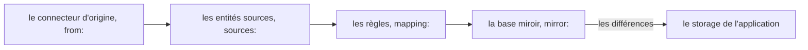

# La migration déclarée

> **Un processus de migration** est une entrée de `migration.yml`. Le
> fichier décrit et nomme les processus. Chacun a un connecteur
> d'origine, et un même connecteur peut apparaître dans plusieurs
> processus. Ils s'exécutent dans l'ordre alphabétique de leurs noms
> ([glossaire](../../glossaire.md)).

Ce fichier dit ce que le concepteur déclare pour une migration : le
processus et ses clés, sa forme courte, ses fichiers et leur ordre, son
mode, sa base miroir, son rythme. Ce qui se passe pendant un passage est
au chapitre 9, le moteur. Les décisions citées entre parenthèses
renvoient au [registre](../../conception.md).

## Le sommaire

- [Le processus](#le-processus)
  - [Ce qu'un processus déclare](#ce-quun-processus-déclare)
  - [Un connecteur d'origine par processus](#un-connecteur-dorigine-par-processus)
  - [L'ordre des processus et l'ordre des sources](#lordre-des-processus-et-lordre-des-sources)
- [La forme courte](#la-forme-courte)
  - [Une ligne pour une reprise un pour un](#une-ligne-pour-une-reprise-un-pour-un)
  - [Le connecteur implicite d'un projet minimal](#le-connecteur-implicite-dun-projet-minimal)
  - [Les règles de la forme courte](#les-règles-de-la-forme-courte)
- [Les fichiers et leur ordre](#les-fichiers-et-leur-ordre)
  - [La référence par motif](#la-référence-par-motif)
  - [L'ordre des étapes](#lordre-des-étapes)
  - [Le rangement par sous-dossier](#le-rangement-par-sous-dossier)
  - [Le versionnement](#le-versionnement)
- [Le mode et la remise à zéro](#le-mode-et-la-remise-à-zéro)
  - [Les deux modes](#les-deux-modes)
  - [La remise à zéro](#la-remise-à-zéro)
- [La base miroir](#la-base-miroir)
- [Le rythme et les opérations](#le-rythme-et-les-opérations)
  - [Le rythme se déclare par des opérations périodiques](#le-rythme-se-déclare-par-des-opérations-périodiques)
  - [`migrate`](#migrate)
  - [`reset_coverage`](#reset_coverage)
  - [`on_running:`](#on_running)

## Le processus

### Ce qu'un processus déclare

Une migration relie trois choses : un connecteur d'origine, la
description de ses entités, et les règles qui portent ses données vers
l'application (D662). Le registre le dit : « Une migration peut faire
converger plusieurs sources vers une seule destination — le `from:` seul
ne suffit pas. » Le concepteur l'écrit dans `migration.yml`, que la
version cite par `migrations:`.



Un processus porte sept clés :

| La clé | Ce qu'elle dit | Sans elle |
|---|---|---|
| `from:` | le connecteur d'origine | la dernière version déployée : c'est une migration de version (D1983) |
| `mode:` | `relative` ou `absolute` | `relative` (D1889) |
| `reset:` | vider les tables cibles avant l'import | `false` (D1889) |
| `sources:` | les fichiers qui décrivent les entités sources | le connecteur se décrit lui-même |
| `mapping:` | les fichiers des règles | le mapping est champ à champ |
| `exchange:` | les règles d'une migration de version (D1981) | aucune |
| `operations:` | le rythme, par des opérations périodiques (D943) | la migration se lance à la demande |

Le processus de l'entrepôt (le cas 5) reprend les données de Cegid PMI :

```yaml
# La migration cegid
# La reprise des données de Cegid PMI dans l'entrepôt ; les migrations d'un fichier s'exécutent dans l'ordre
# alphabétique de leurs noms.
cegid:

  # La base d'origine
  # Le storage de PMI, lu en lecture seule.
  from: cegid

  # Le mode
  # relative : les enregistrements conformes entrent, les autres vont au rapport ; l'entrepôt se met à jour sans être
  # vidé.
  mode: relative

  # La remise à zéro
  # Jamais : les tables de l'entrepôt ne sont pas vidées avant l'import ; l'historique et les champs propres à
  # l'entrepôt tiennent.
  reset: false

  # Les tables sources
  # Vingt-trois tables décrites, une par fichier au nom de la table, rangées par module : quatorze lues, neuf écartées.
  sources:
    - ~{sources/.*/.*\.yml}

  # Les règles
  # Trente-trois règles en cinq dossiers numérotés — les lieux, les tiers, la technique, les commandes, le stock : le
  # numéro du dossier, puis celui du fichier, font l'ordre des étapes. Une règle porte le nom de sa table source : sa
  # description, sa cible (to), son filtre (filter), ses valeurs distinctes (distinct), son possesseur (parent), ses
  # affectations (fields — la formule, ou en forme longue formula, description et message), ses contrôles
  # (validation — rule, description et message), ses opérations de fin (operations) et son rapport (report). Le
  # message est un gabarit : {…} y cite une colonne de la source ou un champ de l'enregistrement construit (me).
  mapping:
    - ~{mapping/[0-9]+_.*/[0-9]+_.*\.yml}
```

### Un connecteur d'origine par processus

Un processus se définit pour un connecteur d'origine, que `from:` nomme
(D1086, D1087, D1888). Il n'en a qu'un. L'inverse n'est pas vrai : un
même connecteur peut apparaître dans plusieurs processus (D2058). Deux
processus d'illustration, en forme courte, reprennent chacun une entité
du même connecteur : `clients: fichier_csv[client]` et
`fournisseurs: fichier_csv[fournisseur]`.

Une application peut lire plusieurs bases d'origine (D1885) : chacune a
son processus, au moins, et `migration.yml` les décrit et les nomme
tous. La clé `sources:` est au pluriel pour une autre raison : un
processus décrit plusieurs entités (D1884).

Une règle peut tout de même appeler un autre connecteur que ce `from:`,
par son nom, dans une formule. Le processus garde une seule origine
(D1961).

Avec une seule source, le nom du processus peut être celui du
connecteur : `cegid` dans l'entrepôt. Un exemple d'illustration, à deux
bases d'origine :

```yaml
# La migration de l'ancien ERP
# Elle s'exécute la première : son nom vient avant l'autre dans l'ordre alphabétique.
legacy_erp:

  # La base d'origine
  from: legacy_db

  # Les entités sources
  sources:
    - ~{legacy_db/sources/.*\.yml}

  # Les règles
  mapping:
    - ~{legacy_db/mapping/.*\.yml}

# La migration de l'ancien CRM
old_crm:

  # La base d'origine
  from: crm_db

  # Les entités sources
  sources:
    - ~{old_crm/sources/.*\.yml}

  # Les règles
  mapping:
    - ~{old_crm/mapping/.*\.yml}
```

### L'ordre des processus et l'ordre des sources

**Les processus s'exécutent dans l'ordre alphabétique de leurs noms**
(D1888). Le concepteur les ordonne selon sa logique, qui ne se déduit pas
des données (D1905). Dans l'exemple, `legacy_erp` passe avant `old_crm`.

**L'ordre des entités sous `sources:` n'a pas d'importance** (D1903).
Syncytium construit le graphe de dépendance des sources :

- la validité du graphe se mesure à la fin de la lecture complète des
  entités sources du processus (D1905) ;
- les références peuvent former des cycles, comme dans une
  nomenclature ;
- le concepteur peut numéroter ses sources pour la lisibilité ;
  Syncytium réordonne les éléments par le graphe (D1904).

La déclaration de `sources:` se lit tout de même comme celle de
`mapping:`, de haut en bas, un motif trié sur le chemin complet de ses
fichiers (D1900, D1902). Cet ordre ne change pas le passage.

## La forme courte

### Une ligne pour une reprise un pour un

Un storage sait se décrire : `get_instance()` rend ses entités et leurs
champs (D1299). Pour un CSV, ce sont les entités de la carte
`entities:`, et la ligne d'entête nomme les colonnes (D829, D845). Cette
description suffit à un mapping champ à champ.

Le processus s'écrit alors en une valeur, le nom du connecteur d'origine
(D1895, D1896). Les trois exemples sont d'illustration :

```yaml
# La migration legacy
# La reprise un pour un : le connecteur se décrit, chaque entité alimente l'entité du modèle de même nom, chaque
# colonne le champ de même nom.
legacy: fichier_csv
```

Cette forme associe toutes les entités du connecteur `fichier_csv` au
storage de l'application. Les crochets nomment la seule entité que le
processus reprend :

```yaml
# La migration legacy
# La reprise de la seule entité client du connecteur.
legacy: fichier_csv[client]
```

Une liste d'entités se note entre les mêmes crochets, séparées par une
virgule (D1897) :

```yaml
# La migration legacy
# La reprise de deux entités du connecteur, client et fournisseur.
legacy: fichier_csv[client, fournisseur]
```

### Le connecteur implicite d'un projet minimal

Dans un projet minimal, le connecteur lui-même ne se déclare pas
(D2001). La forme courte nomme la classe, comme `storage: sqlite` sans
bloc `connectors:`. C'est l'écriture de tiny (le cas 1), sous sa
version :

```yaml
      migrations:
        legacy: csv[personne]
```

- **le fichier** porte le nom de l'entité : `personne.csv` ;
- **son dossier** vient de la variable d'environnement
  `SYNCYTIUM_CSV_DIRECTORY` (D2002) ;
- **son format** par défaut : UTF-8, le point-virgule pour séparateur,
  les entêtes en première ligne (D2002) ;
- **la variable doit être définie** : absente, c'est une erreur de
  démarrage (D2003).

### Les règles de la forme courte

La forme courte est l'écriture courte du bloc qui ne porte que `from:`
(D1898). Six règles la gouvernent (D1896) :

- **les deux absences sont indépendantes** : sans `sources:`, le
  connecteur se décrit ; sans `mapping:`, le mapping est champ à champ.
  Le concepteur écrit `sources:` seul pour apporter une précision, un
  `mask:` par exemple ; le processus s'écrit alors en bloc, et `from:`
  nomme le connecteur ;
- **la conversion** est portée par le type de destination, celui du
  champ dans le modèle ; sans `mask:`, c'est lui qui convertit la valeur
  lue ;
- **la colonne sans champ de même nom** n'est pas lue ; elle se relève à
  la complétude. De même la colonne dont le champ de même nom est
  `unmapped:` (D1966) ;
- **le champ sans colonne de même nom** prend sa valeur par défaut sur
  une ligne nouvelle ; sur une ligne modifiée, il garde sa valeur ;
- **le champ requis sans colonne** refuse une ligne nouvelle, jamais une
  ligne modifiée ; le refus va au rapport, en `relative` comme en
  `absolute` (D1898) ;
- **l'ordre des entités** est celui des dépendances du modèle.

## Les fichiers et leur ordre

### La référence par motif

La migration référence ses fichiers par motifs (D664, sur le patron
multi-fichiers de D320–D321) :

- **un fichier par entité source**, et un fichier par règle. Un fichier
  peut porter plusieurs règles, exécutées dans l'ordre où il les écrit ;
  un fichier par règle reste recommandé, pour la lisibilité et la
  maintenabilité, et le concepteur choisit (D1940) ;
- **l'organisation des dossiers est libre** : la déclaration fait foi ;
- **un motif est une expression régulière** (D806 : « plus de
  personnalisation et de contrôle »). Il dit le standard de rangement et
  de nommage que le concepteur se fixe. Partout où une liste de fichiers
  se déclare, il peut remplacer l'énumération ;
- **la référence de fichier est explicite** (D956) : `~{<fichier ou
  motif>}`. Une valeur nue est un littéral, jamais un fichier. Dans une
  collection en ligne, `[ … ]`, l'accolade oblige les guillemets : la
  forme en bloc s'impose (D892).

### L'ordre des étapes

**L'ordre des étapes suit celui de la déclaration** (D1900). La liste se
lit de haut en bas. Elle peut alterner des fichiers, des descriptions et
des motifs ; une description est une carte en ligne, écrite sur place
(D968, D1905). Les règles gardent cet ordre, que Syncytium ne réordonne
pas : c'est le concepteur qui le maîtrise (D1905).

**Un motif se trie sur le chemin complet de ses fichiers**, dans l'ordre
alphanumérique, et non sur le seul nom du fichier. Les fichiers triés
s'insèrent à la position du motif dans la déclaration (D665, D1900). Un
préfixe numérique décrit donc les étapes : `001_referentiels.yml`,
`002_customers.yml`, `003_orders.yml`.

**Le tri compare les caractères, non les nombres** (D1901) : `10_stock`
passe avant `2_tiers`. Pour l'inverse, le concepteur écrit `02_tiers` et
`10_stock`.

Un exemple d'illustration alterne un fichier, un motif et un fichier :

```yaml
  # Les règles
  # Trois déclarations, lues de haut en bas : un fichier, puis un motif, trié sur le chemin complet de ses fichiers
  # et inséré à sa place, puis un fichier.
  mapping:
    - ~{mapping/ouverture.yml}
    - ~{mapping/[0-9]+_.*/[0-9]+_.*\.yml}
    - ~{mapping/cloture.yml}
```

Le câblage `from:` de D610 se relit comme le raccourci du cas à une
seule migration.

### Le rangement par sous-dossier

Les cas rangent leurs fichiers par item fonctionnel (D1103, D1104) :

- **les sources**, par module : `sources/<module>/<TABLE>.yml` ;
- **les règles**, dans des dossiers numérotés :
  `mapping/<N>_<groupe>/<NN>_<nom>.yml`. Les fichiers sont numérotés à
  partir de 1 dans chaque dossier. Le numéro du dossier, puis celui du
  fichier, font l'ordre des étapes : c'est l'ordre du chemin, et le
  motif le suit, `~{mapping/[0-9]+_.*/[0-9]+_.*\.yml}`.

Dans l'entrepôt, cinq dossiers : `1_lieux`, `2_tiers`, `3_technique`,
`4_commande`, `5_stock`.

### Le versionnement

Le versionnement est plein (D670) : `sources/` et `mapping/` sont
versionnés comme tout le reste. L'exploration d'une reprise s'itère
donc ainsi :

- le numéro de build monte à chaque essai (D323) ;
- la version reste sous le statut `beta/` (D340) ;
- le dry-run n'engage rien (D667) ;
- la version des règles est consignée à chaque passage, dans le module
  `_migration` (D668).

## Le mode et la remise à zéro

### Les deux modes

Une migration a deux modes (D649, D669, D671) :

| Le mode | Ce qu'il fait | Son usage |
|---|---|---|
| `relative`, le défaut | seuls les enregistrements conformes sont portés ; les erreurs sont isolées et vont au rapport | l'entrepôt, alimenté au fil des jours |
| `absolute` | le tout-ou-rien : la migration ne vaut que si toutes les règles se déroulent sans erreur | la bascule d'un système vers une application Syncytium |

En mode `relative` :

- dans une composition, l'échec du parent entraîne ses composants ;
  l'échec d'un composant ne rejette que lui (D933) ;
- le rapport est porté par chaque règle et par chaque entité source,
  vers son destinataire (D929, D1058) ; à défaut, l'administrateur
  (D407) ;
- les indicateurs se lisent : la complétude du schéma, la couverture des
  données (D1056).

La reprise des origines (D175–D179) est le mode relatif du `from:` ; le
mode absolu en est le durcissement, pour la bascule définitive. Ce sont
les deux postures de D180.

L'entrepôt est en `relative`, sans remise à zéro : voir son processus
plus haut. Le véhicule (le cas 3) est en `absolute`, et repart de zéro à
chaque passage :

```yaml
# La migration classeurs
# La reprise des classeurs historiques, un par véhicule, sur le patron de la banque ; les migrations d'un fichier
# s'exécutent dans l'ordre alphabétique de leurs noms.
classeurs:

  # La base d'origine
  # Le storage xlsx de l'environnement : les classeurs du dossier du legacy.
  from: legacy

  # Le mode
  # absolute : le tout ou rien — un passage en erreur n'écrit rien.
  mode: absolute

  # La remise à zéro
  # Chaque passage repart de zéro.
  reset: true
```

### La remise à zéro

`mode:` et `reset:` sont deux propriétés orthogonales (D669, D671).
`reset: true` efface le contenu des tables cibles avant l'import, dans
le seul périmètre de la migration. C'est le patron de l'exploration
répétée.

Les deux se définissent par processus. Par défaut : `relative` et
`false` (D1889).

## La base miroir

> **La base miroir** est la base, à l'image de la destination, où une
> migration se construit et se contrôle avant de reporter ses
> différences ([glossaire](../../glossaire.md)).

Les phases de contrôle et la comparaison se jouent dans la base miroir.
Les différences se reportent ensuite dans la base de l'application
(D1044–D1046). La base vit le temps de la migration.

**Elle ne se déclare pas dans un processus**, parce qu'elle sert leur
enchaînement. Elle se déclare dans le fichier de l'environnement, par
`mirror:` (D1890, D1891). Celle de l'entrepôt, en production :

```yaml
# La base miroir
# Là où les migrations se construisent et se contrôlent, à l'image de l'entrepôt, avant d'y reporter leurs
# différences ; elle est vidée à la fin de la migration. Sans cette clé, un connecteur en mémoire et
# quatre-vingt-dix jours de rétention.
mirror:

  # Le connecteur de la base miroir
  # Un storage de l'environnement ; sans cette clé, memory, un connecteur en mémoire.
  storage: temporaire

  # La rétention
  # La durée pendant laquelle le détail des passages se garde ; sans cette clé, quatre-vingt-dix jours.
  retention: 90d
```

`mirror:` a deux propriétés (D1892) :

- **`storage:`** nomme le connecteur de la base miroir : un storage dans
  un schéma donné. Par défaut, `memory`, la classe en mémoire de la
  famille `storage` ; il se configure pour une base très volumineuse
  (D1889) ;
- **`retention:`** dit combien de temps le détail des passages se
  garde : quatre-vingt-dix jours par défaut. Le nettoyage se fait à
  chaque début de journée (D1894).

La clé a aussi une forme courte (D1894). Deux exemples d'illustration :
`mirror: temporaire` nomme le seul connecteur ; `mirror: temporaire[5d]`
ajoute la rétention entre crochets.

**Le détail d'un passage** vit dans le module `_migration` (D1889 ; il
remplace la clé `storage:` et le fichier SQLite de D1066–D1073) :

- l'état de la migration et ses écarts y sont partitionnés par une date ;
- Syncytium assure le nettoyage, par cette clé de partition ;
- la ligne d'exécution de chaque passage reste sans délai.

## Le rythme et les opérations

### Le rythme se déclare par des opérations périodiques

Le rythme n'est pas une clé de la migration : il se déclare par des
opérations périodiques, sous `operations:` (D943). Le calendrier est
celui de toute opération (D434), et la composition celle des hooks du
socle (D609). L'entrepôt en déclare deux :

```yaml
  # Les opérations périodiques
  # Le rythme de la migration. Chaque opération porte son calendrier (every), ce qu'elle lance (operations) et, au
  # besoin, sa conduite quand un passage tourne déjà (on_running — cancel par défaut : elle est annulée).
  operations:

    # Le delta de la nuit
    # Chaque nuit, la migration relit les plages récentes des tables partitionnées et les autres tables en entier.
    delta_nocturne:
      every: daily[02:00]
      operations: [ migrate ]

    # La relecture complète
    # La nuit de samedi, la couverture des tables partitionnées revient au départ : la migration du dimanche relit
    # tout ; si le delta tourne encore, la relecture attend sa fin.
    relecture_complete:
      every: weekly[saturday at 23:00]
      on_running: wait
      operations:
        - reset_coverage(MVTSTO)
        - reset_coverage(ECOMCLI)
        - reset_coverage(LCOMCLI)
        - reset_coverage(ECOMFOU)
        - reset_coverage(LCOMFOU)
```

C'est le rythme type : le delta en semaine, la relecture complète le
dimanche, préparée dans la nuit de samedi.

### `migrate`

`migrate` exécute une migration déclarée (D662, D667, qui complète
D574). C'est la dix-huitième opération du socle. Elle se déclenche comme
toute opération (D428, D609) :

- le bouton d'administration ;
- un `when:` ;
- un `every:` calendaire, pour le différentiel de la nuit ;
- l'API.

La relancer, c'est la réexécuter : le rejeu ne crée pas de doublon,
grâce à la clé fonctionnelle (D654). Le dry-run absolu (D649) est le
preview de `migrate`, suspendu avant le commit (D594–D595) : la base
miroir est comparée, rien n'est reporté (D1044).

**Un passage à la fois** (D1077) : l'administrateur peut interrompre un
passage, hors de la bascule. Un redémarrage vaut interruption ; la
relance est manuelle.

### `reset_coverage`

`reset_coverage` remet au départ la dernière valeur parcourue d'une
entité, sans rien effacer du module (D881, précisé par D1030 et D1037).
Le `migrate` suivant relit alors la totalité. L'opération garde son nom,
bien que la clé de la source s'appelle `partition:` (D1930).

- c'est la vingtième opération du socle, au degré `administrator` ;
- elle se planifie par `every:` (D434), et se déclenche comme toute
  opération (D428) ;
- elle s'écrit par entité partitionnée : `reset_coverage(MVTSTO)`.

### `on_running:`

`on_running:` dit ce que fait une opération quand un passage de la
migration tourne déjà (D1077–D1080) :

| La valeur | Ce que fait l'opération |
|---|---|
| `cancel`, le défaut | elle est refusée, et tracée |
| `wait` | elle attend la fin du passage |
| `interrupt` | elle interrompt le passage avant de se lancer — jamais pendant la bascule vers la cible |

Dans l'entrepôt, la relecture complète porte `on_running: wait` : si le
delta de la nuit tourne encore, elle attend sa fin.
