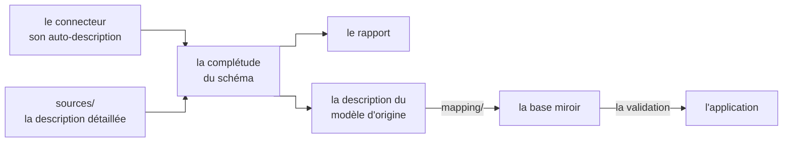

# La source

> **Une entité source** est une table, un fichier ou une feuille du
> système d'origine. `sources/` la décrit dans la grammaire du
> méta-modèle, colonne par colonne : lue, ou écartée avec son motif
> ([glossaire](../../glossaire.md)).

Reprendre des données commence par les comprendre. Ce fichier montre
comment une reprise décrit sa source, du plus large au plus fin : les
deux maisons de la migration et la complétude qui les relie, puis
l'entête d'une entité, ses colonnes et ses liens avec les autres
entités, enfin l'alias, le filtre et la partition, qui règlent ce qui
est lu. Les décisions citées entre parenthèses renvoient au
[registre](../../conception.md).

## Le sommaire

- [Les deux maisons](#les-deux-maisons)
  - [La source se décrit comme la destination](#la-source-se-décrit-comme-la-destination)
  - [La complétude](#la-complétude)
  - [Les deux régimes](#les-deux-régimes)
- [La description d'une entité source](#la-description-dune-entité-source)
  - [L'entête d'une entité](#lentête-dune-entité)
  - [Un fichier par entité](#un-fichier-par-entité)
  - [Les textes](#les-textes)
- [Les colonnes](#les-colonnes)
  - [Les trois états d'une colonne](#les-trois-états-dune-colonne)
  - [La colonne décrite](#la-colonne-décrite)
  - [La normalisation](#la-normalisation)
  - [Le masque de lecture](#le-masque-de-lecture)
  - [Les colonnes d'un classeur](#les-colonnes-dun-classeur)
- [Les liens entre entités](#les-liens-entre-entités)
  - [La composition](#la-composition)
  - [La référence](#la-référence)
  - [La référence nommée](#la-référence-nommée)
  - [La référence à plusieurs entités](#la-référence-à-plusieurs-entités)
  - [La lecture d'une autre table](#la-lecture-dune-autre-table)
- [L'alias](#lalias)
- [Le filtre et la partition](#le-filtre-et-la-partition)
  - [Le filtre](#le-filtre)
  - [La partition](#la-partition)

## Les deux maisons

### La source se décrit comme la destination

Une source de données, liée à un connecteur, dans le cadre d'une reprise
de données ou d'une migration, utilise la même syntaxe et la même
structure que la définition du méta-modèle (D652, D653). Pour procéder à
la migration, il faut donc définir deux maisons :

- **`sources/`** porte la description des données à reprendre, table par
  table et colonne par colonne ;
- **`mapping/`** décrit les règles de conversion et de transformation,
  table par table, sachant qu'une cible peut avoir plusieurs origines.

La source et le méta-modèle parlent le même langage. Le typage statique
vérifie donc les expressions des deux côtés (D581), et l'exhaustivité se
juge entre deux descriptions (D648).

La complétude du schéma précède les règles (D2060). Le chemin d'une
reprise, de la source à l'application :

| Le temps | Ce qui s'y passe |
|---|---|
| les deux origines | le connecteur se décrit lui-même ; `sources/` porte la description détaillée |
| la complétude du schéma | elle se construit des deux, et rend un rapport |
| la description du modèle d'origine | elle en sort : c'est elle que les règles lisent |
| le mapping | les règles de `mapping/` s'y appliquent, dans la base miroir |
| l'application | elle vient à la fin de la validation |



[La base miroir](02-declaration.md#la-base-miroir) se déclare dans
l'environnement ; [les contrôles](05-controles.md) décrivent la
validation.

### La complétude

> **La complétude du schéma** est la part de la description d'une source
> qui tient encore face au modèle lu par le connecteur
> ([glossaire](../../glossaire.md)).

La complétude compare la description à la réalité, et elle révèle les
écarts (D2061). La réalité est le schéma que le connecteur lit dans le
système d'origine : `get_instance` le rend (D629, D680). Syncytium fait
la comparaison à l'ingestion, et à chaque `migrate` (D861).

**La description cite toutes les colonnes qui seront dans le méta-modèle
de destination.** C'est par elle que les règles les lisent.

**Les écarts servent la reprise d'un existant.** Ils assurent que toutes
les données présentes dans le système d'origine ont été identifiées, et
traitées comme il se doit. Un écart n'est pas une négligence : c'est un
point à creuser (D868). Le concepteur le traite de l'une de deux façons :

- il décrit la colonne, pour la lire ;
- il l'écarte, par `ignored`, avec son motif : voir
  [les trois états d'une colonne](#les-trois-états-dune-colonne).

À la fin de l'analyse, il ne reste aucun écart : chaque colonne est lue,
ou écartée (D2081).

Syncytium relève trois écarts (D1053) :

| L'écart | Ce que Syncytium en dit |
|---|---|
| une colonne du schéma réel que la description ne cite pas | une anomalie de complétude |
| une colonne décrite dont le type n'est pas conforme | une anomalie de description |
| une colonne décrite qui a disparu de la source | une erreur de description : l'entité est illisible |

Dans l'entrepôt, la table ARTICLE de PMI compte 181 colonnes. Sa
description cite les colonnes qu'elle lit et celles qu'elle écarte. Les
autres ne sont pas lues : le rapport de migration les relève, et le
concepteur sait où il en est de son analyse.

### Les deux régimes

Une source se décrit selon deux régimes (D1907) :

| Le régime | Qui décrit la source | Le rôle du connecteur |
|---|---|---|
| la reprise analysée | le concepteur, dans `sources/` : c'est un acte | il sert la comparaison, jamais l'écriture (D868) |
| la forme courte | le connecteur, qui se décrit lui-même (D1895) | il donne ses entités et leurs colonnes |

La complétude se porte de la même façon dans les deux. En forme courte,
une colonne correspond à un champ d'une entité, et la complétude se
mesure par les écarts entre les deux : d'un CSV vers une base, comme
d'une base vers une autre.

Quand les noms diffèrent, comme entre PMI et l'entrepôt, le lien ne se
fait pas sans mapping. La description de l'origine se mesure alors à la
complétude de la source, pour ne rien oublier.

## La description d'une entité source

### L'entête d'une entité

Puisque `sources/` parle toute la grammaire du modèle (D652), une entité
source se décrit comme une entité de l'application : un fichier, un
entête, des champs. L'entête dit de quelle table il s'agit, ce qui s'y
lit, et ce qui identifie une ligne. Dans l'entrepôt, voici celui des
commandes de vente de PMI :

```yaml
# Le nom de la table
# La table ECOMCLI de PMI, 91 colonnes : l'entête d'une commande de vente, une ligne par révision.
name: ECOMCLI

# La description de la table
description: Les entêtes de commandes de vente de PMI — la source de commande.commande_vente

# Le périmètre lu
# La seule société 100.
filter: ECKTSOC = "100"

# L'identité d'une ligne
# Le numéro et l'indice de révision de la commande.
identity: [ECKTNUMERO, ECKTINDICE]

# Le rapport des anomalies de la table
# Le commercial corrige les commandes de vente à l'origine.
report:
  when: migration
  to: commercial
  by: [notification, mail]

# La lecture par partition
# Les dix mille derniers numéros de commande sont relus ; la relecture complète du dimanche relit tout.
partition: ECKTNUMERO[10000]
```

Les clés d'une entité source :

| La clé | Ce qu'elle dit |
|---|---|
| `alias:` | le nom de l'entité, quand il diffère de celui de la table : voir [l'alias](#lalias) |
| `name:` | le nom de la table |
| `description:` | ce que la table est dans le système d'origine |
| `filter:` | le périmètre lu : voir [le filtre](#le-filtre) |
| `identity:` | les colonnes qui identifient une ligne : la contrainte d'unicité (D357) |
| `report:` | le rapport des anomalies de la table et ses destinataires : voir [les contrôles](05-controles.md) |
| `partition:` | la lecture par plages : voir [la partition](#la-partition) |
| `fields:` | les colonnes, et les champs calculés |

Une entité source déclare aussi la taille des lots par lesquels sa
table est lue (D2160) : une table large demande des lots plus modestes
qu'une table étroite. La clé reste à écrire : voir
[une taille par entité](../09-moteur/README.md#une-taille-par-entité).

### Un fichier par entité

Un fichier décrit une entité d'origine, et porte le nom de sa table :
`sources/technique/ARTICLE.yml`, `name: ARTICLE` (D947). Quand l'entité
est un alias de la table, le fichier porte le nom de l'entité (D966).

### Les textes

Les `description:` des sources, comme celles des règles, sont des textes
de la version (D1474, D1517). À plusieurs langues, ils les portent
toutes : sinon, c'est une erreur d'ingestion. La banque (le cas 4) en
porte neuf à traduire (D1502).

## Les colonnes

### Les trois états d'une colonne

> **Ignoré** est l'état d'une table ou d'une colonne comprise et écartée
> volontairement : elle compte dans la complétude du schéma, pas dans la
> couverture ([glossaire](../../glossaire.md)).

Décrire une table, c'est se prononcer sur chacune de ses colonnes. Le
concepteur la lit, ou il l'écarte en disant pourquoi ; tant qu'il ne
s'est pas prononcé, elle reste à creuser. Une colonne, comme une table,
a donc trois états (D869, D947) :

| L'état | Ce que la description écrit | Ce que Syncytium en fait |
|---|---|---|
| lue | la colonne, avec son type | il la lit |
| ignorée | la colonne, avec `ignored`, et son motif recommandé | il ne la lit pas ; l'écart est volontaire |
| non lue | rien | il la relève au rapport de migration : un point à creuser (D868) |

`ignored` dit l'élément attendu dans la source mais non développé
(D657). Ce n'est pas un type (D1909). Il s'écrit de deux façons :

- **en forme courte** : `audit_log: ignored` pour une table,
  `ref_ext: ignored` pour une colonne ;
- **en bloc** : la propriété `ignored: true`, `false` par défaut, et le
  motif en `description:`.

Dans l'entrepôt, une colonne lue et une colonne écartée de la table des
articles :

```yaml
  ARCTNOFOU1:
    type: FOURNIS.CLKTCODE or CLIENT.CLKTCODE
    description: >-
      Le compte 1 : le fournisseur par défaut de l'article acheté, ou son client de référence ; le premier des deux qui
      correspond fait le lien.

  ARCTNOFOU2:
    ignored: true
    description: "Le compte 2, le dernier achat ou la dernière vente : il se calcule, il ne se reprend pas."
```

Une table écartée garde son nom en clé, avec `ignored: true` et sa
description sous lui (D1911). Les devis de PMI :

```yaml
# Une table écartée
# Analysée et écartée volontairement : elle compte dans la complétude du schéma, pas dans la couverture des données.
DEVIS:
  ignored: true
  description: Les devis de PMI, 28 colonnes — hors du périmètre de l'entrepôt.
```

### La colonne décrite

Ce que la documentation doit porter s'écrit en propriété, pas en
commentaire (D1100, D1101) :

- **chaque colonne lue porte son `type:`** ;
- **sa `description:`** dit le sens de la colonne dans le système
  d'origine. C'est une recommandation, non une obligation : la
  complétude de la documentation la relève quand elle manque (D1910) ;
- **le champ que la colonne alimente** se lit dans les règles : il ne se
  redit pas ici ;
- **une colonne à codes**, à trois codes ou plus, décrit ses codes en
  tableau Markdown : une ligne par code et son libellé, dans un scalaire
  littéral, `description: |`. À deux codes, une phrase suffit (D1102).

Avec une seule langue, la description est un texte simple.

### La normalisation

> **La normalisation** est l'expression appliquée à une valeur à la
> frontière, quand elle entre ([glossaire](../../glossaire.md)).

Le nettoyage, la casse et le transcodage s'écrivent sur la description
de la source, non dans les règles (D660). Deux écritures :

- **`normalize:`**, sur un type ou sur une colonne. C'est un usage : la
  fonction se décrit avec
  [les fonctions du langage](../03-langage/04-fonctions.md) (D1921,
  D1924). L'entrepôt rogne les blancs de tout texte lu :

```yaml
  # Le type text
  # Les défauts de tout champ texte ; un champ peut surcharger avec sa propre expression.
  text:

    # La normalisation
    # La valeur lue est rognée de ses blancs, à la frontière ; me désigne la valeur.
    normalize: me.trim()
```

- **un champ calculé**, par `formula:`. Le mapping le consomme comme une
  colonne. Dans le véhicule (le cas 3), un calculé réunit deux colonnes
  qui ne coexistent pas :

```yaml
  quantite_n:
    formula: ifnull(nb_litres, charge)
    description: La quantité, litres ou kWh — les deux colonnes en une.
```

### Le masque de lecture

Une colonne source déclare son masque, par `mask:` (D820). Une valeur
hors du masque est une non-conformité. Dans la banque, les dates de
l'ancien système se lisent au format du jour, du mois, de l'année :

```yaml
  Date_Operation:
    type: date
    mask: "dd/mm/yyyy"
    description:
      fr: La date de l'opération ; le masque lit le jj/mm/aaaa du legacy.
      en: The operation date; the mask reads the legacy's dd/mm/yyyy.
```

`mask:` peut s'écrire dans les entités du connecteur, ou dans la source
(D1934).

### Les colonnes d'un classeur

Un classeur déclare ses colonnes dans la carte `entities:` de son
connecteur : le type, la cellule, l'entête (D1933, D1936). Le
[chapitre 5](../05-connecteurs/02-declaration.md) le décrit, avec les
formats voisins d'Excel (D1932). La source ne fait alors qu'ajouter ce
que le connecteur ne porte pas (D1936) :

- une colonne qui n'ajoute rien ne s'y écrit pas (D1937) ;
- un classeur est un storage : il se lit, et il s'écrit, par le contrat
  du storage (D1937, D1938) ;
- les adresses des cellules valent pour un environnement : c'est la
  limite de l'approche (D1937). Une feuille qui change sans changer la
  nature de ses informations se suit dans l'environnement, sans nouvelle
  version (D1938) ;
- les informations du connecteur, `connector.filename`, `connector.path`
  et `connector.line`, se définissent au chapitre 5 ; une source peut
  les lire (D1935).

Dans le véhicule, la source des ravitaillements n'ajoute que des
descriptions et quatre calculés.

## Les liens entre entités

### La composition

Les tables d'un système d'origine ne vivent pas seules : une commande
possède ses lignes, une ligne désigne un article. La description porte
ces liens, que le schéma réel les déclare ou non (D869).

Le premier est la composition. Elle se déclare chez le possesseur (D399,
D1913, D1914) : la table d'appartenance déclare `list of <fils>`, dans
un champ qui n'est pas une colonne, et le fils ne déclare rien. Dans
l'entrepôt, une commande de vente possède ses lignes :

```yaml
  # Les compositions
  LIGNES:
    type: 'list of LCOMCLI[LCKTNUMERO: ECKTNUMERO, LCKTPSF: ECKTINDICE]'
    description: Les lignes de la commande ; une ligne retrouve sa commande par le numéro et l'indice.
```

- **la convention du connecteur** suffit quand les colonnes d'identité
  portent les mêmes noms (D876). Le concepteur peut la surcharger
  (D877) ;
- **les crochets** donnent le lien quand la convention ne le trouve
  pas : la colonne du fils d'abord, puis la colonne du possesseur à
  laquelle elle se lie (D1915) ;
- **les guillemets** sont imposés par YAML, à cause des deux-points ;
- **le champ s'écrit en bloc**, avec `type:` et `description:` ;
- **un fils qui référence deux fois son possesseur** se lie par ses
  colonnes, plus lisibles que le nom de la référence (D1916).

Le `parent:` du fils, que D931 donnait à la source, en sort : il reste
le mot des règles de `mapping/`. Le contrôle avant la migration compare
les valeurs brutes (D874).

### La référence

Une colonne référence une autre entité par son type : `ECCTCODE` porte
`type: CLIENT.CLKTCODE` dans l'entête des commandes. C'est la dépendance
déclarée (D648, D396).

Une référence composée se déclare colonne par colonne. Les colonnes qui
dépendent des champs d'identité d'une même entité forment une référence,
dans l'ordre de cette identité.

### La référence nommée

> **Une référence nommée** lie les colonnes d'une même référence par un
> nom entre crochets, quand la même entité est référencée plusieurs fois
> ([glossaire](../../glossaire.md)).

Une ligne de nomenclature référence deux articles : le produit, et le
composant. Pour les distinguer, chaque référence porte un nom entre
crochets (D995). Ce nom joue le rôle d'un alias de l'entité : il relie
entre elles les colonnes qui, ensemble, retrouvent l'enregistrement
référencé. Voici les deux colonnes du produit, dans l'entrepôt :

```yaml
  NOKTCODPF:
    type: ARTICLE[PRODUIT].ARKTCODART
    description: Le code de l'article produit, que la ligne compose.

  NOKTCOMPF:
    type: ARTICLE[PRODUIT].ARKTCOMART
    description: Le complément du code de l'article produit.
```

Le composant s'écrit de même, `ARTICLE[COMPOSANT].ARKTCODART`. Les
colonnes du même nom forment une référence.

- le nom est libre, et sensible à la casse ;
- l'entrepôt garde les majuscules de ses entités sources (D1913) ;
- une référence unique garde la forme simple.

### La référence à plusieurs entités

Une référence peut faire le lien vers plusieurs entités différentes :
deux, trois, ou davantage (D996, D2062). Les entités se séparent par
`or`, et la première qui correspond fait le lien. Dans l'entrepôt, le
compte 1 de l'article, plus haut, en vise deux :
`FOURNIS.CLKTCODE or CLIENT.CLKTCODE`.

- le `or` sert le contrôle avant la migration (D874) ;
- à l'affectation, le premier trouvé est la valeur (D1913).

### La lecture d'une autre table

À la source, l'entité décrite est une collection (D965). Un champ
calculé lit une valeur, ou une liste de valeurs, dans une autre table.
Dans l'entrepôt, un mouvement de stock lit l'unité de stock de son
article :

```yaml
  # Les colonnes calculées
  unite_stock:
    description: L'unité de stock de l'article, lue dans la table ARTICLE ; la quantité se construit dans cette unité.
    formula: ARTICLE.first(ARCTUNISTO if ARKTCODART = MVCTCODART and ARKTCOMART = MVCTCOMART)
```

- **`first` rend la valeur, `list` la liste**. Ce sont les méthodes
  qu'une entité porte déjà au modèle : aucune fonction n'est inventée
  pour la source (D1919) ;
- **la condition** s'écrit « valeur if condition », et la projection ne
  change pas (D887, D889) ;
- **la valeur est typée par la colonne** (D581). L'absence rend le nul :
  c'est un fait ;
- **le filtre vient avec** : lire une entité, c'est appliquer le filtre
  qu'elle définit (D966). On lit l'entité décrite, jamais la table nue ;
- **la source est lue par lots**, pas affichée : la règle du modèle,
  jamais l'entité entière, reste entière (D891).

Les mêmes critères reviennent souvent d'une ligne à l'autre. Pour que la
réponse reste rapide, le moteur met ce résultat en cache, par entité,
expression et valeurs des critères, le temps d'un passage.

- il n'y a qu'un mécanisme de cache, et deux façons de l'utiliser
  (D1923) : le moteur s'en sert lui-même, pour cette lecture ; le
  concepteur y déclare une entrée, dans une règle, par `cache.push` ;
- l'entrée se déclare à son premier `push` : il n'y a pas de
  déclaration explicite (D1925) ;
- le fonctionnement du cache se décrit au chapitre 9 : voir
  [le cache](../09-moteur/04-passage.md#le-cache) ; ici se disent son
  usage et sa déclaration (D1920).

## L'alias

> **L'alias d'une entité source** est le nom donné à une entité qui
> décrit une table sous un filtre
> ([glossaire](../../glossaire.md)).

Une même table peut porter plusieurs entités. L'alias donne alors un nom
à chacune : il désigne une entité qui lit la même source sous un filtre
différent (D966). Dans PMI, la table PARAM en est l'exemple : elle
réunit les paramètres qui conditionnent le fonctionnement de l'ERP, et
donc ses données. Chaque paramètre lu en devient une entité. Voici celle
des emplacements de stock :

```yaml
# L'alias de l'entité
# Les emplacements de stock paramétrés : le paramètre 170 de la table générique des paramètres de PMI ; les règles et
# les calculés nomment l'entité par cet alias.
alias: PARAM_EMPLACEMENTS

# Le nom de la table
# PARAM, la table des paramètres ; chaque paramètre lu en devient une entité à son alias, avec son filtre.
name: PARAM

# La description de la table
description: Le paramètre 170 de PMI — la source des emplacements actifs et de leur libellé

# Le périmètre lu
# La société 100 et le seul paramètre 170, celui des emplacements.
filter: PAKTSOC = "100" and PAKTNOPAR = "170"
```

- **`alias:` porte le nom de l'entité, `name:` celui de la table**.
  L'alias s'écrit avant le nom, pour la lisibilité (D1918) ;
- **l'identifiant de l'entité est son alias s'il est défini, sinon son
  nom**. Le fichier le porte (D947) ;
- **les règles et les calculés nomment l'entité par lui**, et le filtre
  vient avec (D965) ;
- **chaque entité a son filtre, son identité, ses colonnes lues** ;
- **la complétude du schéma se mesure sur la table**, toutes entités
  confondues (D861).

Le même mot couvre le même concept sur un connecteur storage (D2141) :
`alias:` y donne à la base que Syncytium a créée un nom par lequel un
tiers garde toujours le même lien. Voir
[le nom stable](../05-connecteurs/05-storage.md#le-nom-stable).

## Le filtre et la partition

### Le filtre

Une reprise ne lit pas toujours tout ce qu'une table contient.
`filter:` sélectionne les enregistrements que la migration parcourt
(D663). L'entrepôt, par exemple, ne lit que la société 100 :
`filter: ECKTSOC = "100"`. Deux autres exemples, d'illustration :
`filter: order_date >= now() - 10y` borne une période ;
`filter: company_code = "PARIS"` isole une instance, quand une table en
recoupe plusieurs.

C'est le périmètre déclaré. Un enregistrement hors du filtre n'est ni un
rejet, ni de la couverture : il n'est jamais lu.

### La partition

> **La partition** d'une entité source règle sa lecture par plages
> ([glossaire](../../glossaire.md)).

Une table volumineuse ne se relit pas en entier chaque nuit. La lecture
de l'origine se règle par `partition:`, sur l'entité source (D1929). Le
mot est celui de l'entité du modèle, où `partition:` découpe la table
(D1293) ; à la source, le crochet porte en plus la plage relue. Dans
l'entrepôt, les mouvements de stock :

```yaml
# La lecture par partition
# Le mois du mouvement : chaque nuit, les trois derniers mois sont relus ; la relecture complète du dimanche relit tout.
partition: MVCJMVT[month - 3]
```

`partition:` dit deux choses :

- **la clé de la partition**, distincte de l'`identity:` au besoin.
  Syncytium garde, par clé d'origine, sa valeur de partition et un hash
  qui compte les lignes modifiées (D1047–D1050). Il garde aussi la
  dernière valeur parcourue, pour reprendre depuis la dernière lecture ;
- **la plage de valeurs**. Sur une date, une période : `month - 3`, les
  trois derniers mois. Sur un numéro, un nombre de valeurs distinctes :
  `ECKTNUMERO[10000]` relit les dix mille derniers numéros distincts,
  non les dix mille dernières lignes, pour ne pas couper une commande
  (D1927).

Elle s'écrit de trois façons, équivalentes :

| La forme | L'écriture |
|---|---|
| courte, au crochet (D880) | la nature puis la plage : `MVCJMVT[month - 3]` ; ou la plage seule : `ECKTNUMERO[10000]` |
| en liste | plusieurs champs de partition |
| riche (D879) | la carte des champs, chacun avec `value:`, la nature, et `range:`, la plage |

La forme riche, en illustration :

```yaml
# La lecture par partition
# La forme riche : le champ, sa nature et sa plage.
partition:
  MVCJMVT:
    value: month
    range: 3m
```

**Sans `partition:`, la totalité est relue.** L'état se relit en entier,
le journal se partitionne (D1013) :

- le niveau de stock, deux cent mille lignes au plus, se relit sans
  surcoût : il n'a ni `partition:` ni `history:`, et les mouvements
  portent l'histoire ;
- les mouvements, plusieurs millions de lignes, portent `partition:`,
  et un `reset_coverage` à planifier.

`filter:` reste le périmètre jamais lu. Le traitement des écarts, lui,
se lit sur la destination : avec `history:`, ils complètent et
l'historique les garde ; sans lui, ils remplacent.
