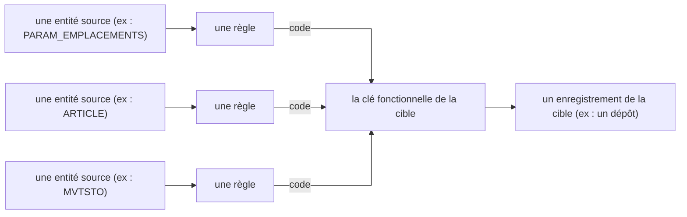

# Les règles

> **Le mapping** est l'ensemble des règles de correspondance qu'une
> migration applique pour porter les données d'une description vers une
> autre. Le concepteur les écrit pour une reprise, une règle par fichier
> de `mapping/` ([glossaire](../../glossaire.md)).

La source est décrite ; reste à dire où vont ses données. C'est le rôle
de la règle, que ce fichier suit de sa forme la plus simple à ses
écritures les plus riches : son sens et sa clé, sa description et ses
formes longues, le partage entre fichiers, puis le possesseur et la clé
lue. Ce que la règle contrôle fait l'objet du fichier suivant,
[les contrôles](05-controles.md). Les décisions citées entre parenthèses
renvoient au [registre](../../conception.md).

## Le sommaire

- [Le sens et la clé](#le-sens-et-la-clé)
  - [De l'entité source vers la cible](#de-lentité-source-vers-la-cible)
  - [Les clés d'une règle](#les-clés-dune-règle)
  - [La clé fonctionnelle ne se déclare pas](#la-clé-fonctionnelle-ne-se-déclare-pas)
  - [Plusieurs origines, une même cible](#plusieurs-origines-une-même-cible)
  - [Les agrégats](#les-agrégats)
  - [Les opérations d'une règle](#les-opérations-dune-règle)
- [La description et les formes longues](#la-description-et-les-formes-longues)
  - [La description de la règle](#la-description-de-la-règle)
  - [L'affectation, courte ou longue](#laffectation-courte-ou-longue)
  - [La référence composée](#la-référence-composée)
  - [La validation, courte ou longue](#la-validation-courte-ou-longue)
  - [Le message, un gabarit](#le-message-un-gabarit)
- [Le partage entre fichiers](#le-partage-entre-fichiers)
  - [Le bloc commun](#le-bloc-commun)
  - [Le cumul sous une carte](#le-cumul-sous-une-carte)
- [Le possesseur et la clé lue](#le-possesseur-et-la-clé-lue)
  - [`parent:`, par les champs mappés](#parent-par-les-champs-mappés)
  - [Le parent d'une hiérarchie](#le-parent-dune-hiérarchie)
  - [La conversion d'une clé, à la lecture](#la-conversion-dune-clé-à-la-lecture)

## Le sens et la clé

### De l'entité source vers la cible

Une règle se lit dans le sens du voyage des données, de la source vers
la cible : chaque entité source déclare où vont ses colonnes (D655).
Elle porte d'ailleurs le nom de cette entité source (D656). Dans
l'entrepôt, voici la règle des articles de PMI :

```yaml
# Les articles
ARTICLE:
  description: >-
    Les articles qui ne sont pas des dérivés : tous les codes de gestion sauf 01, 09 et 12. Le bloc commun, et le
    fournisseur par défaut propre à l'article acheté — le compte 1 de PMI.
  to: technique.article
  filter: ARCTFATN not in ["01", "09", "12"]
  fields:
    - ~{articles/fields.yml}
    - fournisseur_defaut: ARCTNOFOU1
  report:
    when: [migration]
    to: [bureau_etudes]
    by: [notification, mail]
```

Cette règle se lit ainsi :

- elle porte le nom de l'entité source qu'elle lit, `ARTICLE` ;
- `filter:` écarte trois codes de gestion ;
- `to:` nomme la cible : l'entité `article` du module `technique` ;
- `fields:` construit l'enregistrement ;
- `report:` adresse ses rejets au bureau d'études.

### Les clés d'une règle

| La clé | Ce qu'elle dit |
|---|---|
| `description:` | ce que la règle fait : voir [la description](#la-description-de-la-règle) |
| `to:` | la cible : une entité, ou un agrégat (D656) |
| `filter:` | les lignes de l'entité source que la règle prend |
| `distinct:` | les valeurs distinctes d'une ou de plusieurs colonnes : voir [les compléments](06-complements.md) |
| `parent:` | le possesseur, par ses champs mappés (D931) : voir [le possesseur](#le-possesseur-et-la-clé-lue) |
| `fields:` | les affectations : des expressions du langage unique |
| `validation:` | les contrôles de chaque ligne importée (D932) : voir [les contrôles](05-controles.md) |
| `operations:` | l'expression exécutée pour chaque ligne construite : voir [les opérations](#les-opérations-dune-règle) |
| `report:` | le rapport de ses rejets (D929) : voir [les rapports](05-controles.md#les-rapports) |
| `name:` | le nom propre de la règle, quand une autre la désigne : voir [la dépréciation](09-depreciation.md) |
| `deprecation:` | le retrait annoncé de la règle : voir [la dépréciation](09-depreciation.md) |

Un fichier peut porter plusieurs règles ; un fichier par règle est
recommandé (D1940) : voir
[les fichiers et leur ordre](02-declaration.md#les-fichiers-et-leur-ordre).

### La clé fonctionnelle ne se déclare pas

> **La clé fonctionnelle** identifie un enregistrement aux yeux du
> métier, de façon unique : un code client, un numéro de facture
> ([glossaire](../../glossaire.md)).

La règle ne déclare pas de clé : la propriété `key:` est retirée (D930).
La clé est l'identité de la cible, son `identity:` (D142, D398). La
règle l'alimente par `fields:`. Dans l'extrait, le bloc commun alimente
`code` et `complement` : ils font l'identité de l'article.

Le mapping construit l'enregistrement avant sa validation (D654) :

- l'enregistrement doit être converti, et cohérent (D177) ;
- il s'écrit par le chemin standard (D175) ;
- la clé fonctionnelle l'identifie : un rejeu ne crée pas de doublon.

### Plusieurs origines, une même cible

Plusieurs règles peuvent alimenter la même cible. Elles se rejoignent
par la clé : la jointure n'est pas une syntaxe, c'est la clé (D654,
D655).



Dans l'entrepôt, les dépôts ont plusieurs origines. La première : les
paramètres de PMI.

```yaml
# Les dépôts des paramètres de PMI
PARAM_EMPLACEMENTS:
  description: >-
    La première origine des dépôts : les paramètres des emplacements actifs, dont le dépôt est la partie gauche du
    couple dépôt.emplacement ; une valeur distincte, un dépôt. Un dépôt des paramètres est actif ; son libellé n'y
    figure pas.
  to: stock.depot
  distinct: [depot]
  fields:
    code: depot
    actif: true
  report:
    when: [migration]
    to: [logistique]
    by: [notification, mail]
```

Une autre : les mouvements de stock.

```yaml
# Les dépôts trouvés dans les mouvements
MVTSTO:
  description: >-
    La troisième origine des dépôts : chaque dépôt cité par un mouvement lu, y compris les dépôts qui ne servent plus.
    Un dépôt né ici est inactif et sans libellé.
  to: stock.depot
  distinct: [MVCTDEPOT]
  filter: MVCTDEPOT is not null
  fields:
    code: MVCTDEPOT
  report:
    when: [migration]
    to: [logistique]
    by: [notification, mail]
```

Les deux règles alimentent `code`, l'identité du dépôt. Un dépôt cité
par les deux n'existe qu'une fois.

Quand plusieurs règles alimentent le même champ du même enregistrement,
la dernière mise à jour l'emporte (D1951) :

- les contributions se fondent champ par champ ;
- l'ordre est celui où les règles s'exécutent : voir
  [l'ordre des étapes](02-declaration.md#lordre-des-étapes) ;
- la documentation décrit les différentes règles, et précise que la
  dernière qui répond est celle que Syncytium retient.

Ici, seule la première règle alimente `actif`. La seconde n'y touche
pas : un dépôt déjà connu garde sa valeur.

### Les agrégats

La clé lie aussi les agrégats : la ligne retrouve sa commande,
l'association son vis-à-vis. L'identité d'une ligne se lit au sein de
son possesseur (D841). Voir
[le possesseur et la clé lue](#le-possesseur-et-la-clé-lue).

### Les opérations d'une règle

`operations:` porte l'expression exécutée pour chaque ligne construite.
Dans l'entrepôt, la règle des commandes de vente repositionne le
compteur des commandes sur le numéro repris :

```yaml
  operations:
    commande_vente.numero.update(numero)
```

Le mot `operations:` sert à trois étages (D1942) :

- les opérations nommées et planifiées d'un processus : voir
  [les opérations périodiques](02-declaration.md#les-opérations-périodiques) ;
- la liste de ce qu'une de ces opérations lance ;
- l'expression d'une règle, ici.

C'est la même question dans trois contextes.

## La description et les formes longues

### La description de la règle

Une règle n'est pas lue que par Syncytium : la documentation la
présente, et celui qui la reprendra devra la comprendre. Or ce que la
documentation doit porter s'écrit en propriété, pas en commentaire
(D1100). La règle se décrit donc en `description:` (D1105), et ses
écritures courtes ont une forme longue, pour s'expliquer. Les extraits
de ce fichier le montrent : chaque règle de l'entrepôt dit ce qu'elle
reprend, et pourquoi.

### L'affectation, courte ou longue

Une affectation reste une formule : `champ: formule`. Elle se lit
d'elle-même. Quand elle demande un complément, elle prend sa forme
longue (D1105) :

| La clé | Ce qu'elle porte |
|---|---|
| `formula:` | la formule |
| `description:` | le complément |
| `message:` | le texte de l'anomalie, si l'affectation échoue |

Dans l'entrepôt, la règle des contacts des clients mêle les deux
formes :

```yaml
    identifiant:  CTKNID
    civilite:     'CTCTCIVILI.select(M: "monsieur", MME: "madame")'
    nom:          CTCTNOM
    prenom:       CTCTPRENOM
    fonction:
      formula: >-
        CTCTFONCTI.select(DIR: "Direction", ACH: "Acheteur", COM: "Commercial",
        TEC: "Technicien", "...": CTCTFONCTI)
      description: Le libellé de la fonction ; un code inconnu se reprend tel quel.
    telephone:
      formula: CTCTNOTEL1
      description: Le premier numéro de PMI.
```

### La référence composée

La clé d'une référence composée s'écrit entre crochets, en liste de
paires (D1941) : `article: [code: LCCTCODART, complement: LCCTCOMART]`.
La forme longue reste seule à s'écrire en carte : les deux écritures ne
se confondent pas.

### La validation, courte ou longue

Une validation s'écrit de même :

- en forme courte : `- expression` ;
- en forme longue : `rule:`, `description:`, `message:`.

Voir [la validation et son message](05-controles.md#la-validation-et-son-message).

### Le message, un gabarit

> **Un gabarit** est un texte à trous, dont les accolades citent des
> valeurs ([glossaire](../../glossaire.md)).

Le `message:` est un gabarit (D1106). Ses accolades sont celles du
langage unique (D6, D90). Dans l'entrepôt, la validation des lignes
d'achat :

```yaml
  validation:
    - rule: me.unite in me.article.unite.units
      description: L'unité de la ligne est l'une de celles que son article connaît.
      message: L'unité {me.unite} de la ligne n'est pas une unité connue de l'article {LCCTCODART}.
```

Entre les accolades s'écrit :

- une valeur de la source : `{LCCTCODART}`, la colonne lue ;
- une propriété de l'enregistrement construit : `{me.unite}`,
  `{me.article.code}` ;
- plus largement, un nom, un chemin ou une expression du langage unique.

Le texte se résout à l'échec, et l'anomalie garde le message résolu. Une
valeur nulle s'écrit vide. À la source et à l'entité, les mêmes
accolades citent la colonne lue ou le champ.

Ce n'est pas l'interpolation `${…}` de la configuration : celle-ci se
résout au chargement (D802).

## Le partage entre fichiers

### Le bloc commun

Des règles voisines se ressemblent : elles alimentent les mêmes champs,
de la même façon. Plutôt que de le répéter, le concepteur l'écrit une
fois. Quand plusieurs règles portent le même bloc `fields:`, le bloc vit
dans son fichier, et chaque règle l'inclut (D967), comme l'entité le
fait déjà (D767, D956). Dans l'entrepôt, l'article a quatre règles, une par dérivé,
filtrées sur le code de gestion (D940). Leur bloc commun vit dans
`articles/fields.yml`. Il s'ouvre sur `code` et `complement`, l'identité
de l'article. Deux de ses champs :

```yaml
type:
  formula: >-
    ARCTTYPART.select(AC: "accessoire", CO: "consommable", LI: "libelle", MI: "libelle", MO: "main_oeuvre",
    OU: "outillage", PF: "produit_fini", PL: "plaque", SF: "semi_fini", ST: "sous_traitance")
  description: Le type d'article au vocabulaire de l'entrepôt ; LI et MI donnent tous deux un libellé.
gestion:
  formula: >-
    ARCTFATN.select(01: "fabrique", 02: "achete", 03: "cg03", 07: "libelle", 09: "semi_fini", 12: "fantome",
    14: "quantite_superieure", 17: "inactif", 32: "resultant", 33: "procedure")
  description: Le code de gestion au vocabulaire de l'entrepôt ; 03, sans libellé connu, se nomme cg03.
```

- **l'inclusion** s'écrit `~{articles/fields.yml}` : le chemin est
  relatif au fichier (D768) ;
- **le fichier inclus n'a pas de préfixe numérique** : il est hors du
  motif des règles (D806). Ce n'est pas une règle, il est inclus ;
- **la règle ne garde que ce qui la distingue** : `to:`, `filter:`,
  `report:`, et ses champs propres.

La règle des fabriqués :

```yaml
# Les produits fabriqués
ARTICLE:
  description: >-
    Les produits fabriqués, au code de gestion 01, qui portent une nomenclature : le bloc commun, et le client de
    référence propre au fabriqué — le compte 1 de PMI.
  to: technique.fabrique
  filter: ARCTFATN = "01"
  fields:
    - ~{articles/fields.yml}
    - client_defaut: ARCTNOFOU1
  report:
    when: [migration]
    to: [bureau_etudes]
    by: [notification, mail]
```

Comparée à la règle des articles, plus haut, elle ne change que la
cible, le filtre et son champ propre. Quand une règle n'a aucun champ
propre, la référence suffit : `fields: ~{articles/fields.yml}`.

### Le cumul sous une carte

Les deux règles cumulent : un fichier, puis une carte en ligne. Ce cumul
a ses règles (D968) :

- **la liste de références s'écrit en bloc**, jamais en flux :
  l'accolade y casse YAML (D956) ;
- **elle vaut sous toute propriété qui porte une carte** : `fields:`,
  `values:`, `parameters:`… ;
- **la fusion se fait dans l'ordre** : la carte est l'union des clés ;
- **la même clé deux fois est une surcharge** : le dernier l'emporte, et
  une alerte est levée à l'ingestion ;
- **le motif y vaut** : `- ~{articles/.*\.yml}`, dans l'ordre
  alphabétique (D665) ;
- **un élément est une référence de fichier, ou une carte en ligne**,
  fusionnée comme un contenu de fichier.

Cette écriture est plus élégante, et plus proche des approches
classiques.

## Le possesseur et la clé lue

> **Le possesseur** est l'enregistrement qui possède une composition
> ([glossaire](../../glossaire.md)).

### `parent:`, par les champs mappés

Une ligne de commande ne se reprend pas seule : elle doit retrouver sa
commande. La ligne fille le fait par `parent:` (D931). Les champs de
cette clé sont les champs mappés, non les colonnes de la source : un
champ mappé peut avoir été converti ou transformé avant que la clé ne
soit vérifiée.

La clé du possesseur se vérifie donc sur les valeurs construites.
`parent:` nomme les champs de l'identité du possesseur. Chacun porte
l'expression qui produit, depuis la ligne fille, la valeur telle que la
règle du possesseur l'a construite.

| L'identité du possesseur | L'écriture | Dans l'entrepôt |
|---|---|---|
| à un champ | le raccourci : l'expression seule, le champ implicite | `parent: { client: CTCTCOMPTE }` |
| composée | les paires, entre crochets (D1943) | `article: [code: NOKTCODPF, complement: NOKTCOMPF]` |

La règle des nomenclatures :

```yaml
  to: technique.nomenclature
  parent:
    article: [code: NOKTCODPF, complement: NOKTCOMPF]
  fields:
    numero:      NOKNLIGNOM
    composant:   [code: NOCTCODECP, complement: NOCTCOMCPT]
```

- **`to:` nomme l'entité fille**, comme pour les écritures de la banque
  (le cas 4) ;
- **`parent:` retrouve l'article** qui porte la nomenclature, par son
  code et son complément ;
- **`composant` est une référence par clé composée** : elle porte les
  mêmes paires, entre crochets (D1941) ;
- **le complément est souvent vide** : le nul du texte est la chaîne
  vide, il n'y a rien à convertir.

### Le parent d'une hiérarchie

`parent:` peut nommer le parent d'une hiérarchie (D969) :

- l'identité déclarée chez le parent est partagée par ses dérivés
  (D353) ;
- le moteur retrouve l'enregistrement quelle que soit sa classe ;
- il attache la ligne à sa composition.

Dans l'extrait, `article` retrouve le fabriqué, le semi-fini ou le
fantôme qui porte la nomenclature. Si l'enregistrement retrouvé ne porte
pas la composition visée, la ligne est un rejet au rapport (D933) : un
acheté avec des composants se voit.

### La conversion d'une clé, à la lecture

Une conversion écrite deux fois, chez le possesseur et dans chaque
`parent:`, est un risque d'entretien. Quand l'identité du possesseur
demande une vraie conversion — une casse, un préfixe, un cadrage —, elle
ne s'écrit ni dans la règle ni dans chaque `parent:` (D990). Elle
s'écrit à la source :

- **par `normalize:`**, sur la colonne (D872). En illustration :
  `normalize: right("0000" + me, 4)`. Ici, `normalize:` est un usage :
  ses fonctions et ses méthodes sont au
  [catalogue des fonctions](../03-langage/04-fonctions.md) (D1924) ;
- **ou par un champ calculé** de la source (D660).

La règle et les `parent:` lisent alors des colonnes déjà converties, et
`parent:` ne porte que des colonnes nues. La conversion n'est écrite
qu'une fois, là où la donnée entre : voir
[la normalisation](03-sources.md#la-normalisation).
