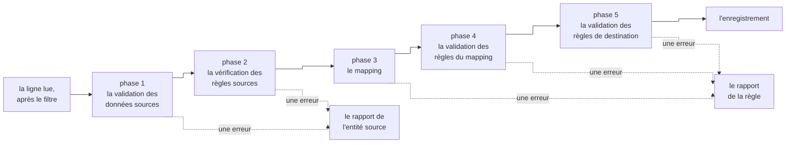

# Les contrôles

> **La validation** réunit les règles de refus : sur une valeur, ou sur
> la cohérence d'un enregistrement. Toute règle enfreinte refuse et
> trace ([glossaire](../../glossaire.md)).

Une donnée reprise n'entre pas dans l'application sans avoir été
contrôlée. Ce fichier suit ce contrôle : la validation et le message
qu'elle produit, les rapports qui portent les anomalies à qui peut les
corriger, les phases où les contrôles se jouent, et enfin ce que la
reprise écrit et ce qu'elle laisse en place. Les décisions citées entre
parenthèses renvoient au [registre](../../conception.md).

## Le sommaire

- [La validation et son message](#la-validation-et-son-message)
  - [Les deux formes](#les-deux-formes)
  - [Le message construit](#le-message-construit)
  - [Les labels du catalogue](#les-labels-du-catalogue)
  - [Le `message:` est facultatif](#le-message-est-facultatif)
- [Les rapports](#les-rapports)
  - [Chaque règle a son rapport](#chaque-règle-a-son-rapport)
  - [Le rapport général](#le-rapport-général)
  - [Le rapport de l'entité source](#le-rapport-de-lentité-source)
  - [Qui reçoit quoi](#qui-reçoit-quoi)
  - [Une ligne fautive se signale, elle ne se filtre pas](#une-ligne-fautive-se-signale-elle-ne-se-filtre-pas)
- [Les phases de contrôle](#les-phases-de-contrôle)
  - [Les cinq phases](#les-cinq-phases)
  - [Un exemple par place](#un-exemple-par-place)
  - [Les trois temps](#les-trois-temps)
  - [L'échec dans une composition](#léchec-dans-une-composition)
- [Ce que la reprise écrit, ce qu'elle laisse](#ce-que-la-reprise-écrit-ce-quelle-laisse)
  - [Les quatre cas](#les-quatre-cas)
  - [Le champ qu'aucune règle n'alimente](#le-champ-quaucune-règle-nalimente)
  - [Le champ tenu hors du mapping](#le-champ-tenu-hors-du-mapping)
  - [La source fait foi](#la-source-fait-foi)
  - [Le texte trop long](#le-texte-trop-long)

## La validation et son message

### Les deux formes

Une validation dit ce qu'une ligne doit respecter pour entrer. Elle
s'écrit de deux façons (D1116), selon que la règle se suffit ou qu'elle
demande une explication :

| La forme | L'écriture |
|---|---|
| courte | `- expression` |
| longue | `rule:`, la règle ; `description:`, ce qu'elle vérifie ; `message:`, le texte de l'anomalie |

- les deux formes se mêlent dans une même liste ;
- elles valent aux trois places : au champ (D364), à l'entité (D404), et
  à la règle d'une reprise.

Dans l'entrepôt, la règle des lignes d'achat porte une validation en
forme longue. La règle entière :

```yaml
# Les lignes des commandes d'achat
LCOMFOU:
  description: >-
    Les lignes des commandes d'achat, composition de l'entête, la structure des lignes de vente : le possesseur est la
    révision de la commande, son numéro et son indice ; l'identité d'une ligne est son numéro. Les prix, à la devise de
    la ligne, sont restreints dans l'entrepôt : la reprise les écrit par son privilège. Les délais sont des jours. Un
    statut hors de la liste est une anomalie.
  to: commande.ligne_achat
  parent:
    commande_achat: [numero: numero, indice: LCKTPSF]
  fields:
    numero:  ligne
    article: [code: LCCTCODART, complement: LCCTCOMART]
    quantite:        LCCNQTECDE
    unite:           LCCTUNICDE
    quantite_recue:
      formula: LCCNQTEEXP
      description: L'expédié de PMI, reçu chez l'acheteur.
    prix_brut:       amount(LCCNPUBRUT, LCCTDEVISE)
    prix_net:        amount(LCCNPUNET, LCCTDEVISE)
    delai_demande:   LCCJDELDDE
    delai_accuse:    LCCJDELARR
    delai_reception: LCCJDELEXP
    statut: 'LCCTSTATUT.select("": "non_traite", A: "en_cours", P: "partielle", S: "soldee", T: "terminee")'
  validation:
    - rule: me.unite in me.article.unite.units
      description: L'unité de la ligne est l'une de celles que son article connaît.
      message: L'unité {me.unite} de la ligne n'est pas une unité connue de l'article {LCCTCODART}.
  report:
    when: migration
    to: achats
    by: [notification, mail]
```

Cette règle réunit les formes longues (D1105, D1106, D1941) :

- `quantite_recue` est une affectation en forme longue : `formula:` et
  `description:` ;
- `article` est une référence composée : sa clé s'écrit entre crochets ;
- la validation porte `rule:`, `description:` et `message:` ;
- le `message:` est un gabarit : voir
  [le message, un gabarit](04-regles.md#le-message-un-gabarit).

### Le message construit

> **Le message construit** est le texte de l'anomalie d'une validation
> écrite sans `message:`. Il cite la règle, les valeurs qu'elle met en
> cause, et la clé de l'enregistrement
> ([glossaire](../../glossaire.md)).

Sans `message:`, l'échec produit un message construit (D1116, D1117). Il
cite :

- la règle ;
- les valeurs des champs qu'elle cite ;
- les valeurs de la clé de l'enregistrement.

La `description:` n'y entre pas. Un `message:` explicite l'emporte.

### Les labels du catalogue

Le message construit se compose d'un label par opérateur (D1944). Un
label est un gabarit du catalogue des textes du moteur. Sa mise en
forme, ses traductions et sa réécriture par le projet se font sans
toucher au code de Syncytium.

Chaque opérateur a deux labels (D1945, D1948) :

| Le label | Ce qu'il donne |
|---|---|
| `_syncytium.<opérateur>.validation` | le message de l'anomalie |
| `_syncytium.<opérateur>.description` | la traduction littérale d'une règle, pour la documentation |

Les règles de leur écriture (D1949) :

- **l'opérateur s'écrit par son nom**, non par son signe : `equal`,
  `in` ;
- **le gabarit cite les deux côtés de la règle** : `{left}` et
  `{right}`, tels qu'ils sont écrits ; `{left_value}` et
  `{right_value}`, leurs valeurs ;
- **`not`, `and`, `or` et `xor` assemblent** les messages de leurs
  membres, à gauche et à droite (D1947).

### Le `message:` est facultatif

Dès que le catalogue couvre tous les labels, le `message:` d'une
validation est facultatif. Le concepteur peut le surcharger (D1946).

## Les rapports

### Chaque règle a son rapport

Une anomalie n'a d'intérêt que si elle atteint celui qui peut la
corriger. C'est pourquoi chaque règle de migration a son rapport, et non
la migration un rapport qui les réunirait toutes (D929). La règle sait sa source, sa
cible, et qui corrige l'origine : l'information va ainsi à la bonne
personne (D859). Elle déclare donc `report:`, dans la forme du modèle
(D406) :

| La clé | Ce qu'elle dit |
|---|---|
| `when:` | quand le rapport part : à la migration, chaque semaine |
| `to:` | le groupe, ou l'utilisateur |
| `by:` | les canaux |

Dans l'extrait plus haut, le rapport des lignes d'achat part après
chaque passage de la migration, vers les achats, par une notification et
un courriel.

Ce rapport porte les enregistrements que la règle construit et que la
cible refuse (D177) :

- la conversion échouée ;
- sa propre `validation:` (D932) ;
- le contrat de la cible ;
- la référence non résolue.

Sans `report:`, le défaut tient (D407) : à la demande, vers
l'administrateur, par les surfaces du module `_migration` (D666).

### Le rapport général

Aucun rapport ne regroupe toutes les anomalies, ni à la migration
déclarée (D662), ni au module : elles vont, règle par règle, à qui peut
les corriger. La cascade reste celle du modèle (D407) : les
non-conformes des références (D395).

Un rapport général peut exister pourtant, à condition de ne pas les
reprendre : il référence le nombre d'anomalies par règle (D2078). Ses
indicateurs donnent au concepteur ou aux administrateurs une vision
globale de l'état de santé de la migration.

| Le rapport | Ce qu'il porte | Pour qui |
|---|---|---|
| celui d'une règle, ou d'une entité source | les anomalies elles-mêmes | celui qui corrige l'origine |
| le rapport général | le nombre d'anomalies par règle : des indicateurs | le concepteur, les administrateurs |

### Le rapport de l'entité source

L'entité source déclare, elle aussi, son propre `report:` (D1058). Les
anomalies des phases de la source vont aux destinataires qu'elle
déclare, sous la même forme. La règle garde son
`report:` pour les siennes. Dans l'entrepôt, l'entité source des
commandes de vente :

```yaml
# Le rapport des anomalies de la table
# Le commercial corrige les commandes de vente à l'origine.
report:
  when: migration
  to: commercial
  by: [notification, mail]
```

### Qui reçoit quoi

| L'anomalie | Des exemples | Où elle va |
|---|---|---|
| du modèle de la source (D1042, D1053) | la colonne non décrite, le type non convertible, la colonne décrite disparue, l'identité non respectée | au concepteur, par le module `_migration` |
| des données de la source (D1058) | ses phases de contrôle : le type, l'identité, l'orphelin, ses propres règles | au `report:` de l'entité source |
| d'un enregistrement construit (D929) | la conversion, la validation de la règle, le contrat de la cible, la référence | au `report:` de la règle |

Les anomalies du modèle ne sont pas des rejets de règle : la description
est en cause, non la donnée.

### Une ligne fautive se signale, elle ne se filtre pas

Une ligne que la cible refuse ne s'écarte pas par un filtre. Dans le
véhicule (le cas 3), des lignes d'entretien n'ont pas de date (D851) :

- elles échouent à la cible, où la date est requise ;
- la migration les signale en anomalie ;
- l'utilisateur ajuste la source, et rejoue.

Il n'y a jamais de perte silencieuse.

## Les phases de contrôle

### Les cinq phases

Un contrôle peut porter sur ce qui est lu, sur ce qui est construit, ou
sur ce qui est écrit. `validation:` a donc trois places, dans la même
grammaire (D404) : l'entité source, la règle, l'entité de destination. Elles prennent leur rang
dans le déroulé d'un passage, en cinq phases (D932, D1033, D1040) :

| La phase | Ce qu'elle contrôle | Sur quoi |
|---|---|---|
| 1. la validation des données sources | après le `filter:` : les colonnes converties du type lu au type décrit, l'identité, les liens — l'orphelin | la ligne lue |
| 2. la vérification des règles sources | les `validation:` de l'entité source | la ligne lue |
| 3. le mapping | `fields:` construit l'enregistrement | la base miroir (D1044) |
| 4. la validation des règles du mapping | les `validation:` de la règle | les colonnes de la source à nu, l'enregistrement construit par `me` |
| 5. la validation des règles de destination | les contraintes et les `validation:` du modèle, avec les enfants (D933) | la base miroir complète, après la lecture de toutes les données, avant l'enregistrement |



Trois règles valent pour toutes les phases :

- chaque phase relève toutes ses erreurs ;
- l'enregistrement en erreur ne passe pas à la phase suivante (D1057) ;
- chaque erreur garde un message clair, pour le rapport : le `message:`
  de la forme longue, quand il est écrit (D1105).

Le déroulé d'un passage est décrit dans
[migration.md](../../migration.md).

### Un exemple par place

**À la source, la phase 2.** Aucun cas n'en porte : l'exemple est
d'illustration, sur les colonnes de la validité d'une ligne de
nomenclature. La règle lit la ligne lue, déjà normalisée (D660) :

```yaml
# La cohérence de la ligne lue
# La fin de la validité ne précède pas son début.
validation:
  - NOCJFINVAL >= NOCJDEBVAL if NOCJFINVAL is not null and NOCJDEBVAL is not null
```

**À la règle, la phase 4.** La validation des lignes d'achat, plus
haut : `me.unite in me.article.unite.units` lit l'enregistrement
construit, par `me` ; son message cite `{LCCTCODART}`, une colonne de la
source, à nu.

**À la destination, la phase 5.** Dans l'entrepôt, le modèle de la
commande de vente :

```yaml
# La cohérence des données converties
validation:
  - rule: date_echeance >= date if date_echeance is not null
    message: L'échéance {date_echeance} précède la date de la commande {date}.
```

### Les trois temps

Les cinq phases se résument en trois temps (D1006) :

| Le temps | Ce qu'il fait |
|---|---|
| sur la source, à la lecture | il limite les enregistrements aux valeurs valides |
| sur le mapping | il identifie les règles non respectées ou les données incorrectes |
| sur la destination | il garantit que les règles des données entreposées sont correctes |

Deux conséquences :

- une contrainte du modèle n'a pas à être redite par la règle ;
- une grandeur donnée à titre indicatif ne se valide pas : ses cas
  limites s'observent.

### L'échec dans une composition

Dans une composition, un parent et ses composants n'échouent pas
toujours ensemble. Tout dépend de l'endroit où l'échec est vu (D933) :

| L'échec | Ce qui est rejeté |
|---|---|
| l'échec propre du parent : sa conversion, sa `validation:`, sa référence | le parent, et tous ses composants |
| l'échec propre d'un composant : sa conversion, sa `validation:` à la règle ou à l'entité, sa référence — l'orphelin (D875) | le composant seul : le parent entre sans lui |
| la `validation:` du parent qui lit ses enfants : `lignes.count() > 0`, une somme | le parent, et tous ses enfants ; elle s'évalue en phase 5 (D1033) |

L'agrégat reste le grain d'écriture (D420) : ce qui s'écrit est le
parent, avec ses composants conformes. Dans l'entrepôt :

- l'article entre sans la cellule tarifaire fautive, et ses mouvements
  le trouvent ;
- la commande sans ligne valide tombe entière.

Le rapport nomme la cause : le parent, ou la ligne (mien).

## Ce que la reprise écrit, ce qu'elle laisse

### Les quatre cas

Une reprise qui se rejoue rencontre des données déjà là : celles qu'elle
a écrites la veille, et celles que les utilisateurs ont saisies depuis.
Ce qu'elle écrit et ce qu'elle laisse tient en quatre cas (D1964) :

| Le cas | Ce que la reprise fait |
|---|---|
| le champ qu'aucune règle n'alimente | il reste tel quel |
| le champ `unmapped: true` | la migration ne l'écrit jamais |
| le champ alimenté | la source fait foi |
| le texte trop long pour sa cible | il se refuse à l'ingestion |

Les mécanismes gardent leur définition dans leur chapitre : `unmapped:`
et `default:` au [modèle](../02-modele/03-champs.md), le typage au
[langage](../03-langage/README.md).

### Le champ qu'aucune règle n'alimente

Le différentiel ne compare que l'enregistrement construit, donc les
seuls champs que les règles alimentent (D941). Un champ qu'aucune règle
n'alimente reste donc tel quel, et `reset: false` le garde.

Le champ obligatoire, lui, naît à sa valeur par défaut : `default:`
répond à ce besoin.

### Le champ tenu hors du mapping

Le champ qu'un écran de saisie remplit se protège par la propriété
`unmapped: true`, `false` par défaut (D941, D1965). Pour un nouvel
enregistrement, le champ prend sa valeur par défaut ; si
l'enregistrement existe, il garde sa valeur.

- la migration ne l'écrit jamais ;
- la saisie reste libre : c'est la différence avec `mode: write-once`,
  immuable pour tous ;
- une règle qui alimente un tel champ est une erreur d'ingestion.

Dans l'entrepôt, `note_interne`, sur le tiers, porte `default: ""` et
`unmapped: true` :

- aucune colonne de PMI ne l'alimente ;
- elle naît vide ;
- elle est ouverte au commercial et aux achats, par l'`allow` au champ
  (D886, D942) ;
- la note de l'acheteur survit à chaque nuit.

### La source fait foi

Sur un champ alimenté, la source fait foi. Le principe se dit ici ; le
différentiel qui l'applique est au chapitre 9 (D1966).

### Le texte trop long

Un `text[30]` de la source vers un `text[..20]` de la cible est une
conversion avec perte (D581). Le typage statique la refuse à
l'ingestion : ni troncature silencieuse, ni rejet à l'exécution. Le
concepteur l'écrit s'il la veut : `left(ARCTLIB01, 20)`, par les
fonctions du texte (D934).
