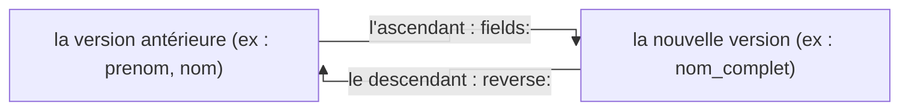

# La migration de version

> **La migration de version** est la migration dont l'origine est la
> version antérieure de l'application. Syncytium calcule les
> correspondances depuis les écarts entre les deux versions ; le
> concepteur n'écrit que ce que le calcul ne devine pas
> ([glossaire](../../glossaire.md)).

Une application évolue : un champ s'ajoute, un autre change de nom, un
troisième se scinde. À chaque version, les données existantes doivent
suivre. Ce fichier montre ce que le concepteur écrit pour cela : rien le
plus souvent, car Syncytium calcule les écarts ; puis le protocole et le
processus, ce qui s'écrit quand le calcul ne suffit pas, les deux volets
d'une règle d'`exchange/`, et les écarts documentés. Le mécanisme de la
migration relève du chapitre 9. Les décisions citées entre
parenthèses renvoient au [registre](../../conception.md).

## Le sommaire

- [L'implicite](#limplicite)
  - [Entre deux versions, rien ne s'écrit](#entre-deux-versions-rien-ne-sécrit)
  - [Une forme courte](#une-forme-courte)
- [Le protocole et le processus](#le-protocole-et-le-processus)
  - [Le même protocole qu'une reprise](#le-même-protocole-quune-reprise)
  - [L'origine et son garde-fou](#lorigine-et-son-garde-fou)
  - [Le processus d'une migration de version](#le-processus-dune-migration-de-version)
- [Ce qui s'écrit](#ce-qui-sécrit)
  - [Le renommage](#le-renommage)
  - [L'éclatement et la fusion](#léclatement-et-la-fusion)
  - [La dépréciation](#la-dépréciation)
  - [Le changement de type](#le-changement-de-type)
  - [La création et la suppression d'un champ](#la-création-et-la-suppression-dun-champ)
- [Les deux volets](#les-deux-volets)
  - [L'ascendant](#lascendant)
  - [Le descendant](#le-descendant)
  - [La bijection, à la charge du concepteur](#la-bijection-à-la-charge-du-concepteur)
  - [Le bloc descendant n'est pas toujours dû](#le-bloc-descendant-nest-pas-toujours-dû)
- [Les écarts documentés](#les-écarts-documentés)

## L'implicite

### Entre deux versions, rien ne s'écrit

D'une version à la suivante, la plupart des changements se devinent : un
champ ajouté, une entité ajoutée. Syncytium porte donc lui-même cette
migration. Son origine, le `from:` implicite, est la version précédente,
et le concepteur n'écrit rien tant que le calcul des écarts suffit.

### Une forme courte

La migration de version est une forme courte (D1968) :

- la version antérieure est la source. Elle se décrit elle-même, par son
  méta-modèle ;
- le mapping est champ à champ, par les noms ;
- la conversion vient du type de destination.

Les règles de la forme courte d'une reprise s'y appliquent (D1896) :

| Entre les deux versions | Ce que la forme courte y voit | Ce qui se passe |
|---|---|---|
| un champ supprimé | une colonne sans champ | la colonne n'est pas lue |
| un champ ajouté | un champ sans colonne | il prend sa valeur par défaut |
| un champ requis ajouté, sans `default:` | un champ sans colonne ni valeur | une erreur d'ingestion, même s'il est alimenté par une règle d'`exchange/` (D1970, D1972) |

La procédure à chaud dépend du moteur : elle est au chapitre 9.

## Le protocole et le processus

### Le même protocole qu'une reprise

Quand le calcul ne suffit plus, le concepteur écrit. Il ne découvre pas
pour autant une nouvelle grammaire : une migration de version et une
reprise suivent le même protocole, et seule l'origine change (D1981). Un processus de migration déclare trois
clés, au même niveau :

| La clé | Ce qu'elle déclare |
|---|---|
| `sources:` | sa source |
| `mapping:` | ses règles de mapping |
| `exchange:` | ses règles de transformation |

Une règle d'`exchange/` a le format d'une règle de mapping, formules
comprises. Son sens diffère : elle porte sur le format existant.

### L'origine et son garde-fou

L'origine d'une migration de version se déduit :

- par défaut, `from:` est la dernière version déployée ;
- le concepteur peut l'écrire. Si la version écrite n'est pas la
  dernière version connue, c'est une erreur d'ingestion (D1983).

Ce `from:` écrit est le garde-fou des règles d'`exchange/` (D1989) :

- une règle oubliée à la version suivante est refusée à l'ingestion, au
  lieu d'être rejouée ;
- l'écrire est donc préconisé dès que le processus porte des règles ;
- c'est le même garde-fou que pour [le renommage](#le-renommage) ;
- Syncytium ne compare pas les règles d'une version à l'autre.

### Le processus d'une migration de version

Le processus d'une migration de version porte un nom libre, comme celui
d'une reprise (D1990). Il se reconnaît à son `from:` :

| Le `from:` du processus | Ce qu'est le processus |
|---|---|
| un connecteur | une reprise |
| un numéro de version, ou rien | une migration de version |

Il ne s'écrit que s'il y a des règles d'`exchange/`. Sans règle, la
migration reste silencieuse, et `migration.yml` n'en dit rien (D1908).

Aucun cas n'en porte. En illustration, un processus nommé
(ex : `contacts`) :

```yaml
# La migration de version des contacts
contacts:

  # La version d'origine
  from: 1.0.0.1

  # Les règles de transformation
  exchange:
    - ~{exchange/.*\.yml}
```

Dans `exchange/`, l'organisation des fichiers est libre, comme dans
`mapping/` : un fichier peut porter plusieurs règles, et un fichier par
règle reste recommandé (D1940, D1990).

## Ce qui s'écrit

Tous les changements ne demandent pas le même effort. Voici les cinq
qu'une version peut porter, et ce que chacun demande au concepteur :

| Le changement | Ce qu'il demande | Où |
|---|---|---|
| un renommage | `from: <ancien nom>` | dans le modèle, sur l'élément renommé |
| un éclatement, une fusion | une règle | dans `exchange/` |
| une dépréciation | le bloc `deprecation:` | sur l'élément |
| un changement de type | rien : le type porte ses règles de conversion | — |
| une création, une suppression de champ | rien : les règles actées persistent | — |

### Le renommage

> **Le renommage** change le nom d'un champ, d'une entité ou d'un module
> d'une version à l'autre. L'élément renommé dit son ancien nom par
> `from:` : ses données suivent ([glossaire](../../glossaire.md)).

Le renommage s'écrit `from: <ancien nom>`, sur le champ, l'entité ou le
module renommé (D651, D1111, D1984). Il s'écrit dans le modèle, à côté
de ce qu'il renomme, non dans `exchange/` (D1985). Dans l'entrepôt, le
nom abrégé du tiers, `abrege`, devient `nom_court` à la version
1.0.0.1 :

```yaml
nom_court:
  type: text[..10]
  from: abrege@1.0.0.0
  label: Nom court
  hint: Le nom court, celui des listes.
```

- **sans précision**, l'ancien nom se lit dans la dernière version
  connue ;
- **`from: <ancien nom>@<version>`** écrit la version d'origine. Le
  numéro s'écrit sans `v` (D1987) ;
- **une version écrite est une erreur d'ingestion** si elle n'est pas la
  dernière version connue, si elle n'existe pas, ou si elle ne porte pas
  l'ancien nom (D1986–D1988).

Écrire le numéro de version est préconisé :

- un renommage oublié dans le modèle se rejouerait à la version
  suivante ;
- deux noms échangés reviendraient en arrière, sans qu'on le veuille ;
- avec la version écrite, l'ingestion refuse le renommage oublié, au
  lieu de le rejouer : la transformation ne se fait pas deux fois.

Le journal de migrations en dérive la translation, et la chaîne API
continue de servir l'ancien nom. Le chapitre 2 décrit
[le renommage d'un champ](../02-modele/03-champs.md#le-renommage-dun-champ).

### L'éclatement et la fusion

> **L'éclatement et la fusion** sont deux transformations d'une
> migration de version : un champ de la version antérieure réparti en
> plusieurs, ou plusieurs réunis en un seul
> ([glossaire](../../glossaire.md)).

Ils s'écrivent dans une règle d'`exchange/`, au format d'une règle de
mapping (D4, D6, D1981, D1990). Ils n'ont pas de grammaire propre : ce
sont deux usages des formules du langage.

| La transformation | Son écriture |
|---|---|
| la fusion | le gabarit |
| l'éclatement | `extract`, et son expression régulière |

Aucun cas n'en porte. En illustration, sur le contact de l'entrepôt, la
fusion :

```yaml
# La fusion : le prénom et le nom de la version antérieure en un seul champ
tiers.contact:

  # Les affectations
  fields:
    nom_complet: "{prenom} {nom}"
```

Et l'éclatement :

```yaml
# L'éclatement : un champ de la version antérieure en deux
tiers.contact:

  # Les affectations
  fields:
    prenom: extract(nom_complet, '^(\S+)')
    nom: extract(nom_complet, '\s(.+)$')
```

### La dépréciation

Une dépréciation se joue en trois temps (D650, D1870, D1872) :

| Le temps | Ce qui se passe |
|---|---|
| l'intention | le bloc `deprecation:` : l'élément vit encore, son avenir est scellé |
| la validation | la beta qui retire l'élément |
| la suppression | un geste de version : l'élément quitte la description, et les règles actées prennent le relais (D11–D13) |

La documentation est obligatoire : elle précise le remplacement, ou
l'abandon. L'ingestion le vérifie. En illustration, un prix unitaire
remplacé :

```yaml
# Le prix unitaire
# Son type, et sa dépréciation : un autre champ le remplace.
unit_price:
  type: amount
  deprecation:
    documentation: "Remplacé par pricing.unit_price à la 2.x."
    to: pricing.unit_price
```

- **le bloc dit l'intention** ; `deprecated` reste le statut d'une
  version (D1872) ;
- **`to:` nomme le remplaçant** ; absent, le bloc dit l'abandon
  (D1871) ;
- **la forme courte nomme le seul remplaçant** (D1873) :
  `deprecation: pricing.unit_price`.

La dépréciation d'un élément de la reprise est dans
[la dépréciation](09-depreciation.md).

### Le changement de type

Chaque type porte sa ou ses règles de conversion (D647, D579, D584) : la
compatibilité, ou le transcodage. Le concepteur n'écrit rien.

### La création et la suppression d'un champ

Les règles actées persistent (D11–D13) : la substitution vers l'ancien,
le défaut vers le neuf.

## Les deux volets

> **Les volets d'une règle d'`exchange/`** sont ses deux sens.
> L'ascendant est son `fields:`. Le descendant est le bloc `reverse:` de
> la même règle ([glossaire](../../glossaire.md)).

Les données ne vont pas que de l'ancienne version vers la nouvelle : une
version antérieure peut encore être servie, et il faut alors revenir de
la nouvelle vers elle. Une règle d'`exchange/` va donc dans deux sens
(D1883, D1992, D1996) :

| Le volet | Son écriture | Son sens |
|---|---|---|
| l'ascendant | `fields:` | de la version antérieure vers la nouvelle |
| le descendant | le bloc `reverse:`, dans la même règle (D1997) | de la nouvelle version vers une ancienne |



Les deux sens se lisent au même endroit. En illustration :

```yaml
# La fusion du prénom et du nom, et son inverse
tiers.contact:

  # L'ascendant : de la version antérieure vers la nouvelle
  fields:
    nom_complet: "{prenom} {nom}"

  # Le descendant : de la nouvelle vers l'antérieure
  reverse:
    prenom: extract(nom_complet, '^(\S+)')
    nom: extract(nom_complet, '\s(.+)$')
```

### L'ascendant

Le modèle de données n'est pas stocké dans toutes ses versions : il
reflète la dernière version en production. L'ascendant permet :

- de basculer ;
- ou de fournir des données sans que le modèle soit encore
  officiellement basculé : une beta, hors du bac à sable, peut être
  servie sans que son modèle soit déployé.

### Le descendant

Le concepteur n'écrit le descendant que là où le moteur ne le dérive
pas :

| Le changement | Ce que le bloc `reverse:` porte |
|---|---|
| un renommage, un champ repris tel quel | rien |
| une formule | la règle inverse |
| un champ supprimé | une substitution : une constante du bloc, `echeance: 30` |
| un éclatement, une fusion | leur inverse écrit, comme toute formule (D91) |

### La bijection, à la charge du concepteur

La bijection d'une règle n'est pas assurée par Syncytium (D91, D1993) :
elle est de la responsabilité du concepteur. En écrivant la règle, il ne
sait pas toujours qu'elle ne conserve pas les données.

Un contrôle, à la migration de version, vérifie donc ce point (D1994) :
il joue l'aller puis le retour sur chaque enregistrement migré, et
compare le retour à l'original. Avec la règle ci-dessus :

| Le temps | `prenom` | `nom` | `nom_complet` |
|---|---|---|---|
| l'original | Jean Pierre | Dupont | |
| l'aller | | | Jean Pierre Dupont |
| le retour | Jean | Pierre Dupont | |

La règle ne conserve pas les données. Un écart entre au rapport de la
migration de version. Il demande une lecture et une validation du
concepteur pour basculer.

### Le bloc descendant n'est pas toujours dû

Une formule peut s'écrire sans bloc descendant (D1995) :

| Les champs que la formule lit | La règle sans bloc descendant |
|---|---|
| ils disparaissent de la nouvelle version | une erreur d'ingestion : une ancienne API ne saurait plus les rendre |
| ils restent | elle est acceptée : elle initialise un champ nouveau, en combinant des champs existants |

Si `prenom` et `nom` restent, `nom_complet` est défini à
l'initialisation. À l'usage, il vit ensuite sa vie dans l'application.

## Les écarts documentés

Le concepteur n'a pas à tenir le journal de ce qui change d'une version
à l'autre : les écarts sont documentés par Syncytium (D1112). La
description d'un champ dit donc ce qu'il est, jamais ce qui a changé :

- la documentation de la version présente les écarts calculés — les
  champs ajoutés, renommés, retypés, supprimés — sans que le concepteur
  les décrive ;
- les notes de version portent l'évolution fonctionnelle.
