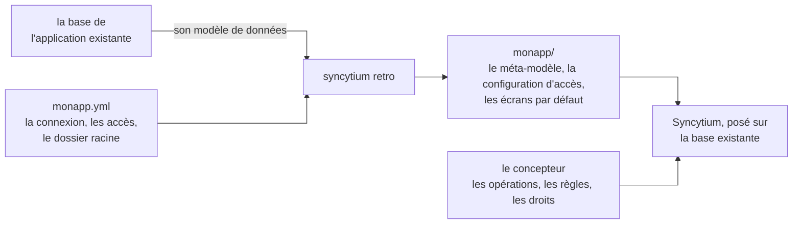

# La rétro-conception

> **La rétro-conception** est le troisième usage du chapitre : un outil
> de Syncytium analyse le modèle de données d'une application existante
> et construit sa configuration. Aucune donnée ne migre
> ([glossaire](../../glossaire.md)).

Cette section exploite les notions abordées pour la reprise et pour la
migration de version : une source que son connecteur décrit, un
méta-modèle, des données qui passent de l'un à l'autre. Dans leur
continuité, Syncytium peut s'adapter à une application existante, grâce
à l'analyse de la description de son modèle de données : c'est la
rétro-conception. Ce fichier dit ce qu'elle est, ce que l'outil
construit et ce qu'il laisse au concepteur, comment elle se montre, et
comment elle se lance. Les décisions citées entre parenthèses renvoient
au [registre](../../conception.md).

## Le sommaire

- [La rétro-conception d'une application existante](#la-rétro-conception-dune-application-existante)
  - [Le principe](#le-principe)
  - [L'intérêt](#lintérêt)
- [Ce que l'outil construit, ce qu'il laisse](#ce-que-loutil-construit-ce-quil-laisse)
  - [Le partage](#le-partage)
  - [Aucune donnée ne migre](#aucune-donnée-ne-migre)
- [Un scénario de démonstration](#un-scénario-de-démonstration)
  - [Quatre temps](#quatre-temps)
  - [Le retour à l'application d'origine](#le-retour-à-lapplication-dorigine)
- [La commande](#la-commande)
  - [`syncytium retro`](#syncytium-retro)
  - [Le fichier de la commande](#le-fichier-de-la-commande)
- [Ce qui reste à préciser](#ce-qui-reste-à-préciser)

## La rétro-conception d'une application existante

### Le principe

La rétro-conception ne migre pas les données, et ne les transforme pas.
Un outil de Syncytium analyse le modèle de données de l'application
existante : le méta-modèle se déduit automatiquement de la description
que le connecteur donne de la base (D1907, D2026). Syncytium se pose
alors sur cette base, telle qu'elle est : ses modules, ses entités et
ses champs sont ceux de l'application (D2027).

### L'intérêt

Le modèle obtenu permet de lancer Syncytium sans une première charge
d'analyse trop lourde : c'est une forme de rétro-ingénierie (D2028). En
démonstration, l'effet est immédiat. Syncytium se plaque sur une
application existante et, en quelques minutes, une nouvelle application
est disponible : de quoi montrer d'un coup l'intérêt de la solution
(D2029, D2097).

## Ce que l'outil construit, ce qu'il laisse

### Le partage

L'outil va au-delà du méta-modèle (D2026). Beaucoup d'éléments se
construisent automatiquement ; trois ne se déduisent pas d'un existant :

| L'outil construit | Le concepteur écrit |
|---|---|
| le méta-modèle, exploitable et opérationnel, à partir du modèle de données existant | les opérations |
| les fichiers de configuration pour accéder à l'application, si cela se déduit | les règles |
| les écrans par défaut : construits pour l'occasion, ou ceux que Syncytium fournit | les droits |

Reporter tout ce qui fait un métier, et ses besoins, est le travail du
concepteur (D2028).



### Aucune donnée ne migre

Le méta-modèle se pose sur le modèle de données existant. Puis Syncytium
prend le relais, en douceur (D2026). La base reste celle de
l'application d'origine.

## Un scénario de démonstration

### Quatre temps

Pour un démonstrateur, la rétro-conception peut être puissante (D2029).
Elle se montre en quatre temps :

1. une application existante est là, avec sa base de données ;
2. le méta-modèle se construit ;
3. Syncytium s'exécute, et montre son initialisation ;
4. le modèle évolue pour une exploitation — ou l'on revient à
   l'application d'origine, si cela ne convient pas.

### Le retour à l'application d'origine

Le retour est possible parce qu'aucune donnée ne migre (D2030) : la
base reste celle de l'application d'origine.

| Ce qui a été fait | Le retour |
|---|---|
| aucune modification du modèle de données | sans perte : l'application d'origine retrouve sa base telle quelle |
| le modèle intègre des évolutions | une perte minimale : une évolution que l'application d'origine ne connaît pas |
| le modèle n'intègre pas des contrôles existants | une perte minimale : des enregistrements entrés sans un contrôle qu'elle imposait |

## La commande

### `syncytium retro`

La rétro-conception se lance par `syncytium retro monapp.yml` (D2030).
Le fichier `monapp.yml` porte :

- les éléments de connexion à la base de données à analyser ;
- les propriétés et les accès ;
- le dossier racine.

Le cadre commun des commandes de `syncytium` se définit au chapitre 10,
l'administration et l'exploitation (D2098).

### Le fichier de la commande

Ce fichier ne sert qu'à construire le dossier `monapp/` (D2031) :

- il n'a pas besoin de variables d'environnement : ses valeurs
  s'écrivent en clair ;
- une fois le dossier construit, il n'est plus exploitable ;
- il est recommandé de ne pas le versionner, surtout s'il contient des
  données sensibles.

Un fichier minimal illustre la proposition :

```yaml
# La base à analyser
# La base de données de l'application existante : la classe de son connecteur, ses paramètres de connexion et ses
# accès, écrits en clair ; la marque * signale un paramètre confidentiel.
database:
  class: postgresql
  parameters:
    host: localhost
    database: monapp
    schema: public
    user: lecteur
    password*: <le mot de passe du compte>

# Le dossier racine
# Le dossier où la commande écrit la configuration construite.
root: monapp/
```

Il se complétera à l'implémentation.

## Ce qui reste à préciser

La rétro-conception n'a pas encore été lue point par point, comme la
reprise et la migration de version l'ont été. Ses points se dégageront à
l'ouverture de cette lecture.
