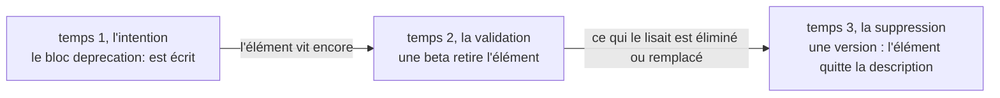

# La dépréciation d'un élément de la reprise

> **La dépréciation** d'un élément annonce son retrait. L'élément vit
> encore ; le bloc `deprecation:` dit ce qui le remplace, ou son abandon.
> Elle ne se confond pas avec la dépréciation d'une version, qui est
> effective ([glossaire](../../glossaire.md)).

Une reprise ne dure pas toujours : le système d'origine s'éteint, une
table cesse d'être lue, une règle en remplace une autre. Avant de
retirer un élément, le concepteur l'annonce. Ce fichier montre comment
se déprécie une migration déclarée, une entité source ou une règle
(D1873, D1877, D2011) : les deux formes du bloc, ce que la dépréciation
touche, l'adresse d'une règle remplaçante, et les trois temps qui mènent
au retrait. Les décisions citées entre parenthèses renvoient au
[registre](../../conception.md).

## Le sommaire

- [Les trois éléments](#les-trois-éléments)
- [Les deux formes](#les-deux-formes)
  - [La forme courte](#la-forme-courte)
  - [La forme longue](#la-forme-longue)
- [Ce que la dépréciation touche](#ce-que-la-dépréciation-touche)
  - [Les sources et les règles, non les destinations](#les-sources-et-les-règles-non-les-destinations)
  - [Signaler n'est pas déprécier](#signaler-nest-pas-déprécier)
  - [Au retrait](#au-retrait)
- [L'adresse d'une règle remplaçante](#ladresse-dune-règle-remplaçante)
  - [Le nom propre d'une règle](#le-nom-propre-dune-règle)
  - [Les trois règles du nom](#les-trois-règles-du-nom)
- [De l'intention à la suppression](#de-lintention-à-la-suppression)
  - [Les trois temps](#les-trois-temps)
  - [`deprecation:` et `deprecated`](#deprecation-et-deprecated)

## Les trois éléments

Trois éléments d'une reprise peuvent être appelés à disparaître :

| L'élément | Pourquoi il disparaît |
|---|---|
| la migration déclarée | le système d'origine s'arrête |
| l'entité source | une table n'est plus fournie |
| la règle | une règle cède à une autre |

La configuration ne retire pas l'élément d'un coup. Elle l'annonce
d'abord, sur l'élément lui-même, dans la version en service (D650,
D1871). La migration continue de tourner comme avant.

## Les deux formes

### La forme courte

Le bloc nomme le remplaçant, rien de plus (D1873) :

- une migration déclarée nomme une autre migration déclarée ;
- une entité source nomme une autre entité source ;
- une règle nomme une autre règle.

Aucun cas n'en porte : l'exemple est d'illustration. Dans l'entrepôt,
PMI céderait à un nouveau système. Une migration nommée (ex : `cegid`)
céderait alors à une autre (ex : `nouvel_erp`) :

```yaml
# La migration cegid : la migration du nouveau système la remplace
cegid:

  # La base d'origine
  # Le storage de PMI, lu en lecture seule.
  from: cegid

  # La dépréciation
  # La migration nouvel_erp prend le relais.
  deprecation: nouvel_erp
```

### La forme longue

Elle porte deux clés (D1871) :

| La clé | Ce qu'elle porte |
|---|---|
| `documentation:` | le texte qui explique la dépréciation. C'est un texte de la version : à plusieurs langues, il les porte toutes (D1474) |
| `to:` | l'élément remplaçant |

- **sans `to:`, le bloc dit l'abandon**, et `documentation:` est
  exigée ;
- **une dépréciation dit toujours le remplacement ou l'abandon** :
  l'ingestion le vérifie (D650) ;
- **le bloc n'a pas de `mode:`** : sa présence dit l'intention (D1872) ;
- **dans une règle, ce `to:` est celui du bloc** : il ne se confond pas
  avec le `to:` de la règle, qui nomme son entité cible.

L'entrepôt a une langue : son texte s'écrit en texte simple. En
illustration, une entité source abandonnée :

```yaml
# Les contacts de PMI : la table n'est plus fournie, sans remplaçante
CONTACT:

  # La dépréciation
  # L'abandon : le texte est exigé.
  deprecation:
    documentation: PMI ne fournit plus les contacts ; ils se saisissent dans l'entrepôt.
```

## Ce que la dépréciation touche

### Les sources et les règles, non les destinations

L'élément déprécié vit encore (D2011). Une dépréciation à venir signale
les sources et les règles, non les destinations (D2012) :

| L'élément déprécié | Ce qu'il signale | Ce qui continue |
|---|---|---|
| la migration déclarée | ses sources et ses règles | ses passages tournent, déclenchés par ses opérations périodiques, jusqu'à la version qui la retire |
| l'entité source | les règles qui la lisent | elle est lue comme avant |
| la règle | rien d'autre qu'elle | elle s'applique comme avant |

- **les destinations ne sont pas signalées** : les entités et les champs
  que la reprise alimente continuent de vivre après elle. Ils
  s'utilisent tels quels, sans que le processus s'exécute ;
- **le dictionnaire de la donnée** le montre : son chapitre 4.1,
  « Reprise des données », donne l'élément déprécié, son remplaçant ou
  son abandon, et ce qu'il signale.

Dans l'entrepôt, en illustration :

- déprécier une migration (ex : `cegid`) signalerait ses vingt-trois
  sources et ses trente-trois règles ;
- déprécier une source (ex : `CONTACT`) signalerait les deux règles qui
  la lisent ;
- les tiers, les articles et les commandes de l'entrepôt ne seraient pas
  signalés.

### Signaler n'est pas déprécier

Rien n'est déprécié en cascade (D2014). Une source ou une règle signalée
garde son propre bloc `deprecation:`, si le concepteur veut annoncer son
retrait.

### Au retrait

« À la dépréciation » désigne le retrait : la version qui retire
l'élément (D2013). Le concepteur élimine ou remplace alors ce qui doit
l'être : une règle qui lit une source retirée, par exemple. Toute erreur
est une erreur d'ingestion (D2012, D2013).

## L'adresse d'une règle remplaçante

### Le nom propre d'une règle

Une migration déclarée et une entité source ont un nom. Une règle porte
le nom de sa source, que plusieurs règles partagent : dans l'entrepôt,
`CONTACT:` ouvre la règle des contacts des clients, et celle des
contacts des fournisseurs.

Une règle remplaçante se désigne donc par son nom propre, la propriété
`name:` (D2015). En illustration, une règle unique reprendrait tous les
contacts :

```yaml
# Les contacts : la règle remplaçante, désignée par son nom propre
CONTACT:

  # Le nom propre de la règle
  name: contacts

  # La cible
  to: tiers.contact
```

La règle qu'elle remplace la nomme, dans son bloc :

```yaml
# Les contacts des clients : la règle contacts la remplace
CONTACT:

  # La cible
  to: tiers.contact

  # Le périmètre
  filter: CTCTTYPCPT = "C"

  # La dépréciation
  deprecation: contacts
```

### Les trois règles du nom

Trois règles accompagnent ce nom (D2016) :

- `name:` ne s'écrit que sur une règle qu'une autre désigne. Les
  trente-trois règles de l'entrepôt n'en portent pas ;
- deux règles d'un même processus ne portent pas le même nom : sinon,
  c'est une erreur d'ingestion ;
- ce `name:` n'est pas celui d'une source, qui nomme sa table (D1918).

## De l'intention à la suppression

### Les trois temps

Un élément ne disparaît pas d'un coup : entre l'annonce et le retrait,
le concepteur a le temps de vérifier que rien n'en dépend plus. Une
dépréciation se joue ainsi en trois temps :

| Le temps | Ce qui se passe |
|---|---|
| 1. l'intention | le bloc est écrit. Rien ne change : la reprise s'exécute comme avant (D650, D1872) |
| 2. la validation | une beta complète la dépréciation : en retirant l'élément, elle la valide (D1870, D1875) |
| 3. la suppression | elle vient avec une version : l'élément quitte la description (D650) |



### `deprecation:` et `deprecated`

Le mot `deprecated` nomme autre chose : le statut d'une version, déposée
dans `versions/deprecated/`. Là, la dépréciation est effective (D1869).
Sur un élément de la reprise, le bloc s'écrit toujours `deprecation:`
(D1871).
