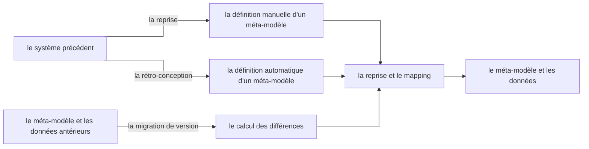

# La migration

> **La migration** porte les données d'une description vers une autre. Elle
> a deux origines : une source, un système précédent, c'est la **reprise** ;
> la version antérieure de l'application, c'est la **migration de version**.
> Dans les deux cas elle applique un **mapping**
> ([glossaire](../../glossaire.md)).

Ce chapitre dit ce que le concepteur écrit pour une migration (D1879).
Il compte trois usages : la reprise, la migration de version, la
rétro-conception (D2025). La reprise vient d'abord : la migration
déclarée, la source, les règles, les contrôles, les compléments. Viennent
ensuite la migration de version, la rétro-conception, la dépréciation,
et ce que tout cela livre à la documentation. L'entrepôt est le fil
rouge des exemples (D2007). Les décisions citées entre parenthèses
renvoient au [registre](../../conception.md).

## Le sommaire

1. La migration
   - [Les trois usages](#les-trois-usages)
   - [Un seul mapping](#un-seul-mapping)
   - [Le dossier d'une migration](#le-dossier-dune-migration)
   - [Ce qui quitte le chapitre](#ce-qui-quitte-le-chapitre)
   - [Les décisions](#les-décisions)
2. [La migration déclarée](02-declaration.md)
   - [Le processus](02-declaration.md#le-processus)
   - [La forme courte](02-declaration.md#la-forme-courte)
   - [Les fichiers et leur ordre](02-declaration.md#les-fichiers-et-leur-ordre)
   - [Le mode et la remise à zéro](02-declaration.md#le-mode-et-la-remise-à-zéro)
   - [La base miroir](02-declaration.md#la-base-miroir)
   - [Les opérations périodiques](02-declaration.md#les-opérations-périodiques)
3. [La source](03-sources.md)
   - [Les deux maisons](03-sources.md#les-deux-maisons)
   - [La description d'une entité source](03-sources.md#la-description-dune-entité-source)
   - [Les colonnes](03-sources.md#les-colonnes)
   - [Les liens entre entités](03-sources.md#les-liens-entre-entités)
   - [L'alias](03-sources.md#lalias)
   - [Le filtre et la partition](03-sources.md#le-filtre-et-la-partition)
4. [Les règles](04-regles.md)
   - [Le sens et la clé](04-regles.md#le-sens-et-la-clé)
   - [La description et les formes longues](04-regles.md#la-description-et-les-formes-longues)
   - [Le partage entre fichiers](04-regles.md#le-partage-entre-fichiers)
   - [Le possesseur et la clé lue](04-regles.md#le-possesseur-et-la-clé-lue)
5. [Les contrôles](05-controles.md)
   - [La validation et son message](05-controles.md#la-validation-et-son-message)
   - [Les rapports](05-controles.md#les-rapports)
   - [Les phases de contrôle](05-controles.md#les-phases-de-contrôle)
   - [Ce que la reprise écrit, ce qu'elle laisse](05-controles.md#ce-que-la-reprise-écrit-ce-quelle-laisse)
6. [Les compléments](06-complements.md)
   - [Au-delà du un pour un](06-complements.md#au-delà-du-un-pour-un)
   - [Le référentiel par valeurs distinctes](06-complements.md#le-référentiel-par-valeurs-distinctes)
   - [L'importation en phases](06-complements.md#limportation-en-phases)
   - [Le rapprochement par le cache](06-complements.md#le-rapprochement-par-le-cache)
   - [Le compteur surchargé](06-complements.md#le-compteur-surchargé)
   - [L'identité partout](06-complements.md#lidentité-partout)
   - [Une entité source, plusieurs fichiers](06-complements.md#une-entité-source-plusieurs-fichiers)
   - [Les composés par la fonction du type](06-complements.md#les-composés-par-la-fonction-du-type)
7. [La migration de version](07-version.md)
   - [L'implicite](07-version.md#limplicite)
   - [Le protocole et le processus](07-version.md#le-protocole-et-le-processus)
   - [Ce qui s'écrit](07-version.md#ce-qui-sécrit)
   - [Les deux volets](07-version.md#les-deux-volets)
   - [Les écarts documentés](07-version.md#les-écarts-documentés)
8. [La rétro-conception](08-retro-conception.md)
   - [La rétro-conception d'une application existante](08-retro-conception.md#la-rétro-conception-dune-application-existante)
   - [Ce que l'outil lit](08-retro-conception.md#ce-que-loutil-lit)
   - [Ce que l'outil construit, ce qu'il laisse](08-retro-conception.md#ce-que-loutil-construit-ce-quil-laisse)
   - [La vie commune avec l'application d'origine](08-retro-conception.md#la-vie-commune-avec-lapplication-dorigine)
   - [Un scénario de démonstration](08-retro-conception.md#un-scénario-de-démonstration)
   - [La commande](08-retro-conception.md#la-commande)
   - [Ce qui reste à la conception](08-retro-conception.md#ce-qui-reste-à-la-conception)
9. [La dépréciation d'un élément de la reprise](09-depreciation.md)
   - [De l'intention à la suppression](09-depreciation.md#de-lintention-à-la-suppression)
   - [Les trois éléments](09-depreciation.md#les-trois-éléments)
   - [Les deux formes](09-depreciation.md#les-deux-formes)
   - [Ce que la dépréciation touche](09-depreciation.md#ce-que-la-dépréciation-touche)
   - [L'adresse d'une règle remplaçante](09-depreciation.md#ladresse-dune-règle-remplaçante)
10. [Ce que la migration livre à la documentation](10-documentation.md)
   - [La facette de la reprise](10-documentation.md#la-facette-de-la-reprise)
   - [La migration de version, dans les documentations](10-documentation.md#la-migration-de-version-dans-les-documentations)

## Les trois usages

Une application peut naître vide, de sa seule description : le tiny le
montre. Ce chapitre montre deux autres aptitudes de Syncytium (D2038) :

- **supporter l'évolution du méta-modèle** : d'une version à la
  suivante, les données suivent ;
- **prendre la suite d'un outil ou d'un système existant** : ses
  données, ou son modèle, sont repris.

Trois usages les portent (D2025) :

| L'usage | D'où l'on part | Ce qui se passe | Ce que le concepteur écrit |
|---|---|---|---|
| **La reprise** | une source, un système précédent | ses données sont lues, contrôlées, puis portées dans l'application | la source, dans `sources/` ; les règles, dans `mapping/` |
| **La migration de version** | la version antérieure de l'application | les données existantes passent au nouveau modèle, à chaud | rien le plus souvent ; un renommage, une règle d'`exchange/` |
| **La rétro-conception** | la base d'une application existante | un outil en déduit la configuration ; aucune donnée ne migre | les opérations, les règles et les droits, que l'outil ne déduit pas |

Les trois usages se lisent sur un seul schéma, dans l'ordre du tableau.
Chacun part d'un existant, définit ou calcule un méta-modèle, puis
passe par la même étape, la reprise et le mapping (D2037). Ils n'ont
qu'une seule issue (D2039).



- **La reprise** part du système précédent. Le concepteur définit le
  méta-modèle à la main. Elle fournit un méta-modèle et des données
  propres à Syncytium, sans toucher au système existant (D2042).
- **La migration de version** part du méta-modèle et des données
  antérieurs. Syncytium calcule les différences. Elle fournit un
  méta-modèle et des données à jour, propres à Syncytium, en ajustant
  l'ancien méta-modèle (D2043).
- **La rétro-conception** part du système précédent. Un outil définit le
  méta-modèle automatiquement. Elle fournit un méta-modèle et des
  données au format du système d'origine, en utilisant le système
  existant (D2043).

Les trois chemins mènent à la même issue : un méta-modèle et ses
données, que Syncytium exploite. Seul change l'endroit où ils vivent :
dans Syncytium pour les deux premiers, dans le système existant pour
le troisième. Ces trois déclinaisons sont propres au processus que l'on
déclenche, et que ce chapitre décrit (D2044).

Les deux premiers usages sont des migrations : des données passent d'une
description à une autre (D1882). Le troisième n'en est pas une :
Syncytium se pose sur la base existante (D1907, D2027).

Dans l'entrepôt (le cas 5), les trois mots ont un visage :

- **la reprise** lit la base de Cegid PMI, par un processus nommé
  (ex : `cegid`) ;
- **la migration de version** mène de la 1.0.0.0 à la 1.0.0.1, où le nom
  abrégé d'un tiers devient son nom court ;
- **la rétro-conception** n'y sert pas : le modèle de l'entrepôt a été
  conçu, non déduit (D882).

## Un seul mapping

Le mapping couvre deux fonctions essentielles : la migration entre deux
versions de l'application, et la migration entre deux schémas, d'un
système existant vers le nouveau (D646). Parce qu'il est le même dans
les deux cas, les deux migrations partagent l'essentiel :

- **le même langage**, et les mêmes conversions (D647) ;
- **le même protocole** : seule l'origine change (D1981) ;
- **la même prudence** : les données sont contrôlées avant d'être
  écrites.

Chacune garde pourtant ses traits propres.

- **Entre deux versions**, la migration se fait à chaud (D3) :
  l'application reste en service. Syncytium déduit seul les cas simples,
  un champ ajouté, une entité ajoutée (D5). Elle se joue en quatre
  gestes : une nouvelle instance créée à côté de l'existante, le plan de
  reprise, la bascule par un changement de référence, la suppression de
  la version antérieure au terme de sa rétention (D631, D1974, D2136).
  Le même mapping sert aussi les API : il engendre la chaîne qui
  traduit une version dans l'autre, dans les deux sens (D11–D13).
- **Depuis un système existant**, `from:` nomme la base d'origine (D610).
  Les interfaces de Syncytium montrent les données migrées et validées
  (D646) : l'écran devient un poste de contrôle (D175–D179, D180).
  Quand un legacy bascule vers Syncytium, une alternative aux passages
  existe, que le concepteur choisit ou non :
  [le double fonctionnement](../09-moteur/04-passage.md#le-double-fonctionnement-une-alternative)
  (D2147).

## Le dossier d'une migration

Une version range sa migration dans un dossier, `migration/` (D1883) :

```text
versions/beta/v1.0.0.1/migration/
├── migration.yml    # un processus nommé (ex : cegid) : la base d'origine, le mode, les opérations périodiques
├── sources/         # vingt-trois entités sources, rangées par module
└── mapping/         # trente-trois règles, en cinq dossiers numérotés
```

- `migration.yml` déclare les processus : voir
  [la migration déclarée](02-declaration.md) ;
- `sources/` décrit le système d'origine : voir [la source](03-sources.md) ;
- `mapping/` porte les règles de mapping, qui associent les champs des
  entités d'une source à ceux de la destination : voir
  [les règles](04-regles.md),
  [les contrôles](05-controles.md) et [les compléments](06-complements.md) ;
- `exchange/` porte les règles de transformation d'une migration de
  version, qui convertissent les données entre les versions pour une
  compatibilité ascendante et descendante : voir
  [la migration de version](07-version.md). Aucun cas n'en a encore.

Le nom du dossier est celui des cas ; son organisation reste libre
(D1883).

## Ce qui quitte le chapitre

Le chapitre définit ce que le concepteur écrit ; ce qui s'exécute est
ailleurs :

- **l'exécution d'un passage** et les conversions, au chapitre 9, le
  moteur (D1880, D1881) : voir
  [l'exécution d'un passage](../09-moteur/04-passage.md) et
  [ce qu'un passage laisse](../09-moteur/05-suivi.md) ;
- **le mécanisme de la migration de version**, au chapitre 9 (D1974) :
  voir [la migration de version, le mécanisme](../09-moteur/03-migration.md) ;
- **le détail du module `_migration`** et sa facette documentation, au
  chapitre 10, l'administration et l'exploitation (D2010) ;
- **le cadre commun des commandes de `syncytium`**, au chapitre 10
  (D2098) ;
- **le contrat de compatibilité vu de l'API**, au chapitre 13 ;
- **la carte des fichiers d'un connecteur**, au
  [chapitre 5](../05-connecteurs/README.md).

Ce qui attend le chapitre 10 est dans
[administration.md](../../administration.md), « Reçu du chapitre 8 », et
dans [migration.md](../../migration.md), qui reste en place jusqu'au
chapitre 10.

## Les décisions

Ce chapitre repose sur les décisions de la famille « la migration », relues
du 08/11/2026 au 19/11/2026 (D1863–D2023). Il vient de l'artefact
préparatoire `mapping.md` (D661) ; le second, `migration.md` (D1028), reste
en place jusqu'au chapitre 10 (D2010). Elles sont 170 décisions au
registre :
D3–D6, D91, D175–D179, D406, D606, D610, D632, D646, D648–D649, D651–D652, D654–D658, D660–D665, D669, D671, D673, D811, D819–D823, D828, D847–D848, D851, D869, D871, D874, D877–D880, D882, D929–D932, D943, D965–D966, D969, D986, D990, D995–D996, D1006–D1007, D1038, D1042, D1044–D1045, D1058, D1087, D1102–D1105, D1111, D1116, D1259, D1262, D1302, D1880, D1882–D1886, D1888–D1898, D1900–D1905, D1907–D1911, D1913–D1916, D1918, D1923, D1925, D1927, D1929–D1930, D1940–D1949, D1951, D1953, D1956, D1958, D1961, D1964, D1966, D1968–D1972, D1981–D1990, D1992–D1993, D1995–D1997, D2007, D2010–D2016, D2025–D2031.
