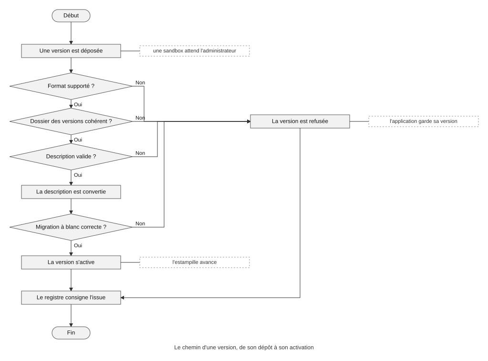

# Le démarrage d'une version

> **L'ingestion** convertit une version de la configuration en une
> entrée du moteur, exploitable par toutes les composantes de
> l'application : les API, les écrans, les fichiers CSV
> ([glossaire](../../glossaire.md)).

Publier une version, c'est déposer un dossier. Entre ce dépôt et le
premier écran servi, le moteur fait donc tout le reste : il découvre la
version, la contrôle, la convertit, migre les données, puis l'active.
C'est le moment où ses contrôles sont les plus nombreux, car une fois la
version ingérée ils s'estompent, et les fichiers ne servent plus que de
trace (D1784). Ce fichier suit ce chemin : les étapes d'une ingestion,
ses contrôles, l'identité d'une version, le registre qui garde la
mémoire des essais, l'estampille que la base porte, ce qui reste après
l'ingestion, et enfin la sandbox d'une beta. Les décisions citées entre
parenthèses renvoient au [registre](../../conception.md).

## Le sommaire

- [Le chemin d'une version](#le-chemin-dune-version)
  - [De la version déposée à la version servie](#de-la-version-déposée-à-la-version-servie)
  - [Quand l'ingestion se déclenche](#quand-lingestion-se-déclenche)
- [Les contrôles](#les-contrôles)
  - [L'en-tête et le format](#len-tête-et-le-format)
  - [La cohérence du dossier des versions](#la-cohérence-du-dossier-des-versions)
  - [La description, vérifiée en entier](#la-description-vérifiée-en-entier)
  - [La migration à blanc](#la-migration-à-blanc)
- [L'identité d'une version](#lidentité-dune-version)
  - [L'environnement et le numéro](#lenvironnement-et-le-numéro)
  - [L'empreinte](#lempreinte)
- [Le registre des versions](#le-registre-des-versions)
- [L'estampille](#lestampille)
- [Après l'ingestion](#après-lingestion)
  - [La logique interne](#la-logique-interne)
  - [Le dossier interne](#le-dossier-interne)
  - [Les fichiers, gardés pour trace](#les-fichiers-gardés-pour-trace)
  - [Ce qui reste contrôlé en fonctionnement](#ce-qui-reste-contrôlé-en-fonctionnement)
- [La sandbox](#la-sandbox)
  - [L'origine d'une beta](#lorigine-dune-beta)
  - [La mise en service, d'office](#la-mise-en-service-doffice)
  - [La migration de la copie, au choix du concepteur](#la-migration-de-la-copie-au-choix-du-concepteur)
  - [La recharge](#la-recharge)

## Le chemin d'une version

### De la version déposée à la version servie

Une version passe par sept étapes, toujours dans le même ordre. Chacune
peut l'arrêter :

| L'étape | Ce que le moteur fait | Ce qui l'arrête |
|---|---|---|
| la découverte | il lit le dossier des versions, et y trouve une version qu'il n'a pas encore ingérée (D324) | — |
| l'en-tête | il lit le format que la description déclare (D322) | un format plus récent que lui (D330) |
| le dossier des versions | il vérifie les statuts, leurs transitions, et le `from:` d'une beta (D344, D928, D2166) | une version dans deux statuts, un `from:` cassé, ou resté sous `production` |
| la description | il la vérifie en entier (D328) | toute erreur d'ingestion |
| la conversion | il la compile dans sa logique interne (D327, D329) | — |
| la migration à blanc | il joue la migration de version sur les données, sans rien toucher (D1974) | une donnée qui ne passe pas |
| l'activation | la version s'active, l'estampille avance, le registre consigne (D93, D326) | — |

<p align="center"></p>

Une version arrêtée n'est jamais servie à moitié : l'application
continue sur la version en service, et le refus est consigné au
[registre des versions](#le-registre-des-versions).

### Quand l'ingestion se déclenche

Le concepteur ne lance rien : déposer suffit (D324, D921).

- **au démarrage** de l'instance, le moteur lit le dossier des
  versions ;
- **ensuite, sans redémarrage** : la configuration se relit à chaud. La
  montée de version sans arrêt de l'application est un point crucial du
  projet (D801) ;
- **l'application rejoint la version la plus élevée** du statut de son
  mode d'exécution : `beta` ou `production` (D801, D2165). Le
  numéro qui compte est celui que `version.yml` porte en tête ;
- **la description est contrôlée dès le dépôt** : une erreur est dite
  au concepteur sans attendre (D2164) ;
- **la migration attend une période de faible affluence** : elle se
  joue alors, et la version devient sollicitable, par les API et par
  les écrans (D7, D328, D2163). Voir
  [le moment](03-migration.md#le-moment--une-période-de-faible-affluence).

Le statut dit l'environnement qui sert la version. Dans l'entrepôt (le
cas 5), le statut `beta` désigne le staging :

```yaml
# Les versions beta s'exécutent sur l'environnement de développement.
environment: staging

# Chaque dossier nommé vM.m.i.b qui porte un version.yml est une version beta.
versions:
  - ~{v[0-9]+\.[0-9]+\.[0-9]+\.[0-9]+/version\.yml}
```

Deux règles tiennent ensuite pour toute la vie de la version :

- **les écrans suivent toujours la dernière version déployée** (D10).
  L'utilisateur ne choisit pas sa version : seules les API en servent
  plusieurs, ce que dit le chapitre 13 ;
- **une version `beta` fonctionne dans une sandbox** : l'environnement
  que son statut désigne, le staging dans l'entrepôt. Syncytium y copie
  d'office la base de son origine (D2168). Voir
  [la sandbox](#la-sandbox).

## Les contrôles

### L'en-tête et le format

La première clé de `syncytium.yml` nomme le format de la configuration
(D322) : elle décrit le cadre, et le compilateur utilisé (D2134). Voir
[le core en tête](../01-configuration/README.md#le-core-en-tête). Celle
de l'entrepôt :

```yaml
# Le format de la configuration
# La version de la grammaire que parle ce projet : un moteur qui ne la connaît pas refuse le projet à la lecture de
# cette seule ligne ; un format plus ancien est converti à l'ingestion.
from: Syncytium-1.0
```

Le moteur compare ce format à celui qu'il connaît :

| Le format déclaré | Ce que fait le moteur |
|---|---|
| celui du moteur | il poursuit |
| un format antérieur | il le lit, et le compile directement dans sa logique interne à jour (D331) |
| un format plus récent | il refuse, sur la seule lecture de l'en-tête, avant toute ingestion (D330) |

- le refus donne la version de moteur requise. Il est consigné au
  registre des versions, avec la cause « format non supporté » ;
- incrémenter le build de la version n'y change rien : c'est le moteur
  qui doit monter (D330) ;
- les fichiers du concepteur ne sont jamais réécrits. Un format ancien
  reste tel qu'il a été écrit, commentaires compris (D331, D332).

### La cohérence du dossier des versions

Le statut d'une version est son emplacement, et ses transitions sont
des gestes de fichier : voir
[`versions/`](../01-configuration/03-arbre.md#33-versions--le-cycle-de-vie-en-dossiers).
Le moteur vérifie ces gestes avant d'ingérer :

| Ce qu'il trouve | Ce qu'il fait |
|---|---|
| une même version dans deux dossiers de statut | une erreur (D344) |
| une transition interdite, de `production` vers `beta` par exemple | une erreur (D344, D345) |
| une version sous `production` qui porte encore `from:` | une erreur avant l'ingestion : la ligne se retire à la promotion (D928) |
| une version `beta` dont `from:` nomme une version absente | une erreur : le lien est cassé, le concepteur réécrit `from:` (D928, D2166) |

Les dossiers sont le geste, l'état ingéré est la vérité : le statut
d'une version est porté par son ingestion, que le registre consigne
(D344). Aucun lien ne se devine : il s'écrit, ou c'est une erreur.

### La description, vérifiée en entier

La description se vérifie en entier avant de servir (D328). Les causes
de refus sont réunies au chapitre 1 :
[l'ingestion, ce qui est refusé](../01-configuration/06-regles.md#5-lingestion--ce-qui-est-refusé).
Elles ont un point commun : aucune n'attend l'exécution. Une formule mal
typée, une référence de fichier absente, un nom en double sont vus ici,
jamais devant l'utilisateur.

Les hooks suivent la même règle. Un hook est déployé, versionné et
validé avec la description : un hook en défaut arrête l'ingestion (D52).

### La migration à blanc

L'ingestion d'une version comprend la migration de ses données, jouée à
blanc (D1974, D1977). Le moteur prépare une nouvelle instance et y porte les
données existantes, sans toucher à ce qui est en service. Une valeur qui
ne passe pas fait une erreur d'ingestion : la version est refusée, et
rien n'a changé. Le mécanisme est décrit dans
[la migration de version](03-migration.md).

## L'identité d'une version

### L'environnement et le numéro

Le dépôt du client est un dossier, qui contient toute la description du
projet. Il se synchronise par git ou par un autre dispositif : ce
dispositif, et les droits de qui y pousse, sont en dehors de Syncytium
(D336, D920).

L'identité d'une version ne tient donc à aucun outil. C'est un couple
(D920, D927) :

- **l'environnement** ;
- **le numéro de la version**, en quatre nombres.

Le contenu n'y entre pas. Une version ingérée l'est une fois : si la
configuration change sous le même numéro, dans le même environnement,
elle n'est pas relue. Il n'y a ni refus, ni relecture : la version en
service reste celle de l'ingestion.

### L'empreinte

> **L'empreinte d'une version** est la trace du contenu de son dossier,
> calculée à l'ingestion et consignée au registre des versions. Elle ne
> décide de rien : elle révèle qu'un dossier a changé après coup
> ([glossaire](../../glossaire.md)).

L'ingestion calcule l'empreinte du dossier de la version, et la consigne
au registre, sous la clé de la version (D920). Elle est ensuite
recalculée à chaque chargement, et comparée à celle du registre (D927) :

| L'empreinte recalculée | Ce que fait le moteur |
|---|---|
| identique | rien |
| différente | il écrit une trace au journal, au niveau `warning` : le concepteur est informé qu'il doit changer de numéro |

Dans l'entrepôt, la version 1.0.0.1 est en essai sur le staging.
Supposons que le concepteur y corrige un libellé, sans changer le
numéro :

- le staging continue de servir la 1.0.0.1 telle qu'elle a été ingérée ;
- le journal trace l'écart, à chaque chargement ;
- la correction entre avec la 1.0.0.2, où seul le build a monté.

Le numéro de version reste ainsi une promesse, un contenu par numéro,
sans que le moteur bloque quoi que ce soit. Les données d'une version
`beta`, elles, se réinitialisent à la demande : voir
[la recharge](#la-recharge).

## Le registre des versions

> **Le registre des versions** est la mémoire que le moteur garde des
> versions qu'il a essayées, validées ou en erreur, dans chaque
> environnement ([glossaire](../../glossaire.md)).

Le registre répond à une question simple : cette version a-t-elle déjà
été essayée ici, et avec quelle issue ? Sa clé est l'identité de la
version, l'environnement et le numéro (D326, D920). Pour chaque version,
il garde :

| Ce qu'il garde | À quoi cela sert |
|---|---|
| l'issue de l'ingestion : validée, ou en erreur avec sa cause | une version en erreur n'est pas réessayée telle quelle |
| le statut ingéré | il est la vérité du cycle de vie, quand les dossiers n'en sont que le geste (D344) |
| l'empreinte du dossier | elle révèle une configuration changée sous le même numéro (D927) |

Une version en erreur n'est pas réessayée sans un incrément, au moins du
build (D326). Le nouvel essai est ainsi un acte explicite du
concepteur : pas d'acharnement, et chaque tentative reste traçable. Une
seule cause échappe à cette règle : le format non supporté, où c'est le
moteur qui doit monter (D330).

L'ingestion est un acte tracé du concepteur ; la recharge d'une version
`beta`, un acte d'administration, se consigne au même registre (D920,
D921).

## L'estampille

> **L'estampille** est la marque de version que la base porte : la
> version de la description, et celle du moteur. Le moteur la contrôle
> à chaque démarrage ([glossaire](../../glossaire.md)).

Une base peut être restaurée, copiée, ou servie par un moteur plus
ancien : le système de gestion de base de données n'en sait rien. La
base dit donc elle-même où elle en est. L'estampille porte deux axes
(D93) :

- **la version de la description**, le schéma métier ;
- **la version du moteur**, son format.

Ce sont des paramètres du moteur : le concepteur ne les édite pas.
Chaque schéma porte sa version dans une table système (D678).

Au démarrage, le moteur compare l'estampille à ce qu'il est et à ce
qu'il doit servir. Quand le doute existe, il ne sert pas :

| Ce que l'estampille dit | Ce que fait le moteur |
|---|---|
| les données sont à la version attendue | il sert |
| les données sont en retard sur la description | il migre : voir [la migration de version](03-migration.md) |
| les données sont en avance : le moteur est plus ancien qu'elles | il refuse de démarrer |
| l'estampille est absente ou corrompue | il initialise la base, ou il refuse |

L'estampille est aussi la source de vérité de « la version courante » :
c'est elle que la migration de version lit pour savoir d'où elle part.

## Après l'ingestion

### La logique interne

Le fichier est le code source de l'application : voir
[la description et le moteur](README.md#la-description-et-le-moteur).
L'ingestion le compile dans la logique interne du moteur, et c'est elle
qui sert (D327) :

- **les fichiers sont inertes** : les modifier après la lecture ne
  reconstruit rien, et n'altère rien de l'existant ;
- **rien n'est revérifié** à chaque sollicitation, ni à chaque
  relance ;
- **la forme compilée est gardée** : le moteur traduit les descriptions
  dans un journal à son format, propre à la performance. À la relance,
  les règles sont prêtes à l'emploi, et les optimisations déjà faites
  resservent (D329).

### Le dossier interne

> **Le dossier interne** est le dossier, propre à l'application, où le
> moteur range tout ce qu'il génère pour une version. Il n'est ni
> versionné, ni poussé sur un git ([glossaire](../../glossaire.md)).

Une version a donc deux dossiers, qui ne se confondent pas (D2154) :

| Le dossier | Ce qu'il contient | Qui l'écrit | Où il vit |
|---|---|---|---|
| le dossier de la version, dans le dépôt du client | la description : le code source | le concepteur | il est versionné, et synchronisé par git ou par un autre dispositif (D336) |
| le dossier interne de la version | tout ce que l'ingestion génère pour elle, la forme compilée en tête (D329) | le moteur | dans l'application : ni versionné, ni poussé sur un git |

La séparation vaut dans les deux sens. Le moteur n'écrit jamais dans le
dépôt du client : les fichiers du concepteur ne sont pas réécrits
(D331, D332). Et rien de ce que le moteur génère ne remonte vers ce
dépôt.

Le dossier interne se déclare au fichier de l'environnement, par une
clé, comme le dossier des journaux (D2171). Le nom de cette clé reste à
écrire.

Si un arrêt brutal surprend une ingestion, le dossier interne de la
version en cours est supprimé au redémarrage : la relance ne part
jamais d'une version partielle. Voir
[le redémarrage après un arrêt brutal](06-demarrage.md#le-redémarrage-après-un-arrêt-brutal).

Le dossier interne reçoit aussi le détail des anomalies d'une reprise,
passage après passage (D2164) : voir
[le détail et sa rétention](05-suivi.md#le-détail-et-sa-rétention).

### Les fichiers, gardés pour trace

Dès qu'une version est ingérée, ses fichiers changent de rôle : ils ne
sont plus traités, ils sont gardés pour trace (D1784). Le concepteur y
relit ce qu'il a publié ; le moteur, lui, ne les relit que pour en
recalculer l'empreinte.

### Ce qui reste contrôlé en fonctionnement

Les contrôles de la description s'arrêtent à l'ingestion. Ceux des
données continuent, à chaque écriture : les droits, la confidentialité,
l'intégrité. Ils sont au chapitre 7 :
[les invariants](../07-securite/09-invariants.md). On y retrouve la
concurrence par champ (D111), les identifiants invariants (D142) et
l'intégrité des références, qui survit à l'effacement (D138, D139).

## La sandbox

> **La sandbox** est l'environnement fermé où une version `beta`
> fonctionne : elle y a sa propre base, copiée de celle de son origine
> ([glossaire](../../glossaire.md)).

Une version à l'essai ne doit rien abîmer. Elle ne travaille donc
jamais sur la base de la production : elle travaille sur une copie,
dans un environnement à part. Cet environnement est la sandbox. Il n'y
a pas de dossier `versions/sandbox/` : c'est le statut `beta` qui
utilise la sandbox, et la sandbox est l'environnement que `beta.yml`
désigne, quel que soit son nom (D2165, D2167, D2168). Dans l'entrepôt
(le cas 5), c'est le staging.

### L'origine d'une beta

Une version `beta` nomme son origine dans son `version.yml`, par
`from:` et le seul numéro de la version (D2166). Une même version ne
peut pas être dans deux statuts : son numéro suffit donc à dire si
l'origine est en production ou en beta.

```yaml
# L'origine de la version
# La version dont la base est copiée dans la sandbox, nommée par son seul numéro.
from: v1.0.0.0
```

Trois origines sont possibles (D2164) :

| L'origine | Ce que `version.yml` écrit | Ce que fait Syncytium |
|---|---|---|
| aucune : c'est la première version | pas de `from:` | il crée le modèle |
| la dernière version en production | `from: v1.0.0.0` | il copie la base de la production |
| une autre beta | `from: v1.0.0.1` | il copie la base de cette beta |

Si la base de l'origine n'existe pas, Syncytium crée le modèle, comme
pour une première version (D2164).

### La mise en service, d'office

Le concepteur ne lance rien : déposer la version suffit, et Syncytium
fait le reste d'office (D2168). Dans l'entrepôt, la production sert la
1.0.0.0. La 1.0.0.1 est déposée dans `versions/beta/`, avec
`from: v1.0.0.0` :

| Le geste | Ce qu'il fait |
|---|---|
| le contrôle | la description est contrôlée dès le dépôt (D2164) |
| la copie | la base de la 1.0.0.0 est copiée dans la sandbox, le staging ; l'origine n'est jamais touchée (D907) |
| la migration, sauf si la version écrit `migrate: false` | la copie est portée à la 1.0.0.1 |
| la rotation des clés | les valeurs chiffrées copiées sont rechiffrées sous la clé de la sandbox (D915) : voir [la rotation](07-secrets.md#la-rotation-des-clés) |

### La migration de la copie, au choix du concepteur

Par défaut, la copie est migrée : la beta est servie sur une base à sa
version. Le concepteur peut s'en passer, une fois pour la version, par
la clé `migrate:` de `version.yml`, à côté de `from:` (D2168, D2171) :

```yaml
# L'origine de la version
# La version dont la base est copiée dans la sandbox, nommée par son seul numéro.
from: v1.0.0.0

# La migration de la copie
# Sans cette clé, true : la copie est migrée vers la version. À false, elle reste au modèle de son origine.
migrate: false
```

| `migrate:` | La base de la sandbox | Comment la beta lit ses données |
|---|---|---|
| `true`, la valeur par défaut | elle est copiée, puis portée à la version de la beta | directement |
| `false` | elle est copiée, et reste au modèle de l'origine | par les règles de migration ascendantes, qui délivrent les données dans la forme de la dernière version (D1996, D2164) |

Supposons que la 1.0.0.1 renomme un champ. Avec la migration, la base
du staging porte le nouveau nom. Sans elle, la base garde l'ancien nom,
et la règle ascendante le présente sous le nouveau : voir
[les deux volets](../08-migration/07-version.md#les-deux-volets).

Une beta peut naître d'une autre beta : `from: v1.0.0.1`. Les
migrations, ou les règles ascendantes, s'enchaînent alors d'origine en
origine, jusqu'à la version à l'essai (D908).

### La recharge

> **La recharge** réinitialise les données d'une version `beta` : elle
> recopie la base de son origine ([glossaire](../../glossaire.md)).

Un essai use ses données : après quelques jours, on veut repartir de
l'origine. Les données d'une beta se réinitialisent donc à la demande
(D2164). La recharge, `reload` (D922) :

- recopie la base de l'origine, la migre sauf si la version écrit
  `migrate: false`, et rejoue la rotation des clés ;
- est un geste de l'administrateur, tracé, et consigné au registre des
  versions (D921) ;
- ne vaut que pour une version `beta` : une version en `production` ne
  se recharge pas.

La vie de l'instance d'une sandbox, sa conservation, sa suppression et
ses commandes, relève de l'exploitation : elle est au chapitre 10
(D912).
