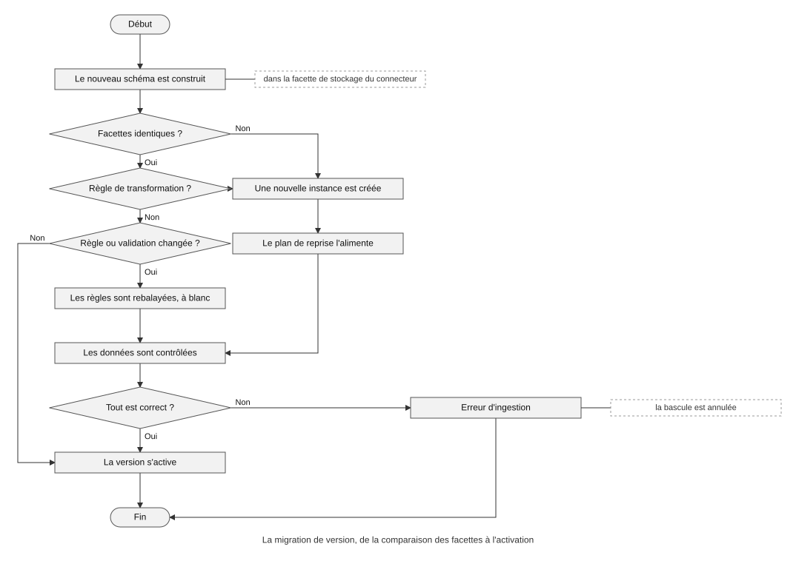
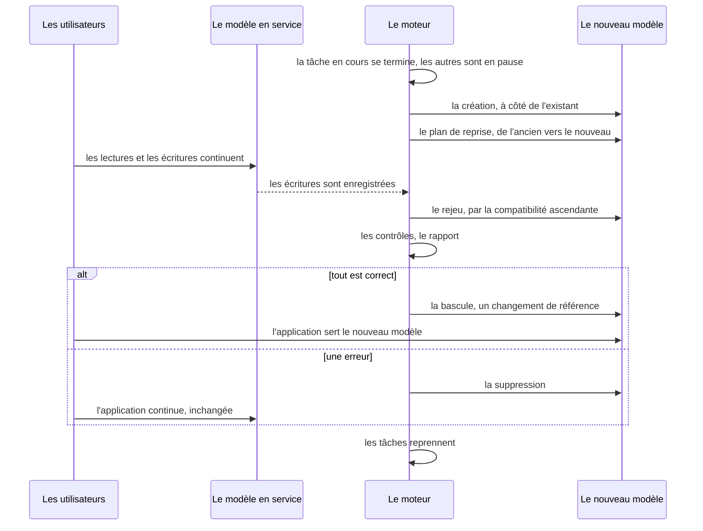

# La migration de version : le mécanisme

> **La migration de version** est la migration dont l'origine est la
> version antérieure de l'application : d'une version à la suivante,
> les données existantes passent au nouveau modèle
> ([glossaire](../../glossaire.md)).

Le chapitre 8 dit ce que le concepteur écrit pour une
[migration de version](../08-migration/07-version.md) : rien le plus
souvent, parfois un renommage ou une règle de transformation. Reste à
dire ce que le moteur fait de ces données qui doivent changer de forme
pendant que l'application sert. Ce fichier suit ce mécanisme : ce qui
le déclenche, la comparaison qui décide de tout, les deux chemins
qu'elle ouvre, leur issue, ce que deviennent les lectures et les
écritures pendant ce temps, puis la bascule, le retour en arrière, le
changement de connecteur et le coût assumé. Les décisions citées entre
parenthèses renvoient au [registre](../../conception.md).

## Le sommaire

- [Ce qui déclenche le mécanisme](#ce-qui-déclenche-le-mécanisme)
- [La comparaison des facettes](#la-comparaison-des-facettes)
- [Les deux facettes sont identiques](#les-deux-facettes-sont-identiques)
- [Les deux facettes diffèrent](#les-deux-facettes-diffèrent)
- [L'issue](#lissue)
  - [La version s'active, ou rien ne change](#la-version-sactive-ou-rien-ne-change)
  - [L'erreur se joue sur les données](#lerreur-se-joue-sur-les-données)
  - [Le défaut qui change](#le-défaut-qui-change)
  - [Le contrôle de la bijection](#le-contrôle-de-la-bijection)
- [Pendant la migration](#pendant-la-migration)
  - [Avant de démarrer : les tâches](#avant-de-démarrer--les-tâches)
  - [L'activité continue](#lactivité-continue)
- [La bascule](#la-bascule)
  - [Les lecteurs externes de la base](#les-lecteurs-externes-de-la-base)
- [Le retour en arrière](#le-retour-en-arrière)
  - [La rétention de la version antérieure](#la-rétention-de-la-version-antérieure)
  - [La restauration](#la-restauration)
- [Le changement de connecteur](#le-changement-de-connecteur)
  - [Le contrat qui le rend possible](#le-contrat-qui-le-rend-possible)
  - [La non-dépendance à une technologie](#la-non-dépendance-à-une-technologie)
- [Ce que le mécanisme coûte](#ce-que-le-mécanisme-coûte)

## Ce qui déclenche le mécanisme

Toute version nouvelle ne migre pas. Le mécanisme part de l'une de
trois causes (D1969, D1979) :

| La cause | Un exemple |
|---|---|
| un écart de structure entre deux versions | un champ ajouté, un type modifié, une entité renommée |
| des règles de transformation, écrites dans `exchange/` | une valeur renommée dans une liste (D1971) |
| un changement de connecteur, dans un environnement | la base passe de MySQL à PostgreSQL |

Sans aucune des trois, la version s'active sans migration. L'absence
d'écart de structure ne suffit pas à l'écarter : une règle de
transformation peut modifier les valeurs d'un champ sans toucher à sa
forme (D1969). Un champ calculé, lui, ne touche jamais au stockage
(D673).

## La comparaison des facettes

> **La facette** d'un type est l'un de ses modes de représentation : la
> valeur logique, le stockage physique, l'affichage, la forme d'API
> ([glossaire](../../glossaire.md)).

Changer le type d'un champ demande d'habitude deux conversions : celle
de la forme d'enregistrement du champ dans la base, puis celle des
valeurs existantes. La première est critique, avec un risque de perte ;
la seconde est laissée au moteur de la base, ou à un script. Syncytium
travaille autrement, pour deux raisons (D1974) :

- ses types sont simples comme complexes. Un type complexe se range
  souvent en plusieurs données simples : un montant et sa devise ;
- mettre en place une version ne transforme pas seulement le stockage :
  elle applique aussi les règles de vérification.

Le moteur ne modifie donc pas le modèle en service. Il construit le
schéma de la nouvelle version dans la facette de stockage du
connecteur, et le compare au schéma en production. Un schéma tenu en
mémoire peut suffire à cette comparaison. Tout le reste en découle :

<p align="center"></p>

## Les deux facettes sont identiques

Le modèle garde alors sa forme dans le connecteur. Seul le format des
données stockées peut changer : une unité retirée d'une mesure, un
format de texte. Trois cas se présentent (D1974, D2138) :

| Ce que la version change | Ce que fait le moteur |
|---|---|
| ni règle, ni validation, ni règle de transformation | il ne touche pas aux données |
| une règle ou une validation apparaît, ou change | il rebalaye les règles, à blanc |
| la version porte des règles de transformation | il prévoit une nouvelle instance de la base, pour valider |

Dans le premier cas, la version change des éléments visuels, des API,
ou l'organisation logique des données : le module d'une entité, un
groupe de propriétés, une liste.

Dans le deuxième, le moteur vérifie que toutes les données respectent
les règles nouvelles, sans rien écrire.

Dans le troisième, une transformation modifie des valeurs. Elle peut
donc avoir des impacts sur des règles, ou sur des traitements. Le
moteur ne la joue pas sur le modèle en service (D2138) :

- **il prévoit une nouvelle instance de la base**, à côté de
  l'existante, comme lorsque
  [les deux facettes diffèrent](#les-deux-facettes-diffèrent) ;
- **il y applique les transformations, puis les vérifications**.
  L'ordre compte : pour retirer une valeur d'une liste, il faut d'abord
  la renommer ;
- **il valide sur cette instance**, avant toute bascule.

Dans les deux derniers cas, le moteur ne traite que ce qui est touché :
le graphe de dépendance borne les vérifications et les transformations
aux impacts identifiés.

Dans l'entrepôt (le cas 5), la version 1.0.0.1 fait de la langue d'un
tiers une liste : français, anglais, allemand, espagnol. Supposons
qu'un tiers porte encore `it` :

- la vérification échoue sur cette valeur ;
- le concepteur écrit, dans `exchange/`, la transformation qui la
  traduit ;
- à l'essai suivant, le moteur prévoit une nouvelle instance : la
  transformation y passe d'abord, la vérification ensuite.

## Les deux facettes diffèrent

> **Le plan de reprise** est la suite des opérations par lesquelles le
> moteur porte les données d'un modèle vers un autre, dans une
> migration de version ([glossaire](../../glossaire.md)).

Dès que les deux facettes diffèrent, même de peu, le moteur ne retouche
pas le modèle en service (D1974) :

- **il crée un nouveau modèle** dans le connecteur, à côté de
  l'existant ;
- **il dresse un plan de reprise** des données, de l'ancien modèle vers
  le nouveau ;
- **il l'applique**, sans modifier l'ancien.

Le même chemin sert quand les deux facettes sont identiques et que la
version porte des règles de transformation : la nouvelle instance y est
prévue pour valider (D2138).

Un champ qui passe de `text[..20]` à `text[..40]` suffit : les deux
facettes diffèrent, un nouveau modèle est créé, et le concepteur n'a
rien à écrire.

Le connecteur joue ces gestes par les méthodes de son contrat (D631,
D680) : `create_instance` crée le nouveau modèle, les méthodes
d'enregistrement portent le plan de reprise, `delete_instance` supprime
le modèle qui n'a plus cours. Voir
[le storage](../05-connecteurs/05-storage.md). La bascule, elle, est un
changement de référence, que Syncytium tient (D2136) : voir
[la bascule](#la-bascule).

Le plan de reprise suit le protocole d'une reprise : seule l'origine
change. Ses correspondances se déduisent des deux descriptions, sans
que le concepteur écrive rien (D632).

## L'issue

### La version s'active, ou rien ne change

Les deux chemins mènent à la même alternative (D1974) :

| Le constat | Ce que fait le moteur |
|---|---|
| tout est correct | la version s'active ; quand une nouvelle instance a été créée, Syncytium bascule vers elle |
| une erreur apparaît | c'est une erreur d'ingestion : la bascule est annulée, la nouvelle instance est supprimée |

La migration est transactionnelle (D9) : elle réussit entièrement, ou
la base reste dans l'état précédent. Avant la bascule, revenir en
arrière ne coûte donc rien : le modèle en service n'a pas été touché.

### L'erreur se joue sur les données

Une conversion risquée ne fait pas refuser une version d'avance. Le
moteur joue le plan sur les données réelles, et seule une valeur qui
échoue fait l'erreur (D1975) :

| Le changement | Les données | L'issue |
|---|---|---|
| de `text[..40]` à `text[..20]` | toutes les valeurs tiennent en vingt caractères | la version passe |
| de `text[..40]` à `text[..20]` | une valeur dépasse | une erreur d'ingestion |
| un texte devient une liste | une valeur est hors de la liste | une erreur d'ingestion ; le concepteur écrit la transformation |

Une règle écrite par le concepteur se juge autrement. Dans une reprise,
une formule qui range un texte trop long est refusée dès l'ingestion,
avant toute donnée : voir
[le texte trop long](../08-migration/05-controles.md#le-texte-trop-long).
La migration de version, elle, n'a pas de formule : elle n'a que des
données (D1977).

### Le défaut qui change

Quand le `default:` d'un champ change d'une version à l'autre, les
enregistrements existants gardent leur valeur (D1976). Le nouveau
défaut ne vaut que pour ceux qui sont créés ensuite : rien ne distingue
une valeur saisie d'une valeur née du défaut.

### Le contrôle de la bijection

> **Le rapport de migration de version** porte ce que la migration de
> version relève avant la bascule
> ([glossaire](../../glossaire.md)).

Une règle d'`exchange/` va dans deux sens : son volet ascendant, de la
version antérieure vers la nouvelle, et son volet descendant, de la
nouvelle vers une ancienne (D1996). Voir
[les deux volets](../08-migration/07-version.md#les-deux-volets). Le
moteur s'en sert dans deux situations (D2136) :

| La situation | Ce que la règle y fait |
|---|---|
| les compatibilités ascendante et descendante | une version antérieure de l'API reste servie (D11–D13) : ce qu'elle écrit monte par l'ascendant, ce qu'elle lit redescend par le descendant |
| le traitement de reprise, après la validation du modèle | le plan de reprise porte les données existantes vers le nouveau modèle, par l'ascendant |

Dans les deux, la règle doit conserver les données. Ce qu'une ancienne
API a écrit, elle doit pouvoir le relire ; ce que la reprise a porté
dans le nouveau modèle, une ancienne API doit le retrouver. Or cette
bijection n'est pas assurée par Syncytium : elle est de la
responsabilité du concepteur (D1993). Le moteur la vérifie donc pendant
le traitement de reprise, une fois le nouveau modèle validé (D1994) :

- il joue l'aller puis le retour sur chaque enregistrement migré ;
- il compare le retour à l'original ;
- il porte au rapport de migration de version les enregistrements dont
  le retour diffère.

Sans écart, la version s'active seule. Avec un écart, la bascule attend
une lecture et une validation du concepteur. L'exemple d'une règle qui
ne conserve pas les données est au chapitre 8 :
[la bijection, à la charge du concepteur](../08-migration/07-version.md#la-bijection-à-la-charge-du-concepteur).

## Pendant la migration

### Avant de démarrer : les tâches

Une tâche est un traitement que la file exécute à part : une génération
de documents, un envoi de mails (D24, D55). Voir
[la file](../06-operations/05-taches.md#la-file). Une migration ne
démarre pas au milieu de l'une d'elles (D2136) :

- avant de démarrer, le moteur attend qu'une tâche en cours se
  termine ;
- il met en pause toutes les autres ;
- à la fin de la migration, ou en cas d'échec, les tâches reprennent.

Ex. : une génération de documents est en cours quand la version est
déposée. Elle va à son terme. L'envoi de mails qui la suivait dans la
file attend. La migration se joue, réussit ou échoue, puis l'envoi
part.

### L'activité continue

L'application ne s'arrête pas. Dès le démarrage de la migration,
l'activité continue sur le modèle en service (D1974) :

| L'activité | Ce qu'elle devient |
|---|---|
| les lectures | elles continuent : lire ne modifie ni les données, ni leur structure (D676) |
| les écritures | elles s'appliquent au modèle en service, et sont enregistrées, comme pour un plan de reprise ou de continuité d'activité |
| le rejeu | les écritures enregistrées sont appliquées au nouveau modèle par la compatibilité ascendante, comme l'appel d'une API d'une version antérieure : aucune mécanique dédiée (D677) |
| les tâches | elles sont en pause, et reprennent à la fin de la migration, ou à son échec (D24, D2136) |
| la bascule | c'est un changement de référence : elle est rapide, et les lectures n'attendent que ce temps (D8, D679, D2136) |

Une erreur au rejeu, dans le nouveau modèle, est une erreur
d'ingestion : la version est refusée.



## La bascule

> **La bascule** est le moment où ce qui a été préparé à part devient
> l'existant : dans une migration de version, Syncytium change de
> référence, vers la version cible ([glossaire](../../glossaire.md)).

La bascule ne copie rien, et ne renomme rien : tout a été préparé avant
elle. Elle tient en un changement de référence (D2136). Syncytium
pointait vers la version antérieure ; il pointe vers la version cible.
Une version est en effet un couple de deux pointeurs (D2138) :

| Le pointeur | Ce qu'il désigne |
|---|---|
| vers l'instance de la base de données | le modèle et ses données, dans le connecteur |
| vers la version ingérée | la forme compilée de la description : voir [la logique interne](02-ingestion.md#la-logique-interne) |

Deux conséquences en découlent :

- **les bascules sont rapides** ;
- **la version antérieure reste entière**, à côté de la nouvelle : elle
  est conservée le temps de
  [sa rétention](#la-rétention-de-la-version-antérieure).

### Les lecteurs externes de la base

> **Le nom stable** est le nom, constant d'une version à l'autre, sous
> lequel un storage publie l'instance en service, pour les lecteurs qui
> ne passent pas par Syncytium ([glossaire](../../glossaire.md)).

Tous les lecteurs de la base ne passent pas par Syncytium : une
application tierce, ou un outil de BI, peut lire directement le schéma
que Syncytium a créé (D1260). Pour eux, la bascule change l'instance à
lire : ils doivent en être informés (D2138). Deux mécanismes les
servent, ensemble (D2139) :

| Le mécanisme | Ce qu'il fait |
|---|---|
| un nom stable | le storage publie l'instance en service sous un nom qui ne change pas, par des synonymes et des vues ; la bascule et la restauration leur font suivre le pointeur |
| une information | la bascule est annoncée, avec les écarts entre les deux versions : à l'administrateur, dans le mail des faits marquants ; aux applications tierces, par un webhook sortant |

Les deux se complètent. Le nom stable porte le changement de pointeur :
le lecteur ne touche pas à sa connexion. L'information porte ce que le
nom stable ne règle pas : un champ renommé ou retiré change ce que le
lecteur trouve, où qu'il se connecte.

Rien de cela ne s'écrit à la main dans la base : tout est déclaration.

- **le nom stable est une facette de la description du modèle** : ses
  synonymes et ses vues se déduisent de la description, comme la forme
  de stockage ;
- **c'est une option du connecteur** : elle se déclare au connecteur
  storage, par `alias:`, à côté de `class:` (D2140). Sans elle, aucun
  nom stable n'est publié. Voir
  [le nom stable](../05-connecteurs/05-storage.md#le-nom-stable).

Supposons que le connecteur de l'entrepôt (le cas 5) déclare
`alias: entrepot_bi`. Un rapport de BI y lit les tiers. La version
1.0.0.1 bascule un mardi à dix heures : à dix heures une, le rapport lit
l'instance de la 1.0.0.1, sans que sa connexion ait changé. L'annonce de la bascule dit à son auteur que le nom abrégé du
tiers a été renommé.

Une limite demeure : seule l'API garde la forme d'une version
antérieure (D11–D13). Un lecteur qui ne veut subir aucun changement lit
par elle.

## Le retour en arrière

### La rétention de la version antérieure

> **La rétention d'une version** est la durée pendant laquelle la
> version antérieure est conservée après la bascule, pour permettre d'y
> revenir ([glossaire](../../glossaire.md)).

Avant la bascule, le retour est gratuit : le modèle en service n'a pas
été touché. Après, la version antérieure est conservée durant un laps
de temps, que la rétention règle (D2136) :

| Le moment | Ce que devient la version antérieure |
|---|---|
| pendant la rétention | elle est conservée, entière : son instance, et sa version d'ingestion |
| au terme de la rétention | elle est supprimée |

La durée s'écrit par `retention:`, dans le fichier de l'environnement,
à côté de `storage:` (D2137). Sans la clé, la version antérieure est
conservée sept jours. Aucun cas n'écrit la clé : l'entrepôt garde les
sept jours. En illustration, une production qui garde la version
antérieure deux semaines :

```yaml
# La rétention de la version antérieure
# La durée pendant laquelle la version antérieure est conservée après une bascule ; sans cette clé, sept jours.
retention: 14d
```

La durée se règle ainsi environnement par environnement : chacun
dimensionne son espace, voir
[ce que le mécanisme coûte](#ce-que-le-mécanisme-coûte).

### La restauration

La restauration est le geste inverse de la bascule. Elle fait pointer
Syncytium vers l'instance de la version antérieure, et vers la version
d'ingestion correspondante (D2136). C'est l'opération `restore` du
socle (D574).

| Ce qu'elle coûte | Combien |
|---|---|
| le geste | un coût infime : un changement de référence, sans copie ni reconstruction |
| les données | dans le pire des cas, celles qui ont été traitées depuis la bascule sont perdues |

Dans l'entrepôt (le cas 5), la version 1.0.0.1 bascule un mardi à dix
heures. Le jeudi, l'administrateur revient à la 1.0.0.0. L'application
retrouve aussitôt ses données du mardi à dix heures ; ce qui a été
saisi depuis est perdu.

Chaque modèle porte sa version dans une table système : c'est
[l'estampille](02-ingestion.md#lestampille), et rien n'est à deviner
(D678).

## Le changement de connecteur

Une migration peut aussi porter un changement de connecteur : une base
MySQL devient SQL Server, ou PostgreSQL (D1978). Le modèle de données
peut ne pas changer dans Syncytium, alors que la forme des
enregistrements est radicalement différente. Le mécanisme reste le
même :

- les deux facettes diffèrent ;
- un nouveau modèle est créé, dans le nouveau connecteur ;
- un plan de reprise l'alimente depuis l'existant.

Ce changement se déclenche par l'environnement, qui désigne le
connecteur du modèle : aucune version nouvelle n'est nécessaire, le
dossier de la version ne bouge pas (D1979). Dans l'entrepôt, la
production nomme sa base par `storage:` :

```yaml
# La base de l'application
# Le connecteur storage qui porte le modèle et ses données ; les autres storages de l'environnement servent la reprise.
storage: entrepot
```

Changer la classe du connecteur `entrepot`, dans `connectors.yml`,
suffit donc à lancer le mécanisme.

Ce transfert est un cas d'une aptitude plus générale : Syncytium sait
convertir ou transférer des données d'un connecteur à un autre, d'un
coup ou par différences (D606). Une reprise s'en sert, quand son
`from:` nomme la base d'origine (D610) ; la réplication vers une
instance passive aussi, ce que dira le chapitre 10 (D112–D114).

### Le contrat qui le rend possible

Le changement de connecteur tient à une condition : toutes les classes
de storage respectent le même contrat (D2136). Voir
[le contrat](../05-connecteurs/05-storage.md#le-contrat). La condition
vaut pour toutes les implémentations, celles qui sont livrées comme
celles qui viendront. Un agent, ou des compétences, devront compléter
l'approche pour garantir ce mode de fonctionnement.

Le contrat respecté, la bascule d'un type de base à un autre a deux
effets :

| Ce qui est en jeu | Ce que le changement y fait |
|---|---|
| le fonctionnement | aucun impact : l'application sert comme avant |
| la performance | des écarts sont possibles, selon le moteur de base de données |

### La non-dépendance à une technologie

La clé de cette fonctionnalité est une démonstration : Syncytium ne
dépend pas d'une technologie. Dans un environnement mouvant, une
entreprise qui dispose de cette garantie n'est pas contrainte de payer
des licences inutiles.

## Ce que le mécanisme coûte

Le nouveau modèle vit à côté de l'existant le temps de la migration,
puis la version antérieure à côté de la nouvelle le temps de sa
rétention (D2136). La conséquence est assumée (D1977) : il faut un
espace de stockage au moins égal à deux fois l'espace initial. Ce dimensionnement entre dans
le dossier d'architecture technique de l'application.
