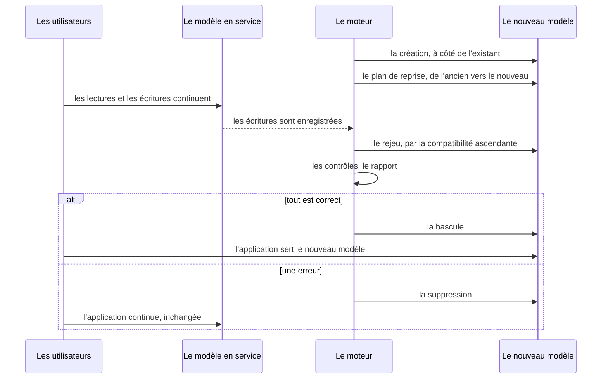

# La migration de version : le mécanisme

> **La migration de version** est la migration dont l'origine est la
> version antérieure de l'application : d'une version à la suivante,
> les données existantes passent au nouveau modèle
> ([glossaire](../../glossaire.md)).

Le chapitre 8 dit ce que le concepteur écrit pour une
[migration de version](../08-migration/07-version.md) : rien le plus
souvent, parfois un renommage ou une règle de transformation. Reste à
dire ce que le moteur fait de ces données qui doivent changer de forme
pendant que l'application sert. Ce fichier suit ce mécanisme : ce qui
le déclenche, la comparaison qui décide de tout, les deux chemins
qu'elle ouvre, leur issue, ce que deviennent les lectures et les
écritures pendant ce temps, puis le retour en arrière, le changement de
connecteur et le coût assumé. Les décisions citées entre parenthèses
renvoient au [registre](../../conception.md).

## Le sommaire

- [Ce qui déclenche le mécanisme](#ce-qui-déclenche-le-mécanisme)
- [La comparaison des facettes](#la-comparaison-des-facettes)
- [Les deux facettes sont identiques](#les-deux-facettes-sont-identiques)
- [Les deux facettes diffèrent](#les-deux-facettes-diffèrent)
- [L'issue](#lissue)
  - [La version s'active, ou rien ne change](#la-version-sactive-ou-rien-ne-change)
  - [L'erreur se joue sur les données](#lerreur-se-joue-sur-les-données)
  - [Le défaut qui change](#le-défaut-qui-change)
  - [Le contrôle de la bijection](#le-contrôle-de-la-bijection)
- [Pendant la migration](#pendant-la-migration)
- [Le retour en arrière](#le-retour-en-arrière)
  - [Le délai de grâce](#le-délai-de-grâce)
  - [La restauration](#la-restauration)
- [Le changement de connecteur](#le-changement-de-connecteur)
- [Ce que le mécanisme coûte](#ce-que-le-mécanisme-coûte)

## Ce qui déclenche le mécanisme

Toute version nouvelle ne migre pas. Le mécanisme part de l'une de
trois causes (D1969, D1979) :

| La cause | Un exemple |
|---|---|
| un écart de structure entre deux versions | un champ ajouté, un type modifié, une entité renommée |
| des règles de transformation, écrites dans `exchange/` | une valeur renommée dans une liste (D1971) |
| un changement de connecteur, dans un environnement | la base passe de MySQL à PostgreSQL |

Sans aucune des trois, la version s'active sans migration. L'absence
d'écart de structure ne suffit pas à l'écarter : une règle de
transformation peut modifier les valeurs d'un champ sans toucher à sa
forme (D1969). Un champ calculé, lui, ne touche jamais au stockage
(D673).

## La comparaison des facettes

> **La facette** d'un type est l'un de ses modes de représentation : la
> valeur logique, le stockage physique, l'affichage, la forme d'API
> ([glossaire](../../glossaire.md)).

Changer le type d'un champ demande d'habitude deux conversions : celle
de la forme d'enregistrement du champ dans la base, puis celle des
valeurs existantes. La première est critique, avec un risque de perte ;
la seconde est laissée au moteur de la base, ou à un script. Syncytium
travaille autrement, pour deux raisons (D1974) :

- ses types sont simples comme complexes. Un type complexe se range
  souvent en plusieurs données simples : un montant et sa devise ;
- mettre en place une version ne transforme pas seulement le stockage :
  elle applique aussi les règles de vérification.

Le moteur ne modifie donc pas le modèle en service. Il construit le
schéma de la nouvelle version dans la facette de stockage du
connecteur, et le compare au schéma en production. Un schéma tenu en
mémoire peut suffire à cette comparaison. Tout le reste en découle :

<p align="center"></p>

## Les deux facettes sont identiques

Aucune migration ne passe alors par le connecteur. Seul le format des
données stockées peut changer : une unité retirée d'une mesure, un
format de texte. Deux cas se présentent (D1974) :

| Ce que la version change | Ce que fait le moteur |
|---|---|
| ni règle, ni validation, ni règle de transformation | il ne touche pas aux données |
| une règle ou une validation apparaît, ou change | il rebalaye les règles |

Dans le premier cas, la version change des éléments visuels, des API,
ou l'organisation logique des données : le module d'une entité, un
groupe de propriétés, une liste.

Dans le second, le moteur vérifie que toutes les données respectent les
règles nouvelles :

- **il ne rebalaye que ce qui est touché** : le graphe de dépendance
  borne les vérifications et les transformations aux impacts
  identifiés ;
- **les transformations se font à blanc**. Quand le volume ne tient pas
  en mémoire, un substitut dans le connecteur les reçoit ;
- **les vérifications viennent après les transformations**. Pour
  retirer une valeur d'une liste, il faut d'abord la renommer.

Dans l'entrepôt (le cas 5), la version 1.0.0.1 fait de la langue d'un
tiers une liste : français, anglais, allemand, espagnol. Supposons
qu'un tiers porte encore `it` :

- la vérification échoue sur cette valeur ;
- le concepteur écrit, dans `exchange/`, la transformation qui la
  traduit ;
- à l'essai suivant, la transformation passe d'abord, la vérification
  ensuite.

## Les deux facettes diffèrent

> **Le plan de reprise** est la suite des opérations par lesquelles le
> moteur porte les données d'un modèle vers un autre, dans une
> migration de version ([glossaire](../../glossaire.md)).

Dès que les deux facettes diffèrent, même de peu, le moteur ne retouche
pas le modèle en service (D1974) :

- **il crée un nouveau modèle** dans le connecteur, à côté de
  l'existant ;
- **il dresse un plan de reprise** des données, de l'ancien modèle vers
  le nouveau ;
- **il l'applique**, sans modifier l'ancien.

Un champ qui passe de `text[..20]` à `text[..40]` suffit : les deux
facettes diffèrent, un nouveau modèle est créé, et le concepteur n'a
rien à écrire.

Le connecteur joue ces gestes par quatre de ses méthodes,
`create_schema`, la migration, `switch_schema`, `delete_schema`
(D631) : voir [le storage](../05-connecteurs/05-storage.md). Le plan de
reprise suit le protocole d'une reprise : seule l'origine change. Ses
correspondances se déduisent des deux descriptions, sans que le
concepteur écrive rien (D632).

## L'issue

### La version s'active, ou rien ne change

Les deux chemins mènent à la même alternative (D1974) :

| Le constat | Ce que fait le moteur |
|---|---|
| tout est correct | la version s'active, et les transformations s'appliquent ; quand un nouveau modèle a été créé, l'instance bascule vers lui |
| une erreur apparaît | c'est une erreur d'ingestion : la bascule est annulée, le nouveau modèle est supprimé |

La migration est transactionnelle (D9) : elle réussit entièrement, ou
la base reste dans l'état précédent. Avant la bascule, revenir en
arrière ne coûte donc rien : le modèle en service n'a pas été touché.

### L'erreur se joue sur les données

Une conversion risquée ne fait pas refuser une version d'avance. Le
moteur joue le plan sur les données réelles, et seule une valeur qui
échoue fait l'erreur (D1975) :

| Le changement | Les données | L'issue |
|---|---|---|
| de `text[..40]` à `text[..20]` | toutes les valeurs tiennent en vingt caractères | la version passe |
| de `text[..40]` à `text[..20]` | une valeur dépasse | une erreur d'ingestion |
| un texte devient une liste | une valeur est hors de la liste | une erreur d'ingestion ; le concepteur écrit la transformation |

Une règle écrite par le concepteur se juge autrement. Dans une reprise,
une formule qui range un texte trop long est refusée dès l'ingestion,
avant toute donnée : voir
[le texte trop long](../08-migration/05-controles.md#le-texte-trop-long).
La migration de version, elle, n'a pas de formule : elle n'a que des
données (D1977).

### Le défaut qui change

Quand le `default:` d'un champ change d'une version à l'autre, les
enregistrements existants gardent leur valeur (D1976). Le nouveau
défaut ne vaut que pour ceux qui sont créés ensuite : rien ne distingue
une valeur saisie d'une valeur née du défaut.

### Le contrôle de la bijection

> **Le rapport de migration de version** porte ce que la migration de
> version relève avant la bascule
> ([glossaire](../../glossaire.md)).

Une règle d'`exchange/` peut ne pas conserver les données : sa
bijection est de la responsabilité du concepteur. Le moteur la vérifie
à la migration (D1993, D1994) :

- il joue l'aller puis le retour sur chaque enregistrement migré ;
- il compare le retour à l'original ;
- il porte au rapport de migration de version les enregistrements dont
  le retour diffère.

Sans écart, la version s'active seule. Avec un écart, la bascule attend
une lecture et une validation du concepteur. L'exemple d'une règle qui
ne conserve pas les données est au chapitre 8 :
[la bijection, à la charge du concepteur](../08-migration/07-version.md#la-bijection-à-la-charge-du-concepteur).

## Pendant la migration

L'application ne s'arrête pas. Dès le démarrage de la migration,
l'activité continue sur le modèle en service (D1974) :

| L'activité | Ce qu'elle devient |
|---|---|
| les lectures | elles continuent : lire ne modifie ni les données, ni leur structure (D676) |
| les écritures | elles s'appliquent au modèle en service, et sont enregistrées, comme pour un plan de reprise ou de continuité d'activité |
| le rejeu | les écritures enregistrées sont appliquées au nouveau modèle par la compatibilité ascendante, comme l'appel d'une API d'une version antérieure : aucune mécanique dédiée (D677) |
| les tâches | la file des tâches est drainée, ou suspendue, le temps de la migration (D24) |
| la bascule | les lectures attendent le temps du renommage, qui est très court (D8, D679) |

Une erreur au rejeu, dans le nouveau modèle, est une erreur
d'ingestion : la version est refusée.



## Le retour en arrière

### Le délai de grâce

> **Le délai de grâce** est la durée pendant laquelle l'ancien modèle
> est gardé après la bascule, pour permettre d'y revenir
> ([glossaire](../../glossaire.md)).

Avant la bascule, le retour est gratuit. Après, il dépend du délai de
grâce (D675, D678) :

| Le délai de grâce | Ce que devient l'ancien modèle |
|---|---|
| aucun, le défaut | il est supprimé à la bascule |
| déclaré | il devient le modèle sauvegardé, gardé le temps du délai |

Le délai se configure ; sa clé, `grace:`, est en proposition.

### La restauration

Sous grâce, la restauration est le geste inverse de la bascule (D678) :
le modèle courant est renommé, le modèle sauvegardé reprend sa place.
C'est l'opération `restore` du socle (D574).

- chaque modèle porte sa version dans une table système : c'est
  [l'estampille](02-ingestion.md#lestampille), et rien n'est à
  deviner ;
- les lectures ne s'arrêtent que le temps du renommage (D679).

## Le changement de connecteur

Une migration peut aussi porter un changement de connecteur : une base
MySQL devient SQL Server, ou PostgreSQL (D1978). Le modèle de données
peut ne pas changer dans Syncytium, alors que la forme des
enregistrements est radicalement différente. Le mécanisme reste le
même :

- les deux facettes diffèrent ;
- un nouveau modèle est créé, dans le nouveau connecteur ;
- un plan de reprise l'alimente depuis l'existant.

Ce changement se déclenche par l'environnement, qui désigne le
connecteur du modèle : aucune version nouvelle n'est nécessaire, le
dossier de la version ne bouge pas (D1979). Dans l'entrepôt, la
production nomme sa base par `storage:` :

```yaml
# La base de l'application
# Le connecteur storage qui porte le modèle et ses données ; les autres storages de l'environnement servent la reprise.
storage: entrepot
```

Changer la classe du connecteur `entrepot`, dans `connectors.yml`,
suffit donc à lancer le mécanisme.

Ce transfert est un cas d'une aptitude plus générale : Syncytium sait
convertir ou transférer des données d'un connecteur à un autre, d'un
coup ou par différences (D606). Une reprise s'en sert, quand son
`from:` nomme la base d'origine (D610) ; la réplication vers une
instance passive aussi, ce que dira le chapitre 10 (D112–D114).

## Ce que le mécanisme coûte

Le nouveau modèle vit à côté de l'existant le temps de la migration.
La conséquence est assumée (D1977) : il faut un espace de stockage au
moins égal à deux fois l'espace initial. Ce dimensionnement entre dans
le dossier d'architecture technique de l'application.
