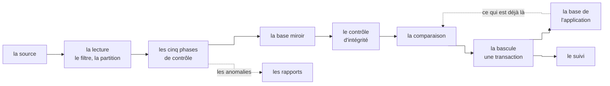
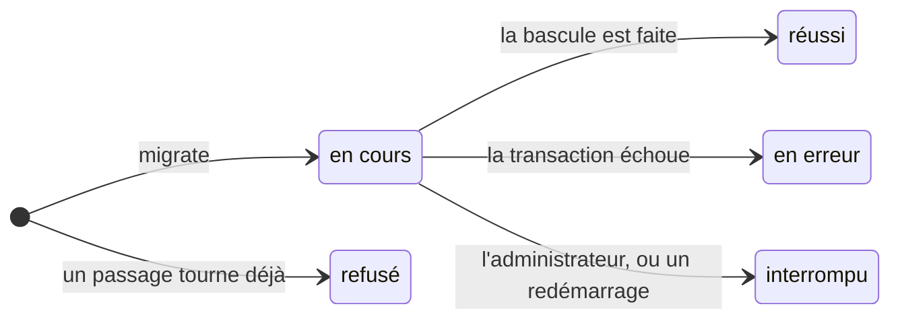
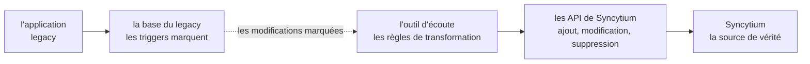

# L'exécution d'un passage

> **Un passage** est une exécution d'une reprise de données, par
> l'opération `migrate` : la lecture, les cinq phases de contrôle, la
> comparaison, la bascule ([glossaire](../../glossaire.md)).

Le chapitre 8 décrit la reprise telle que le concepteur l'écrit : la
source, les règles, les contrôles. Tout cela reste immobile tant que
`migrate` n'est pas lancé. Ce fichier dit ce qui se passe alors, d'un
bout à l'autre d'un passage : son déroulé, la lecture de la source, les
phases de contrôle en marche, la base miroir et sa transaction, le
contrôle d'intégrité, la comparaison et la bascule, le cache, la règle
d'un seul passage à la fois, et une alternative aux passages, le double
fonctionnement. Ce qu'un passage garde après lui est
dans [le fichier suivant](05-suivi.md). Les décisions citées entre
parenthèses renvoient au [registre](../../conception.md).

## Le sommaire

- [Le déroulé](#le-déroulé)
- [La lecture de la source](#la-lecture-de-la-source)
  - [Le modèle lu](#le-modèle-lu)
  - [Le filtre](#le-filtre)
  - [La partition et la dernière valeur parcourue](#la-partition-et-la-dernière-valeur-parcourue)
- [Les cinq phases, en marche](#les-cinq-phases-en-marche)
  - [Ce qui vaut pour toutes](#ce-qui-vaut-pour-toutes)
  - [Ce qui tombe, et quand](#ce-qui-tombe-et-quand)
  - [Selon le mode](#selon-le-mode)
- [La base miroir et la transaction](#la-base-miroir-et-la-transaction)
  - [Une base à part, le temps du passage](#une-base-à-part-le-temps-du-passage)
  - [Tout, ou rien](#tout-ou-rien)
  - [L'échec, tracé](#léchec-tracé)
- [Le contrôle d'intégrité](#le-contrôle-dintégrité)
- [La comparaison et la bascule](#la-comparaison-et-la-bascule)
  - [Les cinq blocs](#les-cinq-blocs)
  - [L'enregistrement entier se compare](#lenregistrement-entier-se-compare)
  - [La source fait foi](#la-source-fait-foi)
  - [La suppression](#la-suppression)
  - [La bascule](#la-bascule)
  - [L'exécution à blanc](#lexécution-à-blanc)
- [Le cache](#le-cache)
- [Un passage à la fois](#un-passage-à-la-fois)
  - [La règle](#la-règle)
  - [L'interruption](#linterruption)
  - [Les cinq états](#les-cinq-états)
  - [Qui exécute](#qui-exécute)
- [Le double fonctionnement, une alternative](#le-double-fonctionnement-une-alternative)

## Le déroulé

Un passage ne touche pas directement à l'application. Il construit la
reprise à part, dans une base miroir, puis reporte les seules
différences (D1044). Ses étapes, dans l'ordre :

| L'étape | Ce que le moteur fait |
|---|---|
| le modèle lu | le connecteur lit le schéma réel de la source ; le moteur le compare à sa version précédente et à la description de `sources/` (D653, D1053) |
| la lecture | par entité source, `filter:` écarte, `partition:` choisit la plage relue (D663, D878) |
| les cinq phases de contrôle | chaque ligne est contrôlée, construite dans la base miroir, puis contrôlée encore (D1033, D1040) |
| le contrôle d'intégrité | les identités sont vérifiées, une fois toutes les données lues (D1954) |
| la comparaison | la base miroir est comparée à la base de l'application (D672, D1037) |
| la bascule | dès qu'aucune tâche ne tourne, Syncytium passe en mode pause et reporte les différences, en une transaction (D1041, D2142, D2143) |
| le suivi | la table des clés d'origine, les compteurs, les indicateurs et les anomalies sont mis à jour (D1047–D1056) |
| les rapports | les anomalies sont réunies par destinataire, et envoyées (D929, D1058) |



## La lecture de la source

### Le modèle lu

Avant de lire une seule ligne, le moteur regarde si la source est
encore celle que le concepteur a décrite. Le connecteur lit le schéma
réel ; le moteur le compare à la description. Les écarts se traitent
toujours de la même façon (D1053) :

| L'écart | Ce qu'il produit |
|---|---|
| une colonne de la source, que la description ne cite pas | une anomalie de complétude : le passage continue |
| une colonne dont le type décrit ne se convertit pas depuis le type lu | une anomalie de description |
| une colonne décrite, qui a disparu de la source | une erreur de description : l'entité n'est pas lue |
| une valeur qui ne se convertit pas | l'enregistrement tombe, en phase 1 |

Le connecteur lit chaque colonne dans un type de Syncytium. La
description peut en citer un autre : les deux sont compatibles s'ils se
convertissent l'un dans l'autre.

### Le filtre

`filter:` est le périmètre déclaré : voir
[le filtre](../08-migration/03-sources.md#le-filtre). Une ligne hors du
filtre n'est jamais lue, et rien n'en est gardé (D663, D1032).

### La partition et la dernière valeur parcourue

> **La dernière valeur parcourue** est le repère que le moteur garde,
> par entité source, pour reprendre la lecture là où le passage
> précédent s'est arrêté ([glossaire](../../glossaire.md)).

Une table volumineuse ne se relit pas en entier à chaque passage. Avec
`partition:`, le passage ne relit qu'une plage. Dans l'entrepôt (le
cas 5), les mouvements de stock :

```yaml
# La lecture par partition
# Le mois du mouvement : chaque nuit, les trois derniers mois sont relus ; la relecture complète du dimanche relit tout.
partition: MVCJMVT[month - 3]
```

Le moteur tient cette lecture par trois moyens (D878, D1050) :

- **la dernière valeur parcourue**, par entité source : le passage
  suivant repart d'elle ;
- **la valeur de partition de chaque clé**, gardée dans
  [la table des clés d'origine](05-suivi.md#la-table-des-clés-dorigine) :
  elle dit si une ligne absente était, ou non, dans la plage relue ;
- **la plage**, que le crochet déclare.

Trois règles en découlent :

- **sans `partition:`, tout est relu** ;
- **`reset_coverage` remet la dernière valeur parcourue au départ**,
  sans rien effacer : le passage suivant relit la totalité (D881,
  D1030) ;
- **la base miroir ne reçoit que la plage relue**. Un enregistrement
  non relu, qu'une référence désigne, y est recopié depuis la base de
  l'application (D1044).

## Les cinq phases, en marche

Les cinq phases sont définies au chapitre 8 :
[les phases de contrôle](../08-migration/05-controles.md#les-phases-de-contrôle).
Voici comment le moteur les conduit.

### Ce qui vaut pour toutes

- **chaque phase relève toutes ses erreurs**, pas seulement la
  première : la phase 1 convertit toutes les colonnes, et référence
  chaque échec ; de même toutes les règles, toutes les validations de
  la destination (D1057) ;
- **un enregistrement en erreur ne passe pas à la phase suivante** ;
- **un enregistrement refusé n'est pas enregistré**. Ses motifs sont
  gardés, et rejoués au passage suivant, si une règle ou une donnée
  change (D1032).

### Ce qui tombe, et quand

| Ce que le moteur constate | La phase | Ce qui tombe |
|---|---|---|
| une valeur qui ne se convertit pas dans le type décrit | 1 | l'enregistrement (D1053) |
| l'identité de la source n'est pas respectée | 1 | l'entité entière, puis ce qui la référence (D1042) |
| une référence orpheline, qu'une règle du mapping utilise | 1 | l'enregistrement (D1040) |
| une règle de la source, ou de la règle de mapping, enfreinte | 2, 4 | l'enregistrement |
| deux enregistrements de même identité, dans la base miroir | 5 | le second (D1046) |
| la validation d'un parent qui lit ses enfants | 5 | le parent, et tous ses enfants (D933) |

Quatre de ces lignes appellent une explication :

**La phase 1 conditionne la lecture de l'entité.** Elle se joue après
le filtre : les types d'abord, puis l'identité, puis les liens (D1040).
Sans elle, l'entité n'est pas lisible.

**Une identité non respectée à la source met la description en
cause**, non les données (D1042). Il manque une colonne à la clé, ou
une colonne y est de trop. L'entité n'est donc pas lue ; les champs qui
la référencent tombent ; par transitivité, les enregistrements qui en
dépendent tombent aussi. Le reste de la migration continue. Toute
entité porte une identité, la sienne ou celle de sa racine (D1035,
D1039).

**L'orphelin ne fait pas toujours tomber.** Une référence sans cible se
détecte en phase 1. L'enregistrement tombe si une règle du mapping
utilise cette référence ; sinon il passe, et l'orphelin reste relevé en
anomalie (D1040).

**L'identité de la destination ne bloque jamais.** Elle se vérifie en
phase 5, dans la base miroir : de deux enregistrements de même clé, le
second tombe, et le passage continue. Au moment de la bascule, la base
miroir et la base de l'application portent les mêmes identités
validées : deux enregistrements de même clé sont le même
enregistrement, qui se compare et se met à jour (D1046).

L'échec dans une composition suit les trois cas du chapitre 8 :
[l'échec dans une composition](../08-migration/05-controles.md#léchec-dans-une-composition).

### Selon le mode

Ce qui précède vaut en mode `relative` : l'enregistrement en erreur
tombe seul, et le passage continue. En mode `absolute`, le tout ou
rien, un passage en erreur n'écrit rien (D649, D671) : voir
[les deux modes](../08-migration/02-declaration.md#les-deux-modes).

## La base miroir et la transaction

> **La base miroir** est la base, à l'image de la destination, où une
> migration se construit et se contrôle avant de reporter ses
> différences ([glossaire](../../glossaire.md)).

### Une base à part, le temps du passage

La base miroir se déclare dans le fichier de l'environnement : voir
[la base miroir](../08-migration/02-declaration.md#la-base-miroir).
Pour le moteur, c'est un connecteur comme un autre : la manière de
tenir la base est l'affaire de sa classe (D1045). Celui de l'entrepôt
la tient en mémoire :

```yaml
# La base miroir de la reprise
# La migration y construit et contrôle l'entrepôt avant d'en reporter les différences ; la base est tenue en mémoire, le
# temps de la migration.
temporaire:
  type: storage
  class: memory
```

- la base miroir vit le temps de la migration : son schéma est supprimé
  à la finalisation (D1044) ;
- tant que le passage la construit, rien de l'existant n'est touché :
  les utilisateurs continuent de travailler.

### Tout, ou rien

La reprise est une transaction (D1041) :

- la bascule s'applique en entier, ou pas du tout ;
- une erreur qui interrompt la mise à jour ramène toutes les données à
  leur valeur d'avant ;
- la table des clés d'origine et la dernière valeur parcourue suivent
  la même transaction : un passage interrompu ne fait rien avancer.

L'erreur qui interrompt est un incident : le connecteur perdu, l'arrêt
du serveur, une écriture refusée. Un enregistrement refusé par une
phase de contrôle n'interrompt rien : il tombe seul.

### L'échec, tracé

Une transaction qui échoue est tracée quand même (D1043) :

| Ce qui reste | Ce qui ne bouge pas |
|---|---|
| le passage, ses horodatages, son état, la cause de l'échec | la base de l'application |
| les anomalies relevées avant l'échec, consultables | la table des clés d'origine |
| | la dernière valeur parcourue |

## Le contrôle d'intégrité

Pendant la lecture, des clés peuvent se croiser : deux enregistrements
échangent une clé secondaire d'une étape à l'autre. Le chapitre 8 en
donne l'exemple :
[des clés qui se croisent](../08-migration/06-complements.md#des-clés-qui-se-croisent).
Refuser la première ligne rejetterait un échange valide. Le moteur
attend donc (D1954, D1956) :

- **l'intégrité se vérifie juste avant la validation de la migration**,
  une fois toutes les données lues, et non à chaque ligne ;
- **ce contrôle différé vaut pour les identités secondaires**. La clé
  principale, elle, désigne l'enregistrement à chaque étape ;
- **un doublon qui subsiste à ce moment est une anomalie** (D1955) :
  les deux enregistrements qui portent la même clé tombent, et
  l'anomalie les nomme tous les deux.

## La comparaison et la bascule

### Les cinq blocs

La base miroir, complète et contrôlée, est comparée à la base de
l'application, par partition. Chaque enregistrement entre dans l'un de
cinq blocs (D878, D1034) :

| Le bloc | Ce qu'il réunit |
|---|---|
| les anomalies | les enregistrements tombés à l'une des cinq phases |
| la création | les clés nouvelles |
| la modification | les clés existantes, dont un champ diffère |
| l'inchangé | les clés existantes, sans différence |
| la suppression | les clés de la destination que la base miroir ne reconstruit plus |

### L'enregistrement entier se compare

La comparaison porte sur l'enregistrement reconstruit, ses compositions
comprises, face à celui de la destination, retrouvé par son identité
(D1037). Elle se fait champ par champ, et seuls les écarts s'écrivent
(D672) :

- un écart s'écrit en historique, ou en remplacement, selon la
  configuration de l'entité de destination (D168, D1036) ;
- le différentiel n'est pas un mode de plus : il est la conséquence du
  rejeu par la clé. Relancer `migrate` ne crée jamais de doublon.

### La source fait foi

Le différentiel ne compare que ce que les règles alimentent. Il en
découle trois conduites :

| Le champ | Ce que le passage en fait |
|---|---|
| alimenté par une règle | la valeur de la source est rétablie (D1038) |
| qu'aucune règle n'alimente | il reste intact (D941) |
| marqué `unmapped: true` | la migration ne l'écrit jamais (D941, D1965) |

Une correction faite à la main dans l'application, sur un champ
alimenté, cède donc au passage suivant qui relit l'enregistrement.
Corriger durablement une donnée reprise, c'est la corriger à l'origine.
Le principe est posé au chapitre 8 :
[la source fait foi](../08-migration/05-controles.md#la-source-fait-foi)
(D1966).

### La suppression

La suppression se joue sur la partition relue (D1052) :

| L'enregistrement de la destination | Ce que le passage en fait |
|---|---|
| dans la plage relue, présent avant et absent de la base miroir | il est supprimé |
| hors de la plage relue | rien : il n'est pas supprimé |

- l'enregistrement est absent parce que sa donnée a disparu de
  l'origine, ou parce qu'il est tombé en anomalie ;
- une saisie faite à la main dans la plage relue est supprimée de
  même : sur une entité qu'une migration alimente, la source fait foi ;
- la suppression est celle de Syncytium, l'inactivation (D137) :
  l'enregistrement revient s'il est reconstruit.

### La bascule

Les différences sont reportées dans la base de l'application en une
seule transaction (D1041). C'est le seul moment où l'existant change,
et le seul qui ne s'interrompt pas.

> **Le mode pause** est l'état de Syncytium le temps de la bascule d'un
> passage : les tâches, les lectures et les écritures sont arrêtées
> ([glossaire](../../glossaire.md)).

Une reprise ne crée pas de nouvelle instance : elle modifie l'instance
courante (D2144). Pour basculer, Syncytium passe donc en mode pause
(D2142). La pause arrête trois choses (D2143) :

- les tâches ;
- les lectures ;
- les écritures.

Les gestes, dans l'ordre :

1. il attend : la bascule se fait dès qu'aucune tâche ne tourne ;
2. il met en pause toutes les autres tâches, et arrête les lectures et
   les écritures ;
3. il bascule ;
4. il reprend la suite : les tâches, les lectures et les écritures
   repartent.

Une demande arrivée pendant la pause n'est pas refusée : elle est mise
en attente (D2146), et servie quand la suite reprend.

Arrêter les lectures et les écritures garantit que la transaction des
mises à jour reste cohérente d'un bout à l'autre (D2144) : personne ne
lit une donnée à moitié reportée, personne n'écrit pendant qu'elle se
reporte.

Jusque-là, le passage a construit la reprise à part, dans la base
miroir, sans gêner personne. La pause ne vaut donc que pour la bascule.

Ex. : dans l'entrepôt (le cas 5), le delta de la nuit est prêt à
basculer alors qu'une génération de documents tourne encore. Le moteur
attend sa fin. Il met en pause l'envoi de mails qui la suivait dans la
file, et les demandes de lecture et d'écriture qui arrivent sont mises
en attente. Il reporte les différences. Puis tout repart : l'envoi, et
les demandes qui attendaient.

Le mode pause est propre à la bascule d'un passage de reprise (D2143).
Une migration de version se conduit autrement. Elle ne modifie pas
l'instance courante : elle en prépare une nouvelle, puis change de
pointeur. Elle met les tâches en pause avant de démarrer, et l'activité
continue. Voir
[pendant la migration](03-migration.md#pendant-la-migration).

Quand un legacy bascule vers Syncytium, une alternative à ces passages
existe : voir
[le double fonctionnement](#le-double-fonctionnement-une-alternative).

### L'exécution à blanc

L'exécution à blanc, le dry-run, s'arrête après la comparaison (D649,
D1044) : la reprise se construit dans la base miroir, se compare, et
les différences se montrent sans être reportées. C'est l'aperçu de
`migrate`, suspendu avant d'écrire (D667).

## Le cache

> **Le cache d'une migration** est le mécanisme qui garde des valeurs
> le temps d'un passage ([glossaire](../../glossaire.md)).

Il n'y a qu'un mécanisme de cache, et deux façons de s'en servir
(D1923). Le chapitre 8 dit comment l'utiliser et le déclarer ; voici
comment il fonctionne (D1920) :

| | Le cache que le moteur tient | L'entrée que le concepteur déclare |
|---|---|---|
| ce qui l'écrit | le moteur, quand un champ calculé lit une autre entité | une règle, par `cache.push` |
| sa clé | l'entité, l'expression et les valeurs des critères (D965) | le nom de l'entrée, puis la clé donnée |
| ce qu'il garde | le résultat de la lecture | une pile d'enregistrements par clé (D822) |
| ce qui le relit | la même lecture, aux mêmes critères | `cache.pop`, `cache.size` |
| sa durée | le passage | le passage |

**Le cache du moteur** évite de relire. Dans l'entrepôt, chaque
mouvement de stock lit l'unité de son article : pour mille mouvements
du même article, l'article n'est lu qu'une fois. L'exemple est au
chapitre 8 :
[la lecture d'une autre table](../08-migration/03-sources.md#la-lecture-dune-autre-table).

**L'entrée déclarée** relie deux règles d'un même passage. Elle naît à
son premier `push`, sans déclaration (D1925). Dans la banque (le
cas 4), la règle des écritures empile, et la règle de complément
dépile :

```yaml
  operations:
    cache.push("virement", reference_virement, me) if reference_virement is not null
```

- **une pile par clé**, dernier entré, premier sorti ;
- **l'ordre des règles compte** : une règle ne dépile que ce qu'une
  règle précédente a empilé, et les règles s'exécutent dans l'ordre de
  leur déclaration (D1905) ;
- **rien ne survit au passage** : le cache naît vide à chaque
  `migrate`.

Le détail de ce rapprochement est au chapitre 8 :
[le rapprochement par le cache](../08-migration/06-complements.md#le-rapprochement-par-le-cache).

## Un passage à la fois

### La règle

Une migration n'a qu'un passage en cours (D1077). Une opération qui en
trouve un déjà lancé suit sa clé `on_running:` : elle est annulée, elle
attend, ou elle interrompt. La clé est définie au chapitre 8 :
[`on_running:`](../08-migration/02-declaration.md#on_running).

### L'interruption

L'administrateur peut interrompre un passage (D1077) :

| Le moment | L'interruption |
|---|---|
| le passage construit la base miroir | possible : rien de l'existant n'est touché |
| le passage bascule vers la base de l'application | impossible |

Un redémarrage du serveur pendant un passage vaut interruption. Le
passage reste tracé ; il n'est pas relancé de lui-même : l'administrateur
le relance.

### Les cinq états

Un passage est dans l'un de cinq états (D1079) :



### Qui exécute

`migrate` s'exécute au degré `administrator`, qui passe outre les
`allow:` des entités de destination (D942). Le propriétaire d'une
migration est toujours l'administrateur (D1030) : un passage écrit donc
dans une entité que ses utilisateurs ne peuvent que lire.

## Le double fonctionnement, une alternative

> **Le double fonctionnement** est la période où l'application legacy
> et Syncytium fonctionnent ensemble, la source de vérité étant dans
> Syncytium ([glossaire](../../glossaire.md)).

Basculer un legacy vers Syncytium ne passe pas forcément par des
passages de reprise. Une alternative est possible (D2147). Syncytium ne
l'impose pas : la documentation en propose l'implémentation, et c'est
au concepteur de décider s'il l'applique.

Elle s'inscrit dans un double fonctionnement : l'application legacy et
Syncytium servent ensemble, et la source de vérité est dans Syncytium.
Son principe tient en trois gestes :

- sur la base de données du legacy, des triggers marquent les
  modifications qui ont eu lieu ;
- un outil écoute ces modifications ;
- il transmet à Syncytium, par ses API, les opérations d'ajout, de
  modification ou de suppression.



Ex. : un client est modifié dans l'application legacy. Le trigger
marque la ligne. L'outil lit la marque, applique sa transformation, et
appelle l'API de Syncytium, qui modifie le client.

La source de vérité étant dans Syncytium, c'est lui qui arbitre
(D2148). Une modification venue du legacy passe par les API comme toute
autre. Si une règle de validation la refuse, elle est refusée, et
l'outil la signale.

La méthode a son avantage et son prix :

| Ce qu'elle apporte | Ce qu'elle coûte |
|---|---|
| une méthode douce : les modifications arrivent une à une, par les API | les règles de transformation se traitent en dehors de Syncytium |
