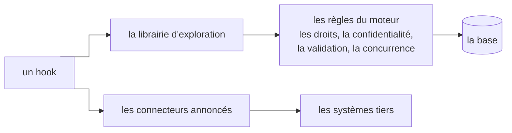

# La disponibilité

> **Un fusible** est une limite que le moteur pose à une exécution,
> pour qu'un traitement qui s'emballe ne prive pas les autres du
> service ([glossaire](../../glossaire.md)).

Une instance sert une entreprise entière depuis un seul serveur. Une
formule trop lente, un appel répété mille fois, un système tiers qui ne
répond plus : chacun peut suffire à l'arrêter. Le moteur s'en protège
de trois façons, que ce fichier réunit. Il borne ce qui s'exécute, par
des fusibles ; il sait quoi faire quand un système tiers fait défaut,
c'est la position de sécurité ; et il tient le code du concepteur dans
des frontières déclarées. Chacune de ces protections est définie dans
le chapitre de son composant : on en trouve ici la vue d'ensemble, et
les renvois. Les décisions citées entre parenthèses renvoient au
[registre](../../conception.md).

## Le sommaire

- [Les fusibles](#les-fusibles)
  - [Cinq limites](#cinq-limites)
  - [Trois portées](#trois-portées)
- [La position de sécurité](#la-position-de-sécurité)
- [Les frontières d'extension](#les-frontières-dextension)
  - [Le même chemin pour tous](#le-même-chemin-pour-tous)
  - [Ce qu'un hook ne contourne pas](#ce-quun-hook-ne-contourne-pas)
  - [Les bornes propres aux connecteurs](#les-bornes-propres-aux-connecteurs)
  - [Ce qui se règle, et où](#ce-qui-se-règle-et-où)
- [La continuité pendant une migration](#la-continuité-pendant-une-migration)

## Les fusibles

### Cinq limites

| Le fusible | Ce qu'il borne | Où le lire |
|---|---|---|
| le délai d'une fonction complexe | une fonction du langage classée complexe a un délai d'exécution, réglable ; une fonction simple n'en a pas (D104) | [le langage](../03-langage/README.md) |
| le délai d'un calcul | un hook de calcul est pur, et son exécution a un délai maximal | [le mécanisme des hooks](../01-configuration/04-version.md#39-hooks--le-mécanisme-des-hooks) |
| la file des tâches | toutes les tâches passent par une file, qui borne la concurrence ; chacune signale qu'elle vit (D55) | [la file](../06-operations/05-taches.md#la-file) |
| le temps de repos d'une opération | appelée par l'API, une opération ne s'exécute qu'une fois par période, pour les mêmes paramètres ; l'appel de trop est refusé (D58) | [les tâches](../06-operations/05-taches.md) |
| la limite des appels | quinze requêtes par seconde pour l'instance, par défaut, ajustable par compte technique ; au-delà, la réponse 429 dit quand revenir (D105) | [l'API au porteur](../07-securite/03-entree.md#lapi-au-porteur) |

### Trois portées

Ces limites ne se recouvrent pas :

- **à l'intérieur**, les délais et la file protègent le moteur de ce
  qu'il exécute lui-même ;
- **à l'extérieur**, la limite des appels le protège de ceux qui
  l'appellent ;
- **par opération**, le temps de repos protège un traitement qui
  pourrait servir de point d'attaque.

Elles agissent sur le moment. La détection après coup, les pics de
fréquence et les accès refusés qui se répètent, est autre chose : elle
relève de la télémétrie, au chapitre 11 (D43).

## La position de sécurité

> **La position de sécurité** est la conduite du moteur quand un
> système tiers fait défaut : la page de maintenance, et l'alerte à
> l'administrateur ([glossaire](../../glossaire.md)).

Un connecteur peut échouer. Les nouvelles tentatives et les délais se
règlent sur lui, par les propriétés du socle (D625). Quand l'erreur
demeure, le moteur ne continue pas comme si de rien n'était (D626,
D627) :

| Le connecteur | Ce que fait le moteur |
|---|---|
| un connecteur clé | il passe sur la page de maintenance, et alerte l'administrateur |
| un connecteur non critique | il rend le résultat de remplacement que le connecteur fournit, et alerte |

La graduation se déclare au connecteur, par `onerror` : voir
[la position de sécurité](../05-connecteurs/03-socle.md#la-position-de-sécurité).

Le moteur prend la même position quand l'application s'arrête (D2135) :
voir [l'arrêt de l'application](06-demarrage.md#larrêt-de-lapplication).

Deux règles l'encadrent, au démarrage :

- l'application ne démarre que si elle peut alerter : c'est
  [la condition indispensable](06-demarrage.md#la-condition-indispensable) ;
- le mode safe en est seul exempté, et tout refus de démarrer
  s'explique (D745).

## Les frontières d'extension

> **Une frontière d'extension** est une limite que le moteur impose au
> code ajouté à Syncytium : ce qu'un hook lit, écrit et appelle se
> déclare, et rien d'autre ne lui est ouvert
> ([glossaire](../../glossaire.md)).

Quand la configuration ne suffit pas, le concepteur prolonge Syncytium
par du code : un hook. C'est un type, un composant, un connecteur ou
une opération, écrit contre le contrat de Syncytium. Ce code s'exécute
au cœur de l'application, près des données de l'entreprise. Mal écrit,
il pourrait lire ce qu'il ne doit pas voir, écrire sans contrôle, ou
appeler un système qu'on ne lui a pas confié. Le moteur ne s'en remet
donc pas à la bonne volonté du code : il l'exécute dans des frontières,
qu'aucun hook ne franchit.

Un exemple suit toute la section : l'opération `dupliquer` de la banque
(le cas 4). C'est un hook du projet, qui duplique une écriture entre
deux dates.

### Le même chemin pour tous

Le socle de Syncytium est lui-même fait de hooks : ses types, ses
composants et ses vingt et une opérations sont écrits contre le même
contrat que ceux du concepteur (D52). Il n'y a donc pas deux portes,
une pour le code de Syncytium et une pour le code du projet. Trois
conséquences :

- **aucun raccourci caché** : ce que le socle fait, il le fait par le
  contrat. `dupliquer` n'a ni plus ni moins de pouvoir qu'une opération
  du socle ;
- **une seule frontière à tenir** : la règle qui protège l'application
  du code du projet est celle que le socle respecte déjà ;
- **un hook arrive avec la version** : il est déployé, versionné et
  validé avec la description. L'ingestion vérifie sa signature, et un
  hook en défaut arrête l'ingestion : voir
  [la description, vérifiée en entier](02-ingestion.md#la-description-vérifiée-en-entier).

### Ce qu'un hook ne contourne pas

Un hook est un citoyen du moteur, jamais un super-utilisateur. Il
n'atteint la base et les systèmes tiers que par deux chemins, que le
moteur tient :

Aucune flèche ne va du hook à la base, ni du hook à un système tiers :
c'est toute la frontière. Elle se décline en quatre règles.

**La lecture et l'écriture passent par la librairie** (D572, D599). Le
hook ne parle jamais à la base. Le moteur lui fournit une librairie
d'exploration, qui lui présente le modèle par ses noms logiques :
l'entité, le champ, jamais la table. À chaque lecture et à chaque
écriture, la librairie applique ce que le moteur applique à un écran :

- les droits de l'utilisateur qui a lancé l'opération ;
- la confidentialité des champs ;
- les règles de validation ;
- la concurrence par champ.

Le hook écrit dans la transaction de l'opération. Quand `dupliquer`
crée ses écritures, chacune est contrôlée comme si l'utilisateur
l'avait saisie. S'il n'a pas le droit de créer une écriture, ou si
l'une d'elles enfreint une règle, la librairie refuse, comme l'écran
l'aurait fait.

**Les connecteurs s'annoncent** (D913). Un hook peut avoir besoin d'un
système tiers : envoyer un mail, déposer un fichier. Il ne le choisit
pas lui-même. Trois temps :

- **le contrat du hook annonce** les connecteurs qu'il attend, par
  `connectors:` : un rôle et une famille, `mailer: smtp` par exemple ;
- **la déclaration de l'opération lie** chaque rôle à un connecteur de
  l'environnement, par `uses:` ;
- **l'ingestion vérifie** la liaison et la famille.

À l'exécution, le hook n'atteint que ces connecteurs : tout autre est
hors de portée (D599). Un hook qui annonce `mailer: smtp` envoie un
mail ; il ne lit pas l'annuaire. De même, il ne lit ni variable
d'environnement ni fichier que la configuration ne référence pas
(D1440). Voir
[le hook, par `uses:`](../05-connecteurs/02-declaration.md#le-hook-par-uses).

**Le navigateur ne reçoit pas tout** (D66, D918). Un hook d'interface,
un composant graphique, s'exécute dans le navigateur de l'utilisateur,
hors du moteur. Le moteur ne lui envoie que les données `public` et
`protected` ; une donnée `private` ne quitte jamais le serveur. Ce hook
relève de l'ergonomie, jamais de la sécurité : ce qu'il affiche ou
masque ne décide de rien, le serveur arbitre. Voir
[le seul code tiers](07-secrets.md#le-seul-code-tiers).

**L'exécution ne se rejoue pas d'elle-même** (D57, D1744). Par défaut,
une opération s'exécute une fois. Si elle échoue, le moteur ne la
relance pas : un mail déjà parti ne doit pas partir deux fois. La
relance est un geste de l'administrateur, depuis la supervision. Un
hook qui supporte d'être rejoué le dit dans son contrat : voir
[les cinq propriétés intrinsèques](../06-operations/07-hooks.md#les-cinq-propriétés-intrinsèques).

Les quatre règles, en une table :

| La frontière | Ce que le hook peut faire | Ce qui lui est fermé |
|---|---|---|
| la lecture et l'écriture | lire et écrire le modèle, par la librairie, dans la transaction | la base elle-même ; une écriture hors des droits ou de la validation |
| les connecteurs | appeler les connecteurs qu'il a annoncés | tout autre connecteur ; une variable ou un fichier hors de la configuration |
| le navigateur | afficher le `public` et le `protected` | le `private` ; décider d'un droit |
| l'exécution | s'exécuter une fois | se rejouer de lui-même |

### Les bornes propres aux connecteurs

Un connecteur est lui aussi une extension, tournée vers l'extérieur. Il
garde ses propres bornes, qu'un hook ne déplace pas :

- **ses valeurs vivent à l'environnement** (D617) : l'adresse, le
  compte, le mot de passe d'un connecteur sont au fichier de
  l'environnement, jamais dans la version. Un hook emploie le
  connecteur tel qu'il est déclaré ;
- **l'annuaire ne s'écrit pas** (D633) : le connecteur `directory` n'a
  que des méthodes de lecture ;
- **le webhook entrant est gardé** (D642) : aucune entrée n'est
  anonyme, l'authentification est obligatoire.

### Ce qui se règle, et où

Une opération a des propriétés d'exécution. Les unes tiennent à son
code, les autres à la charge de l'installation. Le moteur ne les range
pas au même endroit, et ce partage est lui-même une frontière : la
configuration ne peut pas faire mentir le code.

Trois notions d'abord :

- **une opération déterministe** rend toujours le même résultat pour
  les mêmes paramètres. Le moteur garde alors ce résultat : un second
  appel identique le reçoit sans que l'opération se ré-exécute, tant
  que dure la fenêtre de déterminisme (D59) ;
- **le temps de repos** est le délai qu'une opération observe entre
  deux exécutions pour les mêmes paramètres (D58) ;
- **la rétention du résultat** est la durée pendant laquelle le
  résultat d'une opération reste consultable (D906).

| La propriété | Où elle vit | Qui la règle | Pourquoi |
|---|---|---|---|
| `execution`, `deterministic`, `deterministic_duration` | au contrat du hook, jamais dans la configuration (D905) | celui qui écrit le code | une opération est déterministe ou non : cela ne change pas sans que son code change (D59, D904) |
| le temps de repos, `operation.cooldown` | aux paramètres d'administration, surchargeable à la déclaration (D904) | l'administrateur | il se règle selon la charge |
| la rétention du résultat, `operation.retention` | aux paramètres d'administration, surchargeable à la déclaration (D906) | l'administrateur | elle tient au stockage : le résultat échu est purgé |

Deux exemples. Une opération qui produit un état à partir de données
arrêtées peut se déclarer déterministe : appelée deux fois de suite,
elle rend le résultat gardé, sans recalculer. Une opération qui envoie
un mail ne l'est pas, et aucune configuration ne peut dire le
contraire.

Reste une soupape. Si la réalité contredit le code, l'administrateur
invalide le résultat gardé d'une opération déterministe, sans
l'exécuter : le prochain appel la ré-exécute (D60).

Le détail est dans le chapitre de chaque famille :
[le mécanisme des hooks](../01-configuration/04-version.md#39-hooks--le-mécanisme-des-hooks),
[les hooks de connecteur](../05-connecteurs/06-hooks.md),
[les hooks d'opération](../06-operations/07-hooks.md).

## La continuité pendant une migration

Une montée de version n'arrête pas l'application (D801). Les lectures
continuent, les écritures sont enregistrées puis rejouées. La tâche en
cours se termine avant le démarrage, et les autres attendent la fin de
la migration (D24, D2136) : voir
[pendant la migration](03-migration.md#pendant-la-migration).

La continuité d'une instance à l'autre, la sauvegarde, la restauration
et l'instance passive, relève de l'exploitation : elle est au
chapitre 10.
