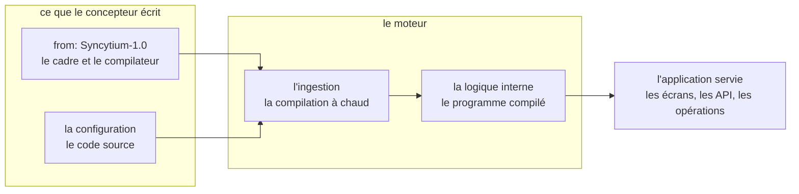
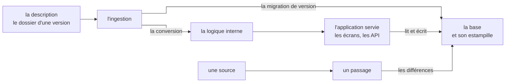

# Le fonctionnement du moteur

> **Le moteur** est le programme de Syncytium. Il lit la description
> d'une application, la convertit dans sa logique interne, puis sert
> l'application : ses écrans, ses API, ses opérations
> ([glossaire](../../glossaire.md)).

Les huit premiers chapitres disent ce que le concepteur écrit. Celui-ci
passe de l'autre côté : il dit ce que le moteur fait de cette écriture.
Il commence par le moment où presque tout se joue, le démarrage d'une
version, avec son ingestion et la migration de ses données (D1784). Il
suit ensuite une reprise pendant qu'elle s'exécute, puis ce qu'elle
laisse derrière elle (D1880, D1881). Il finit par ce qui tient
l'application debout : le démarrage de l'instance, son arrêt et ses
secours, les secrets et le chiffrement, la disponibilité. L'entrepôt (le cas 5)
reste le fil rouge des exemples. Les décisions citées entre parenthèses
renvoient au [registre](../../conception.md).

## Le sommaire

1. Le fonctionnement du moteur
   - [La description et le moteur](#la-description-et-le-moteur)
   - [Les cinq temps du moteur](#les-cinq-temps-du-moteur)
   - [Ce qui quitte le chapitre](#ce-qui-quitte-le-chapitre)
   - [Les décisions](#les-décisions)
2. [Le démarrage d'une version](02-ingestion.md)
   - [Le chemin d'une version](02-ingestion.md#le-chemin-dune-version)
   - [Les contrôles](02-ingestion.md#les-contrôles)
   - [L'identité d'une version](02-ingestion.md#lidentité-dune-version)
   - [Le registre des versions](02-ingestion.md#le-registre-des-versions)
   - [L'estampille](02-ingestion.md#lestampille)
   - [Après l'ingestion](02-ingestion.md#après-lingestion)
   - [La sandbox](02-ingestion.md#la-sandbox)
3. [La migration de version : le mécanisme](03-migration.md)
   - [Ce qui déclenche le mécanisme](03-migration.md#ce-qui-déclenche-le-mécanisme)
   - [La comparaison des facettes](03-migration.md#la-comparaison-des-facettes)
   - [Les deux facettes sont identiques](03-migration.md#les-deux-facettes-sont-identiques)
   - [Les deux facettes diffèrent](03-migration.md#les-deux-facettes-diffèrent)
   - [L'issue](03-migration.md#lissue)
   - [Pendant la migration](03-migration.md#pendant-la-migration)
   - [La bascule](03-migration.md#la-bascule)
   - [Le retour en arrière](03-migration.md#le-retour-en-arrière)
   - [Le changement de connecteur](03-migration.md#le-changement-de-connecteur)
   - [Ce que le mécanisme coûte](03-migration.md#ce-que-le-mécanisme-coûte)
4. [L'exécution d'un passage](04-passage.md)
   - [Le déroulé](04-passage.md#le-déroulé)
   - [La lecture de la source](04-passage.md#la-lecture-de-la-source)
   - [Les cinq phases, en marche](04-passage.md#les-cinq-phases-en-marche)
   - [La base miroir et la transaction](04-passage.md#la-base-miroir-et-la-transaction)
   - [Le contrôle d'intégrité](04-passage.md#le-contrôle-dintégrité)
   - [La comparaison et la bascule](04-passage.md#la-comparaison-et-la-bascule)
   - [Le cache](04-passage.md#le-cache)
   - [Un passage à la fois](04-passage.md#un-passage-à-la-fois)
5. [Ce qu'un passage laisse](05-suivi.md)
   - [La table des clés d'origine](05-suivi.md#la-table-des-clés-dorigine)
   - [Le modèle lu et ses versions](05-suivi.md#le-modèle-lu-et-ses-versions)
   - [La ligne d'exécution](05-suivi.md#la-ligne-dexécution)
   - [Les compteurs](05-suivi.md#les-compteurs)
   - [Les indicateurs](05-suivi.md#les-indicateurs)
   - [Les anomalies](05-suivi.md#les-anomalies)
   - [Le détail et sa rétention](05-suivi.md#le-détail-et-sa-rétention)
   - [Les rapports](05-suivi.md#les-rapports)
6. [Le démarrage de l'instance et le secours](06-demarrage.md)
   - [Les vérifications du démarrage](06-demarrage.md#les-vérifications-du-démarrage)
   - [L'arrêt de l'application](06-demarrage.md#larrêt-de-lapplication)
   - [Le mode safe](06-demarrage.md#le-mode-safe)
   - [L'amorçage et le bris de glace](06-demarrage.md#lamorçage-et-le-bris-de-glace)
7. [Les secrets et le chiffrement](07-secrets.md)
   - [Le patron unique des secrets](07-secrets.md#le-patron-unique-des-secrets)
   - [La rotation des clés](07-secrets.md#la-rotation-des-clés)
   - [Le chiffrement en transit](07-secrets.md#le-chiffrement-en-transit)
   - [Ce que le moteur sert au navigateur](07-secrets.md#ce-que-le-moteur-sert-au-navigateur)
   - [Le chiffrement au repos](07-secrets.md#le-chiffrement-au-repos)
8. [La disponibilité](08-disponibilite.md)
   - [Les fusibles](08-disponibilite.md#les-fusibles)
   - [La position de sécurité](08-disponibilite.md#la-position-de-sécurité)
   - [Les frontières d'extension](08-disponibilite.md#les-frontières-dextension)
   - [La continuité pendant une migration](08-disponibilite.md#la-continuité-pendant-une-migration)

## La description et le moteur

Le concepteur écrit des fichiers. Le moteur ne s'exécute pas sur ces
fichiers : il les ingère, c'est-à-dire qu'il les convertit une fois
pour toutes dans sa logique interne (D327). Pour qui a déjà écrit un
programme, l'image la plus proche est celle d'un compilateur :
l'ingestion est une compilation à chaud de l'application (D2134).

| Avec un compilateur | Avec Syncytium |
|---|---|
| le langage, et le compilateur qui le connaît | `from:`, en tête de `syncytium.yml` : le cadre, et le compilateur utilisé |
| le code source | la configuration |
| la compilation, qui refuse un programme incorrect avant qu'il s'exécute | l'ingestion, qui refuse une version incorrecte avant qu'elle serve |
| le programme compilé | la logique interne |
| le programme qui s'exécute | l'application servie |

L'ingestion est ainsi l'enveloppe de l'application : rien n'est servi
qui ne l'ait traversée, et c'est elle qui en garantit le bon
fonctionnement. La comparaison s'arrête en un point. Un compilateur ne
touche pas aux données ; l'ingestion, elle, migre aussi les données qui
existent, et sans arrêter l'application : c'est ce que dit « à chaud ».

Il y a donc deux régimes, de part et d'autre de l'ingestion (D1784) :

| | Avant l'ingestion | Après l'ingestion |
|---|---|---|
| les fichiers | ils sont lus, et vérifiés en entier | ils sont gardés pour trace |
| les contrôles | ceux de la description, nombreux | ceux des données, à chaque écriture : les droits, l'intégrité |
| ce qui sert l'application | rien encore | la logique interne |

Une erreur de description ne peut donc apparaître qu'à un seul moment,
le démarrage d'une version. C'est ce qui fait de l'ingestion le cœur de
ce chapitre.

## Les cinq temps du moteur

| Le temps | Ce que fait le moteur | Où le lire |
|---|---|---|
| une version démarre | il l'ingère : il la contrôle, la convertit, migre les données, puis l'active | [le démarrage d'une version](02-ingestion.md), [la migration de version](03-migration.md) |
| une reprise s'exécute | un passage lit la source, contrôle, compare, puis reporte les différences ; il garde de quoi suivre la qualité | [l'exécution d'un passage](04-passage.md), [ce qu'un passage laisse](05-suivi.md) |
| l'instance démarre | il vérifie qu'il peut servir sans risque, et offre un secours quand l'entrée est impossible | [le démarrage de l'instance](06-demarrage.md) |
| l'application tourne | il protège les secrets, chiffre les échanges, et borne ce qui s'exécute | [les secrets et le chiffrement](07-secrets.md), [la disponibilité](08-disponibilite.md) |
| l'application s'arrête | il la met en position de sécurité, pour assurer un bon redémarrage ; même après un arrêt brutal, il garde une position de repli | [l'arrêt de l'application](06-demarrage.md#larrêt-de-lapplication) |

Les deux premiers temps se lisent sur un seul schéma. La description
passe par l'ingestion ; une source passe par un passage ; tous deux
aboutissent à la base, que l'application sert.

## Ce qui quitte le chapitre

Le chapitre dit ce que le moteur fait ; ce que l'on fait du moteur est
ailleurs :

- **vers le chapitre 10, l'administration et l'exploitation** :
  - le détail du module `_migration`, ses entités, ses surfaces, sa
    facette documentation (D2010) ;
  - le cadre commun des commandes de `syncytium` (D2098) ;
  - la sauvegarde, la restauration, les environnements, l'instance
    passive (D1785) ;
  - la vie de l'instance d'une sandbox (D912) ;
  - le quotidien des comptes, les journaux et leur rétention (D1786) ;
  - la supervision des tâches (D1689) ;
- **vers le chapitre 11, la télémétrie** : la détection après coup des
  usages anormaux (D43, D1786) ;
- **vers le chapitre 13, les API** : la compatibilité vue de l'API, les
  versions servies, la limite des appels du côté du technicien, et le
  volet d'une règle d'`exchange/` qui sert une API d'une autre version
  (D1996).

Deux sujets voisins sont déjà écrits : ce que le concepteur écrit pour
une migration, au [chapitre 8](../08-migration/README.md) ; l'intégrité
des données en fonctionnement, au
[chapitre 7](../07-securite/README.md).

Ce qui attend le chapitre 10 reste dans
[administration.md](../../administration.md) et dans
[migration.md](../../migration.md).

## Les décisions

Ce chapitre repose sur les décisions de la famille « le fonctionnement du
moteur », constituée à son ouverture, le 23/11/2026 (D2129). Il vient de deux
artefacts préparatoires : `administration.md`, pour ce que les chapitres 7 et 8
y avaient envoyé (D1824, D2033), et `migration.md`, pour l'exécution d'un
passage (D1028) ; tous deux restent en place jusqu'au chapitre 10 (D2010).
Elles sont 90 décisions au registre :
D7–D10, D33, D81, D93, D326–D332, D344, D631, D672, D674–D679, D705–D708, D718, D730, D745, D801, D861–D862, D901–D902, D915–D916, D918–D922, D927–D928, D933, D944, D1032–D1034, D1036–D1037, D1040–D1041, D1043, D1046–D1057, D1059–D1060, D1065, D1068, D1077, D1079–D1080, D1920, D1928, D1952, D1954–D1955, D1974–D1975, D1977–D1979, D1994, D2134–D2139.
