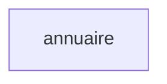
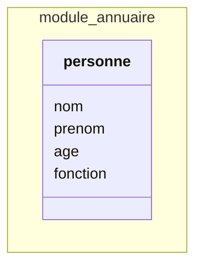

# tiny — Le dictionnaire de la donnée

*Une entité, quatre champs et une application complète avec API et documentation.*

| | |
|---|---|
| **Projet** | tiny |
| **Version** | 1.0.0.0 — production |
| **Langue** | français |
| **Générée** | au dépôt, le 16 octobre 2026 — sans instance : les données ne figurent pas, leur cadre si |
| **Format** | Syncytium-1.0 |

---

## 2. La structure, avec ses évolutions

### 2.1 La version

**Le projet.** tiny — Une entité, quatre champs et une application complète avec API et documentation.

**La version 1.0.0.0.** Production. Une langue, le français.

**Les notes de version.** Version 1 de l'annuaire.

**L'historique.** Première version ; aucune version antérieure.

**À venir.** Aucune version en beta.

### 2.2 Le modèle

#### La vue des modules

Un module, `annuaire`, sans lien.



#### La vue de l'ensemble des entités



*`nom` et `prenom` : l'identité.*

#### Le module annuaire

Une entité : `personne`.

##### L'entité personne

Les membres de l'entreprise.

| | |
|---|---|
| **Identité** | `identity` — `nom`, `prenom` |
| **Visage** | `{prenom} {nom}` |
| **Historisation** | non |
| **Données personnelles** | aucun champ marqué |
| **Groupes de champs** | aucun ; les quatre champs forment le groupe implicite |

**Les champs**

| Nom | Type | Libellé | Aide | Obligatoire | Défaut | Confidentialité | Exceptions d'écriture | Depuis |
|---|---|---|---|---|---|---|---|---|
| `nom` | un texte de 40 caractères au plus | nom | | oui — l'identité | | public | | 1.0.0.0 |
| `prenom` | un texte de 40 caractères au plus | prenom | | oui — l'identité | | public | | 1.0.0.0 |
| `age` | un entier | age | | non | | public | | 1.0.0.0 |
| `fonction` | un texte de 60 caractères au plus | fonction | | non | | public | | 1.0.0.0 |

**Les règles**

Aucune validation. Aucun champ calculé. Aucun état. Aucun automatisme.

**Les évolutions**

Les quatre champs existent depuis la 1.0.0.0. Rien à venir.

---

## 3. Le stockage

*Le storage `sqlite` de l'environnement `home`.*

### La table personne

| Le logique | La colonne | Le type natif | Nul | L'origine |
|---|---|---|---|---|
| l'identité technique | `id` | TEXT | non | la clé primaire |
| `nom` | `nom` | TEXT, 40 caractères au plus | non | un texte |
| `prenom` | `prenom` | TEXT, 40 caractères au plus | non | un texte |
| `age` | `age` | INTEGER | oui | un entier |
| `fonction` | `fonction` | TEXT, 60 caractères au plus | oui | un texte |
| la suppression | `deleted_at` | TEXT | oui | le socle |
| l'audit | `created_at`, `created_by`, `updated_at`, `updated_by` | TEXT | | le socle |

*Les colonnes du socle sont celles de la classe `sqlite` ; leur forme est à l'étude.*

**Les index**

| L'index | Les colonnes | L'origine |
|---|---|---|
| la clé primaire | `id` | l'identité technique |
| `personne_identity` | `nom`, `prenom` — les actifs seulement | l'identité `identity` |

Aucun champ n'est cherchable : aucun `searchable:` déclaré.

**Les partitions.** Aucune.

### Les tables de Syncytium

| La table | Ce qu'elle porte |
|---|---|
| la version | la version courante de la configuration |
| `user` | le compte unique — sans authentification, tous les droits |
| la télémétrie | les compteurs de lecture et d'écriture par entité |

---

## 4. L'origine

### 4.1 Reprise des données

Aucune migration déclarée.

### 4.2 Les imports

Une entité importable : `personne`.

**Le gabarit `personne.csv`**

| Colonne | Type | Obligatoire | Clé de rapprochement | Exemple |
|---|---|---|---|---|
| `nom` | un texte de 40 caractères au plus | oui | oui | Durand |
| `prenom` | un texte de 40 caractères au plus | oui | oui | Marie |
| `age` | un entier | non | | 42 |
| `fonction` | un texte de 60 caractères au plus | non | | Responsable |

*Les exemples sont ceux des types. Le fichier se télécharge depuis l'écran d'import de `personne`.*

### 4.3 Les opérations

Aucune opération déclarée. Les quatre actes du socle sur `personne` — la création, la lecture, la modification, la suppression —, par l'écran et par l'API.

---

## 5. L'usage

### 5.1 Où sert chaque champ

**Par entité**

| L'entité | Référencée par | Référence | Champs lus par une formule, une validation ou une règle | Champs orphelins |
|---|---|---|---|---|
| `personne` | — | — | 0 sur 4 | 0 |

**Par champ**

| Le champ | Où il sert |
|---|---|
| `nom` | l'identité ; le visage `{prenom} {nom}` ; la liste et le formulaire |
| `prenom` | l'identité ; le visage ; la liste et le formulaire |
| `age` | la liste et le formulaire |
| `fonction` | la liste et le formulaire |

### 5.2 Les droits

Aucun groupe déclaré : un seul utilisateur, tous les droits.

| | tous |
|---|---|
| `personne` | créer, lire, modifier, supprimer |

Aucun profil de confidentialité : tout est public.

### 5.3 Les données

*Avec l'instance seulement.* Pour `personne` : le volume ; les créations, les modifications, les suppressions par période. Pour chaque champ : le renseigné et la part de vides, la diversité ; pour `age`, le minimum, le maximum, la moyenne, la plage occupée ; pour les textes, les longueurs ; les valeurs et leur fréquence quand 20 % d'entre elles font 80 % des lignes.

---

## Annexes

### A. La configuration dépliée

```yaml
from: Syncytium-1.0
name: tiny
description: Une entité, quatre champs et une application complète avec API et documentation
visibility: promotional

environments:
  home:
    description: Exécution en mode local
    storage:
      name: sqlite
      family: storage
      class: sqlite

versions:
  production:
    environment: home
    1.0.0.0:
      languages: [fr]
      title: tiny
      release-notes: Version 1 de l'annuaire
      history: false
      menu:
        annuaire:
          personne:
            label: personne
            link: personne[list]
      settings:
        field:
          text:
            normalize: trim(me)
      groups: {}
      modules:
        annuaire:
          title: annuaire
          entities:
            personne:
              title: personne
              description: Les membres de l'entreprise
              label: "{prenom} {nom}"
              identities:
                identity: [nom, prenom]
              history: false
              allow: [create, read, update, delete]
              fields:
                nom:
                  type: text[..40]
                  required: true
                  mode: editable
                  label: nom
                  confidentiality: public
                  default: null
                  unchanged: false
                  searchable: none
                prenom:
                  type: text[..40]
                  required: true
                  mode: editable
                  label: prenom
                  confidentiality: public
                  default: null
                  unchanged: false
                  searchable: none
                age:
                  type: integer
                  required: false
                  mode: editable
                  label: age
                  confidentiality: public
                  default: null
                  unchanged: false
                  searchable: none
                fonction:
                  type: text[..60]
                  required: false
                  mode: editable
                  label: fonction
                  confidentiality: public
                  default: null
                  unchanged: false
                  searchable: none
              gui:
                lists:
                  default:
                    columns: [nom, prenom, age, fonction]
                forms:
                  default:
                    items: [nom, prenom, age, fonction]
```

### B. Le glossaire des types

| Le type | En clair | Les contraintes | L'exemple |
|---|---|---|---|
| `text[..40]` | un texte de 40 caractères au plus | les blancs de tête et de fin retirés | Durand |
| `text[..60]` | un texte de 60 caractères au plus | les blancs de tête et de fin retirés | Responsable |
| `integer` | un entier | sans borne | 42 |
